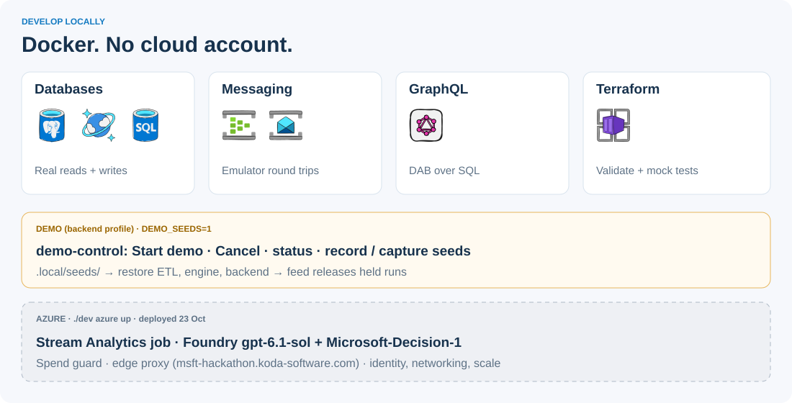

# Build locally

**Start here, people and coding agents.** Docker is the only required tool. No Azure or LocalStack account is needed for this local setup. The first run downloads several large images.



```sh
./dev doctor
./dev up
```

`up` waits for the integration checks to pass. Use `./dev test` to rerun them later.

For the **runnable user-backend harness**, use:

```sh
./dev up backend        # viewer + API + Postgres + owned demo services, then tests
./dev reset backend     # fresh GRF match run; account profiles stay
./dev replay backend    # start the 12-minute aligned replay
```

[Match viewer](http://localhost:18020) · [Event filter lab](http://localhost:18020/lab/) · [Backend API explorer](http://localhost:18000/docs) · [Short walkthrough](user-backend/docs/development.md). Pick a preset or type a request, add the validated filter, then start events. Default fixture mode needs no model account; [optional local LLM](user-backend/docs/local-llm.md) enables flexible requests. This profile needs no Azure login or emulator EULA acceptance. `./dev test backend` reruns the backend tests and the cross-service checkpoint check without resetting the live match.

For messaging, SQL and GraphQL, first review the [Microsoft licence links](local/README.md#licences), then:

```sh
ACCEPT_EULA=Y ./dev up azure
./dev replay
```

`./dev status`, `./dev logs servicebus` and `./dev down` manage only this project's containers. SQL/Postgres volumes survive `down`; emulator messages are disposable. Commands work from the repo root on macOS/Linux, or WSL on Windows.

## Pick your service

| Work on | Start with | First useful result |
| --- | --- | --- |
| Replay | [data-generation guide](data-generation/docs/development.md) | Publish a timestamped, labelled synthetic match. |
| Match data | [ETL guide](etl/docs/development.md) | Events → stored history → GraphQL. |
| Shared narratives | [narrative guide](narrative-engine/docs/development.md) | One minute of context → stored bucket narrative. |
| Viewer experience | [backend guide](user-backend/docs/development.md) | Profile → bucket → current stats and narrative backlog. |
| UI | [frontend guide](frontend/docs/development.md) | One live match, cards and two chat tabs. |

The stack includes a **working match viewer and structured-filter lab**, backed by a persisted demo ETL and a separate authored narrative stub. It runs typed rules rather than generated Python. Aligned GRF footage is generated locally. Stream Analytics, LLM narrative generation and production broker consumers remain planned. The browser uses a labelled synthetic event source that can be replaced behind an adapter.

## Work independently

Follow [development practices](DEVELOPMENT-PRACTICES.md): views call services; services use models, repositories and adapters. Keep logic, migrations and application tests inside the owning service. Shared wiring and dependency checks live in [local/](local/README.md). Azure resource definitions live in [terraform/](terraform/README.md).

Use the documented API/message boundary, never another service's database. Start with fixtures when another service isn't ready. Label fixture output; don't present it as a real model or pipeline result. Agree changes to [integration contracts](local/contracts.md) before changing producers and consumers.

```sh
./dev terraform check
```

This validates and mock-tests Terraform in Docker, with no accounts or cloud deployment. Real Azure integration remains a separate check: **Stream Analytics belongs to the ETL service**, Foundry needs an actual model endpoint, and managed identity/networking/scale need Azure validation.


## Recorded match demo

```text
GRF frames + telemetry → data-generation recording → ETL history + stats
                                                   ↓ GraphQL
144 authored commentaries → narrative stub → user backend → viewer + video
```

The checked-in recording is the exact rendered Chelsea–United simulation. Large footage remains ignored. If `.local/grf-demo-chelsea-united-v2/match.mp4` exists, `./dev` mounts it automatically; otherwise set `DEMO_VIDEO_PATH` to the matching file. See [generation instructions](data-generation/docs/grf-demo.md). Playback is 12 minutes with a 90-minute football clock; no scrubbing.

ETL owns separate local PostgreSQL history/stat databases; the narrative stub owns a SQLite archive. These are replaceable development repositories for planned Azure SQL/Cosmos. The local bridge sends checkpoint metadata, then reads GraphQL; it does not claim Event Hubs/Service Bus or Stream Analytics integration. No backend standard-stat calculations or authored match stories are used by this runtime.
