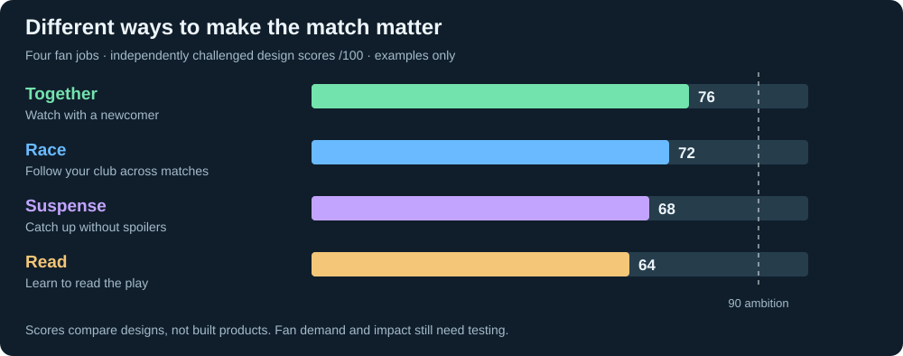
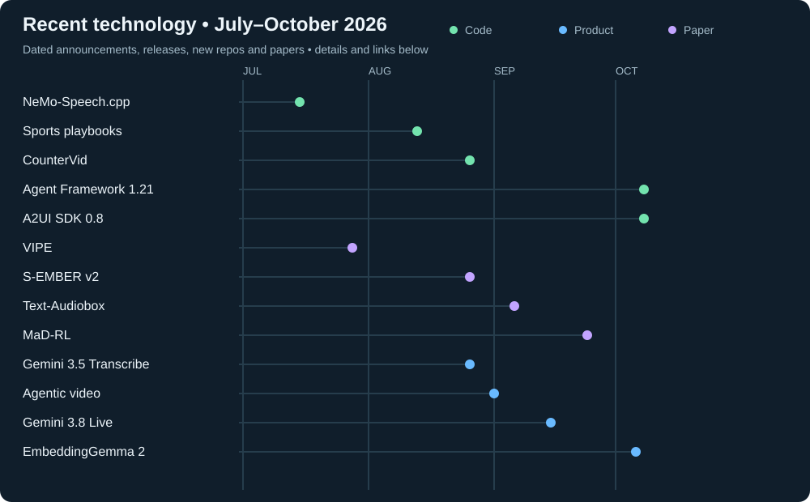
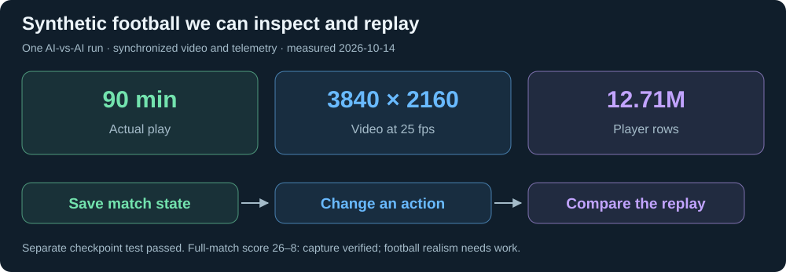
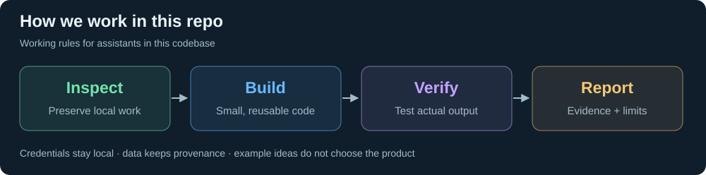

# Inside the Game

Football intelligence from synthetic matches. Research, competitor evidence and working data tools live here; example ideas remain examples.

## The brief

[Explore the research](research/README.md) · [Read the full requirements](research/brief.md#what-the-brief-points-toward)

## Why those asks matter

[Business cases: the gaps, evidence and tests](research/cases.md)

## How it is judged

[Judging criteria, submission requirements and deadlines](research/brief.md)

## Example ideas

[Explore the examples, objections and scores](research/ideas/README.md)

## Recent technology

[Capabilities, release dates and primary sources](research/technology.md)

## Data approach

[Events, tracking, video and what each can prove](research/data.md)

## Working simulator

[Data and collected samples](data/README.md) · [Run the simulator and inspect the results](data/GoogleResearchFootball/README.md)

## Competitors

<!-- competitors:start -->

**72 data files collected from 11 competitors.** The initial inspected samples are synthetic; no real match dataset or Kaggle/Hugging Face dataset use was verified.

→ [Competitors, repo activity, and their data](competitors/README.md) · [Raw project list](competitors/data/projects.json)

Project list: **2026-10-14** · GitHub: **2026-10-14**. [Manual refresh](competitors/README.md#refresh). The scheduled Action was removed because its saved login expired.

<!-- competitors:end -->

## Working with AI assistants

[Repository instructions and test commands](AGENTS.md)
