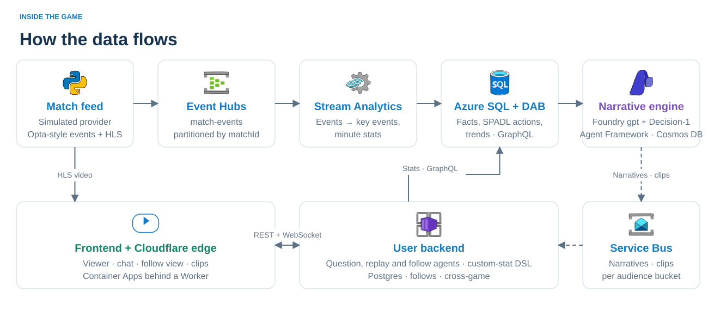

# Inside the Game

**Watch the match, and ask it anything.** Live football stories, questions, replays and follows, framed for your team and style.

[**Open app**](https://msft-hackathon.koda-software.com) · [**Full plan**](plan.excalidraw) · [Plan overview](master-plan.svg) · [Submission](docs/submission.md)




## Try it

Choose a match. Ask about a moment, play its replay, or follow a developing story—even in another match. Answers show supporting facts, model usage and estimated cost.

The footage and events are synthetic, rendered with [Google Research Football](https://github.com/google-research/football). AI writes the stories and answers. [Artwork and licences](frontend/assets/league/PROVENANCE.md).

## How it works

| Part | Responsibility |
| --- | --- |
| [Feed](data-generation/README.md) → [ETL](etl/README.md) | Event Hubs → Stream Analytics → Azure SQL; GraphQL serves history and calculated stats |
| [Narrative engine](narrative-engine/README.md) | Agent Framework + Foundry; shared match analysis, authors per audience; Cosmos memory; Decision-1 claim and clip checks |
| [User backend](user-backend/README.md) | Receives narratives over Service Bus; answers questions separately; validates custom-stat rules |
| [Frontend](frontend/README.md) | Video, cards, chat, follows and clips; no calculations or model calls |
| [Azure](terraform/README.md) + [edge proxy](edge-proxy/README.md) | Container Apps behind the public Cloudflare Worker |

## Plan

[**Full editable plan**](plan.excalidraw) · [**Visual overview**](master-plan.svg) · [Editable overview](master-plan.excalidraw)

Open the full `.excalidraw` file in Excalidraw for the detailed sections. Later decisions live in each service README; the diagram above shows the application architecture. Next steps: player overlays, a real-provider adapter and more audience options.

## Build locally

Docker with 8–12 GB memory; configure the model in ignored `.local/backend-llm.env`. Without a model, questions and narratives are unavailable.

```sh
./dev doctor
# After accepting the Microsoft emulator licences:
ACCEPT_EULA=Y ./dev up backend
./dev test backend
```

Open [localhost:18020](http://localhost:18020). [Local setup and contracts](local/README.md) · [CI](.github/workflows/ci.yml) · [Contributor rules](AGENTS.md).

When finished: `./dev down`.

## Status

Last recorded Azure check: **26 Oct 2026**, build `dedfb2d`. These are recorded results, not continuous monitoring.

| | Recorded result |
| --- | --- |
| **Deployed** | Live matches, questions, follows and replays; labelled team values, both-team custom-stat cards and Clear chat (pins preserved). Foundry `gpt-6.1-sol` + `Microsoft-Decision-1` |
| **Measured** | Live check: time-filtered custom-stat answer 8.4 s; both team values updated over WebSocket |
| **Open** | Azure grounding sample; authentication, quotas and coordinated replicas ([production gaps](terraform/README.md#decisions-and-production-gaps)) |
| **Limits** | Stream Analytics cold start 75–90 s; local narrative lag; no extra time/shoot-outs; momentum and fast-break claims disabled |
