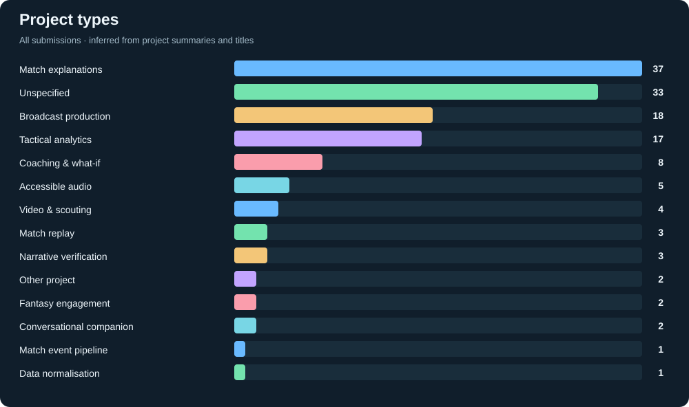

# Inside the Game

A simple view of the hackathon competitors: what they are building, how much code they have, and the data we can inspect.

**40 data files collected from 10 competitors.** The initial inspected samples are synthetic; no real match dataset or Kaggle/Hugging Face dataset use was verified.

→ [Competitors, repo activity, and their data](competitors/README.md) · [Raw project list](competitors/data/projects.json)

[GitHub Actions](https://github.com/taka6745/insidethegame/actions/workflows/competitors.yml) refreshes the list, metrics, data files, and graphics daily at **8 am Brisbane through 28 October 2026**. Expired login requests produce a visible failure and keep the last successful project export.
