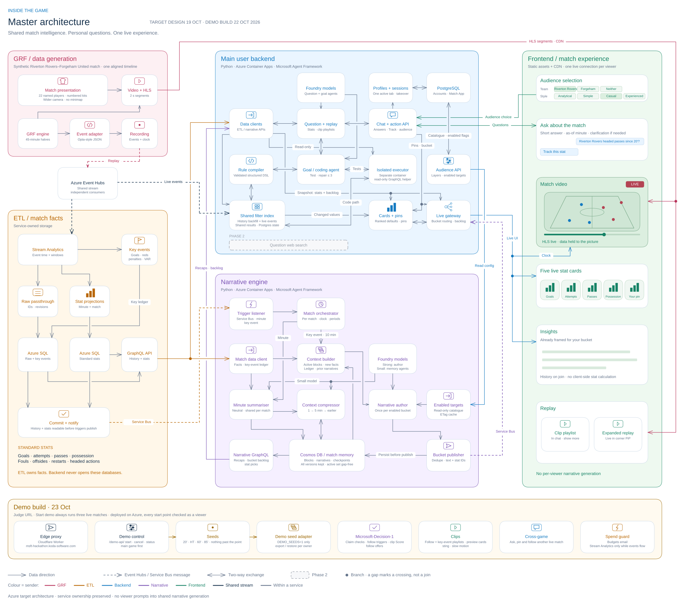

# Inside the Game

Live football, shared match narratives and a personal match companion.

**Watch the match, and ask it anything.** Each viewer gets live stats and narratives framed for their team and style, and can ask questions or ask for replays in chat. Code computes every number: ETL owns the statistics, and agents only choose what to show and explain it. One shared narrative pass serves every viewer of an audience, not one model call per viewer.

What works today, locally (tested; not yet deployed):
- **Live match:** a synthetic 90-minute match (Chelsea 2–1 Manchester United) streams over HLS while its Opta-style events flow through Event Hubs to ETL and the backend.
- **Personalised narratives:** 12 audiences (team × style) receive the same moment framed differently, and are released only up to what the viewer has seen.
- **Questions:** Microsoft Agent Framework agents route each question to ETL statistics, a validated custom-stat compiler, match context, football explanations or replays. Refusals say what data is missing.
- **Chat replays:** "show me all the shots so far" becomes a clip reel cut by code from the agent's chosen evidence, with live picture-in-picture.
- **Receipts:** each answer shows its facts, tokens, time and an estimated cost at a price you set.

**Disclosure.** The match is a simulation rendered with [Google Research Football](https://github.com/google-research/football) (Apache-2.0); it is not a real fixture, and player names are illustrative. Narratives were written offline by AI agents from the recorded events and video, then checked against the events. They are not generated live. Questions use a local OpenAI-compatible model.


**[Master architecture — editable Excalidraw](master-plan.excalidraw)** · [Full graphical plan](master-plan.svg) · [Boundaries and open decisions](docs/master-plan.md). GRF/ETL left, backend and narrative engine centre, frontend right; Phase 2 in grey.

[](master-plan.svg)

**Runnable development lab.** Build custom filters from a request or preset, then watch synthetic match events update shared calculations. Python agents, an indexed rule engine, Postgres and a small browser UI run locally. The match viewer adds live cards, bucketed insights and questions; live messaging uses Microsoft emulators; cloud deployment remains to build. These diagrams describe the agreed application design.

**[Start developing →](DEVELOPMENT.md)** · [Development practices](DEVELOPMENT-PRACTICES.md) · [Local Docker setup](local/README.md) · [Terraform](terraform/README.md)

```sh
ACCEPT_EULA=Y ./dev up backend
```

Open the [match viewer](http://localhost:18020) for the Chelsea–Manchester United demo, or the [event filter lab](http://localhost:18020/lab/). Pick filters, then replay and inspect each event and live value. The connected demo recording is managed by ETL; standalone lab mode also supports JSON uploads. [How it works](user-backend/docs/filter-lab.md).

| Folder | What it does |
| --- | --- |
| [data-generation](data-generation/) | Prepare and replay an existing synthetic match into Event Hubs. |
| [etl](etl/) | Store events, calculate match statistics and expose them through GraphQL. |
| [narrative-engine](narrative-engine/) | Build shared match memory and write narratives for enabled DB-defined audience buckets. |
| [user-backend](user-backend/) | Answer questions, build custom stats and deliver each viewer's experience. |
| [frontend](frontend/) | Show the live match, stat cards, chat and narrative feed. |

The demo has **one live match**, selectable profiles and one active session per profile. Viewer questions do not trigger narrative generation. Viewers can ask in chat for replay clips while live continues picture-in-picture; semantic subscriptions are Phase 2.

Each folder has a short service guide and a closer diagram. Azure products are dependencies of these services, not additional application folders.

**Event paths:** Event Hubs streams independently to ETL and the backend's custom filters. Live backend events do not pass through a database. Historical events and computed standard stats come from ETL GraphQL.

**Narrative boundary:** the backend exposes bucket definitions through a read-only API; the narrative engine owns framing. The backend receives finished bucket versions and routes them. [Diagram and current implementation](user-backend/docs/narrative-framing.md).

[Original Excalidraw board](legacy/design/plan.excalidraw) · [Archived research and simulator](legacy/README.md) · [Detailed user-backend decisions](user-backend/architecture.md)

[Review results](docs/reviews/2026-10-19.md) · [Hackathon readiness](docs/reviews/hackathon-readiness.md) · [Azure deployment gaps](terraform/deployment-readiness.md)

Render the diagrams with `python3 .github/scripts/render_architecture.py`. Icons come from the preserved [engineering library](legacy/docs/icon-libraries/README.md); [attribution](.github/diagram-assets/README.md). [CI](.github/workflows/ci.yml) runs every service's tests. No cloud deployment is configured.

The master board is generated with `python3 .github/scripts/render_master_plan.py`. Its shapes, labels, connectors and embedded icons are editable in Excalidraw. Regenerating replaces manual edits, so keep a copy before doing that. Export `master-plan.svg` through the Excalidraw CLI after updates. The original board remains preserved in `legacy/design/`.
