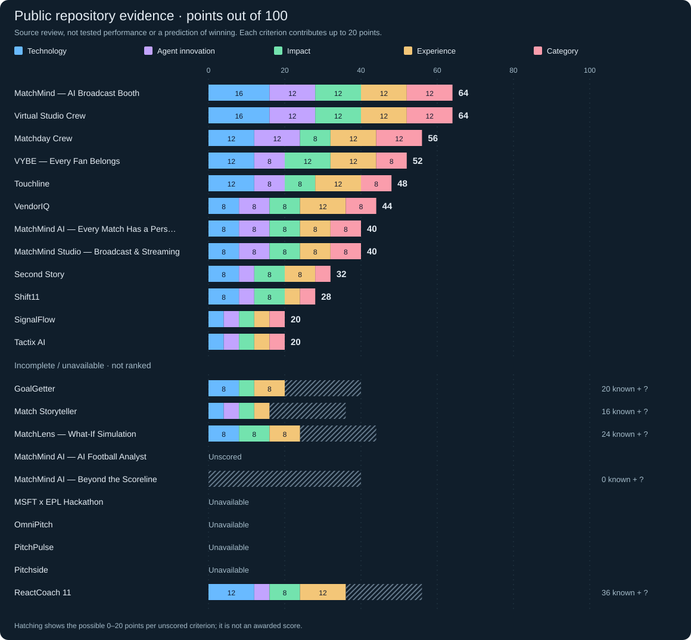
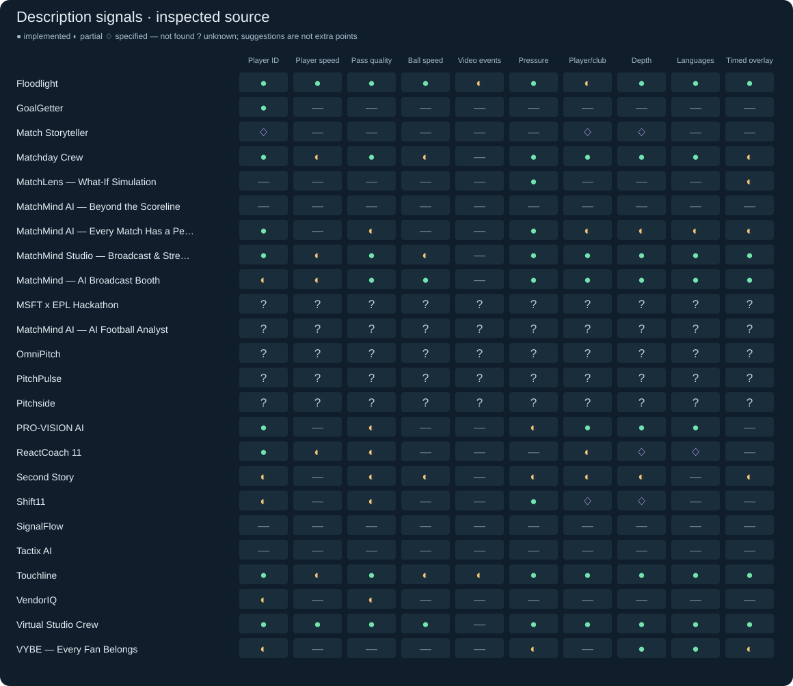
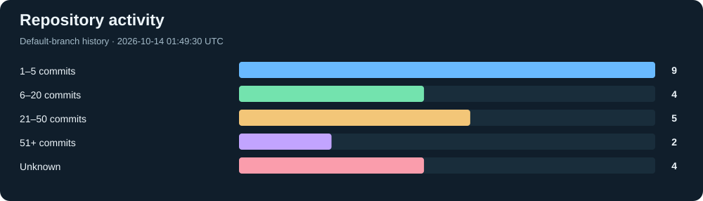
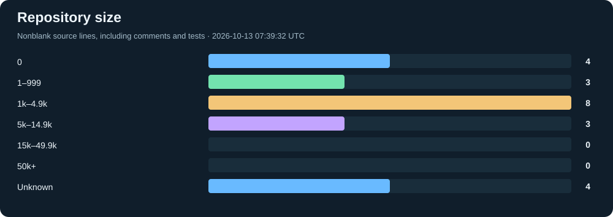
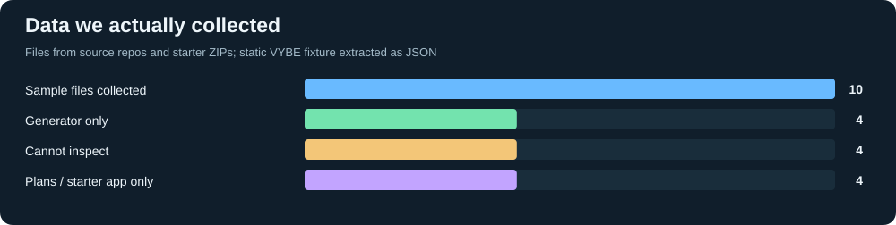

# Competitors

[← Home](../README.md) · [Project JSON](data/projects.json) · [CSV](data/projects.csv)


Project list: **2026-10-14** · GitHub: **2026-10-14**.

**72 files · 11 competitors with data · 12.5 MB.**

These samples are fictional match events, generated CSVs, vendor-shaped examples, and demo scenarios. No real match dataset or Kaggle/Hugging Face dataset use was verified in the initial readable repos.

## Evidence scores

**20 current reviews · 0 need review · 4 unavailable.** Each saved review names the project, repo, commit and reviewer. These are source-evidence scores; example-idea scores use a different scale.



<details>
<summary>Scores and each repo’s main gap</summary>

| Project / pinned code | /100 | Main gap in the inspected evidence |
| --- | ---: | --- |
| [Floodlight](https://github.com/JinYi123456/floodlight/tree/eae2606fcc3f3949aee3de1b9d5e9d7d1b16bc56) | 56 | Precomputed replay and studio recordings; broad fact-verification claims exceed numeric/entity checks. Club relevance and narrative recap are partial, and Microsoft Framework/MCP claims are not supported by inspected integration. / Precomputation leaks future VAR decisions; numeric/name gates do not prove claim meaning. Submission claims Agent Framework, MCP and spoiler-safe recaps without matching inspected implementations. |
| [GoalGetter](https://github.com/Simplify4Me2/goal-getter/tree/8dd5884cf19122ceb55939759dd7a4d70a67ae8d) | Incomplete | The inspected path stops at named event display, before explanation, personalisation or AI. |
| [Match Storyteller](https://github.com/faisalbasra/match-storyteller/tree/c6e3f564bd41cab896216ba563ec5ae3d4422aa5) | Incomplete | Planning-only repository; no application, data fixture or runnable demo at this SHA. |
| [Matchday Crew](https://github.com/timsheldon1/matchday-crew/tree/374de95f4f7474c9a784e01a3ceafb2ce0a16ad5) | 56 | No observed user benefit or independent cloud/demo verification; rendered player positions are a separate shape simulation. |
| [MatchLens — What-If Simulation](https://github.com/vishnugovind10/matchlens/tree/68c4caa0cdf38e36ac05f110882e6fb816dd322b) | Incomplete | Deterministic narrow demo with no AI/provider integration, audience personalisation or automated recap; evidence is precomputed from full fixture. |
| [MatchMind AI — Beyond the Scoreline](https://github.com/natagowai/matchmind-ai/tree/d9f6db5672daaaffc3bc896ebc52cb61b6901e02) | Incomplete | Default .NET weather/Vite counter scaffold; no hackathon path implemented in inspected source. |
| [MatchMind AI — Every Match Has a Personality](https://github.com/swarupe7/microsoft_dev_hackathon/tree/7204630cc4a048b7a57dd46ab6fb21367ebd2c52) | 40 | New deployment template does not close factual validation, full-match recap, personalisation or autonomous-agent gaps; recap explanations can misattribute mixed-team/player events. / Full-match recap drops early events; model text lacks factual validation; latest-actor focus and generic pitch motion do not meet persistent player-following or measured movement suggestions. |
| [MatchMind Studio — Broadcast &amp; Streaming](https://github.com/HamzatAbdulazeez/matchmind-studio/tree/72d315da0e0fbce52d9fad7624998d4f95e37b80) | 40 | Assistant endpoint is placed outside Next route tree; generated speeds are sampled rather than derived from continuous tracking. |
| [MatchMind — AI Broadcast Booth](https://github.com/ALISAEED-1/matchmind/tree/44fc6aa05a35d76995d7797a412868b4cc84df1e) | 64 | No measured fan adoption or single-agent advantage; movement measures cover carries rather than full player tracking. |
| [MSFT x EPL Hackathon](https://github.com/zekariasasaminew/msft-x-epl-hackathon) | Unavailable | No current assessment; see the review queue. |
| [MatchMind AI — AI Football Analyst](https://github.com/s70241963-afk/Sushmitha/tree/9f3eadf03749fb96fe241e4c7748d73412c1ca1e) | Incomplete | External starter ZIPs are not versioned repository implementation; archived data was collected separately but current implementation is unreviewed. |
| [OmniPitch](https://github.com/akashsv01/omnipitch) | Unavailable | No current assessment; see the review queue. |
| [PitchPulse](https://github.com/sethmalefo-del/pitchpulse.git) | Unavailable | No current assessment; see the review queue. |
| [Pitchside](https://github.com/aknotwell/Pitchside) | Unavailable | No current assessment; see the review queue. |
| [PRO-VISION AI](https://github.com/mberry19932025/PRO-VISION/tree/74cbde4746c9c095a9ccc51c9dff4bc6b2d1bded) | 54 | Sparse uncalibrated replay; no tracking/speed/video pipeline or synchronized overlays. Source supports bounded Azure tools, but current live quality, real-browser usability and fan outcomes remain unverified. / Sparse synthetic sequence lacks tracking, speed and auto-eventing; explicit AI requests and a 55-second Director budget do not establish live narrative latency. Shared quotas can restrict judge access. |
| [ReactCoach 11](https://github.com/devgupta-9/reactcoach-11/tree/df4a4b570998ae6dfc25c11b199f72db95eb264c) | Incomplete | Foundry agents are not implemented; coaching recommendations use illustrative synthetic assumptions rather than validated football outcomes. |
| [Second Story](https://github.com/aj0khi/soccer-hackathon-project/tree/ef18fe8b86ff0ea76aeaf59e040203c63f4cbf2b) | 32 | Function labels imply agents, while source uses fixed computations and audience-specific text that can contradict changed inputs. |
| [Shift11](https://github.com/achand280606/Shift11/tree/af6d34bab55f70042cfae93efd637ab9067719da) | 28 | Current snapshot implements generation/momentum; planned attribution, AI explanations and dashboard are not connected. |
| [SignalFlow](https://github.com/kamal-saleh/SignalFlow/tree/75f55828892a0406fdeacccc536bb3ebf87e05e1) | 20 | README-only concept at this SHA; no executable pipeline or demonstrable UX in the repo. |
| [Tactix AI](https://github.com/vasureddyuppunuri/Inside--the-game-Tactix-AI/tree/115fb2ce05d9bff0e5fd5ca9e0113e8ad3157be5) | 20 | Short README-only concept at this SHA; listed architecture remains an unimplemented claim in the repository. |
| [Touchline](https://github.com/audioreworkvisions/touchline/tree/648179a97a99bb4974a089cfd87dd2e1e66acaa2) | 48 | Audio delivery expanded; independent tracking, controlled-colour vision, absent agent orchestration and unverified cloud/audio outcomes remain. / No genuine agent orchestration or verified cloud inference; synthetic player paths and historical actions lack consistent team-match geometry, and fan benefit is unmeasured. |
| [VendorIQ](https://github.com/SeyiBuilds/VendorIQ/tree/5de174c243907cc1807cb8c91d01c108cade67fb) | 44 | Streaming is pipeline progress over batch files; Microsoft technology and genuine audience personalisation are absent in inspected runtime. |
| [Virtual Studio Crew](https://github.com/timmytrace/pl-insights-engine/tree/c14ab314639476e15ccd3f47380d0e783306170c) | 64 | Reported 9.9-second median story latency and same-family quality judging do not establish live fan usefulness or multi-agent advantage. |
| [VYBE — Every Fan Belongs](https://github.com/Hapinam/vybe-ai/tree/c1fd57d1ba206be9b78fabcee1dcbabc771ecbc1) | 52 | Sparse fixed fixture limits explanations; model selects style rather than interpreting football. |

</details>

<details>
<summary>Technology · scores and evidence</summary>

Each score is out of 5 (up to 20 weighted points). Unknown stays unscored.

| Project | /5 | Reviewer reasoning · pinned evidence |
| --- | ---: | --- |
| Floodlight | 3 | [repo-refresh-primary](https://github.com/JinYi123456/floodlight/blob/eae2606fcc3f3949aee3de1b9d5e9d7d1b16bc56/packages/dataset/src/pipeline.ts#L46): Simulator, tracking, event analysis, cue compilation and synthetic-pixel perception are connected and have fixtures/tests. However the app precomputes the match, and verification admits final-state numbers into earlier evidence packs.<br>[repo-refresh-challenger](https://github.com/JinYi123456/floodlight/blob/eae2606fcc3f3949aee3de1b9d5e9d7d1b16bc56/packages/dataset/src/pipeline.ts#L41): Substantial connected simulator, interpretation, vision, cue compiler and tested fallback paths exist. Full-match precomputation exposes future VAR outcomes in the replay score; declared Agent Framework/MCP use is not evidenced in the custom runtime and manifests. |
| GoalGetter | 2 | [repo-reviewer-1](https://github.com/Simplify4Me2/goal-getter/blob/8dd5884cf19122ceb55939759dd7a4d70a67ae8d/GoalGetter/GoalGetter.ApiService/Matches/SyntheticMatchGenerator.cs#L22): Seeded event generation, SSE transport and name tagging form a partial pipeline with test files. |
| Match Storyteller | 1 | [repo-reviewer-2](https://github.com/faisalbasra/match-storyteller/blob/c6e3f564bd41cab896216ba563ec5ae3d4422aa5/README.md#L7): The repository explicitly contains a pre-implementation contract rather than application code. |
| Matchday Crew | 3 | [repo-reviewer-2](https://github.com/timsheldon1/matchday-crew/blob/374de95f4f7474c9a784e01a3ceafb2ce0a16ad5/src/server.js#L165): Seeded event generation, incremental analysis, Foundry integration and focused orchestration tests form a coherent connected implementation. |
| MatchLens — What-If Simulation | 2 | [repo-reviewer-2](https://github.com/vishnugovind10/matchlens/blob/68c4caa0cdf38e36ac05f110882e6fb816dd322b/backend/app/main.py#L34): Immutable evidence, deterministic replay and source tests are connected, but generative AI and Microsoft runtime integration are explicitly absent. |
| MatchMind AI — Beyond the Scoreline | 0 | [repo-reviewer-2](https://github.com/natagowai/matchmind-ai/blob/d9f6db5672daaaffc3bc896ebc52cb61b6901e02/src/MatchMind.Api/Program.cs#L22): Inspected application code is the default weather API and empty domain classes, not a match-intelligence implementation. |
| MatchMind AI — Every Match Has a Personality | 2 | [repo-refresh-primary](https://github.com/swarupe7/microsoft_dev_hackathon/blob/7204630cc4a048b7a57dd46ab6fb21367ebd2c52/.github/workflows/azure-webapps-node.yml#L45): New Azure deployment template has no recorded execution or engine tests. Model output lacks fact checking; recap also attributes aggregate shots/tackles to one team/player without filtering, weakening factual explanations.<br>[repo-refresh-challenger](https://github.com/swarupe7/microsoft_dev_hackathon/blob/7204630cc4a048b7a57dd46ab6fb21367ebd2c52/lib/match/engine.ts#L123): Dashboard, event counters and optional Azure client connect, but events are truncated to 80 before recap and model text is accepted without fact validation. Automated tests remain a README next step. |
| MatchMind Studio — Broadcast &amp; Streaming | 2 | [repo-reviewer-2](https://github.com/HamzatAbdulazeez/matchmind-studio/blob/72d315da0e0fbce52d9fad7624998d4f95e37b80/src/app/api/match/stream/route.ts#L45): Synthetic replay, Azure generation and overlay paths are substantive, but the assistant fetch targets a route located outside Next app routing and no test suite was found. |
| MatchMind — AI Broadcast Booth | 4 | [repo-reviewer-1](https://github.com/ALISAEED-1/matchmind/blob/44fc6aa05a35d76995d7797a412868b4cc84df1e/backend/src/matchmind/agents/orchestrator.py#L542): Connected framework pipeline, explicit event statistics and failure tests support a strong static implementation. |
| MSFT x EPL Hackathon | ? | No current assessment. |
| MatchMind AI — AI Football Analyst | ? | [repo-reviewer-1](https://github.com/s70241963-afk/Sushmitha/blob/9f3eadf03749fb96fe241e4c7748d73412c1ca1e/README.md#L1): The repository points to external starter archives; their implementation was outside this SHA-pinned source audit. |
| OmniPitch | ? | No current assessment. |
| PitchPulse | ? | No current assessment. |
| Pitchside | ? | No current assessment. |
| PRO-VISION AI | 3 | [repo-refresh-primary](https://github.com/mberry19932025/PRO-VISION/blob/74cbde4746c9c095a9ccc51c9dff4bc6b2d1bded/competition-app/src/backend.js#L58): Canonical app connects deterministic data, bounded replay, evidence-checked Azure/Foundry calls, quota controls and failure fallbacks with source tests. Historical evaluation outputs belong to older versions and do not establish current production quality.<br>[repo-refresh-challenger](https://github.com/mberry19932025/PRO-VISION/blob/74cbde4746c9c095a9ccc51c9dff4bc6b2d1bded/competition-app/src/director.js#L20): Canonical app connects deterministic facts, bounded Azure tool calls, evidence validation, usage controls and relevant mocked integration tests. Public deployment/live-call claims are not independent runtime evidence, and full football simulation is limited to 180 actions by ten players. |
| ReactCoach 11 | 3 | [repo-reviewer-1](https://github.com/devgupta-9/reactcoach-11/blob/df4a4b570998ae6dfc25c11b199f72db95eb264c/crates/decision-engine/src/simulation/rollout.rs#L17): A bounded synthetic spatial simulator, validated replay and API-connected decision UI provide coherent static implementation. |
| Second Story | 2 | [repo-reviewer-1](https://github.com/aj0khi/soccer-hackathon-project/blob/ef18fe8b86ff0ea76aeaf59e040203c63f4cbf2b/src/lib/simulation/generate-match.ts#L62): Synthetic generation and deterministic dashboard are connected, but independently sampled pass distance and hardcoded audience text weaken grounding. |
| Shift11 | 2 | [repo-reviewer-2](https://github.com/achand280606/Shift11/blob/af6d34bab55f70042cfae93efd637ab9067719da/src/generator.py#L136): Formation-aware synthetic generation and deterministic momentum have source/tests, while AI, attribution and rendered application remain incomplete. |
| SignalFlow | 1 | [repo-reviewer-1](https://github.com/kamal-saleh/SignalFlow/blob/75f55828892a0406fdeacccc536bb3ebf87e05e1/README.md#L9): README names a five-stage synthetic pipeline and Microsoft services without implementation. |
| Tactix AI | 1 | [repo-reviewer-1](https://github.com/vasureddyuppunuri/Inside--the-game-Tactix-AI/blob/115fb2ce05d9bff0e5fd5ca9e0113e8ad3157be5/README.md#L2): The repository contains only a short synthetic-match concept and licence, not an implementation. |
| Touchline | 3 | [repo-refresh-primary](https://github.com/audioreworkvisions/touchline/blob/648179a97a99bb4974a089cfd87dd2e1e66acaa2/server.mjs#L47): Synthetic ingest, evidence-grounded narration and UI now connect to Azure Speech and audio replay. Podcast code validates duration and decoding, but no generated audio or deployed-cloud result is committed.<br>[repo-refresh-challenger](https://github.com/audioreworkvisions/touchline/blob/648179a97a99bb4974a089cfd87dd2e1e66acaa2/server.mjs#L37): Connected SSE ingestion, validated event state, guarded Azure rewrite and Player Pulse tests support implementation. Recorded timing excludes transport, rendering and models; no cloud runtime proof. |
| VendorIQ | 2 | [repo-reviewer-2](https://github.com/SeyiBuilds/VendorIQ/blob/5de174c243907cc1807cb8c91d01c108cade67fb/backend/agents/orchestrator.py#L150): Normalization, retry/failure handling and test files form a coherent data pipeline, but Microsoft runtime use and live fan personalisation were not located. |
| Virtual Studio Crew | 4 | [repo-reviewer-1](https://github.com/timmytrace/pl-insights-engine/blob/c14ab314639476e15ccd3f47380d0e783306170c/backend/src/Studio.Crew/StudioCrew.cs#L106): Seeded simulator, framework workflow, verified-card streaming and checked-in evaluation form strong inspectable implementation evidence. |
| VYBE — Every Fan Belongs | 3 | [repo-reviewer-1](https://github.com/Hapinam/vybe-ai/blob/c1fd57d1ba206be9b78fabcee1dcbabc771ecbc1/apps/api/vybe/main.py#L16): Replay API, deterministic factual rendering and malformed-model-output tests are connected to the UI. |

</details>

<details>
<summary>Agent innovation · scores and evidence</summary>

Each score is out of 5 (up to 20 weighted points). Unknown stays unscored.

| Project | /5 | Reviewer reasoning · pinned evidence |
| --- | ---: | --- |
| Floodlight | 3 | [repo-refresh-primary](https://github.com/JinYi123456/floodlight/blob/eae2606fcc3f3949aee3de1b9d5e9d7d1b16bc56/packages/agents/src/runtime.ts#L62): Custom task runtime coordinates analyst drafting, verifier-guided revision, commentator calls and deterministic fallbacks. This is substantive orchestration, but no controlled comparison establishes its advantage; Director and Personalizer remain rules/templates.<br>[repo-refresh-challenger](https://github.com/JinYi123456/floodlight/blob/eae2606fcc3f3949aee3de1b9d5e9d7d1b16bc56/packages/agents/src/crew.ts#L243): Analyst drafts, verifier-guided revision, commentator dispatch and provider circuit breaking form a connected crew. Director decisions and audience variants are deterministic; lexical fact gates cannot establish every claim as true. |
| GoalGetter | 0 | [repo-reviewer-1](https://github.com/Simplify4Me2/goal-getter/blob/8dd5884cf19122ceb55939759dd7a4d70a67ae8d/GoalGetter/GoalGetter.ApiService/Endpoints/MatchEndpoints.cs#L12): The inspected service and UI implement deterministic replay only; no model or agent decisions were found. |
| Match Storyteller | 1 | [repo-reviewer-2](https://github.com/faisalbasra/match-storyteller/blob/c6e3f564bd41cab896216ba563ec5ae3d4422aa5/README.md#L43): A single Agent Framework narrator is proposed but compatibility and implementation remain future work. |
| Matchday Crew | 3 | [repo-reviewer-2](https://github.com/timsheldon1/matchday-crew/blob/374de95f4f7474c9a784e01a3ceafb2ce0a16ad5/src/agents/crew.js#L110): Separate model roles pass evidence and shared history through guarded retry/fallback and priority scheduling, without comparative agent-value results. |
| MatchLens — What-If Simulation | 0 | [repo-reviewer-2](https://github.com/vishnugovind10/matchlens/blob/68c4caa0cdf38e36ac05f110882e6fb816dd322b/backend/app/core.py#L136): The inspected system uses deterministic templates and linear scenario projection with no runtime AI/agent implementation. |
| MatchMind AI — Beyond the Scoreline | 0 | [repo-reviewer-2](https://github.com/natagowai/matchmind-ai/blob/d9f6db5672daaaffc3bc896ebc52cb61b6901e02/src/MatchMind.Api/Program.cs#L22): No runtime AI or agent behavior exists in the inspected application entrypoints or domain scaffold. |
| MatchMind AI — Every Match Has a Personality | 2 | [repo-refresh-primary](https://github.com/swarupe7/microsoft_dev_hackathon/blob/7204630cc4a048b7a57dd46ab6fb21367ebd2c52/lib/agents/orchestrator.ts#L40): Five named stages remain deterministic function calls over a shared board; separate Azure commentary rewriting does not establish adaptive agent coordination or collective advantage.<br>[repo-refresh-challenger](https://github.com/swarupe7/microsoft_dev_hackathon/blob/7204630cc4a048b7a57dd46ab6fb21367ebd2c52/lib/agents/orchestrator.ts#L40): Five functions pass a board sequentially; language generation is a separate rewrite. Source offers partial staged orchestration, without agent tool use, planning or demonstrated collective advantage. |
| MatchMind Studio — Broadcast &amp; Streaming | 2 | [repo-reviewer-2](https://github.com/HamzatAbdulazeez/matchmind-studio/blob/72d315da0e0fbce52d9fad7624998d4f95e37b80/src/lib/ai/agent/route.ts#L54): A bounded tool-calling loop exists, but its route is under src/lib rather than src/app/api so the inspected assistant journey is disconnected. |
| MatchMind — AI Broadcast Booth | 3 | [repo-reviewer-1](https://github.com/ALISAEED-1/matchmind/blob/44fc6aa05a35d76995d7797a412868b4cc84df1e/backend/src/matchmind/agents/orchestrator.py#L580): Routing and specialised generation share state and recover to templates, but advantage over simpler orchestration is unmeasured. |
| MSFT x EPL Hackathon | ? | No current assessment. |
| MatchMind AI — AI Football Analyst | ? | [repo-reviewer-1](https://github.com/s70241963-afk/Sushmitha/blob/9f3eadf03749fb96fe241e4c7748d73412c1ca1e/README.md#L1): The repository points to external starter archives; their implementation was outside this SHA-pinned source audit. |
| OmniPitch | ? | No current assessment. |
| PitchPulse | ? | No current assessment. |
| Pitchside | ? | No current assessment. |
| PRO-VISION AI | 3 | [repo-refresh-primary](https://github.com/mberry19932025/PRO-VISION/blob/74cbde4746c9c095a9ccc51c9dff4bc6b2d1bded/competition-app/src/director.js#L4): Match Director uses one model-selected allowlisted tool to choose a past moment, executes it against server-generated data, then asks for an evidence-linked explanation. Concrete bounded tool use is present; broader autonomous collaboration and comparative benefits are not demonstrated.<br>[repo-refresh-challenger](https://github.com/mberry19932025/PRO-VISION/blob/74cbde4746c9c095a9ccc51c9dff4bc6b2d1bded/competition-app/src/director.js#L30): A concrete two-step tool workflow selects a bounded recorded moment, inspects evidence and requests an explanation, with argument checks and fallback. It is a single-model workflow, not multi-agent collaboration; no comparative benefit is measured. |
| ReactCoach 11 | 1 | [repo-reviewer-1](https://github.com/devgupta-9/reactcoach-11/blob/df4a4b570998ae6dfc25c11b199f72db95eb264c/crates/agents/src/lib.rs#L1): Agent roles are explicitly contracts for future work rather than model invocation. |
| Second Story | 1 | [repo-reviewer-1](https://github.com/aj0khi/soccer-hackathon-project/blob/ef18fe8b86ff0ea76aeaf59e040203c63f4cbf2b/src/application/agents/orchestrate-match-intelligence.ts#L25): The named agents are synchronous deterministic functions; Foundry mapping is documentation/configuration rather than inspected model execution. |
| Shift11 | 1 | [repo-reviewer-2](https://github.com/achand280606/Shift11/blob/af6d34bab55f70042cfae93efd637ab9067719da/README.md#L242): Agent Framework and Foundry are planned after deterministic analytics, with no runtime agent path in the inspected tree. |
| SignalFlow | 1 | [repo-reviewer-1](https://github.com/kamal-saleh/SignalFlow/blob/75f55828892a0406fdeacccc536bb3ebf87e05e1/README.md#L13): Attention decisions are named but no decision mechanism or agent code is present. |
| Tactix AI | 1 | [repo-reviewer-1](https://github.com/vasureddyuppunuri/Inside--the-game-Tactix-AI/blob/115fb2ce05d9bff0e5fd5ca9e0113e8ad3157be5/README.md#L2): Multi-agent telemetry is asserted without roles, shared state or execution evidence in the repository. |
| Touchline | 2 | [repo-refresh-primary](https://github.com/audioreworkvisions/touchline/blob/648179a97a99bb4974a089cfd87dd2e1e66acaa2/audio-replay.mjs#L15): The new replay and podcast select events deterministically and call speech synthesis. They extend delivery without adding agent planning, tool choice or specialist collaboration.<br>[repo-refresh-challenger](https://github.com/audioreworkvisions/touchline/blob/648179a97a99bb4974a089cfd87dd2e1e66acaa2/narrator.mjs#L11): Grounded language rewriting and pixel-only transfer detection exist, but orchestration is explicitly absent. Adding a deterministic player index does not establish agent autonomy or measured advantage. |
| VendorIQ | 2 | [repo-reviewer-2](https://github.com/SeyiBuilds/VendorIQ/blob/5de174c243907cc1807cb8c91d01c108cade67fb/backend/agents/orchestrator.py#L150): Named stages mostly run deterministic transforms, with optional entity/narrative AI escalation and explicit failure handling. |
| Virtual Studio Crew | 3 | [repo-reviewer-1](https://github.com/timmytrace/pl-insights-engine/blob/c14ab314639476e15ccd3f47380d0e783306170c/backend/src/Studio.Crew/StudioCrew.cs#L139): Specialised revision and publication decisions are implemented, but the reported comparison does not show final text outperforming drafts. |
| VYBE — Every Fan Belongs | 2 | [repo-reviewer-1](https://github.com/Hapinam/vybe-ai/blob/c1fd57d1ba206be9b78fabcee1dcbabc771ecbc1/apps/api/vybe/ai.py#L48): Azure optionally selects a constrained style; substantive agentic reasoning or orchestration is not present in this inspected path. |

</details>

<details>
<summary>Impact · scores and evidence</summary>

Each score is out of 5 (up to 20 weighted points). Unknown stays unscored.

| Project | /5 | Reviewer reasoning · pinned evidence |
| --- | ---: | --- |
| Floodlight | 2 | [repo-refresh-primary](https://github.com/JinYi123456/floodlight/blob/eae2606fcc3f3949aee3de1b9d5e9d7d1b16bc56/apps/web/src/state/derive.ts#L167): Audience variants, evidence-linked moments and player-follow camera address understanding and relevance. Committed technical fixtures do not demonstrate actual fan demand, comprehension or sustained viewing.<br>[repo-refresh-challenger](https://github.com/JinYi123456/floodlight/blob/eae2606fcc3f3949aee3de1b9d5e9d7d1b16bc56/README.md#L31): Audience variants and event-linked interpretation address comprehension and production needs. No fan-demand, comprehension, retention or business outcome evaluation is present in inspected evidence; vision metrics do not establish audience value. |
| GoalGetter | 1 | [repo-reviewer-1](https://github.com/Simplify4Me2/goal-getter/blob/8dd5884cf19122ceb55939759dd7a4d70a67ae8d/GoalGetter/GoalGetter.Web/Components/Pages/Match.razor#L23): The event-list interface supplies names and coordinates but does not yet establish a meaningful fan or business outcome. |
| Match Storyteller | 1 | [repo-reviewer-2](https://github.com/faisalbasra/match-storyteller/blob/c6e3f564bd41cab896216ba563ec5ae3d4422aa5/README.md#L11): Evidence-grounded fan/analyst storytelling is a plausible pitch with no product or user evidence. |
| Matchday Crew | 2 | [repo-reviewer-2](https://github.com/timsheldon1/matchday-crew/blob/374de95f4f7474c9a784e01a3ceafb2ce0a16ad5/README.md#L136): Multilingual voice and player following address a concrete access/use case, but uptake and comprehension benefit are not measured. |
| MatchLens — What-If Simulation | 2 | [repo-reviewer-2](https://github.com/vishnugovind10/matchlens/blob/68c4caa0cdf38e36ac05f110882e6fb816dd322b/backend/app/core.py#L130): Evidence-backed pressing comparison is useful for a plausible analyst workflow, without user or adoption validation. |
| MatchMind AI — Beyond the Scoreline | ? | [repo-reviewer-2](https://github.com/natagowai/matchmind-ai/blob/d9f6db5672daaaffc3bc896ebc52cb61b6901e02/README.md#L1): The two-line repository README supplies no assessable applicability evidence and the application is a template. |
| MatchMind AI — Every Match Has a Personality | 2 | [repo-refresh-primary](https://github.com/swarupe7/microsoft_dev_hackathon/blob/7204630cc4a048b7a57dd46ab6fb21367ebd2c52/lib/agents/personalizationAgent.ts#L36): Host voice, fan depth and club/player modes target comprehension and relevance, but player focus is a label on the general insight and no measured fan-demand or benefit evidence appears.<br>[repo-refresh-challenger](https://github.com/swarupe7/microsoft_dev_hackathon/blob/7204630cc4a048b7a57dd46ab6fb21367ebd2c52/components/MatchDashboard.tsx#L95): Hosts and club framing address understandable audience preferences, but no measured fan benefit supports impact. Player mode follows the latest actor and adds a generic relevance assertion. |
| MatchMind Studio — Broadcast &amp; Streaming | 2 | [repo-reviewer-2](https://github.com/HamzatAbdulazeez/matchmind-studio/blob/72d315da0e0fbce52d9fad7624998d4f95e37b80/src/components/assistant-panel.tsx#L72): Producer explanations and player-aware recaps support a plausible use case without observed demand or outcome evidence. |
| MatchMind — AI Broadcast Booth | 3 | [repo-reviewer-1](https://github.com/ALISAEED-1/matchmind/blob/44fc6aa05a35d76995d7797a412868b4cc84df1e/frontend/lib/controller.dart#L52): Audience, language and player preferences provide a concrete match-explanation use case without evidence of uptake or League benefit. |
| MSFT x EPL Hackathon | ? | No current assessment. |
| MatchMind AI — AI Football Analyst | ? | [repo-reviewer-1](https://github.com/s70241963-afk/Sushmitha/blob/9f3eadf03749fb96fe241e4c7748d73412c1ca1e/README.md#L1): The repository points to external starter archives; their implementation was outside this SHA-pinned source audit. |
| OmniPitch | ? | No current assessment. |
| PitchPulse | ? | No current assessment. |
| Pitchside | ? | No current assessment. |
| PRO-VISION AI | 2 | [repo-refresh-primary](https://github.com/mberry19932025/PRO-VISION/blob/74cbde4746c9c095a9ccc51c9dff4bc6b2d1bded/competition-app/src/core.js#L33): Conversation, contextual questions and personal memory-card exports provide concrete fan interactions. No fan study or demand evidence shows that these improve understanding, repeat viewing or purchase intent.<br>[repo-refresh-challenger](https://github.com/mberry19932025/PRO-VISION/blob/74cbde4746c9c095a9ccc51c9dff4bc6b2d1bded/README.md#L14): Conversation, recorded player comparisons and personal memory cards target concrete fan activities. No measured demand, comprehension benefit, card sharing or repeat-use evidence supports stronger impact. |
| ReactCoach 11 | 2 | [repo-reviewer-1](https://github.com/devgupta-9/reactcoach-11/blob/df4a4b570998ae6dfc25c11b199f72db95eb264c/README.md#L9): Explained tactical alternatives serve an identifiable coaching need, but real-football validity and a League/fan adoption path are unproven. |
| Second Story | 2 | [repo-reviewer-1](https://github.com/aj0khi/soccer-hackathon-project/blob/ef18fe8b86ff0ea76aeaf59e040203c63f4cbf2b/src/lib/narrative/build-match-insight.ts#L40): A control-versus-danger explanation is concrete, but its fan and player claims can be independent of uploaded evidence. |
| Shift11 | 2 | [repo-reviewer-2](https://github.com/achand280606/Shift11/blob/af6d34bab55f70042cfae93efd637ab9067719da/README.md#L7): Player-linked momentum is a concrete interpretability goal, but its fan usefulness and attribution claims remain unvalidated. |
| SignalFlow | 1 | [repo-reviewer-1](https://github.com/kamal-saleh/SignalFlow/blob/75f55828892a0406fdeacccc536bb3ebf87e05e1/README.md#L7): Competing live stories are a plausible problem, but neither demand evidence nor business effect is supplied. |
| Tactix AI | 1 | [repo-reviewer-1](https://github.com/vasureddyuppunuri/Inside--the-game-Tactix-AI/blob/115fb2ce05d9bff0e5fd5ca9e0113e8ad3157be5/README.md#L2): Tactical insights and persona storytelling suggest a use case but do not establish a problem or benefit. |
| Touchline | 2 | [repo-refresh-primary](https://github.com/audioreworkvisions/touchline/blob/648179a97a99bb4974a089cfd87dd2e1e66acaa2/audio-replay.mjs#L19): Player/team audio selection and spatial spoken context address screen-free following, alongside fan/analyst explanation. Accessibility listening tests and fan comprehension outcomes remain unmeasured.<br>[repo-refresh-challenger](https://github.com/audioreworkvisions/touchline/blob/648179a97a99bb4974a089cfd87dd2e1e66acaa2/dist/player-pulse.mjs#L47): Minute-matched player history and evidence-linked index changes target a concrete fan question; audio replay adds access options. Comprehension and repeat viewing remain unmeasured, and historical baselines are invented. |
| VendorIQ | 2 | [repo-reviewer-2](https://github.com/SeyiBuilds/VendorIQ/blob/5de174c243907cc1807cb8c91d01c108cade67fb/README.md#L5): Cross-vendor normalization addresses a concrete developer workflow, while claimed production standard and audience benefits lack measured adoption. |
| Virtual Studio Crew | 3 | [repo-reviewer-1](https://github.com/timmytrace/pl-insights-engine/blob/c14ab314639476e15ccd3f47380d0e783306170c/backend/src/Studio.Crew/Viewers.cs#L49): Evidence-linked club/player/metric views give a concrete fan-facing use case, without measured adoption or commercial impact. |
| VYBE — Every Fan Belongs | 3 | [repo-reviewer-1](https://github.com/Hapinam/vybe-ai/blob/c1fd57d1ba206be9b78fabcee1dcbabc771ecbc1/apps/web/src/App.tsx#L207): Keyboard, speech and separate audience experiences address a concrete accessibility problem, while adoption and business uplift remain unsupported. |

</details>

<details>
<summary>Experience · scores and evidence</summary>

Each score is out of 5 (up to 20 weighted points). Unknown stays unscored.

| Project | /5 | Reviewer reasoning · pinned evidence |
| --- | ---: | --- |
| Floodlight | 3 | [repo-refresh-primary](https://github.com/JinYi123456/floodlight/blob/eae2606fcc3f3949aee3de1b9d5e9d7d1b16bc56/packages/cuesheet/src/compiler.ts#L24): Clock-driven cues, retraction-aware stories, 3D player following and multilingual depth variants form a connected experience. Club preference is stored but no downstream club-selection effect was located; recaps are mostly a moment feed/stat pack.<br>[repo-refresh-challenger](https://github.com/JinYi123456/floodlight/blob/eae2606fcc3f3949aee3de1b9d5e9d7d1b16bc56/packages/cuesheet/src/compiler.ts#L81): Clocked overlays, evidence inspection, player camera focus and languages support a connected viewing experience. Future rundown/VAR information undermines spoiler-safe claims, and no dedicated automated recap implementation was located. |
| GoalGetter | 2 | [repo-reviewer-1](https://github.com/Simplify4Me2/goal-getter/blob/8dd5884cf19122ceb55939759dd7a4d70a67ae8d/GoalGetter/GoalGetter.Web/Components/Pages/Match.razor#L60): Start, error handling and live event-list rendering are connected, while explanation and personalisation are absent from this screen. |
| Match Storyteller | 1 | [repo-reviewer-2](https://github.com/faisalbasra/match-storyteller/blob/c6e3f564bd41cab896216ba563ec5ae3d4422aa5/README.md#L29): Replay and two audience modes are clearly specified but no runnable UI exists. |
| Matchday Crew | 3 | [repo-reviewer-2](https://github.com/timsheldon1/matchday-crew/blob/374de95f4f7474c9a784e01a3ceafb2ce0a16ad5/web/src/App.jsx#L81): React overlay connects live feed, voice, language/depth/player controls and halftime/fulltime recap with source tests. |
| MatchLens — What-If Simulation | 2 | [repo-reviewer-2](https://github.com/vishnugovind10/matchlens/blob/68c4caa0cdf38e36ac05f110882e6fb816dd322b/frontend/src/App.tsx#L4): The React UI connects evidence and scenario endpoints, but one fixed-team scenario and absent personalisation/recap limit the full journey. |
| MatchMind AI — Beyond the Scoreline | 0 | [repo-reviewer-2](https://github.com/natagowai/matchmind-ai/blob/d9f6db5672daaaffc3bc896ebc52cb61b6901e02/src/matchmind-web/src/App.tsx#L19): The inspected frontend is the default Vite counter rather than a football experience. |
| MatchMind AI — Every Match Has a Personality | 2 | [repo-refresh-primary](https://github.com/swarupe7/microsoft_dev_hackathon/blob/7204630cc4a048b7a57dd46ab6fb21367ebd2c52/components/MatchDashboard.tsx#L139): The UI connects live events, commentary and recap, but model/rules API replies overwrite casual/analyst distinctions, and recap reads only the retained 80 events rather than the full match.<br>[repo-refresh-challenger](https://github.com/swarupe7/microsoft_dev_hackathon/blob/7204630cc4a048b7a57dd46ab6fb21367ebd2c52/lib/match/pitchPositions.ts#L82): Animated pitch and evidence UI add concrete presentation, but pitch positions are illustrative, player focus cannot persist on a chosen player, and cloud commentary bypasses casual/analyst text. Full-match recap loses older events. |
| MatchMind Studio — Broadcast &amp; Streaming | 2 | [repo-reviewer-2](https://github.com/HamzatAbdulazeez/matchmind-studio/blob/72d315da0e0fbce52d9fad7624998d4f95e37b80/src/components/dashboard.tsx#L170): Replay and evidence panels are connected, while the prominent assistant endpoint and absent functioning-demo evidence limit the journey. |
| MatchMind — AI Broadcast Booth | 3 | [repo-reviewer-1](https://github.com/ALISAEED-1/matchmind/blob/44fc6aa05a35d76995d7797a412868b4cc84df1e/frontend/lib/controller.dart#L77): Playback, timed cards, audience preferences and recap state are connected in the frontend; demo usability was not observed. |
| MSFT x EPL Hackathon | ? | No current assessment. |
| MatchMind AI — AI Football Analyst | ? | [repo-reviewer-1](https://github.com/s70241963-afk/Sushmitha/blob/9f3eadf03749fb96fe241e4c7748d73412c1ca1e/README.md#L1): The repository points to external starter archives; their implementation was outside this SHA-pinned source audit. |
| OmniPitch | ? | No current assessment. |
| PitchPulse | ? | No current assessment. |
| Pitchside | ? | No current assessment. |
| PRO-VISION AI | 3 | [repo-refresh-primary](https://github.com/mberry19932025/PRO-VISION/blob/74cbde4746c9c095a9ccc51c9dff4bc6b2d1bded/competition-app/src/client.js#L21): Replay, event citations, team/player filters, fan/coach wording and English/Spanish recaps connect to memory-card exports. Browser/media usability and live response quality remain unverified; no synchronized broadcast-overlay path in the current app was located.<br>[repo-refresh-challenger](https://github.com/mberry19932025/PRO-VISION/blob/74cbde4746c9c095a9ccc51c9dff4bc6b2d1bded/competition-app/src/client.js#L66): Replay, source IDs, audience/language choices, bounded recaps and downloadable cards are connected in source. Phone/media/download testing is explicitly pending; two-call AI workflow can take up to 55 seconds and is not continuous live narration. |
| ReactCoach 11 | 3 | [repo-reviewer-1](https://github.com/devgupta-9/reactcoach-11/blob/df4a4b570998ae6dfc25c11b199f72db95eb264c/apps/web/app/decision-lab.tsx#L28): Editable matchup scenarios and API-driven explanations provide a coherent interaction; live narrative and personalised recap remain unestablished. |
| Second Story | 2 | [repo-reviewer-1](https://github.com/aj0khi/soccer-hackathon-project/blob/ef18fe8b86ff0ea76aeaf59e040203c63f4cbf2b/src/app/page.tsx#L60): Audience switching and data intake feed a dashboard, but the personalisation text is partly fixed and live timing is not established. |
| Shift11 | 1 | [repo-reviewer-2](https://github.com/achand280606/Shift11/blob/af6d34bab55f70042cfae93efd637ab9067719da/README.md#L246): The timeline, pitch and audience modes are described without a frontend or API in the inspected tree. |
| SignalFlow | 1 | [repo-reviewer-1](https://github.com/kamal-saleh/SignalFlow/blob/75f55828892a0406fdeacccc536bb3ebf87e05e1/README.md#L15): Intended attention scheduling is described without an interface or working-demo artifact in the repository. |
| Tactix AI | 1 | [repo-reviewer-1](https://github.com/vasureddyuppunuri/Inside--the-game-Tactix-AI/blob/115fb2ce05d9bff0e5fd5ca9e0113e8ad3157be5/README.md#L2): Persona-driven storytelling is named without an interface or demo artifact in the repository. |
| Touchline | 3 | [repo-refresh-primary](https://github.com/audioreworkvisions/touchline/blob/648179a97a99bb4974a089cfd87dd2e1e66acaa2/dist/app.mjs#L19): Replay chapters, speech controls, evidence links and timed visual overlays are connected in source, with new reproducibility/goal-preservation tests. No listening or usability results justify a higher anchor.<br>[repo-refresh-challenger](https://github.com/audioreworkvisions/touchline/blob/648179a97a99bb4974a089cfd87dd2e1e66acaa2/dist/pulse-ui.mjs#L12): Player tracking, attributed index changes, recap, audience modes and timed overlays form connected interactions. Inspectable UI source and tests support them; screenshots or independent full-session usability results were not established. |
| VendorIQ | 3 | [repo-reviewer-2](https://github.com/SeyiBuilds/VendorIQ/blob/5de174c243907cc1807cb8c91d01c108cade67fb/frontend/src/App.jsx#L120): The inspected UI and streaming API connect sample selection, progress, corruption testing and completed reports. |
| Virtual Studio Crew | 3 | [repo-reviewer-1](https://github.com/timmytrace/pl-insights-engine/blob/c14ab314639476e15ccd3f47380d0e783306170c/frontend/src/components/FanView.tsx#L21): Multiple viewer panes, personalised overlays and commentary have connected source paths; functioning-demo clarity and timing were not observed. |
| VYBE — Every Fan Belongs | 3 | [repo-reviewer-1](https://github.com/Hapinam/vybe-ai/blob/c1fd57d1ba206be9b78fabcee1dcbabc771ecbc1/apps/web/src/App.tsx#L156): Personalised playback, captions, speech pacing and manual event navigation have connected source paths. |

</details>

<details>
<summary>Category · scores and evidence</summary>

Each score is out of 5 (up to 20 weighted points). Unknown stays unscored.

| Project | /5 | Reviewer reasoning · pinned evidence |
| --- | ---: | --- |
| Floodlight | 3 | [repo-refresh-primary](https://github.com/JinYi123456/floodlight/blob/eae2606fcc3f3949aee3de1b9d5e9d7d1b16bc56/packages/agents/src/runtime.ts#L53): Custom crew has retries, revision feedback and distinct analyst/commentator tasks. Submission claims Microsoft Agent Framework/MCP, but inspected orchestration is custom; Foundry is an optional adapter and shipped studio recordings use Featherless.<br>[repo-refresh-challenger](https://github.com/JinYi123456/floodlight/blob/eae2606fcc3f3949aee3de1b9d5e9d7d1b16bc56/packages/agents/src/crew.ts#L271): Custom multi-role orchestration includes verifiable failure/rewrite tests and recorded draft artifacts, supporting inferred multi-agent fit. Microsoft Agent Framework/MCP claims remain unsupported; no measured collaborative advantage or live Microsoft deployment was established. |
| GoalGetter | ? | [repo-reviewer-1](https://github.com/Simplify4Me2/goal-getter/blob/8dd5884cf19122ceb55939759dd7a4d70a67ae8d/README.md#L1): No selected category or sufficient category-specific claim could be established. |
| Match Storyteller | ? | [repo-reviewer-2](https://github.com/faisalbasra/match-storyteller/blob/c6e3f564bd41cab896216ba563ec5ae3d4422aa5/PRD.md#L31): No responsible category selection can be inferred because Foundry/Azure/multi-agent are explicitly excluded and the sole framework integration is conditional. |
| Matchday Crew | 3 | [repo-reviewer-2](https://github.com/timsheldon1/matchday-crew/blob/374de95f4f7474c9a784e01a3ceafb2ce0a16ad5/src/agents/crew.js#L125): Multi-agent category is inferred and supported by Foundry specialist handoffs, shared state and recovery behavior covered by test files (not executed). |
| MatchLens — What-If Simulation | ? | [repo-reviewer-2](https://github.com/vishnugovind10/matchlens/blob/68c4caa0cdf38e36ac05f110882e6fb816dd322b/README.md#L67): Azure is described only as future deployment/provider work; no selected category or implemented category basis is established. |
| MatchMind AI — Beyond the Scoreline | ? | [repo-reviewer-2](https://github.com/natagowai/matchmind-ai/blob/d9f6db5672daaaffc3bc896ebc52cb61b6901e02/README.md#L1): No declared category or substantive category-specific implementation was located. |
| MatchMind AI — Every Match Has a Personality | 2 | [repo-refresh-primary](https://github.com/swarupe7/microsoft_dev_hackathon/blob/7204630cc4a048b7a57dd46ab6fb21367ebd2c52/README.md#L13): The inferred Multi-Agent category still has explicit stage handoffs but no planning, autonomous coordination or comparison showing an advantage over a single sequential pipeline.<br>[repo-refresh-challenger](https://github.com/swarupe7/microsoft_dev_hackathon/blob/7204630cc4a048b7a57dd46ab6fb21367ebd2c52/README.md#L13): Multi-agent category is inferred from the declared pipeline. Named deterministic specialists and shared state are present, but do not establish autonomous collaboration or superiority over a single workflow. |
| MatchMind Studio — Broadcast &amp; Streaming | 2 | [repo-reviewer-2](https://github.com/HamzatAbdulazeez/matchmind-studio/blob/72d315da0e0fbce52d9fad7624998d4f95e37b80/src/lib/ai/client.ts#L12): Foundry is inferred from the Azure OpenAI client and commentary integration; stronger platform-specific capabilities remain unverified. |
| MatchMind — AI Broadcast Booth | 3 | [repo-reviewer-1](https://github.com/ALISAEED-1/matchmind/blob/44fc6aa05a35d76995d7797a412868b4cc84df1e/backend/src/matchmind/agents/orchestrator.py#L580): Declared multi-agent category is supported by typed handoffs and recovery, without a single-agent comparison. |
| MSFT x EPL Hackathon | ? | No current assessment. |
| MatchMind AI — AI Football Analyst | ? | [repo-reviewer-1](https://github.com/s70241963-afk/Sushmitha/blob/9f3eadf03749fb96fe241e4c7748d73412c1ca1e/README.md#L1): The repository points to external starter archives; their implementation was outside this SHA-pinned source audit. |
| OmniPitch | ? | No current assessment. |
| PitchPulse | ? | No current assessment. |
| Pitchside | ? | No current assessment. |
| PRO-VISION AI | 2.5 | [repo-refresh-primary](https://github.com/mberry19932025/PRO-VISION/blob/74cbde4746c9c095a9ccc51c9dff4bc6b2d1bded/competition-app/src/director.js#L26): Foundry/Azure-compatible chat and function calling are implemented with constrained tools, guards and optional native Foundry Local. Current live deployment is claimed but not independently checked, and shared small quotas may restrict access.<br>[repo-refresh-challenger](https://github.com/mberry19932025/PRO-VISION/blob/74cbde4746c9c095a9ccc51c9dff4bc6b2d1bded/README.md#L47): Azure App Service and model integration support an inferred Cloud Native category, but the documented single-instance usage ledger, shared visitor caps and no demonstrated distributed resilience limit category evidence. |
| ReactCoach 11 | ? | [repo-reviewer-1](https://github.com/devgupta-9/reactcoach-11/blob/df4a4b570998ae6dfc25c11b199f72db95eb264c/README.md#L1): No official category selection was established from the inspected material. |
| Second Story | 1 | [repo-reviewer-1](https://github.com/aj0khi/soccer-hackathon-project/blob/ef18fe8b86ff0ea76aeaf59e040203c63f4cbf2b/README.md#L23): The inferred Foundry category remains a documented mapping without substantive Foundry execution in the inspected pipeline. |
| Shift11 | 1 | [repo-reviewer-2](https://github.com/achand280606/Shift11/blob/af6d34bab55f70042cfae93efd637ab9067719da/README.md#L242): Foundry is an inferred category based on the planned architecture, not implemented platform use. |
| SignalFlow | 1 | [repo-reviewer-1](https://github.com/kamal-saleh/SignalFlow/blob/75f55828892a0406fdeacccc536bb3ebf87e05e1/README.md#L22): Foundry is named, but there is no inspectable category-specific implementation. |
| Tactix AI | 1 | [repo-reviewer-1](https://github.com/vasureddyuppunuri/Inside--the-game-Tactix-AI/blob/115fb2ce05d9bff0e5fd5ca9e0113e8ad3157be5/README.md#L2): The inferred multi-agent category is an assertion rather than inspectable collaboration. |
| Touchline | 2 | [repo-refresh-primary](https://github.com/audioreworkvisions/touchline/blob/648179a97a99bb4974a089cfd87dd2e1e66acaa2/infra/main.bicep#L72): Azure Container Apps infrastructure and service adapters are present, but single-replica/in-memory state remains and the Bicep container configuration omits the newly required Speech settings.<br>[repo-refresh-challenger](https://github.com/audioreworkvisions/touchline/blob/648179a97a99bb4974a089cfd87dd2e1e66acaa2/infra/main.bicep#L80): Azure Container Apps, probes and logging provide partial cloud-native fit; single-replica in-memory state and expressly unperformed deployment/inference checks limit scalable and resilient integration evidence. |
| VendorIQ | 2 | [repo-reviewer-2](https://github.com/SeyiBuilds/VendorIQ/blob/5de174c243907cc1807cb8c91d01c108cade67fb/README.md#L5): Multi-agent category is inferred from seven named stages, but most roles are deterministic processors without demonstrated agent advantage. |
| Virtual Studio Crew | 3 | [repo-reviewer-1](https://github.com/timmytrace/pl-insights-engine/blob/c14ab314639476e15ccd3f47380d0e783306170c/backend/src/Studio.Crew/StudioCrew.cs#L139): The inferred multi-agent category has specialised roles, retry loops and fallback, but no equal-budget single-agent superiority test. |
| VYBE — Every Fan Belongs | 2 | [repo-reviewer-1](https://github.com/Hapinam/vybe-ai/blob/c1fd57d1ba206be9b78fabcee1dcbabc771ecbc1/apps/api/vybe/ai.py#L30): The inferred Foundry category has an optional Azure model integration, but little evidence of platform-specific orchestration or development advantage. |

</details>

<details>
<summary>Brief coverage, scoring method and named review evidence</summary>



**Core path:** coherent synthetic data → live ingestion → interpretation → explanation → screen → personalisation; live stories and recaps. Every review also records these eight core checks. Suggested features receive explicit coverage, not bonus points.

| Stable criterion | 20% each · evidence assessed |
| --- | --- |
| `technology` | Synthetic-data design, Microsoft use, maintainability and correctness. |
| `agent_innovation` | Useful AI decisions; orchestration, MCP or collaboration; improvement over a simpler approach. |
| `impact` | Important problem, production applicability, developer/business/user benefit; fan and League value separately examined. |
| `experience` | Live user journey, UI/backend, personalisation and presentation. Demo execution remains unverified. |
| `category_fit` | Category-specific evidence; reviewer-inferred categories are labelled. |

**Local anchors:** 0 absent in inspected material; 1 prose claim; 2 partial; 3 connected source; 4 strong implementation plus inspectable results; 5 exceptional reproducible evidence. Unknown = `?`, never zero. Equal weighting follows the [official rules](https://github.com/microsoft/insidethegamehackathon/blob/9c6c99620b06b2b04dcf69a434cdf4d203d19eda/OFFICIAL%20RULES.md#6-judges--criteria); these anchors are ours.

**Limits:** no competitor code was executed; test files are not passed tests, and demo availability/functionality was not tested. A missing feature today is not a final eligibility verdict. Inferred category fit is provisional. Scores are not win probabilities or comparable with unbuilt design potential.

| Named assessment | T / A / I / U / C | Category basis | Evidence / challenge |
| --- | --- | --- | --- |
| JinYi123456/floodlight @ eae2606 · repo-refresh-primary r1 | 3/3/2/3/3 | Best Multi-Agent System (inferred) | [Technology](https://github.com/JinYi123456/floodlight/blob/eae2606fcc3f3949aee3de1b9d5e9d7d1b16bc56/packages/dataset/src/pipeline.ts#L46) · [Agent innovation](https://github.com/JinYi123456/floodlight/blob/eae2606fcc3f3949aee3de1b9d5e9d7d1b16bc56/packages/agents/src/runtime.ts#L62) · [Impact](https://github.com/JinYi123456/floodlight/blob/eae2606fcc3f3949aee3de1b9d5e9d7d1b16bc56/apps/web/src/state/derive.ts#L167) · [Experience](https://github.com/JinYi123456/floodlight/blob/eae2606fcc3f3949aee3de1b9d5e9d7d1b16bc56/packages/cuesheet/src/compiler.ts#L24) · [Category](https://github.com/JinYi123456/floodlight/blob/eae2606fcc3f3949aee3de1b9d5e9d7d1b16bc56/packages/agents/src/runtime.ts#L53) |
| JinYi123456/floodlight @ eae2606 · repo-refresh-challenger r1 | 3/3/2/3/3 | Best Multi-Agent System (inferred) | [Technology](https://github.com/JinYi123456/floodlight/blob/eae2606fcc3f3949aee3de1b9d5e9d7d1b16bc56/packages/dataset/src/pipeline.ts#L41) · [Agent innovation](https://github.com/JinYi123456/floodlight/blob/eae2606fcc3f3949aee3de1b9d5e9d7d1b16bc56/packages/agents/src/crew.ts#L243) · [Impact](https://github.com/JinYi123456/floodlight/blob/eae2606fcc3f3949aee3de1b9d5e9d7d1b16bc56/README.md#L31) · [Experience](https://github.com/JinYi123456/floodlight/blob/eae2606fcc3f3949aee3de1b9d5e9d7d1b16bc56/packages/cuesheet/src/compiler.ts#L81) · [Category](https://github.com/JinYi123456/floodlight/blob/eae2606fcc3f3949aee3de1b9d5e9d7d1b16bc56/packages/agents/src/crew.ts#L271) |
| Simplify4Me2/goal-getter @ 8dd5884 · repo-reviewer-1 r2 | 2/0/1/2/? | Unknown (unknown) | [Technology](https://github.com/Simplify4Me2/goal-getter/blob/8dd5884cf19122ceb55939759dd7a4d70a67ae8d/GoalGetter/GoalGetter.ApiService/Matches/SyntheticMatchGenerator.cs#L22) · [Agent innovation](https://github.com/Simplify4Me2/goal-getter/blob/8dd5884cf19122ceb55939759dd7a4d70a67ae8d/GoalGetter/GoalGetter.ApiService/Endpoints/MatchEndpoints.cs#L12) · [Impact](https://github.com/Simplify4Me2/goal-getter/blob/8dd5884cf19122ceb55939759dd7a4d70a67ae8d/GoalGetter/GoalGetter.Web/Components/Pages/Match.razor#L23) · [Experience](https://github.com/Simplify4Me2/goal-getter/blob/8dd5884cf19122ceb55939759dd7a4d70a67ae8d/GoalGetter/GoalGetter.Web/Components/Pages/Match.razor#L60) · [Category](https://github.com/Simplify4Me2/goal-getter/blob/8dd5884cf19122ceb55939759dd7a4d70a67ae8d/README.md#L1) |
| faisalbasra/match-storyteller @ c6e3f56 · repo-reviewer-2 r2 | 1/1/1/1/? | Unknown (unknown) | [Technology](https://github.com/faisalbasra/match-storyteller/blob/c6e3f564bd41cab896216ba563ec5ae3d4422aa5/README.md#L7) · [Agent innovation](https://github.com/faisalbasra/match-storyteller/blob/c6e3f564bd41cab896216ba563ec5ae3d4422aa5/README.md#L43) · [Impact](https://github.com/faisalbasra/match-storyteller/blob/c6e3f564bd41cab896216ba563ec5ae3d4422aa5/README.md#L11) · [Experience](https://github.com/faisalbasra/match-storyteller/blob/c6e3f564bd41cab896216ba563ec5ae3d4422aa5/README.md#L29) · [Category](https://github.com/faisalbasra/match-storyteller/blob/c6e3f564bd41cab896216ba563ec5ae3d4422aa5/PRD.md#L31) |
| timsheldon1/matchday-crew @ 374de95 · repo-reviewer-2 r2 | 3/3/2/3/3 | Best Multi-Agent System (inferred) | [Technology](https://github.com/timsheldon1/matchday-crew/blob/374de95f4f7474c9a784e01a3ceafb2ce0a16ad5/src/server.js#L165) · [Agent innovation](https://github.com/timsheldon1/matchday-crew/blob/374de95f4f7474c9a784e01a3ceafb2ce0a16ad5/src/agents/crew.js#L110) · [Impact](https://github.com/timsheldon1/matchday-crew/blob/374de95f4f7474c9a784e01a3ceafb2ce0a16ad5/README.md#L136) · [Experience](https://github.com/timsheldon1/matchday-crew/blob/374de95f4f7474c9a784e01a3ceafb2ce0a16ad5/web/src/App.jsx#L81) · [Category](https://github.com/timsheldon1/matchday-crew/blob/374de95f4f7474c9a784e01a3ceafb2ce0a16ad5/src/agents/crew.js#L125) |
| vishnugovind10/matchlens @ 68c4caa · repo-reviewer-2 r2 | 2/0/2/2/? | Unknown (unknown) | [Technology](https://github.com/vishnugovind10/matchlens/blob/68c4caa0cdf38e36ac05f110882e6fb816dd322b/backend/app/main.py#L34) · [Agent innovation](https://github.com/vishnugovind10/matchlens/blob/68c4caa0cdf38e36ac05f110882e6fb816dd322b/backend/app/core.py#L136) · [Impact](https://github.com/vishnugovind10/matchlens/blob/68c4caa0cdf38e36ac05f110882e6fb816dd322b/backend/app/core.py#L130) · [Experience](https://github.com/vishnugovind10/matchlens/blob/68c4caa0cdf38e36ac05f110882e6fb816dd322b/frontend/src/App.tsx#L4) · [Category](https://github.com/vishnugovind10/matchlens/blob/68c4caa0cdf38e36ac05f110882e6fb816dd322b/README.md#L67) |
| natagowai/matchmind-ai @ d9f6db5 · repo-reviewer-2 r2 | 0/0/?/0/? | Unknown (unknown) | [Technology](https://github.com/natagowai/matchmind-ai/blob/d9f6db5672daaaffc3bc896ebc52cb61b6901e02/src/MatchMind.Api/Program.cs#L22) · [Agent innovation](https://github.com/natagowai/matchmind-ai/blob/d9f6db5672daaaffc3bc896ebc52cb61b6901e02/src/MatchMind.Api/Program.cs#L22) · [Impact](https://github.com/natagowai/matchmind-ai/blob/d9f6db5672daaaffc3bc896ebc52cb61b6901e02/README.md#L1) · [Experience](https://github.com/natagowai/matchmind-ai/blob/d9f6db5672daaaffc3bc896ebc52cb61b6901e02/src/matchmind-web/src/App.tsx#L19) · [Category](https://github.com/natagowai/matchmind-ai/blob/d9f6db5672daaaffc3bc896ebc52cb61b6901e02/README.md#L1) |
| swarupe7/microsoft_dev_hackathon @ 7204630 · repo-refresh-primary r1 | 2/2/2/2/2 | Best Multi-Agent System (inferred) | [Technology](https://github.com/swarupe7/microsoft_dev_hackathon/blob/7204630cc4a048b7a57dd46ab6fb21367ebd2c52/.github/workflows/azure-webapps-node.yml#L45) · [Agent innovation](https://github.com/swarupe7/microsoft_dev_hackathon/blob/7204630cc4a048b7a57dd46ab6fb21367ebd2c52/lib/agents/orchestrator.ts#L40) · [Impact](https://github.com/swarupe7/microsoft_dev_hackathon/blob/7204630cc4a048b7a57dd46ab6fb21367ebd2c52/lib/agents/personalizationAgent.ts#L36) · [Experience](https://github.com/swarupe7/microsoft_dev_hackathon/blob/7204630cc4a048b7a57dd46ab6fb21367ebd2c52/components/MatchDashboard.tsx#L139) · [Category](https://github.com/swarupe7/microsoft_dev_hackathon/blob/7204630cc4a048b7a57dd46ab6fb21367ebd2c52/README.md#L13) |
| swarupe7/microsoft_dev_hackathon @ 7204630 · repo-refresh-challenger r1 | 2/2/2/2/2 | Best Multi-Agent System (inferred) | [Technology](https://github.com/swarupe7/microsoft_dev_hackathon/blob/7204630cc4a048b7a57dd46ab6fb21367ebd2c52/lib/match/engine.ts#L123) · [Agent innovation](https://github.com/swarupe7/microsoft_dev_hackathon/blob/7204630cc4a048b7a57dd46ab6fb21367ebd2c52/lib/agents/orchestrator.ts#L40) · [Impact](https://github.com/swarupe7/microsoft_dev_hackathon/blob/7204630cc4a048b7a57dd46ab6fb21367ebd2c52/components/MatchDashboard.tsx#L95) · [Experience](https://github.com/swarupe7/microsoft_dev_hackathon/blob/7204630cc4a048b7a57dd46ab6fb21367ebd2c52/lib/match/pitchPositions.ts#L82) · [Category](https://github.com/swarupe7/microsoft_dev_hackathon/blob/7204630cc4a048b7a57dd46ab6fb21367ebd2c52/README.md#L13) |
| HamzatAbdulazeez/matchmind-studio @ 72d315d · repo-reviewer-2 r2 | 2/2/2/2/2 | Best Use of Microsoft Foundry (inferred) | [Technology](https://github.com/HamzatAbdulazeez/matchmind-studio/blob/72d315da0e0fbce52d9fad7624998d4f95e37b80/src/app/api/match/stream/route.ts#L45) · [Agent innovation](https://github.com/HamzatAbdulazeez/matchmind-studio/blob/72d315da0e0fbce52d9fad7624998d4f95e37b80/src/lib/ai/agent/route.ts#L54) · [Impact](https://github.com/HamzatAbdulazeez/matchmind-studio/blob/72d315da0e0fbce52d9fad7624998d4f95e37b80/src/components/assistant-panel.tsx#L72) · [Experience](https://github.com/HamzatAbdulazeez/matchmind-studio/blob/72d315da0e0fbce52d9fad7624998d4f95e37b80/src/components/dashboard.tsx#L170) · [Category](https://github.com/HamzatAbdulazeez/matchmind-studio/blob/72d315da0e0fbce52d9fad7624998d4f95e37b80/src/lib/ai/client.ts#L12) |
| ALISAEED-1/matchmind @ 44fc6aa · repo-reviewer-1 r2 | 4/3/3/3/3 | Best Multi-Agent System Prize (declared) | [Technology](https://github.com/ALISAEED-1/matchmind/blob/44fc6aa05a35d76995d7797a412868b4cc84df1e/backend/src/matchmind/agents/orchestrator.py#L542) · [Agent innovation](https://github.com/ALISAEED-1/matchmind/blob/44fc6aa05a35d76995d7797a412868b4cc84df1e/backend/src/matchmind/agents/orchestrator.py#L580) · [Impact](https://github.com/ALISAEED-1/matchmind/blob/44fc6aa05a35d76995d7797a412868b4cc84df1e/frontend/lib/controller.dart#L52) · [Experience](https://github.com/ALISAEED-1/matchmind/blob/44fc6aa05a35d76995d7797a412868b4cc84df1e/frontend/lib/controller.dart#L77) · [Category](https://github.com/ALISAEED-1/matchmind/blob/44fc6aa05a35d76995d7797a412868b4cc84df1e/backend/src/matchmind/agents/orchestrator.py#L580) |
| s70241963-afk/Sushmitha @ 9f3eadf · repo-reviewer-1 r2 | ?/?/?/?/? | Unknown (unknown) | [Technology](https://github.com/s70241963-afk/Sushmitha/blob/9f3eadf03749fb96fe241e4c7748d73412c1ca1e/README.md#L1) · [Agent innovation](https://github.com/s70241963-afk/Sushmitha/blob/9f3eadf03749fb96fe241e4c7748d73412c1ca1e/README.md#L1) · [Impact](https://github.com/s70241963-afk/Sushmitha/blob/9f3eadf03749fb96fe241e4c7748d73412c1ca1e/README.md#L1) · [Experience](https://github.com/s70241963-afk/Sushmitha/blob/9f3eadf03749fb96fe241e4c7748d73412c1ca1e/README.md#L1) · [Category](https://github.com/s70241963-afk/Sushmitha/blob/9f3eadf03749fb96fe241e4c7748d73412c1ca1e/README.md#L1) |
| mberry19932025/PRO-VISION @ 74cbde4 · repo-refresh-primary r1 | 3/3/2/3/3 | Best Use of Microsoft Foundry (inferred) | [Technology](https://github.com/mberry19932025/PRO-VISION/blob/74cbde4746c9c095a9ccc51c9dff4bc6b2d1bded/competition-app/src/backend.js#L58) · [Agent innovation](https://github.com/mberry19932025/PRO-VISION/blob/74cbde4746c9c095a9ccc51c9dff4bc6b2d1bded/competition-app/src/director.js#L4) · [Impact](https://github.com/mberry19932025/PRO-VISION/blob/74cbde4746c9c095a9ccc51c9dff4bc6b2d1bded/competition-app/src/core.js#L33) · [Experience](https://github.com/mberry19932025/PRO-VISION/blob/74cbde4746c9c095a9ccc51c9dff4bc6b2d1bded/competition-app/src/client.js#L21) · [Category](https://github.com/mberry19932025/PRO-VISION/blob/74cbde4746c9c095a9ccc51c9dff4bc6b2d1bded/competition-app/src/director.js#L26) |
| mberry19932025/PRO-VISION @ 74cbde4 · repo-refresh-challenger r1 | 3/3/2/3/2 | Best Azure Cloud Native Integration (inferred) | [Technology](https://github.com/mberry19932025/PRO-VISION/blob/74cbde4746c9c095a9ccc51c9dff4bc6b2d1bded/competition-app/src/director.js#L20) · [Agent innovation](https://github.com/mberry19932025/PRO-VISION/blob/74cbde4746c9c095a9ccc51c9dff4bc6b2d1bded/competition-app/src/director.js#L30) · [Impact](https://github.com/mberry19932025/PRO-VISION/blob/74cbde4746c9c095a9ccc51c9dff4bc6b2d1bded/README.md#L14) · [Experience](https://github.com/mberry19932025/PRO-VISION/blob/74cbde4746c9c095a9ccc51c9dff4bc6b2d1bded/competition-app/src/client.js#L66) · [Category](https://github.com/mberry19932025/PRO-VISION/blob/74cbde4746c9c095a9ccc51c9dff4bc6b2d1bded/README.md#L47) |
| devgupta-9/reactcoach-11 @ df4a4b5 · repo-reviewer-1 r2 | 3/1/2/3/? | Unknown (unknown) | [Technology](https://github.com/devgupta-9/reactcoach-11/blob/df4a4b570998ae6dfc25c11b199f72db95eb264c/crates/decision-engine/src/simulation/rollout.rs#L17) · [Agent innovation](https://github.com/devgupta-9/reactcoach-11/blob/df4a4b570998ae6dfc25c11b199f72db95eb264c/crates/agents/src/lib.rs#L1) · [Impact](https://github.com/devgupta-9/reactcoach-11/blob/df4a4b570998ae6dfc25c11b199f72db95eb264c/README.md#L9) · [Experience](https://github.com/devgupta-9/reactcoach-11/blob/df4a4b570998ae6dfc25c11b199f72db95eb264c/apps/web/app/decision-lab.tsx#L28) · [Category](https://github.com/devgupta-9/reactcoach-11/blob/df4a4b570998ae6dfc25c11b199f72db95eb264c/README.md#L1) |
| aj0khi/soccer-hackathon-project @ ef18fe8 · repo-reviewer-1 r2 | 2/1/2/2/1 | Best Use of Microsoft Foundry Project (inferred) | [Technology](https://github.com/aj0khi/soccer-hackathon-project/blob/ef18fe8b86ff0ea76aeaf59e040203c63f4cbf2b/src/lib/simulation/generate-match.ts#L62) · [Agent innovation](https://github.com/aj0khi/soccer-hackathon-project/blob/ef18fe8b86ff0ea76aeaf59e040203c63f4cbf2b/src/application/agents/orchestrate-match-intelligence.ts#L25) · [Impact](https://github.com/aj0khi/soccer-hackathon-project/blob/ef18fe8b86ff0ea76aeaf59e040203c63f4cbf2b/src/lib/narrative/build-match-insight.ts#L40) · [Experience](https://github.com/aj0khi/soccer-hackathon-project/blob/ef18fe8b86ff0ea76aeaf59e040203c63f4cbf2b/src/app/page.tsx#L60) · [Category](https://github.com/aj0khi/soccer-hackathon-project/blob/ef18fe8b86ff0ea76aeaf59e040203c63f4cbf2b/README.md#L23) |
| achand280606/Shift11 @ af6d34b · repo-reviewer-2 r2 | 2/1/2/1/1 | Best Use of Microsoft Foundry (inferred) | [Technology](https://github.com/achand280606/Shift11/blob/af6d34bab55f70042cfae93efd637ab9067719da/src/generator.py#L136) · [Agent innovation](https://github.com/achand280606/Shift11/blob/af6d34bab55f70042cfae93efd637ab9067719da/README.md#L242) · [Impact](https://github.com/achand280606/Shift11/blob/af6d34bab55f70042cfae93efd637ab9067719da/README.md#L7) · [Experience](https://github.com/achand280606/Shift11/blob/af6d34bab55f70042cfae93efd637ab9067719da/README.md#L246) · [Category](https://github.com/achand280606/Shift11/blob/af6d34bab55f70042cfae93efd637ab9067719da/README.md#L242) |
| kamal-saleh/SignalFlow @ 75f5582 · repo-reviewer-1 r2 | 1/1/1/1/1 | Best Use of Microsoft Foundry Project (inferred) | [Technology](https://github.com/kamal-saleh/SignalFlow/blob/75f55828892a0406fdeacccc536bb3ebf87e05e1/README.md#L9) · [Agent innovation](https://github.com/kamal-saleh/SignalFlow/blob/75f55828892a0406fdeacccc536bb3ebf87e05e1/README.md#L13) · [Impact](https://github.com/kamal-saleh/SignalFlow/blob/75f55828892a0406fdeacccc536bb3ebf87e05e1/README.md#L7) · [Experience](https://github.com/kamal-saleh/SignalFlow/blob/75f55828892a0406fdeacccc536bb3ebf87e05e1/README.md#L15) · [Category](https://github.com/kamal-saleh/SignalFlow/blob/75f55828892a0406fdeacccc536bb3ebf87e05e1/README.md#L22) |
| vasureddyuppunuri/Inside--the-game-Tactix-AI @ 115fb2c · repo-reviewer-1 r2 | 1/1/1/1/1 | Best Multi-Agent System Prize (inferred) | [Technology](https://github.com/vasureddyuppunuri/Inside--the-game-Tactix-AI/blob/115fb2ce05d9bff0e5fd5ca9e0113e8ad3157be5/README.md#L2) · [Agent innovation](https://github.com/vasureddyuppunuri/Inside--the-game-Tactix-AI/blob/115fb2ce05d9bff0e5fd5ca9e0113e8ad3157be5/README.md#L2) · [Impact](https://github.com/vasureddyuppunuri/Inside--the-game-Tactix-AI/blob/115fb2ce05d9bff0e5fd5ca9e0113e8ad3157be5/README.md#L2) · [Experience](https://github.com/vasureddyuppunuri/Inside--the-game-Tactix-AI/blob/115fb2ce05d9bff0e5fd5ca9e0113e8ad3157be5/README.md#L2) · [Category](https://github.com/vasureddyuppunuri/Inside--the-game-Tactix-AI/blob/115fb2ce05d9bff0e5fd5ca9e0113e8ad3157be5/README.md#L2) |
| audioreworkvisions/touchline @ 648179a · repo-refresh-primary r1 | 3/2/2/3/2 | Best Azure Cloud Native Integration (inferred) | [Technology](https://github.com/audioreworkvisions/touchline/blob/648179a97a99bb4974a089cfd87dd2e1e66acaa2/server.mjs#L47) · [Agent innovation](https://github.com/audioreworkvisions/touchline/blob/648179a97a99bb4974a089cfd87dd2e1e66acaa2/audio-replay.mjs#L15) · [Impact](https://github.com/audioreworkvisions/touchline/blob/648179a97a99bb4974a089cfd87dd2e1e66acaa2/audio-replay.mjs#L19) · [Experience](https://github.com/audioreworkvisions/touchline/blob/648179a97a99bb4974a089cfd87dd2e1e66acaa2/dist/app.mjs#L19) · [Category](https://github.com/audioreworkvisions/touchline/blob/648179a97a99bb4974a089cfd87dd2e1e66acaa2/infra/main.bicep#L72) |
| audioreworkvisions/touchline @ 648179a · repo-refresh-challenger r1 | 3/2/2/3/2 | Best Azure Cloud Native Integration (inferred) | [Technology](https://github.com/audioreworkvisions/touchline/blob/648179a97a99bb4974a089cfd87dd2e1e66acaa2/server.mjs#L37) · [Agent innovation](https://github.com/audioreworkvisions/touchline/blob/648179a97a99bb4974a089cfd87dd2e1e66acaa2/narrator.mjs#L11) · [Impact](https://github.com/audioreworkvisions/touchline/blob/648179a97a99bb4974a089cfd87dd2e1e66acaa2/dist/player-pulse.mjs#L47) · [Experience](https://github.com/audioreworkvisions/touchline/blob/648179a97a99bb4974a089cfd87dd2e1e66acaa2/dist/pulse-ui.mjs#L12) · [Category](https://github.com/audioreworkvisions/touchline/blob/648179a97a99bb4974a089cfd87dd2e1e66acaa2/infra/main.bicep#L80) |
| SeyiBuilds/VendorIQ @ 5de174c · repo-reviewer-2 r2 | 2/2/2/3/2 | Best Multi-Agent System (inferred) | [Technology](https://github.com/SeyiBuilds/VendorIQ/blob/5de174c243907cc1807cb8c91d01c108cade67fb/backend/agents/orchestrator.py#L150) · [Agent innovation](https://github.com/SeyiBuilds/VendorIQ/blob/5de174c243907cc1807cb8c91d01c108cade67fb/backend/agents/orchestrator.py#L150) · [Impact](https://github.com/SeyiBuilds/VendorIQ/blob/5de174c243907cc1807cb8c91d01c108cade67fb/README.md#L5) · [Experience](https://github.com/SeyiBuilds/VendorIQ/blob/5de174c243907cc1807cb8c91d01c108cade67fb/frontend/src/App.jsx#L120) · [Category](https://github.com/SeyiBuilds/VendorIQ/blob/5de174c243907cc1807cb8c91d01c108cade67fb/README.md#L5) |
| timmytrace/pl-insights-engine @ c14ab31 · repo-reviewer-1 r2 | 4/3/3/3/3 | Best Multi-Agent System Prize (inferred) | [Technology](https://github.com/timmytrace/pl-insights-engine/blob/c14ab314639476e15ccd3f47380d0e783306170c/backend/src/Studio.Crew/StudioCrew.cs#L106) · [Agent innovation](https://github.com/timmytrace/pl-insights-engine/blob/c14ab314639476e15ccd3f47380d0e783306170c/backend/src/Studio.Crew/StudioCrew.cs#L139) · [Impact](https://github.com/timmytrace/pl-insights-engine/blob/c14ab314639476e15ccd3f47380d0e783306170c/backend/src/Studio.Crew/Viewers.cs#L49) · [Experience](https://github.com/timmytrace/pl-insights-engine/blob/c14ab314639476e15ccd3f47380d0e783306170c/frontend/src/components/FanView.tsx#L21) · [Category](https://github.com/timmytrace/pl-insights-engine/blob/c14ab314639476e15ccd3f47380d0e783306170c/backend/src/Studio.Crew/StudioCrew.cs#L139) |
| Hapinam/vybe-ai @ c1fd57d · repo-reviewer-1 r2 | 3/2/3/3/2 | Best Use of Microsoft Foundry Project (inferred) | [Technology](https://github.com/Hapinam/vybe-ai/blob/c1fd57d1ba206be9b78fabcee1dcbabc771ecbc1/apps/api/vybe/main.py#L16) · [Agent innovation](https://github.com/Hapinam/vybe-ai/blob/c1fd57d1ba206be9b78fabcee1dcbabc771ecbc1/apps/api/vybe/ai.py#L48) · [Impact](https://github.com/Hapinam/vybe-ai/blob/c1fd57d1ba206be9b78fabcee1dcbabc771ecbc1/apps/web/src/App.tsx#L207) · [Experience](https://github.com/Hapinam/vybe-ai/blob/c1fd57d1ba206be9b78fabcee1dcbabc771ecbc1/apps/web/src/App.tsx#L156) · [Category](https://github.com/Hapinam/vybe-ai/blob/c1fd57d1ba206be9b78fabcee1dcbabc771ecbc1/apps/api/vybe/ai.py#L30) |

**Reuse:** unchanged repo SHA + submission description/category/demo metadata + rules + rubric → reuse. Only new/changed entries enter the [review queue](data/review-queue.json). Historical scores remain in [named records](data/judgements.json); stale scores are hidden from the current chart. Daily Actions updates the queue and visuals, **not** fresh AI judgements. A later agent review fills the queue.

Independent challengers inspect cited source and preserve disagreements in the record. Multiple reviewer scores use per-criterion medians; unknowns prevent a total. Related-model reviewers can share biases.

</details>

## What they are building


## Repositories





| Project | What it does | Commits | LOC bucket | Data |
| --- | --- | ---: | --- | --- |
| [Floodlight](https://github.com/JinYi123456/floodlight) | Directs live match stories, tactical overlays and personalised recaps. | 28 | 5k–14.9k | [32 sample files](../data/synthetic/JinYi123456__floodlight/) |
| [GoalGetter](https://github.com/Simplify4Me2/goal-getter) | Generates match events and serves them to a replay app. | 26 | 1k–4.9k | Generator only |
| [Match Storyteller](https://github.com/faisalbasra/match-storyteller) | Plans a match replay with simple and detailed explanations. | 1 | 0 | Planned only |
| [Matchday Crew](https://github.com/timsheldon1/matchday-crew) | Adds commentary and spoken recaps in English, Swahili, and Japanese. | 7 | 1k–4.9k | [1 sample file](../data/synthetic/timsheldon1__matchday-crew/) |
| [MatchLens — What-If Simulation](https://github.com/vishnugovind10/matchlens) | Shows changes in pressing and lets you explore what might happen next. | 3 | 1–999 | [1 sample file](../data/synthetic/vishnugovind10__matchlens/) |
| [MatchMind AI — AI Football Analyst](https://github.com/s70241963-afk/Sushmitha) | Starter ZIPs contain tiny synthetic matches and example match explanations. | 2 | 0 | [2 sample files](../data/synthetic/s70241963-afk__Sushmitha/) |
| [MatchMind AI — Beyond the Scoreline](https://github.com/natagowai/matchmind-ai) | Plans to explain why momentum changed; current code is a starter app. | 2 | 1–999 | No football data found |
| [MatchMind AI — Every Match Has a Personality](https://github.com/swarupe7/microsoft_dev_hackathon) | Lets you choose an entertaining, Hinglish, or tactical commentator. | 4 | 1k–4.9k | Generator only |
| [MatchMind Studio — Broadcast &amp; Streaming](https://github.com/HamzatAbdulazeez/matchmind-studio) | Replays matches with shot maps, momentum, commentary, and multilingual recaps. | 3 | 1k–4.9k | Generator only |
| [MatchMind — AI Broadcast Booth](https://github.com/ALISAEED-1/matchmind) | Shows checked match explanations in English, Urdu, and Arabic. | 29 | 5k–14.9k | [6 sample files](../data/synthetic/ALISAEED-1__matchmind/) |
| [MSFT x EPL Hackathon](https://github.com/zekariasasaminew/msft-x-epl-hackathon) | No clear project idea supplied yet. | Unknown | Unknown | Cannot inspect |
| [OmniPitch](https://github.com/akashsv01/omnipitch) | Limited detail: Beyond the Score. Behind Every Play. | Unknown | Unknown | Cannot inspect |
| [PitchPulse](https://github.com/sethmalefo-del/pitchpulse.git) | Writes live commentary and recaps in different languages. | Unknown | Unknown | Cannot inspect |
| [Pitchside](https://github.com/aknotwell/Pitchside) | Turns match events into graphics and commentary for different viewers. | Unknown | Unknown | Cannot inspect |
| [PRO-VISION AI](https://github.com/mberry19932025/PRO-VISION) | Answers match questions and turns selected moments into fan memory cards. | 37 | 1k–4.9k | Generator only |
| [ReactCoach 11](https://github.com/devgupta-9/reactcoach-11) | Lets you test a football move against an opponent’s response. | 35 | 1k–4.9k | [1 sample file](../data/synthetic/devgupta-9__reactcoach-11/) |
| [Second Story](https://github.com/aj0khi/soccer-hackathon-project) | Shows a simulated momentum swing and explains it. | 17 | 1k–4.9k | Generator only |
| [Shift11](https://github.com/achand280606/Shift11) | Identifies who helped turn the match and shows the evidence. | 15 | 1k–4.9k | [1 sample file](../data/synthetic/achand280606__Shift11/) |
| [SignalFlow](https://github.com/kamal-saleh/SignalFlow) | Chooses which match story a broadcaster should show next. | 1 | 0 | Planned only |
| [Tactix AI](https://github.com/vasureddyuppunuri/Inside--the-game-Tactix-AI) | Plans tactical explanations and personalised commentary from match events. | 1 | 0 | Planned only |
| [Touchline](https://github.com/audioreworkvisions/touchline) | Shows match events, their evidence, and different fan perspectives. | 4 | 1–999 | [1 sample file](../data/synthetic/audioreworkvisions__touchline/) |
| [VendorIQ](https://github.com/SeyiBuilds/VendorIQ) | Converts different football-data formats into one readable format. | 53 | 5k–14.9k | [18 sample files](../data/synthetic/SeyiBuilds__VendorIQ/) |
| [Virtual Studio Crew](https://github.com/timmytrace/pl-insights-engine) | Checks match stories, then produces graphics, commentary, and spoken recaps. | 17 | 5k–14.9k | [8 sample files](../data/synthetic/timmytrace__pl-insights-engine/) |
| [VYBE — Every Fan Belongs](https://github.com/Hapinam/vybe-ai) | Lets children, analysts, and fans with accessibility needs watch differently. | 71 | 1k–4.9k | [1 sample file](../data/synthetic/Hapinam__vybe-ai/) |

Commit and LOC numbers measure size and activity, not whether a product works. LOC counts nonblank source lines, including comments and tests, excluding bundled dependencies.

## Their data



<details>
<summary>Open the collected files</summary>

| Competitor | File | Events / rows | Source |
| --- | --- | ---: | --- |
| MatchMind — AI Broadcast Booth | [data/demo/mm-0003-red_card.json](../data/synthetic/ALISAEED-1__matchmind/data__demo__mm-0003-red_card.json) | 98 | [Original](https://github.com/ALISAEED-1/matchmind/blob/44fc6aa05a35d76995d7797a412868b4cc84df1e/data/demo/mm-0003-red_card.json) |
| MatchMind — AI Broadcast Booth | [data/demo/mm-0004-comeback.json](../data/synthetic/ALISAEED-1__matchmind/data__demo__mm-0004-comeback.json) | 97 | [Original](https://github.com/ALISAEED-1/matchmind/blob/44fc6aa05a35d76995d7797a412868b4cc84df1e/data/demo/mm-0004-comeback.json) |
| MatchMind — AI Broadcast Booth | [data/demo/mm-0020-late_winner.json](../data/synthetic/ALISAEED-1__matchmind/data__demo__mm-0020-late_winner.json) | 99 | [Original](https://github.com/ALISAEED-1/matchmind/blob/44fc6aa05a35d76995d7797a412868b4cc84df1e/data/demo/mm-0020-late_winner.json) |
| MatchMind — AI Broadcast Booth | [data/matches/mm-0003-red_card.json](../data/synthetic/ALISAEED-1__matchmind/data__matches__mm-0003-red_card.json) | 997 | [Original](https://github.com/ALISAEED-1/matchmind/blob/44fc6aa05a35d76995d7797a412868b4cc84df1e/data/matches/mm-0003-red_card.json) |
| MatchMind — AI Broadcast Booth | [data/matches/mm-0004-comeback.json](../data/synthetic/ALISAEED-1__matchmind/data__matches__mm-0004-comeback.json) | 1024 | [Original](https://github.com/ALISAEED-1/matchmind/blob/44fc6aa05a35d76995d7797a412868b4cc84df1e/data/matches/mm-0004-comeback.json) |
| MatchMind — AI Broadcast Booth | [data/matches/mm-0020-late_winner.json](../data/synthetic/ALISAEED-1__matchmind/data__matches__mm-0020-late_winner.json) | 1055 | [Original](https://github.com/ALISAEED-1/matchmind/blob/44fc6aa05a35d76995d7797a412868b4cc84df1e/data/matches/mm-0020-late_winner.json) |
| VYBE — Every Fan Belongs | [demo-match.json](../data/synthetic/Hapinam__vybe-ai/demo-match.json) | 31 | [Original](https://github.com/Hapinam/vybe-ai/blob/c1fd57d1ba206be9b78fabcee1dcbabc771ecbc1/apps/web/src/match.ts#L38) |
| Floodlight | [data/comeback-2026/candidates.jsonl](../data/synthetic/JinYi123456__floodlight/data__comeback-2026__candidates.jsonl) | 31 | [Original](https://github.com/JinYi123456/floodlight/blob/eae2606fcc3f3949aee3de1b9d5e9d7d1b16bc56/data/comeback-2026/candidates.jsonl) |
| Floodlight | [data/comeback-2026/cues.json](../data/synthetic/JinYi123456__floodlight/data__comeback-2026__cues.json) | — | [Original](https://github.com/JinYi123456/floodlight/blob/eae2606fcc3f3949aee3de1b9d5e9d7d1b16bc56/data/comeback-2026/cues.json) |
| Floodlight | [data/comeback-2026/events.csv](../data/synthetic/JinYi123456__floodlight/data__comeback-2026__events.csv) | 2118 | [Original](https://github.com/JinYi123456/floodlight/blob/eae2606fcc3f3949aee3de1b9d5e9d7d1b16bc56/data/comeback-2026/events.csv) |
| Floodlight | [data/comeback-2026/events.jsonl](../data/synthetic/JinYi123456__floodlight/data__comeback-2026__events.jsonl) | 2118 | [Original](https://github.com/JinYi123456/floodlight/blob/eae2606fcc3f3949aee3de1b9d5e9d7d1b16bc56/data/comeback-2026/events.jsonl) |
| Floodlight | [data/comeback-2026/match.json](../data/synthetic/JinYi123456__floodlight/data__comeback-2026__match.json) | — | [Original](https://github.com/JinYi123456/floodlight/blob/eae2606fcc3f3949aee3de1b9d5e9d7d1b16bc56/data/comeback-2026/match.json) |
| Floodlight | [data/comeback-2026/moments.csv](../data/synthetic/JinYi123456__floodlight/data__comeback-2026__moments.csv) | 31 | [Original](https://github.com/JinYi123456/floodlight/blob/eae2606fcc3f3949aee3de1b9d5e9d7d1b16bc56/data/comeback-2026/moments.csv) |
| Floodlight | [data/comeback-2026/moments.jsonl](../data/synthetic/JinYi123456__floodlight/data__comeback-2026__moments.jsonl) | 31 | [Original](https://github.com/JinYi123456/floodlight/blob/eae2606fcc3f3949aee3de1b9d5e9d7d1b16bc56/data/comeback-2026/moments.jsonl) |
| Floodlight | [data/comeback-2026/players.csv](../data/synthetic/JinYi123456__floodlight/data__comeback-2026__players.csv) | 36 | [Original](https://github.com/JinYi123456/floodlight/blob/eae2606fcc3f3949aee3de1b9d5e9d7d1b16bc56/data/comeback-2026/players.csv) |
| Floodlight | [data/derby-2026/candidates.jsonl](../data/synthetic/JinYi123456__floodlight/data__derby-2026__candidates.jsonl) | 38 | [Original](https://github.com/JinYi123456/floodlight/blob/eae2606fcc3f3949aee3de1b9d5e9d7d1b16bc56/data/derby-2026/candidates.jsonl) |
| Floodlight | [data/derby-2026/cues.json](../data/synthetic/JinYi123456__floodlight/data__derby-2026__cues.json) | — | [Original](https://github.com/JinYi123456/floodlight/blob/eae2606fcc3f3949aee3de1b9d5e9d7d1b16bc56/data/derby-2026/cues.json) |
| Floodlight | [data/derby-2026/events.csv](../data/synthetic/JinYi123456__floodlight/data__derby-2026__events.csv) | 2144 | [Original](https://github.com/JinYi123456/floodlight/blob/eae2606fcc3f3949aee3de1b9d5e9d7d1b16bc56/data/derby-2026/events.csv) |
| Floodlight | [data/derby-2026/events.jsonl](../data/synthetic/JinYi123456__floodlight/data__derby-2026__events.jsonl) | 2144 | [Original](https://github.com/JinYi123456/floodlight/blob/eae2606fcc3f3949aee3de1b9d5e9d7d1b16bc56/data/derby-2026/events.jsonl) |
| Floodlight | [data/derby-2026/match.json](../data/synthetic/JinYi123456__floodlight/data__derby-2026__match.json) | — | [Original](https://github.com/JinYi123456/floodlight/blob/eae2606fcc3f3949aee3de1b9d5e9d7d1b16bc56/data/derby-2026/match.json) |
| Floodlight | [data/derby-2026/moments.csv](../data/synthetic/JinYi123456__floodlight/data__derby-2026__moments.csv) | 37 | [Original](https://github.com/JinYi123456/floodlight/blob/eae2606fcc3f3949aee3de1b9d5e9d7d1b16bc56/data/derby-2026/moments.csv) |
| Floodlight | [data/derby-2026/moments.jsonl](../data/synthetic/JinYi123456__floodlight/data__derby-2026__moments.jsonl) | 37 | [Original](https://github.com/JinYi123456/floodlight/blob/eae2606fcc3f3949aee3de1b9d5e9d7d1b16bc56/data/derby-2026/moments.jsonl) |
| Floodlight | [data/derby-2026/players.csv](../data/synthetic/JinYi123456__floodlight/data__derby-2026__players.csv) | 36 | [Original](https://github.com/JinYi123456/floodlight/blob/eae2606fcc3f3949aee3de1b9d5e9d7d1b16bc56/data/derby-2026/players.csv) |
| Floodlight | [data/freeplay-2026/candidates.jsonl](../data/synthetic/JinYi123456__floodlight/data__freeplay-2026__candidates.jsonl) | 17 | [Original](https://github.com/JinYi123456/floodlight/blob/eae2606fcc3f3949aee3de1b9d5e9d7d1b16bc56/data/freeplay-2026/candidates.jsonl) |
| Floodlight | [data/freeplay-2026/cues.json](../data/synthetic/JinYi123456__floodlight/data__freeplay-2026__cues.json) | — | [Original](https://github.com/JinYi123456/floodlight/blob/eae2606fcc3f3949aee3de1b9d5e9d7d1b16bc56/data/freeplay-2026/cues.json) |
| Floodlight | [data/freeplay-2026/events.csv](../data/synthetic/JinYi123456__floodlight/data__freeplay-2026__events.csv) | 2205 | [Original](https://github.com/JinYi123456/floodlight/blob/eae2606fcc3f3949aee3de1b9d5e9d7d1b16bc56/data/freeplay-2026/events.csv) |
| Floodlight | [data/freeplay-2026/events.jsonl](../data/synthetic/JinYi123456__floodlight/data__freeplay-2026__events.jsonl) | 2205 | [Original](https://github.com/JinYi123456/floodlight/blob/eae2606fcc3f3949aee3de1b9d5e9d7d1b16bc56/data/freeplay-2026/events.jsonl) |
| Floodlight | [data/freeplay-2026/match.json](../data/synthetic/JinYi123456__floodlight/data__freeplay-2026__match.json) | — | [Original](https://github.com/JinYi123456/floodlight/blob/eae2606fcc3f3949aee3de1b9d5e9d7d1b16bc56/data/freeplay-2026/match.json) |
| Floodlight | [data/freeplay-2026/moments.csv](../data/synthetic/JinYi123456__floodlight/data__freeplay-2026__moments.csv) | 17 | [Original](https://github.com/JinYi123456/floodlight/blob/eae2606fcc3f3949aee3de1b9d5e9d7d1b16bc56/data/freeplay-2026/moments.csv) |
| Floodlight | [data/freeplay-2026/moments.jsonl](../data/synthetic/JinYi123456__floodlight/data__freeplay-2026__moments.jsonl) | 17 | [Original](https://github.com/JinYi123456/floodlight/blob/eae2606fcc3f3949aee3de1b9d5e9d7d1b16bc56/data/freeplay-2026/moments.jsonl) |
| Floodlight | [data/freeplay-2026/players.csv](../data/synthetic/JinYi123456__floodlight/data__freeplay-2026__players.csv) | 36 | [Original](https://github.com/JinYi123456/floodlight/blob/eae2606fcc3f3949aee3de1b9d5e9d7d1b16bc56/data/freeplay-2026/players.csv) |
| Floodlight | [data/siege-2026/candidates.jsonl](../data/synthetic/JinYi123456__floodlight/data__siege-2026__candidates.jsonl) | 28 | [Original](https://github.com/JinYi123456/floodlight/blob/eae2606fcc3f3949aee3de1b9d5e9d7d1b16bc56/data/siege-2026/candidates.jsonl) |
| Floodlight | [data/siege-2026/cues.json](../data/synthetic/JinYi123456__floodlight/data__siege-2026__cues.json) | — | [Original](https://github.com/JinYi123456/floodlight/blob/eae2606fcc3f3949aee3de1b9d5e9d7d1b16bc56/data/siege-2026/cues.json) |
| Floodlight | [data/siege-2026/events.csv](../data/synthetic/JinYi123456__floodlight/data__siege-2026__events.csv) | 2194 | [Original](https://github.com/JinYi123456/floodlight/blob/eae2606fcc3f3949aee3de1b9d5e9d7d1b16bc56/data/siege-2026/events.csv) |
| Floodlight | [data/siege-2026/events.jsonl](../data/synthetic/JinYi123456__floodlight/data__siege-2026__events.jsonl) | 2194 | [Original](https://github.com/JinYi123456/floodlight/blob/eae2606fcc3f3949aee3de1b9d5e9d7d1b16bc56/data/siege-2026/events.jsonl) |
| Floodlight | [data/siege-2026/match.json](../data/synthetic/JinYi123456__floodlight/data__siege-2026__match.json) | — | [Original](https://github.com/JinYi123456/floodlight/blob/eae2606fcc3f3949aee3de1b9d5e9d7d1b16bc56/data/siege-2026/match.json) |
| Floodlight | [data/siege-2026/moments.csv](../data/synthetic/JinYi123456__floodlight/data__siege-2026__moments.csv) | 28 | [Original](https://github.com/JinYi123456/floodlight/blob/eae2606fcc3f3949aee3de1b9d5e9d7d1b16bc56/data/siege-2026/moments.csv) |
| Floodlight | [data/siege-2026/moments.jsonl](../data/synthetic/JinYi123456__floodlight/data__siege-2026__moments.jsonl) | 28 | [Original](https://github.com/JinYi123456/floodlight/blob/eae2606fcc3f3949aee3de1b9d5e9d7d1b16bc56/data/siege-2026/moments.jsonl) |
| Floodlight | [data/siege-2026/players.csv](../data/synthetic/JinYi123456__floodlight/data__siege-2026__players.csv) | 36 | [Original](https://github.com/JinYi123456/floodlight/blob/eae2606fcc3f3949aee3de1b9d5e9d7d1b16bc56/data/siege-2026/players.csv) |
| VendorIQ | [PL_2025_CLEAN_001/match_sheets/opta_match_sheet.json](../data/synthetic/SeyiBuilds__VendorIQ/backend__data__sample_matches__PL_2025_CLEAN_001__match_sheets__opta_match_sheet.json) | — | [Original](https://github.com/SeyiBuilds/VendorIQ/blob/5de174c243907cc1807cb8c91d01c108cade67fb/backend/data/sample_matches/PL_2025_CLEAN_001/match_sheets/opta_match_sheet.json) |
| VendorIQ | [PL_2025_CLEAN_001/match_sheets/statsbomb_match_sheet.json](../data/synthetic/SeyiBuilds__VendorIQ/backend__data__sample_matches__PL_2025_CLEAN_001__match_sheets__statsbomb_match_sheet.json) | — | [Original](https://github.com/SeyiBuilds/VendorIQ/blob/5de174c243907cc1807cb8c91d01c108cade67fb/backend/data/sample_matches/PL_2025_CLEAN_001/match_sheets/statsbomb_match_sheet.json) |
| VendorIQ | [PL_2025_CLEAN_001/match_sheets/wyscout_match_sheet.json](../data/synthetic/SeyiBuilds__VendorIQ/backend__data__sample_matches__PL_2025_CLEAN_001__match_sheets__wyscout_match_sheet.json) | — | [Original](https://github.com/SeyiBuilds/VendorIQ/blob/5de174c243907cc1807cb8c91d01c108cade67fb/backend/data/sample_matches/PL_2025_CLEAN_001/match_sheets/wyscout_match_sheet.json) |
| VendorIQ | [sample_matches/PL_2025_CLEAN_001/opta.json](../data/synthetic/SeyiBuilds__VendorIQ/backend__data__sample_matches__PL_2025_CLEAN_001__opta.json) | 300 | [Original](https://github.com/SeyiBuilds/VendorIQ/blob/5de174c243907cc1807cb8c91d01c108cade67fb/backend/data/sample_matches/PL_2025_CLEAN_001/opta.json) |
| VendorIQ | [sample_matches/PL_2025_CLEAN_001/statsbomb.json](../data/synthetic/SeyiBuilds__VendorIQ/backend__data__sample_matches__PL_2025_CLEAN_001__statsbomb.json) | 300 | [Original](https://github.com/SeyiBuilds/VendorIQ/blob/5de174c243907cc1807cb8c91d01c108cade67fb/backend/data/sample_matches/PL_2025_CLEAN_001/statsbomb.json) |
| VendorIQ | [sample_matches/PL_2025_CLEAN_001/wyscout.json](../data/synthetic/SeyiBuilds__VendorIQ/backend__data__sample_matches__PL_2025_CLEAN_001__wyscout.json) | 300 | [Original](https://github.com/SeyiBuilds/VendorIQ/blob/5de174c243907cc1807cb8c91d01c108cade67fb/backend/data/sample_matches/PL_2025_CLEAN_001/wyscout.json) |
| VendorIQ | [PL_2025_MESSY_001/match_sheets/opta_match_sheet.json](../data/synthetic/SeyiBuilds__VendorIQ/backend__data__sample_matches__PL_2025_MESSY_001__match_sheets__opta_match_sheet.json) | — | [Original](https://github.com/SeyiBuilds/VendorIQ/blob/5de174c243907cc1807cb8c91d01c108cade67fb/backend/data/sample_matches/PL_2025_MESSY_001/match_sheets/opta_match_sheet.json) |
| VendorIQ | [PL_2025_MESSY_001/match_sheets/statsbomb_match_sheet.json](../data/synthetic/SeyiBuilds__VendorIQ/backend__data__sample_matches__PL_2025_MESSY_001__match_sheets__statsbomb_match_sheet.json) | — | [Original](https://github.com/SeyiBuilds/VendorIQ/blob/5de174c243907cc1807cb8c91d01c108cade67fb/backend/data/sample_matches/PL_2025_MESSY_001/match_sheets/statsbomb_match_sheet.json) |
| VendorIQ | [PL_2025_MESSY_001/match_sheets/wyscout_match_sheet.json](../data/synthetic/SeyiBuilds__VendorIQ/backend__data__sample_matches__PL_2025_MESSY_001__match_sheets__wyscout_match_sheet.json) | — | [Original](https://github.com/SeyiBuilds/VendorIQ/blob/5de174c243907cc1807cb8c91d01c108cade67fb/backend/data/sample_matches/PL_2025_MESSY_001/match_sheets/wyscout_match_sheet.json) |
| VendorIQ | [sample_matches/PL_2025_MESSY_001/opta.json](../data/synthetic/SeyiBuilds__VendorIQ/backend__data__sample_matches__PL_2025_MESSY_001__opta.json) | 300 | [Original](https://github.com/SeyiBuilds/VendorIQ/blob/5de174c243907cc1807cb8c91d01c108cade67fb/backend/data/sample_matches/PL_2025_MESSY_001/opta.json) |
| VendorIQ | [sample_matches/PL_2025_MESSY_001/statsbomb.json](../data/synthetic/SeyiBuilds__VendorIQ/backend__data__sample_matches__PL_2025_MESSY_001__statsbomb.json) | 300 | [Original](https://github.com/SeyiBuilds/VendorIQ/blob/5de174c243907cc1807cb8c91d01c108cade67fb/backend/data/sample_matches/PL_2025_MESSY_001/statsbomb.json) |
| VendorIQ | [sample_matches/PL_2025_MESSY_001/wyscout.json](../data/synthetic/SeyiBuilds__VendorIQ/backend__data__sample_matches__PL_2025_MESSY_001__wyscout.json) | 300 | [Original](https://github.com/SeyiBuilds/VendorIQ/blob/5de174c243907cc1807cb8c91d01c108cade67fb/backend/data/sample_matches/PL_2025_MESSY_001/wyscout.json) |
| VendorIQ | [PL_2025_PARTIAL_001/match_sheets/opta_match_sheet.json](../data/synthetic/SeyiBuilds__VendorIQ/backend__data__sample_matches__PL_2025_PARTIAL_001__match_sheets__opta_match_sheet.json) | — | [Original](https://github.com/SeyiBuilds/VendorIQ/blob/5de174c243907cc1807cb8c91d01c108cade67fb/backend/data/sample_matches/PL_2025_PARTIAL_001/match_sheets/opta_match_sheet.json) |
| VendorIQ | [PL_2025_PARTIAL_001/match_sheets/statsbomb_match_sheet.json](../data/synthetic/SeyiBuilds__VendorIQ/backend__data__sample_matches__PL_2025_PARTIAL_001__match_sheets__statsbomb_match_sheet.json) | — | [Original](https://github.com/SeyiBuilds/VendorIQ/blob/5de174c243907cc1807cb8c91d01c108cade67fb/backend/data/sample_matches/PL_2025_PARTIAL_001/match_sheets/statsbomb_match_sheet.json) |
| VendorIQ | [PL_2025_PARTIAL_001/match_sheets/wyscout_match_sheet.json](../data/synthetic/SeyiBuilds__VendorIQ/backend__data__sample_matches__PL_2025_PARTIAL_001__match_sheets__wyscout_match_sheet.json) | — | [Original](https://github.com/SeyiBuilds/VendorIQ/blob/5de174c243907cc1807cb8c91d01c108cade67fb/backend/data/sample_matches/PL_2025_PARTIAL_001/match_sheets/wyscout_match_sheet.json) |
| VendorIQ | [sample_matches/PL_2025_PARTIAL_001/opta.json](../data/synthetic/SeyiBuilds__VendorIQ/backend__data__sample_matches__PL_2025_PARTIAL_001__opta.json) | 300 | [Original](https://github.com/SeyiBuilds/VendorIQ/blob/5de174c243907cc1807cb8c91d01c108cade67fb/backend/data/sample_matches/PL_2025_PARTIAL_001/opta.json) |
| VendorIQ | [sample_matches/PL_2025_PARTIAL_001/statsbomb.json](../data/synthetic/SeyiBuilds__VendorIQ/backend__data__sample_matches__PL_2025_PARTIAL_001__statsbomb.json) | 300 | [Original](https://github.com/SeyiBuilds/VendorIQ/blob/5de174c243907cc1807cb8c91d01c108cade67fb/backend/data/sample_matches/PL_2025_PARTIAL_001/statsbomb.json) |
| VendorIQ | [sample_matches/PL_2025_PARTIAL_001/wyscout.json](../data/synthetic/SeyiBuilds__VendorIQ/backend__data__sample_matches__PL_2025_PARTIAL_001__wyscout.json) | 300 | [Original](https://github.com/SeyiBuilds/VendorIQ/blob/5de174c243907cc1807cb8c91d01c108cade67fb/backend/data/sample_matches/PL_2025_PARTIAL_001/wyscout.json) |
| Shift11 | [data/match_001.json](../data/synthetic/achand280606__Shift11/data__match_001.json) | 1145 | [Original](https://github.com/achand280606/Shift11/blob/af6d34bab55f70042cfae93efd637ab9067719da/data/match_001.json) |
| Touchline | [data/synthetic-42.jsonl](../data/synthetic/audioreworkvisions__touchline/data__synthetic-42.jsonl) | 722 | [Original](https://github.com/audioreworkvisions/touchline/blob/648179a97a99bb4974a089cfd87dd2e1e66acaa2/data/synthetic-42.jsonl) |
| ReactCoach 11 | [docs/examples/open-play-request.json](../data/synthetic/devgupta-9__reactcoach-11/docs__examples__open-play-request.json) | — | [Original](https://github.com/devgupta-9/reactcoach-11/blob/df4a4b570998ae6dfc25c11b199f72db95eb264c/docs/examples/open-play-request.json) |
| MatchMind AI — AI Football Analyst | [MatchMind_AI_Winning_Starter/data/synthetic_match_events.json](../data/synthetic/s70241963-afk__Sushmitha/MatchMind_AI_Winning_Starter__data__synthetic_match_events.json) | 5 | [Original](https://github.com/user-attachments/files/33134983/MatchMind_AI_Winning_Starter_v2.zip#MatchMind_AI_Winning_Starter/data/synthetic_match_events.json) |
| MatchMind AI — AI Football Analyst | [MatchMind_AI/data/synthetic_match_events.json](../data/synthetic/s70241963-afk__Sushmitha/MatchMind_AI__data__synthetic_match_events.json) | 8 | [Original](https://github.com/user-attachments/files/33134971/MatchMind_AI_GitHub_Starter.zip#MatchMind_AI/data/synthetic_match_events.json) |
| Virtual Studio Crew | [sample/seed-7/events.jsonl](../data/synthetic/timmytrace__pl-insights-engine/data__sample__seed-7__events.jsonl) | 1886 | [Original](https://github.com/timmytrace/pl-insights-engine/blob/c14ab314639476e15ccd3f47380d0e783306170c/data/sample/seed-7/events.jsonl) |
| Virtual Studio Crew | [sample/seed-7/match.json](../data/synthetic/timmytrace__pl-insights-engine/data__sample__seed-7__match.json) | — | [Original](https://github.com/timmytrace/pl-insights-engine/blob/c14ab314639476e15ccd3f47380d0e783306170c/data/sample/seed-7/match.json) |
| Virtual Studio Crew | [synthetic/events/seed-1.csv](../data/synthetic/timmytrace__pl-insights-engine/data__synthetic__events__seed-1.csv) | 1952 | [Original](https://github.com/timmytrace/pl-insights-engine/blob/c14ab314639476e15ccd3f47380d0e783306170c/data/synthetic/events/seed-1.csv) |
| Virtual Studio Crew | [synthetic/events/seed-2.csv](../data/synthetic/timmytrace__pl-insights-engine/data__synthetic__events__seed-2.csv) | 2029 | [Original](https://github.com/timmytrace/pl-insights-engine/blob/c14ab314639476e15ccd3f47380d0e783306170c/data/synthetic/events/seed-2.csv) |
| Virtual Studio Crew | [synthetic/events/seed-3.csv](../data/synthetic/timmytrace__pl-insights-engine/data__synthetic__events__seed-3.csv) | 2052 | [Original](https://github.com/timmytrace/pl-insights-engine/blob/c14ab314639476e15ccd3f47380d0e783306170c/data/synthetic/events/seed-3.csv) |
| Virtual Studio Crew | [synthetic/events/seed-4.csv](../data/synthetic/timmytrace__pl-insights-engine/data__synthetic__events__seed-4.csv) | 1955 | [Original](https://github.com/timmytrace/pl-insights-engine/blob/c14ab314639476e15ccd3f47380d0e783306170c/data/synthetic/events/seed-4.csv) |
| Virtual Studio Crew | [synthetic/events/seed-5.csv](../data/synthetic/timmytrace__pl-insights-engine/data__synthetic__events__seed-5.csv) | 2004 | [Original](https://github.com/timmytrace/pl-insights-engine/blob/c14ab314639476e15ccd3f47380d0e783306170c/data/synthetic/events/seed-5.csv) |
| Virtual Studio Crew | [data/synthetic/matches.csv](../data/synthetic/timmytrace__pl-insights-engine/data__synthetic__matches.csv) | 100 | [Original](https://github.com/timmytrace/pl-insights-engine/blob/c14ab314639476e15ccd3f47380d0e783306170c/data/synthetic/matches.csv) |
| Matchday Crew | [data/match-NNS-KLS-42.json](../data/synthetic/timsheldon1__matchday-crew/data__match-NNS-KLS-42.json) | 2393 | [Original](https://github.com/timsheldon1/matchday-crew/blob/374de95f4f7474c9a784e01a3ceafb2ce0a16ad5/data/match-NNS-KLS-42.json) |
| MatchLens — What-If Simulation | [backend/data/synthetic_events.jsonl](../data/synthetic/vishnugovind10__matchlens/backend__data__synthetic_events.jsonl) | 30 | [Original](https://github.com/vishnugovind10/matchlens/blob/68c4caa0cdf38e36ac05f110882e6fb816dd322b/backend/data/synthetic_events.jsonl) |

</details>

<details>
<summary>What data does each repo use?</summary>

| Project | Data source | Evidence |
| --- | --- | --- |
| MatchMind — AI Broadcast Booth | Seeded Python possession-chain simulator with fictional clubs and three committed story fixtures. No Kaggle/Hugging Face loader found. | [Source 1](https://github.com/ALISAEED-1/matchmind/blob/44fc6aa05a35d76995d7797a412868b4cc84df1e/backend/src/matchmind/generator/simulator.py#L103) · [Source 2](https://github.com/ALISAEED-1/matchmind/blob/44fc6aa05a35d76995d7797a412868b4cc84df1e/backend/src/matchmind/generator/__init__.py#L48) |
| MatchMind Studio — Broadcast &amp; Streaming | TypeScript seeded generator is the default. An adapter can load a user-provided JSON file; its presence does not establish an official dataset source. | [Source 1](https://github.com/HamzatAbdulazeez/matchmind-studio/blob/72d315da0e0fbce52d9fad7624998d4f95e37b80/src/lib/data/synthetic.ts#L39) · [Source 2](https://github.com/HamzatAbdulazeez/matchmind-studio/blob/72d315da0e0fbce52d9fad7624998d4f95e37b80/src/lib/data/adapter.ts#L7) |
| VYBE — Every Fan Belongs | A hard-coded Aurora FC versus Harbor United fixture drives replay. Optional Azure AI writes narration; it does not supply the match dataset. | [Source 1](https://github.com/Hapinam/vybe-ai/blob/c1fd57d1ba206be9b78fabcee1dcbabc771ecbc1/apps/web/src/match.ts#L39) · [Source 2](https://github.com/Hapinam/vybe-ai/blob/c1fd57d1ba206be9b78fabcee1dcbabc771ecbc1/README.md#L24) |
| Floodlight | Seeded TypeScript simulator with fictional clubs/players and authored storylines; exports four scenarios as JSONL/CSV plus cues and player statistics. Tracking and rendered colour frames are generated from the simulation. No Kaggle/Hugging Face or real football input found. Data card states MIT for exports. Featherless/Foundry are narration providers, not match datasets. | [Source 1](https://github.com/JinYi123456/floodlight/blob/eae2606fcc3f3949aee3de1b9d5e9d7d1b16bc56/data/freeplay-2026/DATA_CARD.md#L10) · [Source 2](https://github.com/JinYi123456/floodlight/blob/eae2606fcc3f3949aee3de1b9d5e9d7d1b16bc56/data/freeplay-2026/DATA_CARD.md#L92) · [Source 3](https://github.com/JinYi123456/floodlight/blob/eae2606fcc3f3949aee3de1b9d5e9d7d1b16bc56/packages/simulator/src/tracking.ts#L144) |
| VendorIQ | Ships locally generated samples in Opta-, StatsBomb-, and Wyscout-shaped formats. Vendor schemas and supported uploads are not proof of downloaded vendor datasets. No Kaggle/Hugging Face loader found. | [Source 1](https://github.com/SeyiBuilds/VendorIQ/blob/5de174c243907cc1807cb8c91d01c108cade67fb/backend/data/generators/synthetic_match_generator.py#L2) · [Source 2](https://github.com/SeyiBuilds/VendorIQ/blob/5de174c243907cc1807cb8c91d01c108cade67fb/README.md#L55) |
| GoalGetter | C# generator uses the fixture ID as its random seed and a locally defined fictional squad. The repository is early, rather than a live external-data integration. | [Source 1](https://github.com/Simplify4Me2/goal-getter/blob/8dd5884cf19122ceb55939759dd7a4d70a67ae8d/GoalGetter/GoalGetter.ApiService/Matches/SyntheticMatchGenerator.cs#L22) · [Source 2](https://github.com/Simplify4Me2/goal-getter/blob/8dd5884cf19122ceb55939759dd7a4d70a67ae8d/GoalGetter/GoalGetter.ApiService/Matches/FixtureCatalog.cs#L19) |
| Shift11 | Python seeded scenario generator produces formation-aware events and writes data/match_001.json. No external tracking dataset is consumed in the inspected source. | [Source 1](https://github.com/achand280606/Shift11/blob/af6d34bab55f70042cfae93efd637ab9067719da/src/generator.py#L136) · [Source 2](https://github.com/achand280606/Shift11/blob/af6d34bab55f70042cfae93efd637ab9067719da/docs/GENERATOR_SETUP.md#L12) |
| Second Story | TypeScript generator produces a seeded momentum-shift scenario. The optional Event Hubs adapter is a transport integration, not evidence of an external football dataset. | [Source 1](https://github.com/aj0khi/soccer-hackathon-project/blob/ef18fe8b86ff0ea76aeaf59e040203c63f4cbf2b/src/lib/simulation/generate-match.ts#L43) · [Source 2](https://github.com/aj0khi/soccer-hackathon-project/blob/ef18fe8b86ff0ea76aeaf59e040203c63f4cbf2b/README.md#L26) |
| OmniPitch | GitHub returned 404; no source could be inspected. | Unavailable |
| Pitchside | GitHub returned 404; no source could be inspected. | Unavailable |
| Touchline | Seeded JavaScript events and independent illustrative player tracking remain unchanged. New audio replay and podcast scripts consume the same synthetic match; Azure Speech creates audio, not football event data. No real match feed or external dataset is introduced. | [Source 1](https://github.com/audioreworkvisions/touchline/blob/648179a97a99bb4974a089cfd87dd2e1e66acaa2/dist/engine.mjs#L14) · [Source 2](https://github.com/audioreworkvisions/touchline/blob/648179a97a99bb4974a089cfd87dd2e1e66acaa2/docs/DATA-CARD.md#L5) · [Source 3](https://github.com/audioreworkvisions/touchline/blob/648179a97a99bb4974a089cfd87dd2e1e66acaa2/docs/DATA-CARD.md#L43) · [Source 4](https://github.com/audioreworkvisions/touchline/blob/648179a97a99bb4974a089cfd87dd2e1e66acaa2/scripts/produce-podcast.mjs#L27) |
| ReactCoach 11 | Rust engine uses editable fictional player profiles and deterministic spatial scenarios; it also replays locally supplied synthetic match events. It is not trained on a football dataset. | [Source 1](https://github.com/devgupta-9/reactcoach-11/blob/df4a4b570998ae6dfc25c11b199f72db95eb264c/crates/decision-engine/src/simulation/mod.rs#L1) · [Source 2](https://github.com/devgupta-9/reactcoach-11/blob/df4a4b570998ae6dfc25c11b199f72db95eb264c/crates/decision-engine/examples/open_play.rs#L1) · [Source 3](https://github.com/devgupta-9/reactcoach-11/blob/df4a4b570998ae6dfc25c11b199f72db95eb264c/crates/match-engine/src/lib.rs#L1) |
| Match Storyteller | Planning documents propose seeded synthetic fixtures and a Python statistics reducer. No implemented data pipeline or dataset is present. | [Source 1](https://github.com/faisalbasra/match-storyteller/blob/c6e3f564bd41cab896216ba563ec5ae3d4422aa5/README.md#L7) · [Source 2](https://github.com/faisalbasra/match-storyteller/blob/c6e3f564bd41cab896216ba563ec5ae3d4422aa5/README.md#L42) |
| SignalFlow | README-only attention-engine concept listing synthetic match data; no source, generator, or dataset is present. | [Source 1](https://github.com/kamal-saleh/SignalFlow/blob/75f55828892a0406fdeacccc536bb3ebf87e05e1/README.md#L25) |
| PRO-VISION AI | Canonical competition-app uses a seeded JavaScript generator for 180 fictional events at 30-second intervals, two clubs and ten players. No external match dataset or tracking feed found. User photos/video frames are optional personal card media, not match evidence. Root nine-event prototype is archived. No repository source license was located; preserve attribution and do not infer reuse permission. | [Source 1](https://github.com/mberry19932025/PRO-VISION/blob/74cbde4746c9c095a9ccc51c9dff4bc6b2d1bded/competition-app/src/core.js#L2) · [Source 2](https://github.com/mberry19932025/PRO-VISION/blob/74cbde4746c9c095a9ccc51c9dff4bc6b2d1bded/competition-app/README.md#L48) · [Source 3](https://github.com/mberry19932025/PRO-VISION/blob/74cbde4746c9c095a9ccc51c9dff4bc6b2d1bded/competition-app/src/core.js#L109) · [Source 4](https://github.com/mberry19932025/PRO-VISION/blob/74cbde4746c9c095a9ccc51c9dff4bc6b2d1bded/docs/THIRD-PARTY.md#L11) |
| MatchMind AI — Beyond the Scoreline | The inspected API contains the default weather-forecast example and the frontend is a starter React/Vite interface. No football ingestion, generator, or dataset was found in source. | [Source 1](https://github.com/natagowai/matchmind-ai/blob/d9f6db5672daaaffc3bc896ebc52cb61b6901e02/src/MatchMind.Api/Program.cs#L22) · [Source 2](https://github.com/natagowai/matchmind-ai/blob/d9f6db5672daaaffc3bc896ebc52cb61b6901e02/src/matchmind-web/src/App.tsx#L7) |
| MatchMind AI — AI Football Analyst | Two starter ZIPs include small synthetic JSON matches: one has 5 events, the other 8. These are example fixtures, not a real football dataset. Attachments were inspected without running their code. | [Source 1](https://github.com/s70241963-afk/Sushmitha/blob/9f3eadf03749fb96fe241e4c7748d73412c1ca1e/README.md#L1) |
| PitchPulse | GitHub returned 404; no source could be inspected. | Unavailable |
| MatchMind AI — Every Match Has a Personality | Unseeded in-browser Math.random event generator and fictional local teams are unchanged. The only new file is an Azure deployment workflow, not a data source. The UI retains only the last 80 events; pitch markers are illustrative positions rather than tracking measurements. | [Source 1](https://github.com/swarupe7/microsoft_dev_hackathon/blob/7204630cc4a048b7a57dd46ab6fb21367ebd2c52/lib/match/engine.ts#L44) · [Source 2](https://github.com/swarupe7/microsoft_dev_hackathon/blob/7204630cc4a048b7a57dd46ab6fb21367ebd2c52/lib/match/teams.ts#L6) · [Source 3](https://github.com/swarupe7/microsoft_dev_hackathon/blob/7204630cc4a048b7a57dd46ab6fb21367ebd2c52/lib/match/engine.ts#L123) · [Source 4](https://github.com/swarupe7/microsoft_dev_hackathon/blob/7204630cc4a048b7a57dd46ab6fb21367ebd2c52/lib/match/pitchPositions.ts#L82) |
| Virtual Studio Crew | C# MatchSimulator generates events and tracking from integer seeds. Shipped CSV/JSONL data is generated locally; Azure AI narrates the derived facts. | [Source 1](https://github.com/timmytrace/pl-insights-engine/blob/c14ab314639476e15ccd3f47380d0e783306170c/backend/src/Studio.Engine/MatchSimulator.cs#L96) · [Source 2](https://github.com/timmytrace/pl-insights-engine/blob/c14ab314639476e15ccd3f47380d0e783306170c/data/synthetic/README.md#L3) |
| Matchday Crew | Node generator uses a match/club/seed key and ships one generated JSON sample. AI agents add interpretation and multilingual speech, rather than sourcing match data. | [Source 1](https://github.com/timsheldon1/matchday-crew/blob/374de95f4f7474c9a784e01a3ceafb2ce0a16ad5/src/generator.js#L39) · [Source 2](https://github.com/timsheldon1/matchday-crew/blob/374de95f4f7474c9a784e01a3ceafb2ce0a16ad5/README.md#L22) |
| Tactix AI | README and licence only. The description proposes synthetic telemetry, but no data implementation or dataset is present. | [Source 1](https://github.com/vasureddyuppunuri/Inside--the-game-Tactix-AI/blob/115fb2ce05d9bff0e5fd5ca9e0113e8ad3157be5/README.md#L2) |
| MatchLens — What-If Simulation | Loads a committed JSONL sequence with fictional Arsenal/Liverpool events. Explanations use a deterministic fallback; what-if results are conditional synthetic projections. | [Source 1](https://github.com/vishnugovind10/matchlens/blob/68c4caa0cdf38e36ac05f110882e6fb816dd322b/backend/app/core.py#L12) · [Source 2](https://github.com/vishnugovind10/matchlens/blob/68c4caa0cdf38e36ac05f110882e6fb816dd322b/backend/app/core.py#L81) · [Source 3](https://github.com/vishnugovind10/matchlens/blob/68c4caa0cdf38e36ac05f110882e6fb816dd322b/README.md#L65) |
| MSFT x EPL Hackathon | GitHub returned 404; no source could be inspected. | Unavailable |

</details>

<details>
<summary>Projects without a listed repo (112)</summary>

| Project | Type | What it does |
| --- | --- | --- |
| [88 PLS Synthetic Match Insights](https://innovationstudio.microsoft.com/hackathons/insidethegamedeveloperhackathon/project/126422) | Unspecified | Work in progress; no concrete project description supplied. |
| [Adrena](https://innovationstudio.microsoft.com/hackathons/insidethegamedeveloperhackathon/project/126321) | Match explanations | Limited detail: Match Intelligence. |
| [Agent XI](https://innovationstudio.microsoft.com/hackathons/insidethegamedeveloperhackathon/project/126445) | Match explanations | Uses several assistants to analyse teams, players, and matches. |
| [AI — Premier League](https://innovationstudio.microsoft.com/hackathons/insidethegamedeveloperhackathon/project/126475) | Coaching &amp; what-if | Turns public match events into opponent scouting briefs and coaching plans. |
| [Antifreeze Team - Rabona](https://innovationstudio.microsoft.com/hackathons/insidethegamedeveloperhackathon/project/126331) | Match explanations | Limited detail: Read the game. Direct the story. |
| [App](https://innovationstudio.microsoft.com/hackathons/insidethegamedeveloperhackathon/project/126470) | Unspecified | No clear project idea supplied yet. |
| [Audio Eyes](https://innovationstudio.microsoft.com/hackathons/insidethegamedeveloperhackathon/project/126311) | Accessible audio | Helps blind fans hear ball position and ask match questions. |
| [Between the Lines](https://innovationstudio.microsoft.com/hackathons/insidethegamedeveloperhackathon/project/126429) | Tactical analytics | Shows attacking patterns and player contributions hidden by the score. |
| [Blind-side](https://innovationstudio.microsoft.com/hackathons/insidethegamedeveloperhackathon/project/126432) | Accessible audio | Helps blind fans follow ball position and match action through sound. |
| [Chalkboard](https://innovationstudio.microsoft.com/hackathons/insidethegamedeveloperhackathon/project/126457) | Match explanations | Writes commentary that links back to the match events. |
| [CoachView](https://innovationstudio.microsoft.com/hackathons/insidethegamedeveloperhackathon/project/126371) | Coaching &amp; what-if | Limited detail: Live match analysis. |
| [Control or Chaos](https://innovationstudio.microsoft.com/hackathons/insidethegamedeveloperhackathon/project/126436) | Tactical analytics | Checks live match explanations and translates them for fans. |
| [Control vs. Chaos](https://innovationstudio.microsoft.com/hackathons/insidethegamedeveloperhackathon/project/126425) | Tactical analytics | Shows when a team loses control and explains why. |
| [CounterPress](https://innovationstudio.microsoft.com/hackathons/insidethegamedeveloperhackathon/project/126394) | Match explanations | Plans live explanations and match graphics in different languages. |
| [CRONISTA](https://innovationstudio.microsoft.com/hackathons/insidethegamedeveloperhackathon/project/126452) | Match explanations | Writes bilingual match stories with clickable evidence. |
| [DataRed](https://innovationstudio.microsoft.com/hackathons/insidethegamedeveloperhackathon/project/126368) | Tactical analytics | Limited detail: The power of momentum. |
| [Dinesh - Todo](https://innovationstudio.microsoft.com/hackathons/insidethegamedeveloperhackathon/project/126419) | Unspecified | No clear project idea supplied yet. |
| [energy mgt](https://innovationstudio.microsoft.com/hackathons/insidethegamedeveloperhackathon/project/126400) | Other project | Limited detail: energy management; no features or implementation described. |
| [FansReel](https://innovationstudio.microsoft.com/hackathons/insidethegamedeveloperhackathon/project/126502) | Match explanations | Simplifies match data so fans can share stories with friends and family. |
| [Fantasy Vision](https://innovationstudio.microsoft.com/hackathons/insidethegamedeveloperhackathon/project/126497) | Fantasy engagement | Fantasy-focused viewing experience; features not specified. |
| [FantasyVerse](https://innovationstudio.microsoft.com/hackathons/insidethegamedeveloperhackathon/project/126454) | Fantasy engagement | Connects live match moments to your fantasy football team. |
| [Footbal AI](https://innovationstudio.microsoft.com/hackathons/insidethegamedeveloperhackathon/project/126335) | Unspecified | No clear project idea supplied yet. |
| [Footydata](https://innovationstudio.microsoft.com/hackathons/insidethegamedeveloperhackathon/project/126477) | Unspecified | No clear project idea supplied yet. |
| [Game Co-Commentator](https://innovationstudio.microsoft.com/hackathons/insidethegamedeveloperhackathon/project/126320) | Match explanations | Limited detail: live-game commentary and insights. |
| [GamePulse](https://innovationstudio.microsoft.com/hackathons/insidethegamedeveloperhackathon/project/126329) | Unspecified | Limited detail: See what really happens in the game. |
| [Gantry](https://innovationstudio.microsoft.com/hackathons/insidethegamedeveloperhackathon/project/126472) | Broadcast production | Plans to explain match events for broadcasters and fans. |
| [GESPort](https://innovationstudio.microsoft.com/hackathons/insidethegamedeveloperhackathon/project/126424) | Unspecified | No clear project idea supplied yet. |
| [GhostPlay AI](https://innovationstudio.microsoft.com/hackathons/insidethegamedeveloperhackathon/project/126392) | Match explanations | Explains passing progress and the off-ball runs that create options. |
| [Infinite Stadium](https://innovationstudio.microsoft.com/hackathons/insidethegamedeveloperhackathon/project/126399) | Conversational companion | Replays a 2D match and lets fans ask questions about it. |
| [Inside the Game](https://innovationstudio.microsoft.com/hackathons/insidethegamedeveloperhackathon/project/126343) | Unspecified | No clear project idea supplied yet. |
| [inside the game](https://innovationstudio.microsoft.com/hackathons/insidethegamedeveloperhackathon/project/126362) | Unspecified | No clear project idea supplied yet. |
| [Inside the Game](https://innovationstudio.microsoft.com/hackathons/insidethegamedeveloperhackathon/project/126402) | Match explanations | Limited detail: Real-time football intelligence from every moment on the pitch. |
| [Isagi's Eyes](https://innovationstudio.microsoft.com/hackathons/insidethegamedeveloperhackathon/project/126455) | Tactical analytics | Limited detail: spotting opportunities on the pitch. |
| [Kickers](https://innovationstudio.microsoft.com/hackathons/insidethegamedeveloperhackathon/project/126494) | Match explanations | Explains synthetic matches through live stories and automatic recaps. |
| [KickSense AI](https://innovationstudio.microsoft.com/hackathons/insidethegamedeveloperhackathon/project/126330) | Match explanations | Limited detail: From every touch to every story. |
| [Larp](https://innovationstudio.microsoft.com/hackathons/insidethegamedeveloperhackathon/project/126326) | Unspecified | No clear project idea supplied yet. |
| [Match Story](https://innovationstudio.microsoft.com/hackathons/insidethegamedeveloperhackathon/project/126487) | Match explanations | Football analysis app; features not specified. |
| [MatchDesk](https://innovationstudio.microsoft.com/hackathons/insidethegamedeveloperhackathon/project/126353) | Broadcast production | Lets a producer approve explanations before they go on air. |
| [MatchDirector](https://innovationstudio.microsoft.com/hackathons/insidethegamedeveloperhackathon/project/126336) | Broadcast production | Creates checked match graphics and recaps for different viewers. |
| [MatchEyes](https://innovationstudio.microsoft.com/hackathons/insidethegamedeveloperhackathon/project/126418) | Match explanations | Explains changes in the match and shows the supporting events. |
| [MatchLens](https://innovationstudio.microsoft.com/hackathons/insidethegamedeveloperhackathon/project/126333) | Tactical analytics | Explains shifts in pressure, territory, and control. |
| [Matchmate](https://innovationstudio.microsoft.com/hackathons/insidethegamedeveloperhackathon/project/126398) | Conversational companion | Lets fans ask questions about matches, clubs, and stadiums. |
| [MatchMind AI](https://innovationstudio.microsoft.com/hackathons/insidethegamedeveloperhackathon/project/126388) | Match explanations | Limited detail: Turning every match moment into explainable intelligence. |
| [MatchMind Studio — AI Broadcast Crew](https://innovationstudio.microsoft.com/hackathons/insidethegamedeveloperhackathon/project/126363) | Broadcast production | Shows each fan different commentary and match highlights. |
| [MatchMind — Agentic Match Intelligence](https://innovationstudio.microsoft.com/hackathons/insidethegamedeveloperhackathon/project/126463) | Match explanations | Coordinates commentary, recaps, translation, and fan questions. |
| [MatchMind — Live Football Stories](https://innovationstudio.microsoft.com/hackathons/insidethegamedeveloperhackathon/project/126449) | Match explanations | Creates match graphics and recaps in each viewer’s language. |
| [MatchOS](https://innovationstudio.microsoft.com/hackathons/insidethegamedeveloperhackathon/project/126328) | Match explanations | Tells each viewer a different story about the same match. |
| [MatchPulse](https://innovationstudio.microsoft.com/hackathons/insidethegamedeveloperhackathon/project/126352) | Match explanations | Explains match events and adapts the story to each fan. |
| [MATCH⚽MINE](https://innovationstudio.microsoft.com/hackathons/insidethegamedeveloperhackathon/project/126379) | Match explanations | Explains what happened and what fans should watch for next. |
| [Msimulizi](https://innovationstudio.microsoft.com/hackathons/insidethegamedeveloperhackathon/project/126306) | Match explanations | Writes commentary and recaps in Swahili, English, and French. |
| [MTLstrikers](https://innovationstudio.microsoft.com/hackathons/insidethegamedeveloperhackathon/project/126496) | Match explanations | Turns synthetic matches into explanations, live stories and recaps. |
| [mwx-footbal](https://innovationstudio.microsoft.com/hackathons/insidethegamedeveloperhackathon/project/126366) | Unspecified | No clear project idea supplied yet. |
| [Narrative VAR](https://innovationstudio.microsoft.com/hackathons/insidethegamedeveloperhackathon/project/126444) | Narrative verification | Checks whether a pundit’s match story is backed by the data. |
| [One Match, Many Matches](https://innovationstudio.microsoft.com/hackathons/insidethegamedeveloperhackathon/project/126440) | Match explanations | Explains the same match differently for beginners and experts. |
| [Overlap](https://innovationstudio.microsoft.com/hackathons/insidethegamedeveloperhackathon/project/126482) | Unspecified | No clear project idea supplied yet. |
| [PetKingDom](https://innovationstudio.microsoft.com/hackathons/insidethegamedeveloperhackathon/project/126355) | Other project | A pet-products shop; unrelated to football. |
| [PH-I](https://innovationstudio.microsoft.com/hackathons/insidethegamedeveloperhackathon/project/126467) | Unspecified | No clear project idea supplied yet. |
| [Pitch Ledger](https://innovationstudio.microsoft.com/hackathons/insidethegamedeveloperhackathon/project/126391) | Narrative verification | Checks match claims before showing a story on screen. |
| [PitchLens](https://innovationstudio.microsoft.com/hackathons/insidethegamedeveloperhackathon/project/126334) | Tactical analytics | Replays matches in 3D and explains turning points. |
| [PitchMind](https://innovationstudio.microsoft.com/hackathons/insidethegamedeveloperhackathon/project/126420) | Broadcast production | Shows different match explanations to casual fans and analysts. |
| [PitchPulse AI](https://innovationstudio.microsoft.com/hackathons/insidethegamedeveloperhackathon/project/126367) | Match explanations | Turns match events into commentary and recaps. |
| [PitchPulse — AI Broadcast Director](https://innovationstudio.microsoft.com/hackathons/insidethegamedeveloperhackathon/project/126499) | Broadcast production | Coordinates agents to check stats, explain moments and choose live graphics. |
| [Pitchside](https://innovationstudio.microsoft.com/hackathons/insidethegamedeveloperhackathon/project/126350) | Match explanations | Shows timed match graphics and commentary tailored to each fan. |
| [PitchSignal](https://innovationstudio.microsoft.com/hackathons/insidethegamedeveloperhackathon/project/126503) | Broadcast production | Checks tactical stories against match events before showing personalised overlays. |
| [PitchVision AI](https://innovationstudio.microsoft.com/hackathons/insidethegamedeveloperhackathon/project/126493) | Tactical analytics | Turns synthetic events into live tactical commentary and match recaps. |
| [Pivot](https://innovationstudio.microsoft.com/hackathons/insidethegamedeveloperhackathon/project/126430) | Match explanations | Limited detail: Football Intelligence. |
| [PL-1-test](https://innovationstudio.microsoft.com/hackathons/insidethegamedeveloperhackathon/project/126498) | Unspecified | No clear project idea supplied yet. |
| [Player Scouting](https://innovationstudio.microsoft.com/hackathons/insidethegamedeveloperhackathon/project/126485) | Video &amp; scouting | Finds similar players using deep learning. |
| [Player Scouting](https://innovationstudio.microsoft.com/hackathons/insidethegamedeveloperhackathon/project/126486) | Video &amp; scouting | Finds similar players using deep learning. |
| [Premier League Match Pulse AI](https://innovationstudio.microsoft.com/hackathons/insidethegamedeveloperhackathon/project/126325) | Broadcast production | Explains synthetic match events for fans and studios. |
| [Premier League Studio Insights Project -- DD](https://innovationstudio.microsoft.com/hackathons/insidethegamedeveloperhackathon/project/126349) | Broadcast production | Limited detail: Premier League Studio Insights. |
| [PremierLeague Hackathon](https://innovationstudio.microsoft.com/hackathons/insidethegamedeveloperhackathon/project/126428) | Unspecified | No clear project idea supplied yet. |
| [Proj](https://innovationstudio.microsoft.com/hackathons/insidethegamedeveloperhackathon/project/126421) | Unspecified | No clear project idea supplied yet. |
| [Project Brigma](https://innovationstudio.microsoft.com/hackathons/insidethegamedeveloperhackathon/project/126464) | Unspecified | No clear project idea supplied yet. |
| [Pulse](https://innovationstudio.microsoft.com/hackathons/insidethegamedeveloperhackathon/project/126354) | Match replay | Lets fans explore a replay and check the evidence behind explanations. |
| [qdqdq](https://innovationstudio.microsoft.com/hackathons/insidethegamedeveloperhackathon/project/126446) | Unspecified | No clear project idea supplied yet. |
| [Risk Radar](https://innovationstudio.microsoft.com/hackathons/insidethegamedeveloperhackathon/project/126374) | Narrative verification | Predicts a player’s next risky move and checks whether it happens. |
| [Sauti](https://innovationstudio.microsoft.com/hackathons/insidethegamedeveloperhackathon/project/126309) | Accessible audio | Offers commentary suited to language, knowledge, and accessibility needs. |
| [Second Guess](https://innovationstudio.microsoft.com/hackathons/insidethegamedeveloperhackathon/project/126312) | Coaching &amp; what-if | Lets fans replay a moment and try a different decision. |
| [SecondTouch](https://innovationstudio.microsoft.com/hackathons/insidethegamedeveloperhackathon/project/126378) | Tactical analytics | Adds tactical explanations beside the match you are watching. |
| [Shield](https://innovationstudio.microsoft.com/hackathons/insidethegamedeveloperhackathon/project/126359) | Coaching &amp; what-if | Highlights defensive work and teaches young players how to copy it. |
| [Sisyphus Engine](https://innovationstudio.microsoft.com/hackathons/insidethegamedeveloperhackathon/project/126384) | Tactical analytics | Shows when chasing the ball tires a team and changes control. |
| [Snap ⚽️](https://innovationstudio.microsoft.com/hackathons/insidethegamedeveloperhackathon/project/126431) | Video &amp; scouting | Limited detail: computer vision and sports analytics keywords; no features described. |
| [Soccalytics](https://innovationstudio.microsoft.com/hackathons/insidethegamedeveloperhackathon/project/126315) | Coaching &amp; what-if | Analyses match videos to help with coaching and scouting. |
| [Soccer Image Processing](https://innovationstudio.microsoft.com/hackathons/insidethegamedeveloperhackathon/project/126478) | Video &amp; scouting | Limited detail: Image processing. |
| [SportyFy](https://innovationstudio.microsoft.com/hackathons/insidethegamedeveloperhackathon/project/126377) | Match explanations | Limited detail: insights from synthetic matches. |
| [SyncComm](https://innovationstudio.microsoft.com/hackathons/insidethegamedeveloperhackathon/project/126403) | Match explanations | Limited detail: AI powered football insights. |
| [Tactiq](https://innovationstudio.microsoft.com/hackathons/insidethegamedeveloperhackathon/project/126356) | Tactical analytics | Explains pressure, momentum, and which players influence the match. |
| [TactIQ](https://innovationstudio.microsoft.com/hackathons/insidethegamedeveloperhackathon/project/126434) | Match explanations | Explains how substitutions and formation changes affect a match. |
| [TactIQ](https://innovationstudio.microsoft.com/hackathons/insidethegamedeveloperhackathon/project/126453) | Broadcast production | Explains tactical changes for broadcast studios. |
| [TBD](https://innovationstudio.microsoft.com/hackathons/insidethegamedeveloperhackathon/project/126322) | Unspecified | No clear project idea supplied yet. |
| [TBD](https://innovationstudio.microsoft.com/hackathons/insidethegamedeveloperhackathon/project/126327) | Unspecified | No clear project idea supplied yet. |
| [tbd](https://innovationstudio.microsoft.com/hackathons/insidethegamedeveloperhackathon/project/126342) | Unspecified | No clear project idea supplied yet. |
| [TBD](https://innovationstudio.microsoft.com/hackathons/insidethegamedeveloperhackathon/project/126412) | Unspecified | No clear project idea supplied yet. |
| [TBD](https://innovationstudio.microsoft.com/hackathons/insidethegamedeveloperhackathon/project/126437) | Unspecified | No clear project idea supplied yet. |
| [TBD](https://innovationstudio.microsoft.com/hackathons/insidethegamedeveloperhackathon/project/126476) | Unspecified | No clear project idea supplied yet. |
| [TBD](https://innovationstudio.microsoft.com/hackathons/insidethegamedeveloperhackathon/project/126479) | Unspecified | No clear project idea supplied yet. |
| [test](https://innovationstudio.microsoft.com/hackathons/insidethegamedeveloperhackathon/project/126347) | Unspecified | No clear project idea supplied yet. |
| [The Gallery](https://innovationstudio.microsoft.com/hackathons/insidethegamedeveloperhackathon/project/126473) | Broadcast production | Checks match stories before a producer puts them on screen. |
| [The Gallery — AI Broadcast Crew](https://innovationstudio.microsoft.com/hackathons/insidethegamedeveloperhackathon/project/126469) | Broadcast production | Creates checked commentary in each fan’s language. |
| [THE HALF-TIME LAB](https://innovationstudio.microsoft.com/hackathons/insidethegamedeveloperhackathon/project/126360) | Coaching &amp; what-if | Lets fans choose a half-time plan and simulate the second half. |
| [The Ninety Labs](https://innovationstudio.microsoft.com/hackathons/insidethegamedeveloperhackathon/project/126492) | Accessible audio | Extracts events from synthetic video for verified overlays and accessible audio. |
| [the start of something big](https://innovationstudio.microsoft.com/hackathons/insidethegamedeveloperhackathon/project/126468) | Match explanations | Football-history concept; the submission does not explain a concrete product or implementation. |
| [TOUCH LINE.](https://innovationstudio.microsoft.com/hackathons/insidethegamedeveloperhackathon/project/126435) | Unspecified | No clear project idea supplied yet. |
| [Touchline Signal](https://innovationstudio.microsoft.com/hackathons/insidethegamedeveloperhackathon/project/126397) | Match replay | Simulates matches and previews explanations beside the replay. |
| [TouchlineAI](https://innovationstudio.microsoft.com/hackathons/insidethegamedeveloperhackathon/project/126474) | Broadcast production | Turns match events into tactical explanations for broadcasts. |
| [TouchlineLens](https://innovationstudio.microsoft.com/hackathons/insidethegamedeveloperhackathon/project/126451) | Tactical analytics | Shows pressure, shots, and tactical changes as the match unfolds. |
| [Ultimate PL Experience](https://innovationstudio.microsoft.com/hackathons/insidethegamedeveloperhackathon/project/126307) | Unspecified | No clear project idea supplied yet. |
| [Untitled](https://innovationstudio.microsoft.com/hackathons/insidethegamedeveloperhackathon/project/126310) | Unspecified | No clear project idea supplied yet. |
| [WhyLine](https://innovationstudio.microsoft.com/hackathons/insidethegamedeveloperhackathon/project/126390) | Match explanations | Explains why a moment mattered, with links to the evidence. |
| [Will Figure out a name before submission](https://innovationstudio.microsoft.com/hackathons/insidethegamedeveloperhackathon/project/126376) | Unspecified | No clear project idea supplied yet. |
| [xPlain Live](https://innovationstudio.microsoft.com/hackathons/insidethegamedeveloperhackathon/project/126447) | Match explanations | Limited detail: Expected vs. actual, explained live. |

</details>

<a id="refresh"></a>
<details>
<summary>Refresh and measurement details</summary>

Project export: **2026-10-14T01:49:11+00:00** · status: **ok**. GitHub checked: **2026-10-14 01:49:30 UTC**.

Brave catalogue header showed 137; search UI and fully paginated API both returned 136. Difference unexplained; export includes all 136 returned projects.

Types are inferred from what a project does. Commit counts include merges on the default branch. LOC includes comments and tests; dense single-line code counts as one line. Data-source reviews link to the SHA inspected; changed repos are flagged for re-review. Collected files retain original bytes and SHA-256 checksums in [datasets.json](data/datasets.json). VYBE is extracted from its static TypeScript fixture; ZIP samples are marked in the manifest.

Local refresh requires Python 3.12+, Git and an authenticated GitHub CLI. Keep copied requests in the ignored `.local/` directory.

```bash
python3 .github/scripts/refresh.py --search-request .local/search-request.txt \
  --detail-request .local/detail-request.txt
```

The scheduled Action was removed after its saved login expired. Replace the local request files when needed; `--repos-only` refreshes known repositories without updating the project list. The scripts queue new or changed evidence for review; they do not invent scores.

[Refresh scripts](../.github/scripts/) · [Structured metrics](data/metrics.json) · [Reviewed sources](data/reviews.json) · [GitHub audit](data/repositories.json)

</details>
