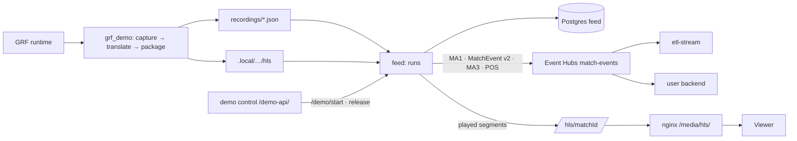

# Architecture

> **In short:** an offline generator writes recordings; the feed, a separate container that shares nothing with our services, turns each run of a recording into a live stream and a live HLS playlist.

| | |
| --- | --- |
| **Generator** | Python + instrumented GRF runtime, FFmpeg (developer machine) |
| **Feed** | FastAPI + asyncio, one task per run; Postgres `feed`; Azure Event Hubs SDK |
| **Boundary** | Event Hubs and HLS over HTTP only; admin API is dev-only (demo control and `/dev/` call it) |
| **Delivery** | At least once; per-match order by partition key |

## 1. Diagram

*In short: left to right, simulator to consumers.*

## 2. Components

*In short: one folder per box.*

| Component | Folder | Responsibility |
| --- | --- | --- |
| [GRF demo](components/grf-demo.md) | `grf_demo/` | Render, derive events, export F24/MA1/MA3/POS, package video |
| [Feed](components/feed.md) | `feed/` | Catalogue, runs, Event Hubs, HLS origin, purge |
| [Recordings](../recordings/README.md) | `recordings/` | Shipped recordings and exports |

## 3. A run, end to end

*In short: one asyncio task per run.*

1. `POST /runs` mints the `matchId`, stores the run and starts a task.
2. At kickoff − 60 s the task sends MA1 (teams, lineups, capabilities, branding, provenance).
3. From kickoff it sleeps until the next item or segment is due, sends everything due in sends of at most 200 items (a backlog after a stall goes out in steps; Event Hubs ingress is about 1,000 events/s per throughput unit), copies played segments even while sends are retried, and saves its position. A refused send counts what went out and backs off (2 s doubling to 60 s; at least 10 s when Event Hubs throttles with `server-busy`); the rest goes out later in order, never dropped. A send the hub took but did not confirm can arrive twice; consumers drop redeliveries by seq, MA3 id and sampleId. The limits are `FEED_SEND_*` [settings](components/feed.md#6-settings).
4. After the final `period_end` and the last segment the run is `finished`.
5. Purge tombstones, stops the task, then deletes the row and the HLS directory.

A seeded demo run skips step 2: it is created waiting at its start point, and demo control releases it once ETL, engine and backend hold the seed ([feed §2a](components/feed.md#2a-demo-and-seeds)).

## 4. Data model

*In short: four tables and a cut-off.*

| Table | Holds |
| --- | --- |
| `recordings` | Catalogue, synced from `recordings/` at start-up |
| `runs` | `run_id`, `match_id`, `fixture`, `kickoff`, `status`, `position` (items sent), `seq`; seeds: `hold_seconds`, `resume_seconds`, `start_point` |
| `demo_settings` | One row: fixtures, `main_fixture`, stagger, run cap, start points, revision |
| `purged_matches` | Permanent tombstones |
| `purge_cutoff` | Latest `all` purge; older runs never resume |
