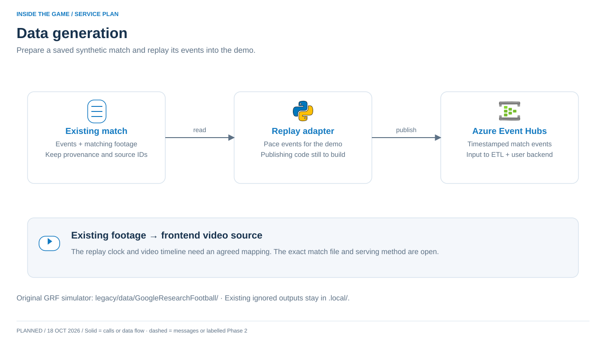

# Develop replay



**Own:** converting an existing synthetic match into timestamped events and aligned footage. The original simulator stays in `legacy/`.

```text
Saved match → normalise → timed replay → Event Hubs
```

**Start:** follow the root [Docker setup](../../DEVELOPMENT.md), then `./dev replay`. This sends three tiny synthetic fixtures immediately; the full replay runner is still to build.

**Build next:** choose the source match; map its fields to the [event contract](../../local/contracts.md); preserve source IDs/time/provenance; add a controllable replay clock and match partition key. Coordinate rebased UTC time with the ETL service's Stream Analytics windows. Keep original footage aligned with match time.

**Prove it:** stable IDs/order on repeat runs; explicit synthetic labels; ETL and backend independently receive all events. Test pause/restart and late events without silently double-counting.

**Azure:** Event Hubs is the output. Replay hosting remains undecided. Put actual runner code/tests here, not in shared local tooling. Large match files remain ignored under root `.local/`.
