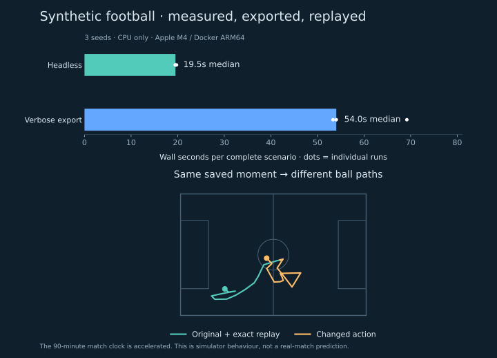

# Google Research Football

[← Data](../README.md) · [Research context](../../research/data.md#google-research-football-generate-and-branch-matches) · [Example data](sample.json) · [Measured results](benchmark.json)

**Two built-in AIs. 22 players. Every physics tick and ball touch.** Synthetic simulation data; no real match feed. Tested 14 October 2026 on Apple M4, native ARM64 Docker, CPU only.

**Three full runs:** 97,680 frames · 2.15 million player rows · 402 passes · 401 MB compressed.



```bash
# From the repo root; requires Docker. First build compiles the engine.
data/GoogleResearchFootball/run.sh --games 3
```

Outputs → `.local/grf-runs/<timestamp>/` (ignored). `--seed 42` sets the first seed; `--max-steps 50` runs a short smoke test. Existing run folders are never overwritten.

| File, per match | Contains |
| --- | --- |
| `raw.jsonl.gz` | Every processed 10 ms physics frame + native ball-touch callbacks. |
| `players.csv.gz` | XYZ, velocity, speed, distance, acceleration, facing, fatigue, possession and opponent proximity. |
| `ball.csv.gz` | XYZ, velocity, 3D/horizontal speed, acceleration, direction, owner, score and restart mode. |
| `events.jsonl.gz` | Executed passes, outcomes, shots, contacts, recoveries, goals, possession changes, stoppages and action attempts. |
| `passes.json` | Passer, intended/actual receiver, launch speed/direction, path length, duration, deflections and completion. |
| `observations.jsonl.gz` | Both agents' full public observations, actions, rewards and episode completion at every agent step. |
| `summary.json` | Counts, maxima, file sizes and SHA-256 checksums. |

The run also saves a **checkpoint + original/repeated/changed-action rollouts**, action logs and a timing report. Identical replay must match exactly; the intervention must change the trajectory. Recording on/off must preserve all observed states for each matched seed.

<details>
<summary>What the numbers mean</summary>

- **Clock:** default scenario ≈300 simulated seconds of active play. Its match clock is accelerated to 90 minutes. Stoppages can jump the physics clock; `clock_jump` records these gaps. Timings include Python, state hashing, compression and file hashing; exclude build, startup and reset. Native simulation is single-environment, sequential.
- **Coordinates:** native metres, pitch centre `(0,0)`, pitch `110 × 72 m`, Z = height. Left attacks +X; right −X. Both teams are exported in the same world orientation. Public observations retain GRF's normalised, agent-relative convention.
- **Speed:** native velocity magnitude; km/h = m/s × 3.6. Acceleration is change in **speed**, not vector acceleration. Distance integrates speed during play and excludes detected teleports. Ball position is instantaneous; the public API smooths it.
- **Pass completion:** first subsequent intentional touch by another teammate. Opponent control, self-recovery and stopped play are separate failed outcomes; export cutoff stays unknown. Deflections are retained. Completion does not require the originally intended receiver.
- **Events:** pass/shot labels use executed contact + animation type. Headers stay headers; animation starts are attempts. A recovery is a contact-based heuristic, not a certified tackle. Goal records link the preceding shot, without claiming causal attribution.
- **Proximity:** nearest opponent and opponents within 3 m are geometry, not a validated pressure or pass-difficulty model. No invented xG, offside or foul labels.
- **Configuration:** upstream `11_vs_11_stochastic`, built-in AI action 19 for both sides, 10 physics ticks per agent step, left difficulty 1.0 / right 0.6. Seed and patch hash are recorded. No LLM or trained external policy is needed.
- **Branch:** restore an opaque snapshot, steer the ball-owning team's controlled player, then hand back to AI. The included probe uses two direction actions and eight shot actions over ten agent steps. This tests controllability, not whether the alternative is better. Custom agent memory would need its own checkpoint.

</details>

<details>
<summary>Test, verify and rebuild the graphic</summary>

```bash
python3 -m unittest discover -s data/GoogleResearchFootball -p 'test_*.py'
# Native-coordinate integration test runs inside the image:
docker run --rm --network none -v "$PWD/data/GoogleResearchFootball:/work:ro" \
  insidethegame-grf:research -m unittest -v test_engine test_events
python3 data/GoogleResearchFootball/verify.py .local/grf-runs/<run>
uvx --with matplotlib python data/GoogleResearchFootball/report.py .local/grf-runs/<run>
```

[GitHub Actions](../../.github/workflows/football.yml) builds the engine, checks coordinates/events, exports a short run and verifies replay/branching on exporter changes. [Validation results](validation.json) include native frame intervals. Rendering/video and football realism have not been validated.

</details>

<details>
<summary>Source, patch and licences</summary>

Pinned [Google Research Football source](https://github.com/google-research/football/tree/3d9e754720a95621bba6475c4d3b0d56fe919014), archived 19 August 2026. [Dockerfile](Dockerfile) pins Python dependencies; [telemetry.patch](telemetry.patch) adds optional, read-only C++ hooks. It leaves game decisions intact and keeps telemetry outside simulation snapshots.

Google Research Football: Google LLC, [Apache 2.0](LICENSE.google). Gameplay Football engine: Bastiaan Konings Schuiling, [Unlicense](LICENSE.engine). Existing upstream notices remain in the image. No game art is exported. Review asset/dependency rights before shipping rendered video or an engine distribution; this test does not establish submission eligibility.

</details>
