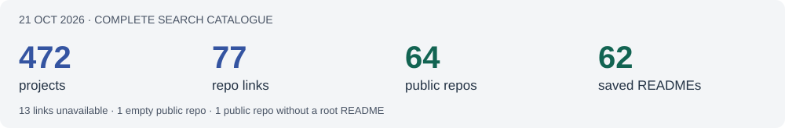

# Competitor refresh · 21 October 2026

**In short:** Refreshed all 472 searchable projects and their full descriptions, then checked every GitHub link in the repository fields and description text.

| Fact | Observed |
| --- | --- |
| Catalogue export | 472 unique IDs; 10 pages; final page reports no next page; 472 detail queries completed |
| Descriptions | 274 provided; 198 empty; full text retained without member/account profiles |
| Repository links | 75 in repository fields + 2 found only in descriptions |
| GitHub | 64 public repositories; 13 HTTP 404 responses |
| Saved READMEs | 62 complete files pinned to commits; 1 public repo has no root README; 1 is empty |
| Since 14 October | 339 new projects, 10 changed descriptions, 3 no longer returned; 44 additional public repos |

**[Browse every project →](PROJECTS.md)** · **[Browse repo descriptions →](REPOSITORIES.md)**

[Full project JSON](projects.json) · [Repo records](repositories.json) · [Change evidence](changes.json) · [Export checks](snapshot.json)

## What changed

The catalogue has grown from 136 to 472 returned projects. The following existing projects changed their description; their before/after text is retained in `changes.json`.

| Project | Current description preview |
| --- | --- |
| [Between the Lines](https://innovationstudio.microsoft.com/hackathons/insidethegamedeveloperhackathon/project/126429) | Between the Lines is a second-screen companion for football. It tells you what's changing in a match, shows you the moments that prove it, and answers your questions with an AI… |
| [Floodlight](https://innovationstudio.microsoft.com/hackathons/insidethegamedeveloperhackathon/project/126495) | Floodlight — every moment, under the floodlights Synthetic match events in. Verified, broadcast-ready storytelling out. How it works - Ingest — a seeded simulator plays a full 90… |
| [Football Foundry](https://innovationstudio.microsoft.com/hackathons/insidethegamedeveloperhackathon/project/126327) | Football Foundry helps casual football viewers understand and enjoy a match as it unfolds by turning live match moments into instant, plain-language, fact-checked explanations of… |
| [Infinite Stadium](https://innovationstudio.microsoft.com/hackathons/insidethegamedeveloperhackathon/project/126399) | Infinite Stadium helps football fans understand the match as they watch. It brings a synthetic match replay, compact statistics and an Azure-powered AI companion into one viewing… |
| [MatchEyes](https://innovationstudio.microsoft.com/hackathons/insidethegamedeveloperhackathon/project/126418) | MatchEyes - See Beyond the Score MatchEyes transforms synthetic football match events into explainable, evidence-backed match intelligence for analysts, broadcasters and fans.… |
| [PitchPulse – AI Broadcast Director](https://innovationstudio.microsoft.com/hackathons/insidethegamedeveloperhackathon/project/126499) | PitchPulse – AI Broadcast Director is an AI control room for football. A team of specialised AI agents turns live, synthetic match events into fact-checked insights, multilingual… |
| [Second Guess: The Football What-If Engine](https://innovationstudio.microsoft.com/hackathons/insidethegamedeveloperhackathon/project/126312) | 🔄 Second Guess — The Football What-If Engine What if he'd passed instead of shot? Every fan asks it. Every pundit argues about it. Second Guess answers it. Second Guess is an AI… |
| [Shield: Play Like Your Idol](https://innovationstudio.microsoft.com/hackathons/insidethegamedeveloperhackathon/project/126359) | The problem Highlights show goals and assists. They miss the defensive midfielder who closes passing lanes and ends attacks before they start. Fans never see that work, and kids… |
| [SignalFlow](https://innovationstudio.microsoft.com/hackathons/insidethegamedeveloperhackathon/project/126358) | SignalFlow is an AI-powered attention and decision engine for live football broadcasts. A live match can generate dozens of meaningful signals at the same time: dangerous attacks,… |
| [VYBE — Every Fan Belongs](https://innovationstudio.microsoft.com/hackathons/insidethegamedeveloperhackathon/project/126450) | VYBE — Every Fan Belongs Feel the Game. Your Way. The Vision Football brings people together across generations, cultures, languages, and abilities. Yet most digital football… |

Three previous project IDs were not returned: 126351 (ReactCoach 11 - AI-Powered Adaptive Football Coaching), 126412 (TBD), 126419 (Dinesh - Todo). This does not prove they were deleted. ReactCoach is now listed under project 126540 and still links the same public repository.

## Scope and limits

Descriptions and README statements are author claims. They are current source text, not proof that apps, tests, AI integrations or deployments work. Previous scores and source reviews remain [archived](../../../../legacy/competitors/README.md) and were not relabelled as current.

The catalogue header shows 473 projects, while the search UI and complete API pagination return 472. The one-project difference is unresolved. Four projects return `linkRepoState=2` without a repository URL: 126700, 126521, 126509, 126620. They remain in the catalogue with no invented link.

This was a manual authenticated export using the existing exporter into ignored `.local/` staging, followed by public GitHub metadata and pinned README reads. No scheduled automation was enabled, no competitor code was executed, and no cloud resources were changed. Authentication headers, member profiles and temporary asset URLs are excluded from the snapshot.
