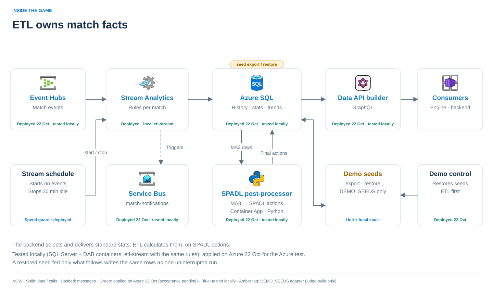

# Match data / ETL

Owns match history, standard statistics and trends. Azure Stream Analytics processes the feed; Azure SQL stores the results; Data API builder serves GraphQL.



## Run it

From the repository root, after accepting the [emulator licences](../local/README.md#run-it):

```sh
ACCEPT_EULA=Y ./dev up backend
```

GraphQL: [localhost:15001/graphql](http://localhost:15001/graphql). Locally, `etl-stream` runs the Python reference because Stream Analytics has no emulator.

```sh
cd etl
python3.12 -m venv .venv
.venv/bin/pip install -r requirements-test.txt
.venv/bin/python -m pytest tests
```

SQL tests need a throwaway SQL Server and `ETL_TEST_SQL_PASSWORD` (`_HOST`/`_PORT` optional); UDF tests need Node. [Tests](tests/) cover reference parity, all 126 stats, incremental SPADL conversion, snapshot bounds, retries and purge.

## Contracts

| Boundary | Contract |
| --- | --- |
| Feed → ETL | Event Hubs `match-events`, partitioned by `matchId`: MA1, MA3 and POS. [Schemas and codes](contracts/); [identity and ordering](../local/README.md#1-identity-and-snapshots) |
| ETL → readers | GraphQL history, watermarks, SPADL, stats and trends. [DAB schema](dab/dab-config.json); [local/README.md Contracts §3–4b](../local/README.md#3-etl-graphql-dab) |
| ETL → engine | Service Bus `match-notifications`: key events, closed minutes and period boundaries; at-least-once delivery, deterministic message ids |
| Admin | Tombstone before purge. [local/README.md Contracts §5](../local/README.md#5-purge) |

Read only at committed watermarks; SPADL actions require `finalSeq ≤ seq`. Standard statistics are calculated here once, never in the backend or browser. Disabled trends remain queryable but must not become narrative claims.

## Code and decisions

| Code | Why |
| --- | --- |
| [Stream Analytics query](stream-analytics/query.asaql) + [Python reference](reference/) | Change both together and compare their actual outputs |
| [SQL](sql/) + [SPADL converter](spadl/) | One action vocabulary; SQL watermark triggers confirm complete writes |
| [TypeScript UDFs](stream-analytics/udfs/src/) | Run `./dev udfs`; never edit generated JavaScript |
| [Local worker](local_stream/) | Runs the reference pipeline against the same tables and contracts |
| [Verification tools](devtools/) | `python -m devtools --help`; compare a replay against the reference |

## Deployment

Use the root [Azure workflow](../terraform/README.md), never apply `infra/` directly. Confirm before `terraform apply`; stop Stream Analytics after testing because it bills while running.

**Limits:** output errors are dropped rather than retried; inspect verification results. SQL auto-pause and DAB scale-to-zero add cold-start latency. [Deployment status](../README.md#status).
