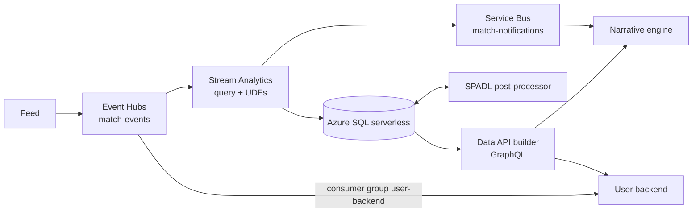

# Match data / ETL

Turns the stream of Opta-style match events into queryable history, a key-event ledger, SPADL actions and running statistics (Azure SQL behind GraphQL), and announces closed minutes and key events on Service Bus. A managed pipeline with little custom code: Stream Analytics processes, Azure SQL stores, a small Python post-processor converts MA3 into SPADL, Data API builder serves GraphQL. ETL owns every standard statistic; no other service recomputes one.

| Folder | Does |
| --- | --- |
| `stream-analytics/` | The whole transformation in one query (`query.asaql`): event-time (`TIMESTAMP BY timeStamp`, 2 s out of order, 5 s late), key events by Opta rules, per-minute team deltas in tumbling windows (one window = one match minute), nine SQL outputs and one Service Bus output; a second arrival-ordered read writes watermark marks. UDFs are TypeScript in `udfs/src/`, compiled by `./dev udfs` |
| `sql/` | Eighteen migrations: `matches`, `rawEvents`, `keyEvents`, `minuteStats`, view `matchStatsAsOf`; multi-match read models (`matchTeams`, `matchPlayers`, `canonicalEvents`, `possessionSamples`, `matchWatermarks`, `purgedMatches`); `spadlActions`; the stat catalogue (`statDefinitions`, `statsAtSeq`); trends (`trendDefinitions`, three procedures). `sql/azure/`: triggers that turn the job's marks into `matchProgress` and drop rows of purged matches |
| `spadl/` | Post-processor: committed MA3 rows → final SPADL actions (`finalSeq`), advancing `spadlSeq`; a thread in `etl-stream` locally, its own Container App (`ETL_ROLE=spadl`) on Azure |
| `reference/` | The same rules in Python (`opta.py`, `pipeline.py`, `spadl.py` = socceraction 1.5.3's Opta rules, `catalogue.py`, `trends.py`): the expected result for tests and `devtools verify`, since Stream Analytics has no emulator |
| `local_stream/` | Local stand-in for the job in the shared stack: same rules via `reference/`, same tables and notifications; also the purge API and demo seeds (`DEMO_SEEDS=1`), which is all its image runs on Azure (`ETL_ROLE=admin`) |
| `dab/` | `dab-config.json`: GraphQL over tables, views and procedures; introspection off on Azure |
| `seeder/`, `devtools/`, `contracts/` | A synthetic match and replay tool for `devtools verify`; `python -m devtools` (local stack, migrate, load, verify, `asa start|stop`, `azure-setup`); JSON schemas (`match-event`, `spadl-action`) and Opta codes |

Trends (`trendsAtSeq`, `trendSpellsAtSeq`, `trendMinutesAtSeq`) say who controls a match per team and window (last 5, last 15, half, match) as of any snapshot: 23 indicators and composites, spells, momentum; formulas fixed in SQL and Python, thresholds and `enabled` in `trendDefinitions`. Guarantees: idempotent writes (`IGNORE_DUP_KEY`) and deterministic `MessageId`s; `MinuteClosed` and its SQL write leave together (retry briefly); data at seq `s` is immutable once the watermark passes it; DAB scales to zero and SQL auto-pauses, so a first query can take about 30 s.

## Run it

| Command | Does |
| --- | --- |
| `ACCEPT_EULA=Y ./dev up backend` | This pipeline's schema and DAB with `etl-stream` in place of Stream Analytics; GraphQL `http://localhost:15001/graphql` |
| `cd etl && python3 -m venv .venv && .venv/bin/pip install -r requirements-test.txt` | Python 3.12 environment |
| `.venv/bin/python -m pytest tests` | All tests; SQL tests need `ETL_TEST_SQL_PASSWORD` (and `_HOST`/`_PORT`) for a throwaway SQL Server, UDF tests need Node |
| `.venv/bin/python -m devtools local-up` | SQL Server 2025 + DAB in Docker, GraphQL on :5000 |
| `seeder.replay seeder/matches/itg-syn-0001.jsonl --speed 10 --target file --match-id demo` → `devtools load-local .local/replays/demo.jsonl --window 6` → `devtools verify … --window 6` | The offline loop: replay to a file, load it the way the job would, compare every GraphQL entity with the reference row by row |
| `devtools asa start` → `seeder.replay … --target eventhub` → `devtools verify --graphql <url>` → `devtools asa stop` | A live replay on Azure (host Python, `az login`; the job bills while running) |

| Test | Proves |
| --- | --- |
| `test_azure_parity.py`, `test_udfs.py`, `test_local_stream.py` | On all three recordings the reference equals the local stream row for row; the UDFs under Node equal the reference; window closing, redelivery, restart, failed commits, purge, two interleaved matches, seed restore, seed routes only with `DEMO_SEEDS` |
| `test_spadl*.py`, `test_catalogue*.py`, `test_trends.py` | `reference/spadl.py` equals socceraction exactly; incremental conversion equals whole-match; all 126 stats equal the golden file at the final seq and 19 prefixes; trend rules and golden |
| `test_sql_*.py` | Real SQL Server: migrations, worker and post-processor, `statsAtSeq`, trends under 500 ms, purge and tombstones, seeds, the Azure triggers with reordered parallel batches |
| `test_seed_bounds.py`, `test_seeder_and_pipeline.py`, `test_devtools.py` | A seed holds nothing past its seq; generated match and reference outputs; devtools read the stack outputs |

A rule change touches the query and the reference together; never edit the compiled UDF `.js`. `.env`, `.local/`, state and tfvars are ignored.

## Contracts

### Input: Event Hubs `match-events`

One JSON message per item, partition key `matchId`, so one match is strictly ordered; every message carries `synthetic: true` and a wall-clock `timeStamp`. Per run: MA1 (match info, lineups, `capabilities`, branding, `knownNames`) about 60 s before kickoff; then per canonical event, in seq order, `MatchEvent` v2 `{seq}` followed by its MA3 rows (`eventSeq = seq`); POS possession samples interleaved by video time. Each period starts just after a window boundary, so one window holds exactly one match minute. Consumers ignore kinds they don't own.

### Output 1: GraphQL (Data API builder, anonymous read)

Internal ingress on Azure; `filter`, `orderBy`, `first`, `after` on every query. `matches`, `matchTeams`, `matchPlayers`, `matchWatermarks` (`seq`, `spadlSeq`), `canonicalEvents`, `possessionSamples`, `rawEvents` (typed columns, full `payload`, indexed `eventSeq`), `keyEvents`, `minuteStats`, `matchStatsAsOfs` (running totals per team and minute: `goals ownGoals passes passesCompleted shots shotsOnTarget corners fouls yellowCards redCards possessionPct`; `minuteLabel` broadcast style, 46 in period 1 is `45+2'`), `spadlActions`, `statDefinitions`, `executeStatsAtSeq`, `trendDefinitions`, `executeTrendsAtSeq`, `executeTrendSpellsAtSeq`, `executeTrendMinutesAtSeq`. Definitions of the catalogue and trends: [local contracts §4, §4b](../local/README.md#4-stat-catalogue).

| keyType | detail | Source | `contestantId` is |
| --- | --- | --- | --- |
| `Goal` | `penalty` or null | type 16, no qualifier 28 | scoring team |
| `OwnGoal` | null | type 16 + qualifier 28 | team that put it in its own net |
| `PenaltyAwarded` | `conceded` | type 4, outcome 0, qualifier 9 | team that conceded |
| `PenaltyMissed` | null | type 13/14/15 + qualifier 9 | taking team |
| `RedCard` | `second-yellow` or null | type 17 + qualifier 32/33 | sent-off player's team |
| `VarOverturn` | `goal-overturned`, `own-goal-overturned` | type 900 + qualifier 901 | team of the overturned goal; `relatedEventId` = its id |

### Output 2: Service Bus topic `match-notifications`

JSON body with the same keys on every type (unused ones `null`); application property `notificationType`; `MessageId` for duplicate detection, delivery at least once. `KeyEventDetected` (the `keyEvents` row; `{matchId}:key:{id}`), `MinuteClosed` (`matchId periodId timeMin windowEnd`; `{matchId}:minute:{periodId}:{timeMin}`; fires when a minute's window closes, nothing during half time), `PeriodStarted` / `PeriodEnded` (`matchId periodId eventTime`). Subscription `narrative-engine` on Azure, `narrative-live` locally; on Azure messages flow only while the Stream Analytics job runs.

### Output 3: SPADL actions

[SPADL](https://github.com/ML-KULeuven/socceraction) is the action contract across the stack: one row per on-the-ball action with type, result, body part, start and end location, team-relative zones; converted from MA3 by `reference/spadl.py`, stored only once final, readable per snapshot (`finalSeq ≤ seq`); schema `contracts/spadl-action.schema.json`. Key events, cards, substitutions and period markers stay outside SPADL.

### Admin (`etl-stream` image)

`POST /admin/matches/purge` ([purge contract](../local/README.md#5-purge)); with `DEMO_SEEDS=1` only, `POST /admin/matches/export` and `/restore` for demo control. Bearer token on Azure.

## Deployment

Terraform in `infra/` (`rg-itg-etl-dev`, Australia East), applied by `./dev azure up` ([terraform](../terraform/README.md)), which stops the job before applying, runs `devtools azure-setup` (migrations, `sql/azure` triggers, identity grants) after, and restarts DAB; never run `terraform` in `infra/` directly. Idle cost is low: SQL auto-pauses (free offer), DAB scales to zero, the job runs only while events flow.

| File | Creates |
| --- | --- |
| `messaging.tf` | Event Hubs Standard (1 TU, 2 partitions, 1-day retention), hub `match-events`, consumer groups `stream-analytics`, `stream-analytics-progress`, `user-backend`; Service Bus topic `match-notifications`, subscription `narrative-engine`; scoped keys |
| `sql.tf` | Entra-only SQL server, serverless database `insidethegame` on the free offer, auto-pause 60 min |
| `stream_analytics.tf`, `stream_schedule.tf` | The job (StandardV2, ⅓ SU, created stopped, `window_seconds` 60), inputs `match-events` and `match-progress`, outputs, UDFs; metric alerts that start the job on traffic and stop it after 30 quiet minutes via the guard's webhooks |
| `dab.tf`, `admin.tf`, `spadl.tf` | Log Analytics, the shared Container Apps environment and registry, DAB (0–1 replicas), the purge API, the SPADL app (1 replica, no ingress) |

Outputs: `graphql_url`, `servicebus_listen_connection_string`, `eventhub_send_connection_string`, `admin_host`, `admin_token`. If nothing arrives: is the job running (`asa status`)? Did the guard's last resort stop it (`./dev azure up` restores)? Missing rows: run `verify`; output errors are dropped, not retried.

## Decisions

| We chose | Because |
| --- | --- |
| Opta MA1/MA3-style events with schema and codes in `contracts/` | A widely known format with qualifiers for every key event |
| A Python reference and `devtools verify` | Stream Analytics has no local emulator; the reference proves the cloud output |
| Watermark marks from a second read of the hub, turned into `matchProgress` by SQL triggers | The job writes each output separately and append-only; only SQL can tell when everything a watermark promises is committed |
| SPADL converted in ETL; stats, rules and context defined on it | One action vocabulary for prompts, filters and formulas |
| Trends as read-time SQL procedures with a Python twin and thresholds in a table | Exact at any snapshot, so a backlog equals live; disabled trends stay computable |
| The job started by traffic and stopped after 30 quiet minutes | It bills while running; the demo build stays up for weeks |
| Tombstones enforced by SQL triggers; purge as a small Container App | Stream Analytics cannot read SQL state per event |
| Managed identity to SQL, scoped keys for messaging | The trial account cannot create role assignments ([production gaps](../terraform/README.md#decisions-and-production-gaps)) |
