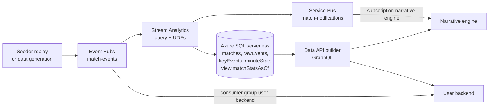

# Architecture

> **In short:** a managed streaming pipeline with no custom server code. Stream Analytics does all the processing in SQL-like queries, Azure SQL stores the results, Data API builder exposes them as GraphQL, and Service Bus carries notifications. Python exists only for the seeder, the reference implementation and developer tools.

| | |
| --- | --- |
| **Processing** | One Stream Analytics job, event-time (`TIMESTAMP BY timeStamp`) |
| **Storage** | Azure SQL serverless (free offer, auto-pause) |
| **API** | Data API builder 2.1.5 on Container Apps |
| **Delivery** | At least once everywhere; inserts and messages are deduplicated by key |

## 1. Diagram

*In short: left to right, event to consumer.*

The rendered overview diagram is [../architecture.svg](../architecture.svg); the original design board section is [design/design-board.svg](design/design-board.svg).

## 2. Components

*In short: one folder per box.*

| Component | Folder | Responsibility |
| --- | --- | --- |
| [Seeder](components/seeder.md) | `seeder/` | Generate a synthetic match; replay it to Event Hubs or a file |
| [Stream Analytics](components/stream-analytics.md) | `stream-analytics/` | Parse events, detect key events, aggregate minutes, emit notifications |
| [SQL](components/sql.md) | `sql/` | Tables and the running-totals view |
| [Data API builder](components/dab.md) | `dab/` | GraphQL over the tables and view |
| [Reference](components/reference.md) | `reference/` | The same rules in Python, the expected result |
| [Devtools](components/devtools.md) | `devtools/` | Local stack, loading, verification, job control |
| Contracts | `contracts/` | Event schema, Opta codes, consumer contract ([README](../contracts/README.md)) |

## 3. Runtime flow

*In short: one event in, up to four writes out.*

1. The replay sends MA1 match info, then MA3 events with wall-clock `timeStamp`s. Each period starts just after a window boundary, so one window holds exactly one match minute.
2. Stream Analytics orders events by `timeStamp`, adjusting events up to 2 s out of order and accepting events up to 5 s late.
3. For each event it writes the raw event, and a key-event row if the event is one.
4. When a minute's window closes it writes that minute's per-team deltas and sends `MinuteClosed`. Key events are sent as `KeyEventDetected` straight away; period start and end events as `PeriodStarted` / `PeriodEnded`.
5. Consumers read the tables through GraphQL; `matchStatsAsOfs` sums the deltas into running totals.

Half time has no events, so no windows close and no `MinuteClosed` fires.

## 4. Data model

*In short: four tables written by the job, one view for consumers.*

| Table / view | One row per | Key |
| --- | --- | --- |
| `matches` | match | `matchId` |
| `rawEvents` | event | `(matchId, id)` |
| `keyEvents` | key event | `(matchId, id)` |
| `minuteStats` | team, match minute, window | `(matchId, contestantId, periodId, timeMin, windowEnd)` |
| `matchStatsAsOf` (view) | team, match minute | running totals as of that minute |

All keys use `IGNORE_DUP_KEY`, so a replayed insert is a no-op. Column lists: [sql](components/sql.md).

## 5. Azure resources

*In short: one resource group, dev-sized everything.*

| Resource | Name (dev) | Size and notes |
| --- | --- | --- |
| Resource group | `rg-itg-etl-dev` | Budget alert at US$50/month |
| Event Hubs | namespace `itg-etl-dev-0zvxh-ehns`, hub `match-events` | Standard, 1 TU, 2 partitions, 1-day retention; consumer groups `stream-analytics`, `user-backend` |
| Stream Analytics | `itg-etl-dev-0zvxh-asa` | StandardV2, ⅓ streaming unit; created stopped, bills only while running |
| Azure SQL | server `itg-etl-dev-0zvxh-sql`, database `insidethegame` | General Purpose serverless, free offer, auto-pause after 60 min; Entra-only auth |
| Container Apps | environment `itg-etl-dev-0zvxh-cae`, app `itg-etl-dev-dab` | DAB, 0–1 replicas; the narrative engine shares this environment |
| Service Bus | `itg-etl-dev-0zvxh-sbns`, topic `match-notifications` | Standard; duplicate detection 10 min; subscription `narrative-engine` (10 deliveries) |
| Log Analytics | `itg-etl-dev-0zvxh-logs` | Container Apps logs, 0.5 GB/day cap |

## 6. Guarantees and limits

*In short: what consumers can rely on.*

- **Idempotent writes and messages:** primary keys ignore duplicates; Service Bus `MessageId`s are deterministic.
- **Minute and data together:** `MinuteClosed` and the SQL write for that minute leave the job together; a consumer may need to retry briefly if the row is not visible yet.
- **Late data:** up to 5 s late and 2 s out of order. Sized for 6-second replay minutes.
- **Window tied to speed:** `window_seconds` must equal 60 / replay speed; changing it means stopping the job and applying Terraform.
- **Cold start:** DAB scales to zero and SQL auto-pauses, so the first query can take about 30 s.
