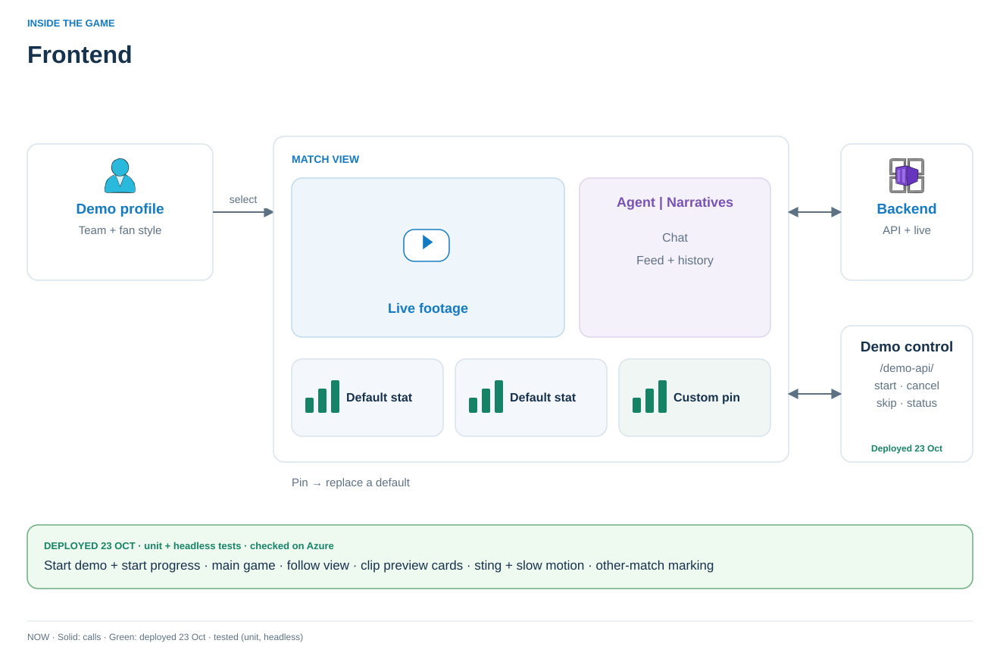

# Frontend

> **In short:** the match viewer, filter lab and `/dev/` console as static TypeScript modules behind nginx. Judges press **Start demo**, watch three live matches (the main game opens first), ask questions, follow stories in this or another match, and play captured clips with a sting and slow motion.

| | |
| --- | --- |
| **Status** | Implemented · unit-tested (176) · headless-checked against the contract mock (`--flow follow\|sting\|capture`) · D1–D7 checked on the local stack (22 Oct) · Azure: applied 22 Oct for the Azure test, acceptance (PLAN.md §10.4) pending |
| **Public URL** | `https://msft-hackathon.koda-software.com` ([edge proxy](../edge-proxy/README.md) → the Azure frontend) |
| **Talks to** | `/viewer-api/` (backend), `/demo-api/` (demo control), `/media/hls/` (feed); dev consoles gated |

[Run locally](docs/development.md) · [Design references](docs/design-references.md) · [Icon checks](assets/README.md) · [Verification log (historical)](docs/design/verification.md)



**Match viewer:** a match picker (`GET /product/matches`: status, score, clock), then one match per tab at `/?match={matchId}` with fixed stat slots, bucketed insights and a question tab. Every API call and the WebSocket are scoped by match id; a purged match (404 or socket close 4404) returns the tab to the picker. Club colours and crests come from the match data (MA1 branding via the backend); crest files stay in `assets/league/clubs/{crestAssetId}.svg`. Footage is the match's own HLS at `/media/hls/{matchId}/live.m3u8`, proxied from the feed's origin. *Implemented; unit- and headless-tested against a contract mock.* Replay answers play clip reels on the stage while live continues in a corner (browser-verified 20 October 2026); per-viewer rewind remains planned. **Reel playback** (implemented, unit-tested): every replay carries `playback` (backend `replay-timing.playback`, editable in `/dev/`). Between clips the reel holds the last frame (`hold_seconds`), the sting video (`asset`, from `asset_start_seconds`) fades in (`fade_seconds`), the next clip is cued under it at `cut_seconds` (after the fade in, before the fade out), and it fades out as that clip plays, gone at `sting_seconds`; a sting that fails to load is skipped, footage ending short of a clip's out point moves to the next clip, and the last clip ends without one. Slow motion eases to `rate` over `ramp_seconds`, holds from `before_seconds` ahead of each marked event to `after_seconds` past it, and eases back. Each has an `enabled` flag; under `prefers-reduced-motion` the reel only holds and cuts, at normal speed. Any playlist (replies, follow moment playlists) gets this by using the replay contract: `playlist`, `clips[]` with `playlist_start`/`playlist_end`/`marks`, and `playback`. Sting source and permission: `assets/league/PROVENANCE.md` (community GIF from Dribbble, downloaded 22 October 2026; use permitted per developer: hackathon allows Premier League resources; community GIF). Each answer shows a receipt (facts, tokens, seconds, estimated cost) costed at the backend's configured prices (`GET /product/prices`; the browser caches the last prices only for offline use; before any arrive, no cost is shown). The separate filter lab stays at `/lab/`. **Developer config** at `/dev/` (implemented, unit-tested): a Matches panel (feed recordings and runs; start a fixture at the next minute; purge one match or all across feed → ETL → engine → backend), an audience template editor per fixture (add, edit and remove layers and options with their descriptions and viewer labels; enable or disable each bucket), narrative prompt versions, revision-checked JSON editors for backend config tables (presentation, replay timing, key-moment ranks, answer prices, stream gap timeout, story follows, key-moment feed, storyline policy, cross-match, follow offer), a demo-profile editor, and pipeline health with stream gaps. It uses `/dev-api/` → backend `/dev/` (`ENABLE_DEV_FEED=1` only), and `/feed-api/` and `/purge-api/{owner}` (nginx `ENABLE_DEV_ADMIN=1` only). The viewer and lab never call the feed. **Start demo** (implemented, unit-tested): the picker's Start demo (with a start-point select; points not yet recorded are disabled) or Cancel demo call the public demo control at `/demo-api/` (local/contracts.md §7a); while a demo is on only its matches are listed, a seven-stage pipeline shows each stage waking from real readiness checks (`/demo-api/status`) until all are ready, and the audience bucket is fixed while a match is live. After Start demo, or on landing on `/` while a demo is live, the viewer opens the **main game** (`main_match_id`, Arsenal–Liverpool by default); "← All matches" (`/?choose`) keeps the picker for switching. A seeded start (20′, HT, 60′, 85′) says "The story so far was generated earlier on this pipeline; live from N′." on the picker and in the match view. `/dev/` edits the demo settings (fixtures, stagger, run cap, start points). `/lab/` selects a live match; recording upload and replay controls are gone.

```text
Static HTML / CSS / modules ← CDN or nginx
             ↓ one live connection
User backend → match state + cards + narratives
             ↔ questions + Track / Untrack
```

- One dropdown lists the match's enabled audience buckets (from the fixture's template, labelled by the backend); switching picks which narratives you see. Nothing is hard-coded in the client. Chat and pins stay with the same demo identity; already-framed narratives come from upstream.
- Standard statistics come from ETL through the backend. The browser never calculates match statistics.
- Tracking a standard or custom stat replaces the lowest-priority default card; untracking restores the default.
- **Feed order** (22 Oct review): Insights and a followed story run oldest first with the newest at the bottom (highlighted), and the list stays on the newest unless the viewer has scrolled up; a followed story marks where the viewer began ("Following since N′", from the follow's `since_clock_seconds`). Focus rings show for keyboard users only; nothing scrolls sideways (follow chips and, on phones, stat cards wrap).
- **Story follows** (implemented, mock-tested): **Customise** (at the bottom of the panel) opens the follow view: its chat (suggestion chips, proposal card with Follow, clarification choices) replaces Insights, with short instructions and Cancel (back to Insights) always there; a follow closes it. One story per viewer. While following, the feed shows only that story's narratives, tagged, with Stop following to restore the insights. Pivotal key moments show for everyone as short grey lines. **Captured clips** (implemented, unit- and headless-tested against the mock; PLAN.md §10.2 D6–D7): a follower's `follow_playlist` (their story's clips) or, in Insights, the bucket's `moment_playlist` (key-event clips of the shared narratives) shows as one card per clip in the feed at its moment's clock (`match/capture.ts`). Each card is a preview built in the browser from the clip's `moments`: a league gradient from the club's colour, its crest, the minute, the event (the first part of its configured label), the player or team and the score after (a penalty names the side that won it, not the player who conceded it); the Play button's label carries the same text, and a captured moment's grey line is not repeated (an overturned one keeps it). Play opens the same playlist on the stage from that clip on, with the reel's transitions and slow motion. A followed story from another match outlines its clips with that match's header (`match/other-match.ts`). A held state shows only the clips its picture has passed. A reply's replay card shows the same minute and event line when its first clip is a key moment.
- **Cross-match** (implemented, unit-tested; PLAN.md §10.2 D5, D5b; local/contracts.md §8c): content from another live match of the demo (a question that names it, a stat pinned from it, a followed story there, a follow option there) carries `other_match` (`follow_match` on the snapshot) and is outlined in yellow (`--cross-match`) with that match's teams and crests, never its score. Reusable pieces in `match/other-match.ts`: `otherMatchHeader(document, other)` builds the header; `markOtherMatch(document, element, other)` adds the `cross-match` class and the header to any element and leaves own-match content untouched. **Follow this story?**: an answer with `follow_offer` shows Follow / No thanks; Follow opens the follow view and sends the question to the follow chat, which proposes the story (this match or another); the viewer still confirms. Stat answers never offer.
- Questions send the seq of the picture the viewer is shown, so answers never cite later events, and keep their as-of snapshot while live cards advance. Enter sends a question; Shift+Enter adds a line. Sessions restore on refresh; a new session takes over the previous tab.

**Scale boundary:** static files can be distributed independently. One push connection per viewer, bounded UI state and shared backend projection avoid per-viewer polling or agent loops. The local single-process harness is not an EPL-capacity demonstration. [Production boundaries](../user-backend/docs/architecture.md#6-scaling-boundary).

[Repository plan](../README.md)
