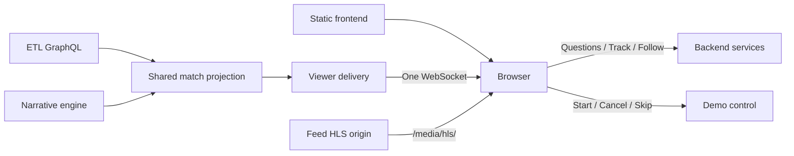

# Frontend

The match viewer, filter lab and `/dev/` console as static TypeScript modules behind nginx. Viewers press **Start demo**, watch three live matches of the fictional Elephant League (the main game opens first), pick an audience, ask questions, follow stories in this or another match, and play captured clips with a sting and slow motion. The browser never calculates statistics, runs a model or reads a database. Implemented, unit-tested, headless-checked against the contract mock and deployed.


| | |
| --- | --- |
| **Public URL** | `https://msft-hackathon.koda-software.com` ([edge proxy](../edge-proxy/README.md) → the Azure frontend) |
| **Pages** | `/` viewer, `/lab/` filter lab, `/dev/` developer console (both gated) |
| **Talks to** | `/viewer-api/` (backend), `/demo-api/` (demo control), `/media/hls/` (feed's HLS origin) |
| **Contracts** | [contracts](../local/README.md#contracts) §6 (HLS), §7a (demo control), §8–8d (backend product API) |
| **Runtime dependency** | `hls.js` 1.7.3 (exact pin); no bundler or framework |
| **Run** | `ACCEPT_EULA=Y ./dev up backend`, then `http://localhost:18020/` ([Development](#development)) |

```text
Static HTML / CSS / modules ← nginx (or a CDN)
             ↓ one live connection
User backend → match state + cards + narratives
             ↔ questions + Track / Untrack + follows
Demo control ↔ Start / Cancel / Skip ahead
```

## What a viewer sees

- **Picker and demo.** `/` lists matches (live, then scheduled, then finished) with status, score and clock; each tab holds one match at `/?match={matchId}`. **Start demo** (kickoff, or a recorded seed at 20′, HT, 60′, 85′; unrecorded points disabled) and **Cancel demo** call demo control. A seven-stage pipeline picture (Feed → Event Hubs → ETL → Service Bus → Narrative engine → Backend → Viewer) appears at the click with every stage waking and lights each stage from real readiness checks, with a Stop button, until the match opens. After Start, or on landing while a demo is live, the viewer opens the **main game**; "← All matches" (`/?choose`) keeps the picker. **Skip ahead** (+10′, +20′, second half) moves every demo match on by the same minutes; a blocking overlay shows the match clock speeding to the new time until it arrives. A seeded start says "Live from N′". Table, Statistics and Clubs are marked demo placeholders.
- **Live match.** Team names, colours and crests come from the match data (MA1 branding). Footage is the match's own HLS; match data is held until the picture reaches it. Five stat cards from ETL through the backend, each default card showing both teams; tracking a stat replaces the lowest-priority default card. One dropdown lists the match's enabled audience buckets; switching picks which already-framed narratives you see, at any time. A purged match (404 or socket close `4404`) returns the tab to the picker.
- **Insights, questions and follows.** Insights run oldest first, newest at the bottom; pivotal key moments show for everyone as short grey lines. Questions send the seq of the picture shown, so answers never cite later events; each answer shows a receipt (facts, tokens, seconds, estimated cost at the backend's prices). **Customise** opens the follow view: a chat with suggestion chips, a proposal card with Follow, and clarification choices; one story per viewer; while following, the feed shows only that story with Stop following. **Follow this story?** may follow an answer. Captured clips (a follower's story clips, or the bucket's key-event clips) show as preview cards (crest, minute, event, player, score after); Play opens the playlist on the stage with the sting and slow motion; a cross-game "all goals" answer plays as one reel. Content from another live match is outlined in yellow with that match's teams and crests, never its score.
- **Viewers and errors.** Each browser keeps an anonymous viewer id; sessions are per (viewer, profile, match); tabs of one browser share it, a new tab or Reconnect takes over. A viewer never sees raw network or script errors. Assets are fingerprinted, so a deploy never needs a hard refresh. Profiles are demo identities, not authentication.

## Architecture



**Routes the viewer calls** (`match/api.ts`, `match/demo.ts`; `M` = `/viewer-api/matches/{matchId}`, `S` = `M/sessions/{token}`): `GET /viewer-api/matches`, `/profiles`, `/prices`; `POST M/sessions {profile_id, viewer_id}`; `GET S` and WebSocket `S/live` (close `4404`: match gone); `PUT S/audience {bucket_id}`; `POST S/messages {prompt, request_id, seq}`; `POST S/offers/{id}/track`, `DELETE S/pins/{id}`; `GET S/turns/{id}/replay/{page}`; `GET S/follows`, `GET S/follow/suggestions?seq=`, `POST S/follow/messages`, `POST S/follows`, `DELETE S/follows/{id}`; `GET /demo-api/state`, `/status`, `POST /demo-api/start {point}`, `/cancel`, `/skip {target}`.

**Snapshots.** Each snapshot carries `projection_epoch`, monotonic `version`, match identity and `seq`, profile, `audience` and `audience_buckets`, five cards, recent events, narrative backlog, `feed_mode`/`follow`/`key_moments`, `follow_playlist`/`moment_playlist`, `other_match`/`follow_match` and `match.media` (`{url, seconds}`). Clients reject older or equal versions within an epoch and ignore late responses from retired epochs. Reconnect restores an authoritative snapshot, never replays deltas. Browser state is bounded: 60 events, 300 narratives, 50 rendered chat turns, five cards, 30 held states; rendering coalesces to animation frames and keeps unchanged nodes.

**Live HLS and replay.** With `match.media.url` the viewer plays it with hls.js (`enableWorker: false`, live sync three segments; catch-up 1.1× when more than 1.5 s behind, one seek when more than 6 s behind for 3 s, then a 10 s cooldown); native HLS only where hls.js is unsupported; no url, no footage. Until the first segment plays it shows "Starting the stream…" and retries (`match/video.ts`). States with `media.seconds` wait until the playhead reaches that time (at most 15 s). Replay replies render a chat card; Play loads the playlist into a second stage player while live continues as a muted corner picture; **Back to live**, the picture or Esc returns. Every replay carries `playback`: a hold, the `builtin:league` sting, a cut and fades between clips, slow motion around marked events; both off under `prefers-reduced-motion`. hls.js (light ES build, Apache-2.0) is copied into the fingerprinted app and loaded on demand from the same origin.

**nginx.**

| Path | Upstream |
| --- | --- |
| `/` and `/app/{fingerprint}/` | Viewer; an old fingerprint falls back to `/app/current/` |
| `/viewer-api/` | Backend `/product/` |
| `/demo-api/{start,cancel,skip,state,status}` | Demo control, rate-limited: start/cancel/skip POST only, one shared limit 10/min burst 5; state/status GET only, per client (last `X-Forwarded-For` hop) 40/s burst 200; over it `429`. `Authorization` stripped. Without a reachable demo control `/demo-api/` is `502` and the viewer hides Start demo |
| `/media/hls/{matchId}/{file}.m3u8\|.ts` | Feed HLS origin; any other `/media/` is `404` |
| `/lab/`, `/api/`, `/dev/`, `/dev-api/`, `/feed-api/`, `/purge-api/{owner}` | Only with `ENABLE_DEV_ADMIN=1` (basic auth when a password is set); `/purge-api/etl|engine` add the owners' bearer tokens, so the browser never holds one |

HTML revalidates; fingerprinted modules are immutable; HLS playlists are `no-cache`, segments immutable. CSP allows `blob:` only in `media-src`; every request is same-origin. nginx re-resolves upstreams every five seconds so a replaced container is found again. One committed change triggers one shared projection read per match, not per viewer; limits bound work, they do not establish a viewer-capacity number ([backend scaling boundary](../user-backend/README.md#limits)).

## Folders

| Folder | Contents |
| --- | --- |
| `match/` | The viewer (`index.html` → `main.ts`), compiled to `dist/match/` and fingerprinted under `/app/{hash}/match/`: `api.ts`, `live.ts` (same-origin requests with viewer-safe errors, one reconnecting live connection); `controller.ts`; `viewer-id.ts`; `picker.ts`, `branding.ts`; `demo.ts`, `demo-progress.ts`; `view.ts`, `audience-view.ts`, `chat-view.ts`, `clarification-view.ts` (bounded, safe DOM rendering); `follow.ts`, `follow-view.ts`; `capture.ts`; `other-match.ts`; `replay.ts`, `replay-card.ts`, `replay-view.ts`; `media.ts`, `video.ts`, `hold.ts`; `receipt.ts`; `format.ts`, `types.ts`; `styles.css`, `companion.css`. Model and event content is rendered as text, never HTML; no secrets shipped |
| `lab/` | The filter lab at `/lab/`: pick a live match, prepare a structured rule, inspect its JSON and the received events, chat with the question agent (`/api/matches/{matchId}/…`, `/api/chat/profiles`; polling 700 ms / 5 s; `503` without a model shows "answers unavailable"). `api.ts`, `chat-api.ts`, `controller.ts`, `chat-controller.ts`, `view.ts`, `chat-view.ts`, `format.ts`, `types.ts` |
| `dev/` | The developer console at `/dev/` (`/dev-api/` → backend `/dev/`; `/feed-api/`, `/purge-api/{owner}`): `api.ts` (`DevApi`; purge in order feed → ETL → engine → backend), `matches.ts` (recordings, runs, purge, demo settings), `audiences.ts` (template per fixture: layers, options, enabled buckets), `prompts.ts` (versions: save, activate), `config.ts` (JSON editors for config tables), `profiles.ts`, `main.ts` (pipeline health with stream gaps). Every editor is revision-checked; a conflict keeps the draft. Never called by the viewer or the lab (`tests/dev.test.ts`) |
| `shared/` | `dom.ts` (`node()`, `keyedList()`), `http.ts` (`parseResponse()`, `ServiceError`); shipped inside the viewer's fingerprint and at `/shared/` for the lab and console |
| `tools/` | `build.sh` (copies `dist/match/` and `dist/shared/` under one content fingerprint, rewrites `index.html`, links `app/current`), `vendor.sh` (pinned hls.js into `dist/match/vendor/`), `nginx-setup.envsh` (resolver, basic-auth include, purge bearer headers) |
| `devtools/` | Never shipped: `mock-server.ts` (serves `dist/` with the production CSP and a synthetic mock of matches, sessions, WebSocket, follows, clips, lab and `/dev/`; `MOCK_NO_MODEL=1`), `headless-check.ts`, `check-bundle.ts`, `test-proxy.ts`, the icon harness (`check_icons.py`, `test_icons.py`) |
| `benchmarks/` | `client.ts`: gzip bytes of the shipped static transfer and bounded state-replacement timing (`npm run build`, then `node frontend/benchmarks/client.ts`); opt-in; budget UI 230 KiB raw / 70 KiB gzip (about 203 / 63 KiB measured), all assets 250 KiB gzip |
| `assets/` | `icons/` (three native SVG feature icons), `league/` (original wordmarks, six club crests, `microsoft.svg` for attribution only; [provenance](assets/league/PROVENANCE.md)); `reference/` is development evidence, not shipped ([Assets](#assets)) |
| `tests/` | `node --test` suite (`*.test.ts`, DOM doubles) |
| `nginx.conf`, `Dockerfile` | Same-origin proxy and image (Node build stage; nginx serves only compiled output) |

## Decisions

| Choice | Why |
| --- | --- |
| No bundler or framework; `tsc` output plus one content fingerprint | Fewer moving parts; relative imports stay inside one cached version |
| `hls.js` light build served from the same origin | Strict CSP: no CDN, no workers |
| One WebSocket for state, HTTP for actions | No per-viewer polling or model loop; reconnect restores an authoritative snapshot |
| Data held until the picture reaches it | Cards and narratives never run ahead of the footage |
| Questions carry the shown `seq` | Answers never cite events the viewer has not seen |
| Viewer-safe error sentences in `match/`, backend messages in `lab/` and `dev/` | Viewers never see exceptions; developers need the detail |
| Fictional Elephant League, original crests and wordmark, CSS sting | No third-party marks; only the Microsoft logo for the Agent Framework credit |
| Agent Framework credit, not "powered by Copilot" | Truthful attribution |
| Skip ahead shows a speeding clock overlay | After a skip the footage jumped while the clock lagged and looked broken |

Design references (checked 18 October 2026): the Premier League match centre and Companion (establish teams, clock and score before statistics; segmented tabs, pill prompts, a rounded composer), Fluent accessibility and motion guidance (visible focus, statuses not relying on colour, motion that communicates changed state and is off under reduced motion), Azure Web PubSub guidance (capacity depends on message size, frequency and fan-out). No real league's fonts, marks or crests are used.

**Production boundary.** Static assets can move behind Azure Front Door or a CDN; the socket transport would be replaced by an authenticated delivery gateway or an Azure Web PubSub adapter using Microsoft's supported recovery SDK (not deployed). Multiple backend replicas need shared session ownership, durable delivery and coordinated match calculations. Profiles are demo identities. No viewer-capacity number has been measured. Open: the UI ships unminified; per-viewer rewind of live footage is not built.

## Development

Source is TypeScript in `match/`, `lab/`, `dev/`, `shared/`, `tests/`, `devtools/`, `benchmarks/`; shell in `tools/`; the icon harness is Python; plain `.js` only in ignored `dist/`. Node 22.18+ runs `.ts` tests and tools directly.

```sh
ACCEPT_EULA=Y ./dev up backend   # then http://localhost:18020/ and Start demo, or ./dev demo start [fixture…], or /dev/ Matches
cd frontend
npm ci
npm test               # tsc (also edge-proxy/src), then node --test on tests/*.test.ts
npm run build          # tsc → dist/ (compiled JS + copied HTML/CSS + hls.js)
npm run check:bundle   # dist/ names no deny-listed term (BUNDLE_DENYLIST or ignored .local/bundle-denylist.txt; never in the repo)
node devtools/mock-server.ts 18099 &
node devtools/headless-check.ts http://127.0.0.1:18099                  # 1440/390/360 px: overflow, console, CSP
node devtools/headless-check.ts http://127.0.0.1:18099 --flow follow    # follow, clarify, stop following
node devtools/headless-check.ts http://127.0.0.1:18099 --flow sting     # reel: hold → sting → cut → play
node devtools/headless-check.ts http://127.0.0.1:18099 --flow capture   # clip preview cards
MOCK_NO_MODEL=1 node devtools/mock-server.ts 18098 &                    # then --flow unavailable on that port
docker build -t itg-frontend-proxy-test frontend && node frontend/devtools/test-proxy.ts   # nginx template, both modes
```

Docker provides nginx, the feed (recordings, runs, HLS origin), the ETL stand-in, the narrative engine, demo control, the backend and Postgres; nothing is mounted into the frontend. Questions and custom stats need a model ([backend](../user-backend/README.md#run-it)); without one they show "answers unavailable" while insights and stats continue. CI runs `tsc`, `npm test`, `npm run build` and the bundle scan. Browser acceptance by hand: Start demo and Skip ahead; two tabs on two matches; purge returning a tab to the picker; audience changes; a question while updates continue; Track/Untrack; follow and stop following; clip Play with sting and slow motion; refresh, takeover and disconnect; keyboard controls and narrow mobile layout.

## Assets

`icons/insight.svg` and `icons/track.svg` are shown in the viewer; `icons/pitch.svg` is kept for the harness. They were generated with the built-in image tool as a reference sheet, then rebuilt by hand as native SVG and checked by `devtools/check_icons.py`: the gate is 80 % normalised intersection-over-union of foreground pixels against the generated reference (pitch 93.6 %, insight 89.9 %, track 83.1 %), with a budget of at most 8 native shapes, 40 path commands, 160 numeric tokens and 2 KiB per icon; embedded raster images are rejected.

```sh
uv venv .local/icon-venv && uv pip install --python .local/icon-venv/bin/python -r frontend/devtools/icon-requirements.txt
.local/icon-venv/bin/python frontend/devtools/check_icons.py          # needs Cairo (brew install cairo / libcairo2)
.local/icon-venv/bin/python -m unittest discover -s frontend/devtools -p 'test_*.py'
```

The league artwork in `assets/league/` is separate original artwork ([provenance](assets/league/PROVENANCE.md)); the only third-party mark is the Microsoft logo in the "Built with Microsoft Agent Framework" attribution.

## Deployment

The nginx image runs as the public Container App (0–2 replicas; [`terraform/frontend.tf`](../terraform/frontend.tf), [terraform](../terraform/README.md)); the public name goes through the [edge proxy](../edge-proxy/README.md), a Cloudflare Worker that forwards every request to the frontend's Azure FQDN (`UPSTREAM` in `wrangler.toml`, rewritten by `./dev azure up`) and adds no logic; behind it the per-client rate-limit key is a Cloudflare edge node, which is why the read limit is high.

| Setting | Local | Azure |
| --- | --- | --- |
| `BACKEND_UPSTREAM` | `backend:8000` | `itgdemo-backend.internal.<domain>` |
| `MEDIA_ORIGIN`, `FEED_ADMIN_UPSTREAM` | `feed:8000` | `itg-feed-dev-app.internal.<domain>` |
| `DEMO_CONTROL_UPSTREAM` | `demo-control:8000` | `itgdemo-demo.internal.<domain>` (absent in a release build: `/demo-api/` is `404`) |
| `NGINX_RESOLVER` | `127.0.0.11` | `auto` (from `/etc/resolv.conf`); never carry the Docker resolver into Azure |
| `ENABLE_DEV_ADMIN`, `DEV_ADMIN_PASSWORD` | `1`, unset (no auth) | `1` with `dev_admin`; Container App secret, user `dev` |
| `ETL_ADMIN_UPSTREAM`, `ENGINE_ADMIN_UPSTREAM`, `ETL_ADMIN_TOKEN`, `ENGINE_ADMIN_TOKEN` | `etl-stream:8000`, `narrative-live:8000`, unset | The owners' internal purge APIs and their bearer tokens (Container App secrets) |

Upstreams are plain HTTP on internal ingress; TLS ends at the Container Apps ingress; the basic-auth header is never forwarded upstream.
