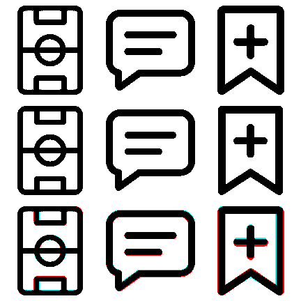

# Small, editable icons



**Built-in image generation → native SVG reconstruction → foreground comparison.** The top row is the generated reference, the middle is the shipped SVG, and the bottom overlays both. Black overlaps; red/cyan differ.

| Icon | Overlap | Native shapes |
|---|---:|---:|
| Pitch | 93.56% | 3 |
| Insight | 89.94% | 2 |
| Track | 83.06% | 2 |

The gate is **80% normalized intersection-over-union of foreground pixels**, not an image score inflated by white background. Each image is thresholded, cropped to its foreground and fitted into the same 128px box preserving aspect ratio. No translation search, distortion or per-pixel path tracing. A separate budget allows at most 8 native shapes, 40 explicit path commands, 160 path/point numeric tokens and 2 KiB per icon; embedded raster images are rejected. The numeric budget also catches implicit repeated path segments.

These three SVGs were reconstructed as intentional geometry from the generated sheet. This is a repeatable verification harness, not an automatic vectorizer for arbitrary images. Edit the SVG shapes and rerun the check. A passing overlap score does not replace inspection at small sizes.

```sh
uv venv .local/icon-venv
uv pip install --python .local/icon-venv/bin/python -r frontend/tools/icon-requirements.txt
.local/icon-venv/bin/python frontend/tools/check_icons.py
.local/icon-venv/bin/python -m unittest discover -s frontend/tools -p 'test_*.py'
```

Cairo is required by CairoSVG (`brew install cairo` on macOS or `libcairo2` on Debian). On Apple Silicon, if the dynamic library is not found, prefix the last two commands with `DYLD_FALLBACK_LIBRARY_PATH=/opt/homebrew/lib`.

## Provenance

Original project artwork generated with the built-in image tool on 18 October 2026, then rebuilt with native SVG. These three feature icons contain no Premier League, Microsoft or club marks. The authentic third-party brand assets requested later are separate in [league/](league/PROVENANCE.md) and are not subject to this reconstruction harness. Reference sheets and test outputs are development evidence and are not shipped to browsers.

**Prompt:** Create a white three-column reference sheet with black monoline icons on a 24-unit grid: a vertical football pitch with halfway line, circle and penalty boxes; a rounded speech bubble with two lines; a bookmark with a plus sign. Use round caps/joins, consistent optical weight, simple geometry and generous spacing. No labels, gradients, shadows, texture or extra decoration.
