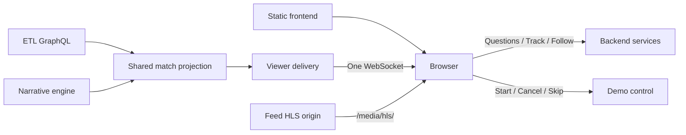

# Architecture

> **In short:** static modules served by nginx; the browser talks only to the backend (`/viewer-api/`) and, for the demo, to demo control (`/demo-api/`). One WebSocket per viewer carries bounded snapshots; questions and follows are HTTP.

| | |
| --- | --- |
| **Contracts** | [local/contracts](../../local/contracts/README.md) §6 (HLS), §7a (demo control), §8, §8b, §8c, §8d (backend product API) |
| **Runtime dependency** | `hls.js` 1.7.3 (exact pin); no bundler or framework |
| **Diagram** | [../architecture.svg](../architecture.svg) |

## 1. Routes the viewer calls

*In short: all in `match/api.ts` and `match/demo.ts`; `M` = `/viewer-api/matches/{matchId}`, `S` = `M/sessions/{token}`.*

| Action | Endpoint |
| --- | --- |
| Picker, profiles, prices | `GET /viewer-api/matches`, `/profiles`, `/prices` |
| Start or take over a session | `POST M/sessions` `{profile_id, viewer_id}` |
| Restore; live state | `GET S`; WebSocket `S/live` (close `4404`: match gone) |
| Audience | `PUT S/audience` `{bucket_id}` |
| Question | `POST S/messages` `{prompt, request_id, seq}` |
| Track, untrack | `POST S/offers/{id}/track`, `DELETE S/pins/{id}` |
| Replay page | `GET S/turns/{id}/replay/{page}` |
| Follows | `GET S/follows`, `GET S/follow/suggestions?seq=`, `POST S/follow/messages`, `POST S/follows`, `DELETE S/follows/{id}` |
| Demo | `GET /demo-api/state`, `/status`; `POST /demo-api/start {point}`, `/cancel`, `/skip {target}` |

## 2. Snapshots

*In short: authoritative, versioned and bounded; reconnect restores, never replays deltas.*

- Each snapshot carries `projection_epoch`, monotonic `version`, match identity and `seq`, profile, `audience` and `audience_buckets`, five cards, recent events, narrative backlog, `feed_mode`/`follow`/`key_moments`, `follow_playlist`/`moment_playlist`, `other_match`/`follow_match` and `match.media` (`{url, seconds}`).
- Clients reject older or equal versions within an epoch and ignore late responses from retired epochs. Heartbeats refresh liveness only.
- A new session for the same viewer and profile ends the previous connection; chat and pins stay. Session tokens live in tab storage.
- Browser state is bounded: 60 events, 300 narratives, 50 rendered chat turns, five cards, 30 held states. Rendering coalesces to animation frames and keeps unchanged nodes.

## 3. Live HLS and replay

*In short: the match's own playlist, data held to the picture, replays on a second stage player.*

- With `match.media.url` (`.m3u8`) the viewer plays it with hls.js (`enableWorker: false`, live sync three segments). Catch-up: 1.1× when more than 1.5 s behind, or one seek after 3 s more than 6 s behind, then a 10 s cooldown; native HLS only where hls.js is unsupported. No url, no footage (no fallback playlist, no MP4).
- Until the first segment plays the viewer shows "Starting the stream…" and retries; it shows unavailable when the match has no stream or a live or finished playlist stays unplayable (`match/video.ts`). Footage follows the live edge; no seeking.
- States with `media.seconds` wait until the playhead reaches that time (at most 15 s; immediately without a playing picture).
- Replay replies render a chat card (clips, captions, paging); Play loads the published playlist into a second stage player while live continues as a muted corner picture. **Back to live**, the picture or Esc returns.
- Every replay carries `playback`: a hold, the `builtin:league` sting, a cut and fades between clips, and slow motion around marked events. Both off under `prefers-reduced-motion`.
- hls.js (light ES build, Apache-2.0) is copied into the fingerprinted app and loaded on demand from the same origin.

## 4. nginx

*In short: same-origin proxy, gated developer routes, cache policy.*

| Path | Upstream |
| --- | --- |
| `/` and `/app/{fingerprint}/` | Viewer (`/app/{fingerprint}/match/`, `/app/{fingerprint}/shared/`); an old fingerprint falls back to `/app/current/` |
| `/viewer-api/` | Backend `/product/` |
| `/demo-api/{start,cancel,skip,state,status}` | Demo control, rate-limited ([deployment](deployment.md#2-public-demo-api)) |
| `/media/hls/{matchId}/{file}.m3u8\|.ts` | Feed HLS origin; any other `/media/` is `404` |
| `/lab/`, `/api/`, `/dev/`, `/dev-api/`, `/feed-api/`, `/purge-api/{owner}` | Only with `ENABLE_DEV_ADMIN=1` (basic auth when a password is set) |

HTML revalidates; fingerprinted modules are immutable; lab, dev and brand assets revalidate. HLS playlists are `no-cache`, segments immutable. CSP allows `blob:` only in `media-src` (hls.js Media Source); every request is same-origin. nginx re-resolves upstreams every five seconds so a replaced container is found again.

## 5. Shared work

*In short: one projection per match, not per viewer.*

One committed change triggers one shared projection read. Standard values come from ETL, narratives come already framed per bucket, default card order from the backend's `presentation` config. Per-viewer work only picks the audience and adds private pins. Limits bound work; they do not establish a viewer-capacity number ([backend scaling boundary](../../user-backend/docs/architecture.md#6-scaling-boundary)).
