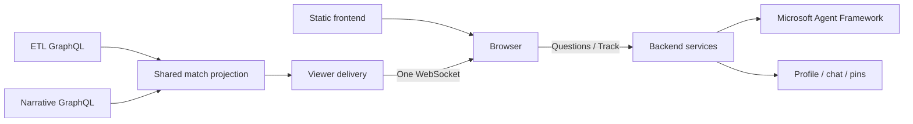

# Live match boundary

> **In short:** the browser talks only to the backend (`/viewer-api`) and, for Start/Cancel demo, to demo control (`/demo-api`). One WebSocket per viewer carries bounded snapshots.

| | |
| --- | --- |
| **Status** | Implemented · unit- and headless-tested against the mock · run on the local stack |
| **Contracts** | [local/contracts.md](../../local/contracts.md) §7a, §8, §8b, §8c |

**Implemented local contract.** The browser only talks to the user backend. The static app uses `/viewer-api` through nginx, which forwards to backend `/product`.

Multi-match routes ([contracts §8](../../local/contracts.md)); `M` = `/matches/{matchId}`. All live in `match/api.ts`.

| Action | Endpoint |
|---|---|
| List matches (picker) | `GET /matches` |
| List demo identities | `GET /profiles` |
| Answer prices (receipts) | `GET /prices` → `{input, output, revision}` US$ per million tokens |
| Start / take over profile | `POST M/sessions` with `profile_id` |
| Restore session and current state | `GET M/sessions/{token}` |
| Receive state | WebSocket `M/sessions/{token}/live` (close `4404`: match gone) |
| Change audience | `PUT M/sessions/{token}/audience` with `{bucket_id}`, one of the snapshot's `audience_buckets` (else 422) |
| Ask question | `POST M/sessions/{token}/messages` with prompt, idempotency `request_id` and the shown snapshot's `seq` (answered at min(latest, seq)) |
| Track offered custom stat | `POST M/sessions/{token}/offers/{offer_id}/track` |
| Remove custom pin | `DELETE M/sessions/{token}/pins/{calculation_id}` |
| Next replay page | `GET M/sessions/{token}/turns/{turn_id}/replay/{page}` |
| Follow chat turns | `GET M/sessions/{token}/follows` → `{follow, follows, turns}` |
| Follow suggestions | `GET M/sessions/{token}/follow/suggestions?seq=` → `{items: [{id, label, spec}]}` |
| Follow chat message | `POST M/sessions/{token}/follow/messages` with prompt, `request_id`, `seq` → `proposal` / `clarify` / `unfollow` / `answer` / `unsupported`; `503 model_unavailable` without a model |
| Follow a story | `POST M/sessions/{token}/follows` with `{spec, seq}` → `{follow, created, snapshot}`; another active follow is `409 follow_limit` |
| Stop following | `DELETE M/sessions/{token}/follows/{subscription_id}` → `{follow: null, snapshot}` |
| Demo state, progress | `GET /demo-api/state`, `GET /demo-api/status` (demo control, not the backend; [contracts §7a](../../local/contracts.md#7a-demo-control-public)) |
| Start / cancel demo | `POST /demo-api/start {point}`, `POST /demo-api/cancel` |

The socket sends bounded snapshots with `projection_epoch`, monotonic `version`, match identity and `seq`, profile, `audience` (`{bucket_id, selections}` or null) and `audience_buckets` (the match's enabled buckets as `{id, label}`), five cards, recent events and narrative backlog. An epoch changes on server restart. Clients reject older/equal revisions within an epoch and ignore late responses from retired epochs. Heartbeats only refresh liveness, not the DOM. Reconnect restores an authoritative snapshot; no unbounded client delta queue is retained.

A new session for the same profile ends the previous connection. Closing a connection does not erase its chat or pins. Session tokens stay in tab-scoped storage. These are demo sessions, not real authentication or a production identity system.

## Shared work and limits

One committed replay change triggers one shared projection read, not a query for every viewer. Standard values come from ETL; narratives come already framed per bucket from the narrative engine; default card order comes from the backend's `presentation` config. Per-viewer composition only selects the audience and combines default cards with private pins. Questions run on demand, separately from live delivery.

The local stack sends match events through Event Hubs (partition key `matchId`) and receives bucket narratives from the narrative engine through Service Bus. Standard stats/history and recap reads use GraphQL. The backend stores Event Hubs positions in Postgres. Production still needs distributed match-owner recovery, authenticated session ownership and managed fan-out. Azure Web PubSub is a possible delivery adapter; it is not currently deployed. [Backend scaling plan](../../user-backend/docs/architecture.md#6-scaling-boundary).

`match.media` carries `{url, seconds}`. With a `url` (`/media/hls/{matchId}/live.m3u8`, null when the match has no video), the browser plays that playlist and holds each state until the live playhead reaches `media.seconds` (at most 15 s; immediately without a playing live picture). Without it there is no footage (no fallback playlist, no MP4). Replay replies (`answer_kind: "replay"`) carry `replay` with clips, captions, paging and the match's published playlist (clip times are its video seconds); their playback stays in the browser and does not affect live delivery. Implemented, unit-tested and browser-verified against live HLS (20 October 2026).

Browser state is bounded (60 received events, 300 narratives, 50 rendered chat turns, five cards, 30 held states). It coalesces rendering to animation frames and retains unchanged nodes. Server queues are bounded and slow peers reconnect. Limits bound work; they do not establish a viewer-capacity number.

**Story follows** ([contracts §8b](../../local/contracts.md#8b-story-follows); implemented, unit-tested and headless-checked against the mock). The Insights tab has a follow chat: suggestion chips follow in one tap; typed requests go to the planner, whose `proposal` shows a card with a Follow button, `clarify` reuses the clarification choices (picking a candidate follows it) and `unfollow` offers Stop following. A proposal is never a follow until the viewer confirms it. One follow per viewer per match. The snapshot's `feed_mode`, `follow` and `key_moments` drive the feed: following shows a "Following {label}" banner with Stop following, only `kind: "subscription"` narratives tagged with the follow's label, and an empty state until the first one; otherwise the bucket's insights. `key_moments` show for everyone as short, centred, grey lines interleaved by clock (overturned goals struck through). Follow changes apply at once to the shown and held states, never ahead of the picture. Without a model the chat says so and locks its composer; suggestions still work.

Clarification replies use `status: "clarification"` and optional `clarification: {question, options, allow_free_text}`. Suggested answers submit ordinary follow-up messages on the same session; the text composer remains available. Only the latest unanswered clarification is interactive, and pending requests or session takeover disable choices. Older replies without this object still render their question text. Composite offers use the existing Track contract and preserve server-provided units; missing values display `—`.

**Clips, cross-game and playback** (PLAN.md §10.2 D3–D7; implemented, unit- and headless-tested against the mock; live check pending on Azure). The snapshot carries `follow_playlist` (a follower's story clips) and `moment_playlist` (the bucket's key-event clips), both in the replay shape and bounded to the viewer's `seq`; each clip's `moments` feed its preview card. Every replay carries `playback` (`transitions`: hold, sting, cut, fades; `slow_motion`: rate, ramp, before/after), both off under `prefers-reduced-motion`. Content from another live match carries `other_match` (snapshot: `follow_match`) and is outlined with that match's header; an answer may carry `follow_offer` (Follow / No thanks), which opens the follow view and sends the question to the follow chat ([contracts §8c](../../local/contracts.md#8c-cross-match-reach-and-follow-offers)).
