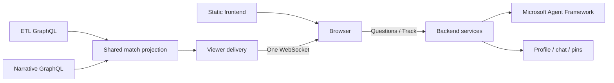

# Live match boundary

**Implemented local contract.** The browser only talks to the user backend. The static app uses `/viewer-api` through nginx, which forwards to backend `/product`.

| Action | Endpoint |
|---|---|
| List demo identities | `GET /profiles` |
| Start / take over profile | `POST /sessions` with `profile_id` |
| Restore session and current state | `GET /{token}` |
| Receive state | WebSocket `/{token}/live` |
| Ask question | `POST /{token}/messages` with prompt and idempotency `request_id` |
| Track offered custom stat | `POST /{token}/offers/{offer_id}/track` |
| Remove custom pin | `DELETE /{token}/pins/{calculation_id}` |
| Select fresh Chelsea–United demo | `POST /demo/reset` (development only) |

The socket sends bounded snapshots with `projection_epoch`, monotonic `version`, match/run identity, profile/bucket, five cards, recent events and narrative backlog. An epoch changes on server restart. Clients reject older/equal revisions within an epoch and ignore late responses from retired epochs. Heartbeats only refresh liveness, not the DOM. Reconnect restores an authoritative snapshot; no unbounded client delta queue is retained.

A new session for the same profile ends the previous connection. Closing a connection does not erase its chat or pins. Session tokens stay in tab-scoped storage. These are demo sessions, not real authentication or a production identity system.

## Shared work and limits

One committed replay change triggers one shared projection read, not a query for every viewer. Standard values come from ETL; messages and approved stat order come from the narrative fixture. Per-viewer composition only selects the audience and combines default cards with private pins. Questions run on demand, separately from live delivery.

The local projection bridge uploads the observed event prefix to fake upstream services; this is deliberately replaceable development plumbing. It is not the production event ingestion path. Production needs incremental broker ingestion, durable match-owner recovery, authenticated session ownership and managed fan-out. Azure Web PubSub is a possible delivery adapter; it is not currently deployed. [Backend scaling plan](../../user-backend/docs/scaling.md).

Browser state is bounded (60 received events, 40 narratives, 50 rendered chat turns, five cards). It coalesces rendering to animation frames and retains unchanged nodes. Server queues are bounded and slow peers reconnect. Limits bound work; they do not establish a viewer-capacity number.
