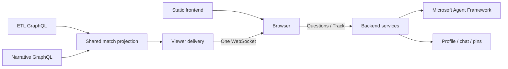

# Live match boundary

**Implemented local contract.** The browser only talks to the user backend. The static app uses `/viewer-api` through nginx, which forwards to backend `/product`.

| Action | Endpoint |
|---|---|
| List demo identities | `GET /profiles` |
| Start / take over profile | `POST /sessions` with `profile_id` |
| Restore session and current state | `GET /{token}` |
| Receive state | WebSocket `/{token}/live` |
| Ask question | `POST /{token}/messages` with prompt and idempotency `request_id` |
| Track offered custom stat | `POST /{token}/offers/{offer_id}/track` |
| Remove custom pin | `DELETE /{token}/pins/{calculation_id}` |
| Next replay page | `GET /{token}/turns/{turn_id}/replay/{page}` |
| Select fresh Chelsea–United demo | `POST /demo/reset` (development only) |

The socket sends bounded snapshots with `projection_epoch`, monotonic `version`, match/run identity, profile/bucket, five cards, recent events and narrative backlog. An epoch changes on server restart. Clients reject older/equal revisions within an epoch and ignore late responses from retired epochs. Heartbeats only refresh liveness, not the DOM. Reconnect restores an authoritative snapshot; no unbounded client delta queue is retained.

A new session for the same profile ends the previous connection. Closing a connection does not erase its chat or pins. Session tokens stay in tab-scoped storage. These are demo sessions, not real authentication or a production identity system.

## Shared work and limits

One committed replay change triggers one shared projection read, not a query for every viewer. Standard values come from ETL; messages and approved stat order come from the narrative fixture. Per-viewer composition only selects the audience and combines default cards with private pins. Questions run on demand, separately from live delivery.

The local demo now sends match events through Event Hubs and receives bucket narratives through Service Bus. ETL and narrative services remain replaceable stubs; ETL can materialize recorded prefixes for recovery. Standard stats/history and recap reads use GraphQL, with HTTP checkpoint writes disabled. Production still needs durable consumer checkpoints, distributed match-owner recovery, authenticated session ownership and managed fan-out. Azure Web PubSub is a possible delivery adapter; it is not currently deployed. [Backend scaling plan](../../user-backend/docs/scaling.md).

`match.media` carries `{aligned, seconds, sampled_at, url, live}`. With `live`, the browser plays the HLS playlist at `url` and holds each state until the live playhead reaches `media.seconds` (at most 15 s; immediately without a playing live picture). Without `live`, the MP4 follows the shared replay clock. Replay replies (`answer_kind: "replay"`) carry `replay` with clips, captions, paging and an optional VOD playlist; their playback stays in the browser and does not affect live delivery. Implemented and unit-tested; browser playback against the HLS producer is not yet verified.

Browser state is bounded (60 received events, 40 narratives, 50 rendered chat turns, five cards, 30 held states). It coalesces rendering to animation frames and retains unchanged nodes. Server queues are bounded and slow peers reconnect. Limits bound work; they do not establish a viewer-capacity number.

Clarification replies use `status: "clarification"` and optional `clarification: {question, options, allow_free_text}`. Suggested answers submit ordinary follow-up messages on the same session; the text composer remains available. Only the latest unanswered clarification is interactive, and pending requests or session takeover disable choices. Older replies without this object still render their question text. Composite offers use the existing Track contract and preserve server-provided units; missing values display `—`.
