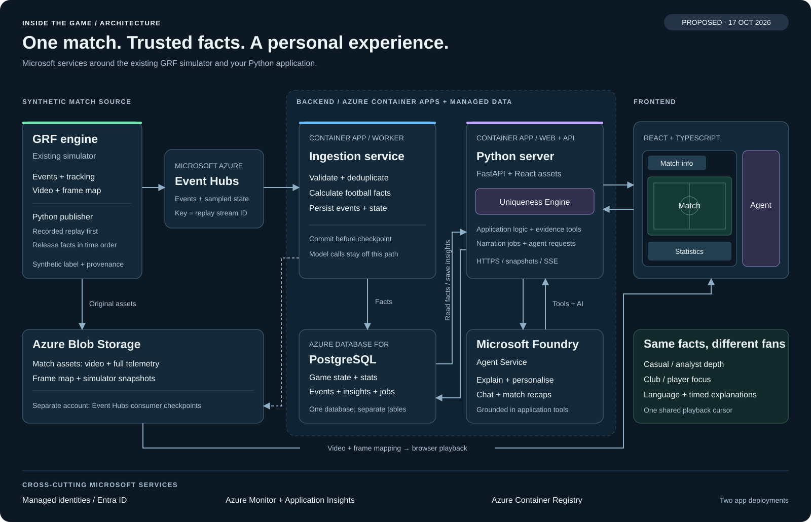
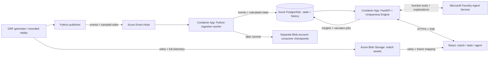

# Microsoft architecture plan

[← Home](../README.md) · [Challenge](../research/brief.md) · [Existing simulator](../data/GoogleResearchFootball/README.md)

**Proposed architecture · 17 October 2026.** Based on the supplied sketch: GRF → Event Hubs → ingestion → storage → Python server → match interface and agent. The Uniqueness Engine is application logic inside the Python server. This document proposes a build; it does not report a deployed system.

[Ingestion and storage detail](ingestion-architecture.svg) · [Editable Mermaid source](ingestion-architecture.mmd)

## Services and responsibilities

| Sketch component | Implementation | Responsibility |
| --- | --- | --- |
| Synthetic match generator | Existing Google Research Football tooling + small Python publisher | Generate or replay synthetic matches. Publish events and sampled state in time order. Start from the existing captured match. |
| Azure Event Hubs | One Standard namespace, one `match-events` hub, initially two partitions | Buffer ingestion and support replay. Partition key = `stream_id`, identifying a particular match replay/session. |
| Ingestion service | Python worker on Azure Container Apps | Validate, deduplicate, calculate match facts and persist state. No model calls in the ingestion path. |
| Game State Storage | `match_state` table in Azure Database for PostgreSQL Flexible Server | Latest authoritative score, clock, player/team statistics and source watermark. |
| Persistent DB | Other tables in the **same PostgreSQL server** | Normalised events, metric history, insights, preferences and durable narration jobs. Full telemetry stays in Blob Storage. |
| Python server + Uniqueness Engine | FastAPI on a second Azure Container App | Application logic, insight selection, API, evidence tools, chat orchestration and frontend updates. Keep the engine as a Python module here. |
| AI agent | Microsoft Foundry Agent Service with application-executed function tools | Explain selected moments, answer match questions, generate recaps and adapt language/depth to the viewer. |
| Frontend | React + TypeScript, built and served by the FastAPI app | Preserve the sketch: match information, main match view, stats below and an agent panel. |
| Match assets | Azure Blob Storage | Video, full 100 Hz telemetry, frame-time mapping, simulator snapshots and provenance. Separate storage account for Event Hubs consumer checkpoints. |
| Operations | Managed identities, Azure Monitor / Application Insights, Azure Container Registry | Service access, traces, metrics, logs and container images. |

Two deployed application processes: **worker** and **web/API**, sharing one Python package. Serving the frontend from the API gives one browser origin and deployment. A separate Static Web Apps deployment can be introduced if independent frontend releases become useful.

Azure supports partition-key ordering and consumer checkpointing in Event Hubs; Python consumer clients can use Blob-backed checkpoints. [Event Hubs concepts](https://learn.microsoft.com/en-us/azure/event-hubs/event-hubs-features), [consumer processing](https://learn.microsoft.com/en-us/azure/event-hubs/event-processor-balance-partition-load).

## Data flow

1. **Prepare a match.** Upload the existing video, telemetry and `frame-times.jsonl` to Blob Storage with a manifest: source/configuration, units, fictional teams/players and asset hashes. Mark the dataset synthetic. Keep a playable browser video rendition.
2. **Publish as live.** A replay adapter reads the recording incrementally and emits only information available at that point. Use a fresh `stream_id` for each replay. Stream football events and compact tracking/state samples; retain every original physics frame in Blob. Preserve native speed/distance readings and accumulate any frame-dependent counters before sampling, so display sampling does not distort the statistics. Start at 10 sampled state messages/sec and measure whether that is sufficient.
3. **Ingest and calculate.** The worker checks the envelope, event order and units. It inserts unseen events and updates state, metric history and a monotonically increasing state version in one database transaction. Persist the Event Hubs checkpoint only after that commit. Repeated deliveries become no-ops.
4. **Run the application logic.** A background loop in the Python server reads new state versions, runs the Uniqueness Engine and persists evidence-backed insight candidates plus narration jobs. This loop and the request handlers use the same modules. Its product-specific rules remain to be defined in the product plan.
5. **Explain.** The same server claims narration jobs and calls Foundry outside the ingestion path. Save the answer with its event IDs, metric values, source watermark, audience settings, model/prompt version and status. Validate names, quantities and evidence references before display.
6. **Render and personalise.** The browser gets a snapshot, then subscribes to updates. The match, statistics, overlays and agent use the same playback cursor. Different audience modes preserve the underlying facts while changing detail, language and focus.

## Contracts that keep the pieces aligned

**Event envelope — proposed, not the current GRF file format.** The adapter adds stable IDs and source timing to existing exporter records.

| Field | Meaning |
| --- | --- |
| `schema_version`, `synthetic` | Contract version; synthetic is explicitly true. |
| `match_id`, `stream_id` | Source match identity; independent replay/session identity. |
| `event_id`, `source_seq`, `revision` | Stable logical identity, publication order and correction version. |
| `physics_ms`, `match_ms`, `video_ms` | Separate physics, displayed match clock and media position. Derive media timing from the recorded frame map. |
| `observed_at`, `published_at` | UTC observation/availability and publication times for latency measurements. |
| `type`, `payload`, `provenance` | Event body, native source reference and whether a label is measured or heuristic. |

Pass outcomes must only become known at the receiving touch or later resolution, even if the exported pass record includes its eventual outcome. The same rule applies to future scores and recaps. The existing exporter distinguishes native measurements from heuristic labels; preserve that distinction. [Exporter definitions](../data/GoogleResearchFootball/README.md).

**Database boundaries.** `matches` and `streams` identify the source and replay. `events` has a unique key on `(stream_id, event_id, revision)`. `match_state` stores current state/version; `metric_history` stores time-indexed measurements for seeking. `insights` stores evidence and validity intervals. `narration_jobs` has a unique logical request key and a retry lease; `narratives` stores audience variants. `viewer_sessions` stores preferences. Index history by stream and time, and keep high-rate raw frames out of SQL.

**API surface.** Every read accepts a stream plus an `as_of` cursor, bounded by that stream's released watermark. The backend applies the bound to tools and database queries; it is not only an instruction to the model.

| Route | Purpose |
| --- | --- |
| `GET /api/matches` | Available synthetic matches and streams. |
| `GET /api/streams/{id}/snapshot?as_of=…` | State, statistics and insight references at the cursor. |
| `GET /api/streams/{id}/updates?after=…` | SSE updates with durable version IDs; resume after reconnect. |
| `GET /api/streams/{id}/assets` | Manifest and short-lived read-only video/telemetry access. |
| `POST /api/viewer-sessions` | Favourite club/player, language and casual/analyst mode. |
| `POST /api/streams/{id}/chat` | Question + viewer session + cursor; returns a request ID. Answer/status arrives through updates. |
| `GET /api/streams/{id}/recap?as_of=…` | Grounded recap up to the permitted cursor. |

Initially the API polls durable versions for connected viewers and reads only the relevant state. Every client-visible state, insight or narrative change advances a per-stream update version transactionally; retain the corresponding update record for reconnects. Use a consistent database snapshot when assembling a response. Coalesce obsolete state updates for slow browsers, but preserve insight/correction records. Reconnect with the last version; if that history has expired, request a fresh snapshot. Rotate SSE connections before the documented 240-second Container Apps HTTP request timeout and prove reconnect under the deployed ingress. [Container Apps ingress](https://learn.microsoft.com/en-us/azure/container-apps/ingress-overview).

## Agent design

Start with **one match agent** and a small set of read-only function tools implemented by the Python server:

| Tool | Returns |
| --- | --- |
| `get_match_state(stream_id, as_of)` | Clock, score, lineups and current facts. |
| `get_event_window(stream_id, start, end)` | Bounded events with evidence IDs. |
| `get_player_stats(stream_id, player_id, as_of)` | Computed player metrics and definitions. |
| `get_insight_evidence(insight_id, as_of)` | Selected moment, supporting facts and uncertainty. |

Use the generally available Foundry Agent Service path and its supported function-calling SDK for the selected region. The application executes tool calls and enforces session/cursor limits. Pin the SDK and deployed model after a real round-trip test; availability, quota and latency are deployment checks. [Foundry Agent Service](https://learn.microsoft.com/en-us/azure/ai-foundry/agents/overview).

Generate a shared factual explanation for an insight, then cache variants by insight revision, language, explanation depth and player/club focus. Cap input size, tool calls, concurrent requests and retries. If generation is late, continue showing match facts; attach the explanation to its original moment in the timeline. Failed generation must not block match state. Offer a deterministic factual recap if the model is unavailable.

Multi-agent orchestration and a remote MCP service are later choices if distinct jobs require them. The tools above remain ordinary reusable Python functions, so adding such orchestration would reuse the same facts and boundaries.

## Timing, reliability and access

**Planning assumptions:** one concurrent replay, up to 50 viewers, 10 sampled state messages/sec plus football events. At an assumed 4 KB/sample, sampled state is roughly 40 KB/sec before protocol overhead. Measure actual payloads before selecting capacity. Target p95 event-to-state visibility under one second and candidate-to-validated narrative under five seconds; these are acceptance targets, not measured results or Azure guarantees.

- **Clock alignment:** use `video.currentTime` → frame mapping → physics time. Match time alone is insufficient because of stoppages and half-time. On seek, request state and stories as of the new cursor; never replace the replay's score with the latest score. Native telemetry supplies speed/distance; sampled positions only drive display and interpolation.
- **Recovery:** Event Hubs is at-least-once input. Insert/deduplicate and update projections atomically. On a late correction, mark dependent insights stale and rebuild the affected projection from canonical events before publishing a new version. Quarantine malformed records with their source offset; advance a checkpoint only when preceding records are durably applied or quarantined. Persist out-of-order/gap records for repair rather than silently applying them out of sequence.
- **Jobs:** claim work with a lease and database locking. Retry transient Foundry failures with bounded backoff; expire superseded jobs. After a crash, a lease can be reclaimed. At scale, preserve a single engine owner per stream or use a database lease to prevent competing selectors.
- **Access:** browser calls only the API and scoped Blob asset URLs. Use managed identity/RBAC for Azure services and Entra-authenticated PostgreSQL connections; credentials stay server-side. Protect publish/replay/reset controls separately from public judging access. Rate-limit anonymous chat with server-side request/token budgets. [Python/PostgreSQL authentication](https://learn.microsoft.com/en-us/azure/postgresql/connectivity/connect-python).
- **Observability:** trace `stream_id`, source event ID, state version and insight ID through ingestion, tools and UI delivery. Record event lag, duplicate count, model latency/errors, unsupported claims, reconnects and token usage. Report a stopped/stale feed visibly.

## Build order and proof

| Step | Deliverable | Evidence needed before moving on |
| --- | --- | --- |
| 1. Vertical slice | Recorded match → publisher → Event Hubs → worker → PostgreSQL → browser score/stats. | Replay totals match existing exported totals; duplicate delivery and worker restart do not change them. |
| 2. Match experience | Main match view, stats, information and playback synchronisation. | Start/middle/end, half-time, pause, seek and reconnect remain aligned; completed passes are never known before resolution. |
| 3. Product logic | Uniqueness Engine inside the Python server. | Define what makes a moment useful; inspect its selected moments and supporting evidence, including quiet periods. |
| 4. AI experience | Foundry tools, explanations, chat, two audience modes and recap. | Questions at a cursor cannot reveal future events; names/numbers survive personalisation; timeout fallback works. |
| 5. Azure demo | Container images, Bicep resource definition and documented deployment. | Real deployed replay, browser-compatible media, long-lived reconnect, 50-viewer load and model quota/latency measured. |
| 6. Submission | Public code, working access and sub-two-minute demo. | Show synthetic event → fact → explanation → personalised screen; verify judging access and asset licences. |

Provision explicitly when deployment is requested. Keep one region where all selected services/model deployments are available; start with one worker and one web/API replica kept warm during demonstrations. Use a bounded PostgreSQL connection pool, bounded model concurrency and short operational log retention. Event Hubs throughput, PostgreSQL, warm app replicas, media egress and model tokens are the main spend to estimate from real usage; this plan makes no price claim. Do not add CI automation as part of this planning work.

Revisit Redis when measured state-query load warrants a cache; a dedicated delivery service when browser fan-out warrants it; a separate narration worker when AI work competes with API traffic; and separate frontend hosting when release needs justify it. A managed database keeps both sketch storage boxes recoverable while avoiding a second state service initially.

**Open product decisions:** the Uniqueness Engine's actual behaviour, the first fan use case, and whether the main match view uses recorded video, a 2D replay or both. The architecture supports these choices without selecting them here. The existing 4K capture demonstrates a data source; its documented 26–8 score is a reminder that football realism still needs evaluation. [Simulator measurements and limits](../data/GoogleResearchFootball/README.md).
