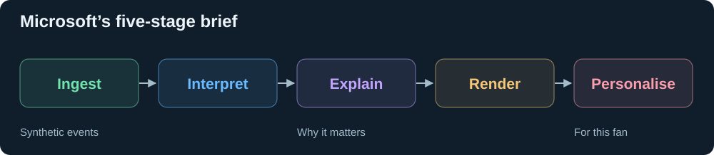
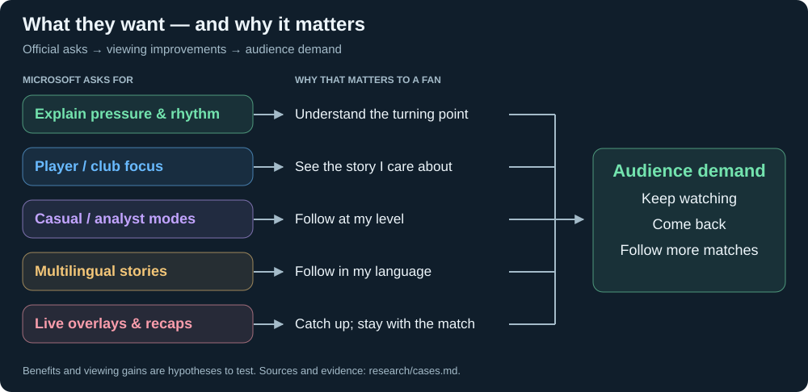
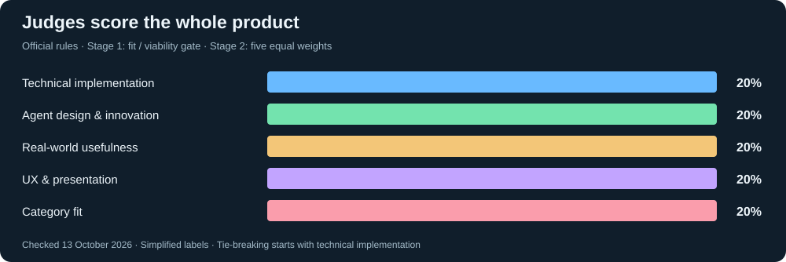
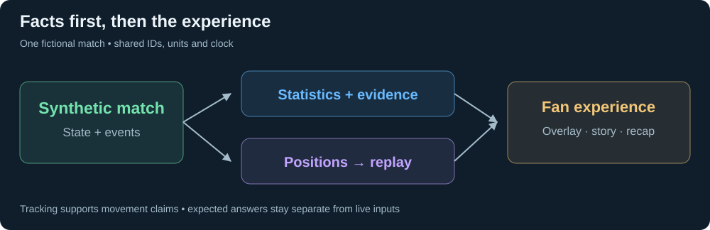

# Premier League research

[← Home](../README.md) · [Competitors](../competitors/README.md)

## What they ask for

[Official requirements and judging](brief.md)

## Why it matters

[Business cases and evidence](cases.md) · [What the League controls](business.md) · [Existing fan experiences](fans.md)

## How it is judged

[Criteria, submission checklist and deadlines](brief.md) · [Microsoft livestream, 15 Oct: hints and winner profile](livestream-2026-10-15/README.md)

## Example ideas

[Examples, independent challenges and the review harness](ideas/README.md)

## Recent technology

[New releases, repos and papers](technology.md) · [Existing technology](landscape.md)

## Data and simulation

[Which data supports which claims](data.md)

[Working simulator](../data/GoogleResearchFootball/README.md) · [Collected datasets](../data/README.md)

Brief-to-benefit mapping checked **14 October 2026**. [Source dates and links](sources.json).
