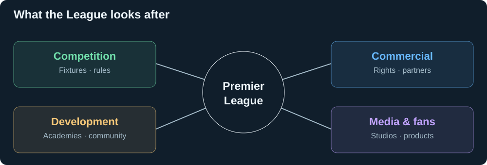

# The League and its business

[← Research](README.md) · [Fan products](fans.md)

| It controls or supports | Scope |
| --- | --- |
| Competition | Fixtures, league rules, club standards, central distributions. |
| Rights and partners | Broadcast licensing; commercial partnerships and licensees. |
| Media | Studios produces international match coverage and programmes. |
| Fan products | App/site, FPL, Companion, and Singapore PL+. |
| Development | Academy standards, community funding and programmes. |

Sources: [governance](https://www.premierleague.com/en/news/4679198/4322439), [rights](https://www.premierleague.com/es/news/3703577/premier-league-broadcast-deals-for-2025-2028), [partners](https://www.premierleague.com/en/about/partners), [Studios](https://www.premierleague.com/es/news/4172032), [Foundation](https://www.premierleague.com/en/footballandcommunity/morethanagame/premier-league-foundation).

## Why these capabilities matter

[The brief → fan benefit → audience demand](cases.md). The useful endpoint is whether fans watch, return and follow more matches.

The League and Microsoft explicitly target personalised content, live insights and global fan access. That establishes the direction; it does not establish that any particular feature increases viewing. [Joint announcement](https://news.microsoft.com/source/2025/07/01/premier-league-and-microsoft-announce-five-year-strategic-partnership-to-personalize-the-fan-experience-with-ai-for-1-8-billion-people/).
