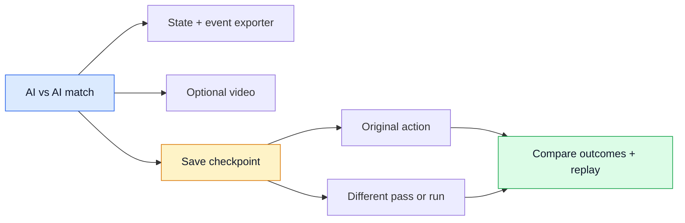

# What data should we have?

[← Research](README.md) · [Challenge](brief.md) · [Competitor samples](../competitors/README.md#their-data)

**Our recommendation: coherent synthetic events + match state, spatial tracking where needed, and a replay from the same data.** Generate commentary from those facts.

| Data | Purpose | Priority |
| --- | --- | --- |
| **Event stream** · JSONL | Passes, shots, tackles, recoveries, pressure, goals, stoppages. | Core |
| **Match state** · JSON | Fictional players/teams, lineups, substitutions, clock, score, pitch units/direction. | Core |
| **Expected answers** | Correct totals, key moments, supporting event IDs, quiet periods. | Core; withheld during evaluation |
| **Tracking** · timestamped positions | Player/ball movement, pressure geometry, speed and distance. | When the experience makes these claims |
| **Context + preferences** | Fictional prior results, glossary, favourite player/club, language, explanation depth. | Small supporting set |
| **Text / audio** | Narratives, captions, recaps and translations. | Derived outputs |
| **Video** | Visual event extraction, or a synchronised match display. | Depends on the experience |

The [official brief](https://github.com/microsoft/insidethegamehackathon/blob/main/OFFICIAL%20RULES.md) requires synthetic football-realistic data. Video auto-eventing is suggested. The mandatory **under-two-minute demo video** is separate from ingesting match footage.

## Video: which kind?

| Option | Useful for | Limitation |
| --- | --- | --- |
| **Deterministic 2D replay** | Showing the match, player focus and timed overlays. | Does not establish real-video understanding. |
| **3D simulation** | Camera views plus known positions/identities. | More setup; simulated behaviour needs checking. |
| **Generative AI video** | Visual concept experiments. | No guaranteed agreement with events, identities or physics. |
| **Real footage** | Separate computer-vision evaluation, with appropriate rights. | Real footage does not meet the synthetic match-data requirement by itself. |

**Start with a 2D replay.** Add video ingestion if visual extraction becomes part of the chosen experience. If we pursue it, keep input frames, model detections and hidden evaluation labels separate.

## Enough data to prove something

Start with **three fictional matches + 8–12 short scenarios**, then expand with new seeds. This is a suggested scope, not a contest rule.

Include a counterattack, sustained pressure without scoring, a substitution, a red card, a late goal, ordinary play, and late/duplicate/corrected events. Hold back unseen seeds and expected answers.

Generate events from consistent match state; calculate statistics from events/positions. LLMs can propose scenarios and write explanations. Keep future events and scenario names out of live model input.

| Claim | Evidence it needs |
| --- | --- |
| Pass length / completion | Start/end coordinates, recipient, outcome, pitch dimensions. |
| Pass difficulty / pressure | Defender geometry or a named, disclosed heuristic. |
| Player speed / distance | Timestamped trajectories; sparse event locations are insufficient. |
| Ball speed | Time-resolved ball movement with units, preferably 3D. |
| “Why this mattered” | Relevant event window and context; distinguish pattern from cause. |

Measure **factual accuracy, missed/false stories, latency, overlay timing and correction handling**. Personalised versions must preserve the same facts; translations must preserve names, numbers and uncertainty.

## What the competitor samples tell us

VYBE’s collected demo has 31 sparse events and no coordinates. MatchMind’s red-card fixture has 997 events with richer spatial fields, but no continuous tracking stream. These are inspected files, not verdicts on the entire products. [Collected files](../competitors/README.md#their-data)

The useful difference would be **consistent match behaviour and provable explanations**, beyond simply having synthetic JSON.

## Google Research Football: generate and branch matches

**Working data experiment.** Two built-in AIs play headlessly; the exporter records native tracking and contacts, and a checkpoint can be replayed or branched. Tested **14 October 2026**. [Run it, inspect the benchmark and browse fields](../data/GoogleResearchFootball/README.md).

| Capability | Available / work needed |
| --- | --- |
| Automatic matches | Built-in AI; no policy training required to begin. The `v2` action set includes `action_builtin_ai`. [Source](https://github.com/google-research/football/blob/master/gfootball/env/football_action_set.py) |
| Synthetic tracking | Player positions/movement, ball position/movement/ownership, score, cards and restart state. [Observations](https://github.com/google-research/football/blob/master/gfootball/doc/observation.md) |
| Football events | Patched native touch callbacks export passes, recipients, shots and contact-based recoveries. Completion and heuristic labels are defined in the [exporter](../data/GoogleResearchFootball/README.md). |
| Branching | `get_state()` / `set_state()` preserve and restore physics, random state and internal player state. Apply different actions, then continue the simulation. [API](https://github.com/google-research/football/blob/master/gfootball/doc/api.md) |
| Video | Optional rendered frames from the same world. Rendering slows simulation; keep bulk generation headless when footage is unnecessary. [API](https://github.com/google-research/football/blob/master/gfootball/doc/api.md) |

**Example:** save before a midfielder's pass → replay the original → restore → attempt another passing direction → let both teams respond. Compare possession retained, pressure escaped and chances created. These would be **simulated alternatives**, not proof of real-world outcomes.

What to save, how to test it, and useful fan experiences

| Save / build | Why |
| --- | --- |
| Checkpoints + action log + pinned engine/configuration | An event JSON row cannot reconstruct hidden state. Replay from the preceding checkpoint to the desired instant; verify restore/replay equivalence. |
| External controller state | Custom agents may have memory or randomness outside the engine snapshot; save that separately. |
| Step → event mapping; original and branch IDs | Link a displayed moment to its checkpoint and distinguish each alternative from the original. |
| Coordinates, step timing and units | Raw coordinates are normalised; movement vectors are displacement per step. Calibrate before reporting metres or km/h. |
| Event definitions + validation fixtures | A requested pass is not necessarily an executed or completed pass. Check exporter labels against engine signals and replay. |
| Varied response policies / plausible interventions | Repeating the identical restored state and actions does not create independent evidence. Report assumptions and distributions before claiming an alternative is better. |

Passing direction influences the engine's recipient selection; an exact recipient or a whole-team instruction such as “press higher” may require additional control logic. The snapshot is opaque, not a freely editable tactical JSON object. [Action semantics](https://github.com/google-research/football/blob/master/gfootball/doc/observation.md)

**Possible experiences:** inspect why a passing lane opened; play an alternative for a few seconds; follow a player through a replay; test a video-only event detector against hidden simulator truth. These are examples, not a product commitment. An engine-generated world still needs football-realism checks and meaningful fan-facing intelligence to satisfy the brief.

Submission route and FIFA / EA FC comparison

GRF's top-level code uses [Apache 2.0](https://github.com/google-research/football/blob/master/LICENSE); its bundled engine uses the [Unlicense](https://github.com/google-research/football/blob/master/third_party/gfootball_engine/LICENSE). Audit shipped assets, fonts and dependencies, preserve notices, and use fictional teams/appropriately licensed visuals. The [repository](https://github.com/google-research/football) was archived **19 August 2026**; headless installation and checkpoint replay are now tested locally. A full 90 minutes of play with native 4K video and synchronized telemetry is now [rendered](../data/GoogleResearchFootball/README.md#4k-with-90-minutes-of-actual-play); deployment remains unverified.

FIFA / EA FC extraction is a different route: [EA's agreement](https://www.ea.com/legal/user-agreement?isLocalized=true&setLocale=en-gb) restricts reverse engineering and source/data extraction except where authorised or permitted by law. Its [content policy](https://help.ea.com/en/articles/security-and-rules/ea-content-policy/) does not generally permit mined assets or third-party product integrations. Permission to publish gameplay is not blanket permission to extract or redistribute an engine.

The [hackathon rules](https://github.com/microsoft/insidethegamehackathon/blob/main/OFFICIAL%20RULES.md) require rights to submitted material and working judging access. An open simulator offers a clearer licensing path, not an automatic eligibility guarantee. Our new contribution would be the exporter, intelligence and audience experience; credit existing components.

## Useful sources

| Source | Data / role | Constraint |
| --- | --- | --- |
| [SkillCorner](https://github.com/SkillCorner/opendata) | 10 real A-League matches: tracking and dynamic events; repo MIT. | Reference for realistic spatial inputs; not synthetic. |
| [Metrica](https://github.com/metrica-sports/sample-data) | Real synchronised tracking + events; documented coordinates. | Attribution requested; broad reuse terms not verified. |
| [StatsBomb / Hudl](https://github.com/hudl/open-data) | Real events, lineups and selected 360 snapshots. | Data-specific [agreement](https://github.com/hudl/open-data/blob/master/LICENSE.pdf); not a permissive code licence. |
| [Google Research Football](https://github.com/google-research/football) | Simulation state + rendered frames; code Apache 2.0. | Archived August 2026; dependencies/assets need checking. |
| [SoccerSynth](https://zenodo.org/records/20839314) | June 2026 synthetic player-detection images and labels. | 90.4 GB; no full match sequences; dataset licence unverified. |
| [SoccerTrack v2](https://atomscott.github.io/SoccerTrack-v2/) | Real panoramic footage + tracking/actions for separate vision evaluation. | Dataset CC BY 4.0; not synthetic or edited broadcast footage. |

Open real data is useful to understand formats; it does not become synthetic by renaming players. Training models is optional: this brief can be investigated with generated inputs and an existing model.

A [6 October 2026 physics benchmark](https://arxiv.org/abs/2610.08791) reports inconsistencies across video generators. It supports checking generated motion; it does not measure football accuracy.

*Checked 13 October 2026.*
