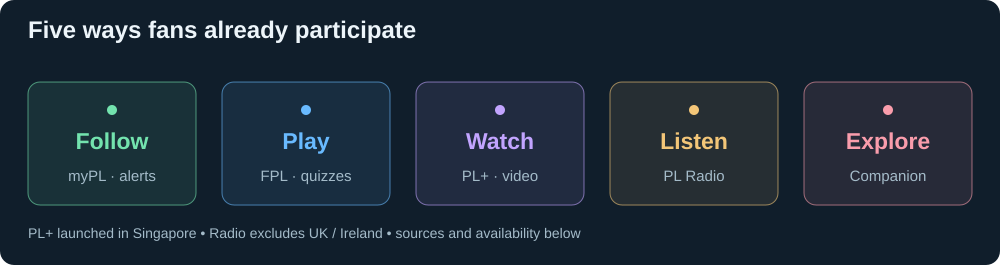

# What fans already get

[← Research](README.md) · [Business context](business.md)

| Product | What a fan does | Availability |
| --- | --- | --- |
| App / website | Follows scores, stats, reporting, stories and alerts. | Official fan platforms. |
| myPremierLeague | Follows chosen clubs, players and matches. | Personalised app/account experience. |
| FPL / Draft / Challenge | Picks players, competes with friends, follows their performances. | Free fantasy games. |
| Companion | Explores league statistics and content through AI. | Official app/site. |
| PL+ | Watches matches, switches camera views, uses overlays and club hubs. | Launched in Singapore, August 2026. |
| Radio | Listens to match or around-the-grounds commentary. | Outside UK / Ireland. |
| Votes / quizzes / predictors | Participates between and during matches. | App / website. |
| Video / events | Watches highlights, analysis and archive content; attends fan events. | Official content and territory-specific events. |

Sources: [app and myPL](https://www.premierleague.com/en/news/4337361/premier-league-launches-new-fan-facing-platforms-as-part-of-digital-transformation), [FPL](https://www.premierleague.com/en/news/4359395/what-is-fantasy-premier-league), [Companion](https://www.premierleague.com/en/about/partners/microsoft), [PL+](https://www.premierleague.com/en/news/4687725/premier-league-launches-video-streaming-service-in-singapore), [fan events](https://www.premierleague.com/en/news/4690118/denver-to-host-13th-premier-league-mornings-live-fan-festival).

FPL gives a fan a reason to care about players and fixtures beyond their own club. That is an engagement mechanism the League already describes. [FPL explanation](https://www.premierleague.com/en/news/4359395/what-is-fantasy-premier-league)

The Microsoft partnership also describes further multilingual, overlay and fantasy-AI features. An announced addition is distinct from a feature verified live. [Partnership](https://www.premierleague.com/en/about/partners/microsoft)

[Adobe partnership](https://www.premierleague.com/en/news/4353014/adobe-and-the-premier-league-kick-off-a-creative-revolution-for-global-fanbase): announced FPL badge/kit creation, fan content and personalised messaging. Adobe also supports fan profiles and marketing analytics.
