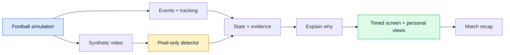
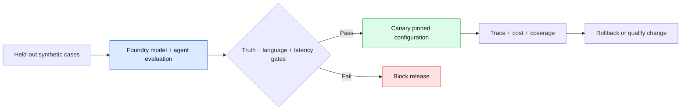

# Stretch ideas · examples only

[← Research](../README.md) · [Official brief](../brief.md) · [Competitor evidence](../../competitors/README.md#evidence-scores)

**Four different fan jobs. Full-production ambitions. No product or stack selected.**

| Example | What the fan gets | League outcome to test |
| --- | --- | --- |
| **Race · Follow the Race** | Follow your club's fate across simultaneous matches. | Watch another fixture after yours finishes. |
| **Together · Same Match** | Enjoy the game with a friend who knows less football. | New fans start watching and return. |
| **Read · Read the Game** | Spot patterns in actual play; see why your reading was right or wrong. | Better understanding, more viewing and return. |
| **Suspense · Keep the Suspense** | A shorter viewing session whose editing cannot reveal unseen results. | Time-constrained fans keep using and renewing the service. |

These outcomes are **hypotheses**, not forecasts. [PL+ Singapore](https://www.premierleague.com/en/news/4687725/premier-league-launches-video-streaming-service-in-singapore) offers a concrete owned distribution context; access and rights are not assumed.

## Independent challenge

**No new example earned 90+.** Best new result: **Together 76**; the earlier accessible-commentary example remains **80**. Greater ambition did not establish stronger demand or originality.

Three independent reviewer contexts, followed by one revision and re-challenge. **Design potential, not delivered performance or win probability.** Criterion medians give Together **76**, Race **72**, Suspense **68**, Read **64**; raw totals and disagreements are below.

Technology · scores, disagreement and reasoning

Scores out of 5; each contributes up to 20 points. **B** business · **M** mechanism/brief · **E** experience/originality.

| Example | Median · range | B / M / E | Reviewer reasoning |
| --- | --- | --- | --- |
| Together | **4** · 4–4 | 4 / 4 / 4 | **B:** A shared truth ledger, separately tested pixel perception, versioned corrections and per-viewer timestamp gates form a coherent technical design. Room policy versus shared cached inference is an appropriate maintainable separation. Arithmetic token bounds clarify a proposed load contract without proving capacity. Synthetic-to-real transfer and quotas remain qualification work rather than reasons to pretend no mechanism exists. **M:** The shared truth, pixel-only worker, deterministic statistics, per-viewer playhead gates and transitive correction trace form a strong testable architecture. It explicitly separates cheap shared evidence from room decisions and accounts for coverage, overload and correction propagation. Exact state/cache invalidation and fairness under capacity pressure remain unresolved, so qualification numbers do not justify 5. **E:** A coherent shared simulation, independent pixel perception, versioned evidence and deterministic publication support both private and group renderings. Playback watermarks and cascading corrections solve actual product failure modes. The strongest remaining technical objection is whether room-specific decisions retain useful coverage within the stated shared inference budget; targets alone do not settle that. |
| Race | **4** · 4–4 | 4 / 4 / 4 | **B:** The exact competition solver, provisional branches, per-match freshness and retraction of dependent claims form a strong coherent state design. A synthetic full season rather than isolated random events serves the actual problem. Deterministic arithmetic and language separation appropriately constrain error. Remaining technical detail includes rule compilation and the concrete optimisation objective for switching; proposed 10,000-sequence testing is not a result. **M:** Strong technical design: a coherent season and match generator, a rules solver independent of language generation, versioned cross-match evidence, provisional branches and per-match watermarks make severe errors diagnosable. The correction trace supplies criterion-specific support. Rule compilation, simulation distributions and inference qualification remain work; the numerical targets themselves earn no extra credit. **E:** The season simulator, pinned rules solver, provisional branches, per-match watermarks and revocation of dependent explanations address consequential correctness risks. Formal outcome conditions remain separate from football interpretation and probabilities. The hardest unresolved technical dependency is generating useful minimal conditions across external competitions and incomplete feeds; the conditional-alternative fallback is sound, but usability at that complexity is not established. |
| Suspense | **4** · 3–4 | 4 / 3 / 4 | **B:** The coherent simulation, hidden perception truth and causal access boundary make this more than generated match text. Counterfactual futures give a criterion-specific correctness control, with correction and fallback paths. This supports strong design potential despite no implementation. Remaining technical gap: the normal/compressed transition and bitrate/segment plan are not precise enough to establish the claimed experience under fast events. **M:** The causal information boundary, hidden simulation truth and paired-future invariance test are technically precise and valuable. However current-time event detection during compressed playback and the edit policy that preserves surprising incidents are not yet operationally specified. Scale targets lack the workload, media pipeline and overload contract needed to resolve those central dependencies. **E:** The viewer-time access boundary includes indirect leaks such as titles and embeddings, and paired futures provide a sharp invariant. Coherent synthetic truth and isolated perception allow genuine tests of an edit scheduler that cannot inspect future outcomes. The specification acknowledges rather than conceals the duration/suspense tradeoff. The remaining challenge is useful compression while preserving understandable sequences and making sudden-event handling reliable. |
| Read | **3** · 3–4 | 3 / 3 / 4 | **B:** Coherent synthetic events, pixel extraction, geometry and a deterministic scoring rubric make the path concrete. The material gap is semantic: crossing a line and retaining possession for three seconds define a contest rule but do not by themselves establish tactical understanding. The verifier's treatment of defensible alternative answers is asserted more than specified. Inheriting another card's operational thresholds does not resolve construct validity. **M:** A coherent simulator, hidden truth, deterministic geometry, multiple accepted answers and abstention provide a testable implementation plan. The unresolved technical dependency is whether meaningful concept/near-miss pairs occur frequently enough in a live match and can be reliably verified before the attention window closes. Inheriting another card's capacity targets does not resolve this workload. **E:** The contrast-pair generator, visibility verifier, deterministic multiple-answer rubric and explicit abstention form a coherent testable pipeline. A later unseen passage tests transfer instead of conflating points with understanding. The largest unresolved issue is football validity: a three-second retention convention can be objectively scored without being a valid measure of perceptual football skill. |

Agent innovation · scores, disagreement and reasoning

Scores out of 5; each contributes up to 20 points. **B** business · **M** mechanism/brief · **E** experience/originality.

| Example | Median · range | B / M / E | Reviewer reasoning |
| --- | --- | --- | --- |
| Together | **4** · 4–4 | 4 / 4 / 4 | **B:** The facilitator makes consequential choices among shared/private/silent explanations based on uncertain knowledge, playback and attention constraints. This differs meaningfully from answering each user's question independently, and the delayed participant example demonstrates why group state matters. The design names relevant simpler controls. A 5 would need evidence the allocation helps a group beyond user-chosen cards and ordinary human explanation. **M:** Selecting shared, private or silent explanations under uncertain knowledge, group attention and playback constraints is a consequential agent decision. The worked trace makes it inspectable, and fixed menus plus a single-agent control can isolate the value of group-aware allocation. This is stronger than simply adding private beginner explanations to synchronized viewing. **E:** The consequential choice between shared explanation, private explanation and silence under uncertain group knowledge is distinct from synchronized watching or visual QA alone. Named fixed-menu, annotated-replay and single-agent controls make the contribution falsifiable. The remaining objection is whether this policy adds value beyond users simply requesting the desired detail; general AI explanations are already represented by Sportify. |
| Race | **3** · 3–3 | 3 / 3 / 3 | **B:** Combining formally checked consequences with a constrained cross-match director is substantive. But the card itself establishes strong existing coverage from multiview, Goal Rush, tables and commentary. The main agent contribution, selecting when understanding justifies a cut, lacks a worked decision where a fixed relevance rule or skilled producer demonstrably chooses worse. A named ablation is good research design, not evidence the combination improves the baseline. **M:** The formal consequence graph combined with programme direction is consequential and falsifiable against Goal Rush, live tables and fixed switching rules. But the director has no explicit objective or executable choice trace showing when it rejects a relevant switch. The AI-specific improvement over a deterministic dependency-aware director remains a central design question. **E:** The revision separates a verified consequence explanation from optional programme direction and compares each against an equivalent information baseline. This makes attribution much cleaner. Score remains 3 because it adds an evaluation decomposition and user controls, not a new selection mechanism or evidence that the director improves on expert coverage and manual multiview. Formal correctness still cannot stand in for agentic novelty. |
| Suspense | **3** · 3–4 | 3 / 3 / 4 | **B:** Restricting future information is a meaningful distinction from outcome-selected recaps. However, the strongest invention is currently a deterministic information boundary. The card does not specify which difficult scheduling decisions require an agent or how it improves on a causal rule editor using the same state. It establishes a coherent research mechanism, not yet strongly supported agentic superiority. **M:** Information-safe editing is a differentiated, falsifiable mechanism. The card does not establish that its core decisions are made or improved by AI: future-data exclusion is deterministic, and Foundry is explicitly assigned short explanations. A fixed causal pacing policy could implement the stated advance. The consequential agent action and its advantage remain partly specified. **E:** A director constrained not to exploit future outcomes is meaningfully different from highlight retrieval, rapid catch-up or merely spoiler-free recap text. The mechanism changes which football reaches the viewer, making the AI decision consequential. It still needs to beat a fixed non-anticipating compression policy; superior suspense cannot be inferred from passing the information-isolation test alone. |
| Read | **3** · 3–4 | 3 / 4 / 3 | **B:** Selecting contrastive live examples and withholding misleading ambiguous tasks is a coherent adaptive-tutor mechanism with meaningful fixed-drill controls. Such selection is a familiar tutoring pattern; the specific advance over fixed expert drills plus rule-selected live examples remains underdeveloped. Multiple named roles do not independently raise novelty. **M:** The agent selects naturally occurring contrast pairs to test transfer, rather than manufacturing teaching incidents or merely generating quiz text. Visibility, temporal leakage, competing answers and abstention make the decision consequential. The expert-drill, fixed-challenge and adaptive-selection ablations target the claimed mechanism. Exceptional novelty still needs evidence that adaptive contrast selection improves transfer. **E:** Selecting live positive/near-miss examples and adapting scaffolding gives AI a consequential instructional role beyond explanation. However adaptive tutoring and event-based sports games are existing approaches; the card has not established that live selection produces better learning opportunities than fixed expert-authored examples. The ablation is appropriately proposed, not evidence that the advance exists. |

Impact · scores, disagreement and reasoning

Scores out of 5; each contributes up to 20 points. **B** business · **M** mechanism/brief · **E** experience/originality.

| Example | Median · range | B / M / E | Reviewer reasoning |
| --- | --- | --- | --- |
| Together | **3** · 3–3 | 3 / 3 / 3 | **B:** Measured co-viewing and adjacent observed comprehension friction support a credible fan problem. Invitations plus an owned distribution surface make adoption plausible; return and total viewing trace a direct League route. Nielsen measures people around one viewing setting, not remote AI rooms, while the Sportify study does not show improved action-order accuracy. The product-specific demand and additional-fan effect remain hypotheses. **M:** Observed co-viewing and adjacent confusion evidence support the broad problem and an invitation distribution path. The gap is whether mixed-knowledge friction suppresses durable PL fandom and whether AI improves on friends' ordinary explanations. The room-randomized return, comprehension and total-viewing experiment is credible, but its targets are not evidence of benefit. **E:** Co-viewing is observed and adjacent research identifies comprehension friction. Inviting friends creates a plausible acquisition path with a direct League viewing/return outcome. Neither source establishes that lack of understanding causes PL newcomer attrition or that an intervention outperforms help from the friend already present, keeping this at a coherent but unvalidated applicability case. |
| Race | **3** · 3–3 | 3 / 3 / 3 | **B:** Final-day viewing and official permutation coverage support a real episodic context, with clear potential fan comprehension and a direct route to additional licensed viewing. They do not establish confusion-driven abandonment or demand for automatic direction. Benefit is plausibly concentrated in the run-in; projecting it across a season or equating switching with incremental value would overstate the case. Owned distribution is a concrete adoption route. **M:** Final-day viewing and official permutations support an important, bounded use case. The League benefit is correctly tied to additional neutral-fixture viewing and return rather than switching counts. Existing products already serve these fans, while confusion-driven abandonment and demand outside the run-in are unestablished. That supports applicability, not a strong adoption claim. **E:** A run-in/final-day audience and official permutations support a real occasion when other matches matter. The path from following those matches to extra legal minutes is direct. Existing viewers may already navigate these stakes easily, and simultaneous conclusions limit the proposed post-own-match opportunity; seasonal concentration and incremental retention remain central uncertainties. A test plan does not establish the unmet demand. |
| Suspense | **3** · 3–3 | 3 / 3 / 3 | **B:** Observed highlights consumption and an owned subscription surface make the problem plausible and commercially testable. Retention is a direct League hypothesis and correctly accounts for substitution. But consumption counts do not establish dislike of editorial foreknowledge, and an estimated-length session may miss the actual time-constrained job. Neither proposed preference nor renewal trials count as achieved benefit. **M:** MOTD requests and commercial condensed games demonstrate shorter-form consumption. The target job is plausible and retained direct subscriptions would benefit the League. Preference for non-anticipating compression, tolerance for duration overrun and resulting renewals remain unmeasured; aggregate replay demand cannot substitute for this exact-job evidence. **E:** Established condensed-game products support the time-budget job, and direct subscription retention is a plausible League benefit. They do not show that viewers care about edit-induced outcome leakage enough to choose this compromise. Exact-product preference, completion and renewal remain hypotheses, especially because the proposed service cannot guarantee the selected finishing time. |
| Read | **3** · 2–3 | 2 / 3 / 3 | **B:** FPL establishes mass participation in a different job, not willingness to do live perceptual exercises. Educational benefit is possible, including outside a commercial League outcome, but the card has not identified an audience with a significant unmet learning need or shown that its scoring construct maps to useful knowledge. The conversion from observation game to additional match consumption has several central unsupported links. This is an impact-mechanism gap, not a penalty for being unbuilt. **M:** FPL participation and existing League games support willingness to engage with football-linked play. Neither establishes desire for live perceptual training. The card correctly tests additional legal viewing and return, and would reject learning that displaces football viewing. A plausible League/fan benefit is specified, but adoption remains hypothetical. **E:** Football games demonstrate participation and comprehension research supports a possible learning problem. A clear recognition-to-enjoyment-to-return hypothesis and direct League metrics are present. Yet FPL participation is distant from willingness to complete live perceptual exercises, and neither transfer nor extra football watching is established; the problem's applicability remains plausible rather than strongly supported. |

Experience · scores, disagreement and reasoning

The mechanism reviewer retained an earlier delayed-room objection in Together’s rationale; the revised private-delivery/expiry policy resolves that case. Its score remains 4.

Scores out of 5; each contributes up to 20 points. **B** business · **M** mechanism/brief · **E** experience/originality.

| Example | Median · range | B / M / E | Reviewer reasoning |
| --- | --- | --- | --- |
| Together | **4** · 4–4 | 4 / 4 / 4 | **B:** The backwards-pass scene clearly joins social conversation to shared evidence while keeping advanced detail private. Silence, expiry, corrected identities and no public beginner label are strong concrete interaction decisions. Clear delay handling supports a 4 on design even without a running demo. Remaining objection: a slow participant can make a shared explanation stale, and the interface may compete with the friend already providing it. **M:** A shared reference with private depth, no public beginner label, voluntary sharing and automatic expiry serves both social comfort and live attention. The asynchronous viewer example connects interaction decisions to system state. A continually lagging participant, conflicting learning needs and expired shared windows still require a demonstrable resolution. **E:** Explicit consent, safe stoppages, no automatic pause and private timestamp delivery for delayed participants strengthen the existing privacy-conscious scene. The revision resolves the room-freezing ambiguity. Experience stays 4 because watching, talking and receiving private explanations still compete for attention, and whether the helper improves the social interaction rather than duplicating the friend remains unsettled. |
| Race | **4** · 4–4 | 4 / 4 / 4 | **B:** One main feed, two consequential scorelines, a plain condition, a lock and stoppage-only switching create a legible user-controlled viewing scene. The fictional reversal example makes correction visible. A season narrative can be intuitive without requiring viewers to operate multiview. Remaining objections include late switches missing a decisive action, divergent feed delays and commentary continuity across cuts. **M:** A visible condition, one main match, optional stoppage switches and a lock affordance give the fan a clear journey. The provisional-goal reversal and continuation after the home match finishes are convincing design scenes linking frontend decisions to corrected backend evidence. Feed delays and conflicting simultaneous decisive moments still need interaction testing. **E:** The one-match/two-scoreline/one-condition scene already earned 4. Explicit opt-in to automatic direction, lock preservation and manual override further protect agency. They do not resolve complex multi-result conditions or show that repeated recommended switches preserve comprehension, so no increase to 5 is justified. |
| Suspense | **3** · 3–3 | 3 / 3 / 3 | **B:** The intended scene makes surprise and re-entry understandable, and delayed playback is honestly labelled. The unresolved tension is user-visible: a 25-minute selection may end before the match does. A sudden goal reached during compression can surprise the viewer while stripping the very buildup that supplies suspense. These are central journey issues, not missing visual polish. **M:** The revision gives the duration tradeoff an honest interaction contract: estimated completion, a firm pause point, a seen-only recap, resume and explicit consent for a conventional final summary. This improves clarity. It still leaves the central time-constrained job unresolved if users want the whole match within their window, and no user evidence shows the compromise acceptable; experience remains 3. **E:** The revised promise is honest estimated duration with a firm pause, seen-only recap, one-tap resume and explicit consent before a spoiler-bearing conventional summary. This removes misleading expectation of guaranteed full-match completion. Experience remains 3 because stopping unfinished can still fail the time-constrained fan job, and a surprise encountered during compression can lose its buildup; those are substantive tradeoffs even when labelled clearly. |
| Read | **3** · 3–4 | 3 / 4 / 3 | **B:** Bookmark, annotate at stoppage, inspect feedback and later transfer form an intelligible journey. Voiding ambiguity is preferable to confidently marking valid football wrong. However live bookmarking competes for attention, scoring a good pass as wrong under an arbitrary retention rule risks frustration, and low eligible-event coverage could make the game feel inert. A coherent design earns 3; enjoyment is not established by a score loop. **M:** The revision makes match intelligence continuous, with distinct novice and analyst representations, a proper turning-point match recap and a separate optional learning strip. No safe challenge now yields a complete viewing experience, while prompts expire as play restarts. That resolves the prior fragmented journey sufficiently for strong design potential. Whether exercises remain enjoyable and teach transfer is still unmeasured. **E:** The revision provides a complete passive match narrative even when no safe challenge exists, explicit novice/analyst renderings and a proper match recap separate from learning feedback. No prompts during moving play and expiry on restart reduce imposed distraction. Experience stays 3: completing a mark/replay/feedback sequence within an unpredictable stoppage and finding the exercise intrinsically enjoyable remain material gaps. A sound fallback and attention rules do not yet specify a satisfying primary game loop. |

Category fit · scores, disagreement and reasoning

Scores out of 5; each contributes up to 20 points. **B** business · **M** mechanism/brief · **E** experience/originality.

| Example | Median · range | B / M / E | Reviewer reasoning |
| --- | --- | --- | --- |
| Together | **4** · 4–4 | 4 / 4 / 4 | **B:** Declared Foundry. The revision now specifies a relevant development and management loop: held-out synthetic cases, custom truth checks, comparison across model/prompt/tool configurations, trace-linked diagnosis, a pinned release configuration and an independent CI regression gate. Official documentation supports the relevant evaluation and Application Insights capabilities. This is a concrete platform-specific mechanism addressing the category, enough for strong design potential. A 5 is not justified: no developer-effort, quality or operating-cost advantage has been observed, and preview portal capabilities need an explicit independent monitoring path. **M:** The revision supplies a concrete Foundry development and management loop: versioned held-out cases, configuration comparisons, deterministic truth evaluators, human semantic review, trace-linked monitoring, qualified releases and rollback. This directly addresses the selected category beyond model hosting and is supported by official capability documentation. The direct-SDK developer-task comparison makes the proposed advantage falsifiable. This is strong design fit, not evidence of achieved productivity or exceptional platform use. **E:** The revision gives Foundry a specific development and management role: versioned synthetic case datasets, configuration comparisons, custom evidence checks, language-stratified evaluation, linked Application Insights traces and pinned deployment rollback. The published platform capabilities support this proposed workflow, and the direct-SDK control distinguishes platform value from model quality. This addresses the original category-specific mechanism gap, supporting 4. Five would require resolving whether the managed workflow actually saves effort and supports the operational target; proposed productivity tests are not results. Preview features are optional to release safety, which remains in reproducible CI. |
| Race | **4** · 4–4 | 4 / 4 / 4 | **B:** Declared Foundry. The revision now specifies a relevant development and management loop: held-out synthetic cases, custom truth checks, comparison across model/prompt/tool configurations, trace-linked diagnosis, a pinned release configuration and an independent CI regression gate. Official documentation supports the relevant evaluation and Application Insights capabilities. This is a concrete platform-specific mechanism addressing the category, enough for strong design potential. A 5 is not justified: no developer-effort, quality or operating-cost advantage has been observed, and preview portal capabilities need an explicit independent monitoring path. **M:** The revision supplies a concrete Foundry development and management loop: versioned held-out cases, configuration comparisons, deterministic truth evaluators, human semantic review, trace-linked monitoring, qualified releases and rollback. This directly addresses the selected category beyond model hosting and is supported by official capability documentation. The direct-SDK developer-task comparison makes the proposed advantage falsifiable. This is strong design fit, not evidence of achieved productivity or exceptional platform use. **E:** The revision gives Foundry a specific development and management role: versioned synthetic case datasets, configuration comparisons, custom evidence checks, language-stratified evaluation, linked Application Insights traces and pinned deployment rollback. The published platform capabilities support this proposed workflow, and the direct-SDK control distinguishes platform value from model quality. This addresses the original category-specific mechanism gap, supporting 4. Five would require resolving whether the managed workflow actually saves effort and supports the operational target; proposed productivity tests are not results. Preview features are optional to release safety, which remains in reproducible CI. |
| Suspense | **4** · 4–4 | 4 / 4 / 4 | **B:** Declared Foundry. The revision now specifies a relevant development and management loop: held-out synthetic cases, custom truth checks, comparison across model/prompt/tool configurations, trace-linked diagnosis, a pinned release configuration and an independent CI regression gate. Official documentation supports the relevant evaluation and Application Insights capabilities. This is a concrete platform-specific mechanism addressing the category, enough for strong design potential. A 5 is not justified: no developer-effort, quality or operating-cost advantage has been observed, and preview portal capabilities need an explicit independent monitoring path. **M:** The revision supplies a concrete Foundry development and management loop: versioned held-out cases, configuration comparisons, deterministic truth evaluators, human semantic review, trace-linked monitoring, qualified releases and rollback. This directly addresses the selected category beyond model hosting and is supported by official capability documentation. The direct-SDK developer-task comparison makes the proposed advantage falsifiable. This is strong design fit, not evidence of achieved productivity or exceptional platform use. **E:** The revision gives Foundry a specific development and management role: versioned synthetic case datasets, configuration comparisons, custom evidence checks, language-stratified evaluation, linked Application Insights traces and pinned deployment rollback. The published platform capabilities support this proposed workflow, and the direct-SDK control distinguishes platform value from model quality. This addresses the original category-specific mechanism gap, supporting 4. Five would require resolving whether the managed workflow actually saves effort and supports the operational target; proposed productivity tests are not results. Preview features are optional to release safety, which remains in reproducible CI. |
| Read | **4** · 4–4 | 4 / 4 / 4 | **B:** Declared Foundry. The revision now specifies a relevant development and management loop: held-out synthetic cases, custom truth checks, comparison across model/prompt/tool configurations, trace-linked diagnosis, a pinned release configuration and an independent CI regression gate. Official documentation supports the relevant evaluation and Application Insights capabilities. This is a concrete platform-specific mechanism addressing the category, enough for strong design potential. A 5 is not justified: no developer-effort, quality or operating-cost advantage has been observed, and preview portal capabilities need an explicit independent monitoring path. **M:** The revision supplies a concrete Foundry development and management loop: versioned held-out cases, configuration comparisons, deterministic truth evaluators, human semantic review, trace-linked monitoring, qualified releases and rollback. This directly addresses the selected category beyond model hosting and is supported by official capability documentation. The direct-SDK developer-task comparison makes the proposed advantage falsifiable. This is strong design fit, not evidence of achieved productivity or exceptional platform use. **E:** The revision gives Foundry a specific development and management role: versioned synthetic case datasets, configuration comparisons, custom evidence checks, language-stratified evaluation, linked Application Insights traces and pinned deployment rollback. The published platform capabilities support this proposed workflow, and the direct-SDK control distinguishes platform value from model quality. This addresses the original category-specific mechanism gap, supporting 4. Five would require resolving whether the managed workflow actually saves effort and supports the operational target; proposed productivity tests are not results. Preview features are optional to release safety, which remains in reproducible CI. |

## Demand: what is actually known?

| Example | Observed behaviour / problem | Missing proof |
| --- | --- | --- |
| Race | Sky reports **3m+ average in-home viewers** across 2025/26 final-day coverage. [Sky](https://www.skygroup.sky/en-gb/article/how-to-watch-the-2026-27-premier-league-season-on-sky-sports) | That confusion causes early exits, or a personal director improves on existing coverage. Strongest use case is the run-in, not every week. |
| Together | Sports co-viewing represents **37–almost 50%** of US sports viewing time across months, September 2022–August 2024. [Nielsen, February 2025](https://www.nielsen.com/insights/2025/sports-coviewing-tv-audiences/) | That mixed-knowledge support recruits durable new football fans. |
| Read | **13m+ played FPL in 2025/26.** [PL, 9 August 2026](https://www.premierleague.com/en/news/4359395/what-is-fantasy-premier-league) | Demand for observation games rather than fantasy management; learning may feel like homework. |
| Suspense | **78m MOTD/MOTD2 iPlayer requests** in 2024/25: shorter-form consumption, not unique people. [PL annual report, p47](https://resources.premierleague.pulselive.com/premierleague/document/2025/10/15/9cbce122-bc7b-4de2-90b1-2db7b665b402/Premier-League-24-25-Annual-Report.pdf) | Preference for uncertainty-preserving pacing over professionally edited highlights. |

[Sportify](https://arxiv.org/html/2408.05123v1) found explanation friction in 13 male basketball fans, but its visualisations **did not improve measured action-order accuracy**. Useful warning for Together/Read; no football efficacy claim.

## See each example

Race · follow the season consequence, not just the score

**“Our match finished. Where is our season being decided now?”**

One main match, two relevant scorelines and a changing condition: “We need a win unless Vale drop points.” A verified rules solver establishes the condition; a Foundry director links it to current football and offers a switch at a stoppage. Fans can lock their match. Automatic direction is opt-in.

**Fictional scene:** Harbor have 38 points, Vale 37. Harbor lose; Vale draw. Vale's provisional goal moves them above Harbor. A diagram explains the consequence and the wide overload preceding the goal. VAR overturns it: the branch and dependent commentary retract. Harbor finish first; Vale's final attack still matters. Full season/tie-break state must support the example.

**Research stretch:** minimal checkable outcome conditions + a continuous story across grounds. Keep arithmetic, provisional events and modelled probability distinct; per-match watermarks expose stale inputs. Never manufacture stakes after a race is settled.

**Existing bar:** [Sky Sports Hub / Your Multiview, August 2026](https://www.skygroup.sky/en-gb/article/sky-gives-sports-fans-the-chance-to-watch-multiple-live-sports-events-simultaneously-on-the-big-screen-for-the-first-time), [Goal Rush](https://www.peacocktv.com/sports/goal-rush-matchweek-1/378fe351-d491-3c80-b126-0d1ec58d3feb) and [Opta permutations](https://theanalyst.com/articles/premier-league-permutations-final-day-2025-26) already connect matches. Compare the combined experience, then separately remove personalised conditions and directing. A prettier table is insufficient.

**Business test:** total legal PL minutes, neutral-fixture minutes after the fan's match finishes, next-matchweek return. More switching alone fails. **90-second scene:** choose club → cross-ground goal → explain play + consequence → switch → VAR correction → personalised race recap.

Together · let a friend join the conversation

**“I want my friend to enjoy watching with me.”**

Point at a backwards pass. Both see the same pitch mark; one privately gets “the forward lanes closed”, the other sees pressure and passing risk. Either may share a short explanation. No public beginner labels, automatic live pauses or assumption that opening a card means understanding.

**Research stretch:** a facilitator chooses shared, private or silent output from uncertain knowledge, explicit questions and available attention. A delayed friend gets a private response at their playback time; shared content waits for consent and a safe stoppage, or expires. Corrected identity invalidates the whole explanation/recap chain.

**Existing bar:** ordinary friends explaining football + PL Companion, [SharePlay](https://www.apple.com/newsroom/2021/11/shareplay-powers-new-ways-to-stay-connected-and-share-experiences-in-facetime/) and Sportify. Compare fixed novice/analyst menus and one facilitator at equal evidence/compute. The contribution must be useful allocation of shared knowledge, not an AI watch party.

**Business test:** room-randomised invitations across four fixtures; target **+5 percentage points newcomer return** and **+5% total legal PL minutes**, with no material enjoyment or missed-action loss for either group. Targets are not predicted results. **90-second scene:** invite → shared backwards pass → two explanations → delayed participant → correction → match recap with saved moments.

Read · play a game of understanding the match

**“I want to recognise good football while it happens.”**

Optionally bookmark a passage. At the stoppage, mark the pass that escaped pressure. Replay shows your evidence, including valid alternatives. A later passage tests recognition without a hint. No wagers, outcome predictions, speed-tapping prizes or prompts during moving play.

**Research stretch:** select a clear example and near miss from what actually happened; verify camera visibility, ambiguity and temporal leakage. A forward pass lost immediately may fail the stated “retain for three seconds” rule; a sideways exit may succeed. Explain that scoring rule without pretending it defines tactical quality. Void borderline judgments and report the void rate.

A continuous match story remains visible even with **zero challenges**. Beginners get one useful relation; analysts get geometry, windows and uncertainty. The final recap covers turning points, player context and why they mattered; learning history is a separate optional strip.

**Existing bar:** [PL Predictor](https://www.premierleague.com/en/games/pl-run-in-table-predictor-2025-26/rules-faqs), expert drills and [Premier League Player's recreated match moments](https://www.premierleague.com/en/pl-player). Compare fixed challenges and one agent; remove adaptive contrast selection separately.

**Business test:** target **+10 points unaided recognition on unseen passages**, **+5% legal viewing minutes**, **+5 points four-fixture return** versus viewing plus existing quizzes. If score improves but comprehension or viewing does not, fail. **90-second scene:** pressure escape → mark → inspect near miss → later unprompted transfer → live turning-point story → match recap.

Suspense · the edit must not know the future

**“I have 25 minutes before bed. Let me experience our match without knowing which attack becomes a goal.”**

Start from kickoff or resume delayed viewing. Compression, explanations and thumbnails can only read facts up to the viewer's current timestamp. Two matches with identical pasts must produce identical output until their futures diverge. A goal cannot secretly make its preceding clip longer.

**Hard tradeoff:** strict duration, every buildup and no future-aware selection cannot all be guaranteed. Offer an estimate and a firm pause/resume point. At the deadline, show a seen-only recap; a conventional full-match summary requires explicit spoiler consent. This compromise may defeat the convenience promise.

A synthetic live stream supplies state as it arrives; delayed viewers receive watermark-bounded pitch sequences and live explanations at their playback time. A surprise event during compression appears immediately, with optional replay. Do not silently skip goals, cards or substitutions. Personalisation changes depth, language and focus—not history. Full-time recap waits until the viewer reaches full time.

**Existing bar:** [DAZN Game in 40](https://www.dazn.com/en-GB/help/articles/16310468908957-dazn-and-nfl-game-pass-the-ultimate-football-experience), score hiding and [Amazon Rapid Recap](https://www.aboutamazon.co.uk/news/entertainment/live-football-amazon-prime-video). Future-isolated editing, not adjustable highlight length, is the research claim.

**Business test:** equal-duration comparison with professional condensed matches: suspense preference, comprehension and completion, then invitation-level paid renewals net of replay/live substitution and serving costs. **90-second scene:** time choice → two attacks fail → reveal identical-past/different-future test → surprise goal → language/depth → pause and seen-only recap.

## One truth, several experiences

Events, trajectories, fictional season history and video share coherent ground truth. The detector gets only pixels, timestamps and calibration. **Text explains state; it does not invent it.** Everything here remains a specification.

The full brief · including its concrete suggestions

All four specify live ingest → interpretation → explanation → on-screen output → meaningful personalisation, plus live narratives and automated **match** recaps. Suspense additionally operates at a delayed viewer's clock.

| Invitation | Race | Together | Read | Suspense |
| --- | --- | --- | --- | --- |
| Player identification | Relevant player + fixture | Point at the same player | Identify marked action | Tag seen-time action |
| Thresholded player speed / distance | Decisive recovery | Explain closing space | Validate recognition | Optional movement context |
| Pass distance / accuracy / difficulty | Explain race-changing play | Why pass backwards? | Distinguish good exits | Explain reached passages |
| Ball / shot speed | Decisive chance | Optional detail | Visible action evidence | Shot context without spoilers |
| Video auto-eventing | Ten rendered fixtures | Shared visual evidence | Check visible challenge | Extract events in time order |
| Pressure / control / chaos / rhythm | Why another ground matters | One shared reference | Learn a changing pattern | Preserve non-goal football |
| Player / club / metric modes | Club consequence + focus | Private preferences | Club and pattern focus | Choose detail and focus |
| Casual ≠ analyst; languages | Condition vs full proof | Diagram vs risk evidence | Relation vs geometry | Orientation vs metrics |
| Timed machine-readable overlays | Conditions + expiry | Shared/private timestamps | Safe challenge window | Seen-time watermark |
| Milestones / recaps | Season turning points | Match + saved moments | Match first; learning optional | Seen-only then full-time |

Suggestions have a purpose, not bonus points. Camera/identity uncertainty suppresses unsupported claims. Measures need units, windows, denominators and calibration; speed requires time-resolved ball/player motion.

Full production targets · data, research, Microsoft and operation

These are qualification gates, not achieved results or Microsoft's numerical requirements.

| Area | Contract |
| --- | --- |
| Synthetic truth | Legal transitions, possession, trajectories, pitch bounds, identity continuity and render agreement; fictional season history and pinned competition rules. Independent held-out tactics/cameras/seeds and blinded realism review. |
| Perception | 22 players at 25 Hz; higher-rate ball truth. Pixel-only worker isolated from metadata. Per-camera/visibility pass/shot macro-F1 ≥0.90, identity F1 ≥0.95, p95 ball-speed error ≤2 m/s, useful coverage ≥80%. Synthetic results do not prove real-footage transfer. |
| Explanation | ≥99% supported claims at ≥80% eligible coverage. Pre-release pass model calibration error ≤0.05; report uncertainty and proper scoring vs frequency baseline. English/Spanish/Arabic first, 12 separately qualified language/depth cohorts. |
| Idea-specific correctness | Race: 10,000 adversarial rule/event sequences, zero observed false qualification assertions. Together: correction/room-delay replay and subgroup attention tests. Read: ≥99% blinded rubric agreement plus void rate and unseen transfer. Suspense: identical-past counterfactual twins with no pre-divergence leakage. |
| Live serving | Ten simultaneous matches / 100,000 viewers; shared evidence/cohort caches, local filters, isolated private state. p95 eligible insight ≤2 s; correction propagation ≤2 s; explicit fallback to verified graphics/playback. |
| Capacity | Ceiling 100 jobs/s sustained, 400/s for 60 s; ≤4,000 input/400 output tokens per job: 24M/2.4M tokens per minute sustained, fourfold burst. Measured quota/capacity gates; queue ≤400, age ≤1 s. ≥90% eligible burst cues within deadline; dropped work is not success. |
| Resilience | Idempotent durable replay, event watermarks, versioned evidence, correction revocation, regional failover, bounded retries and load shedding. 99.95% serving availability distinct from useful-answer coverage. |
| Protection / access | OIDC/RBAC, tenant isolation, encryption, consent/deletion, audit and rollback; keyboard/screen-reader/reduced-motion support. Licensed playback and regional entitlement checks. Meter cost/viewer-hour before release. |
| Fan / business research | Preregister powered invitation/room trials; compare strongest existing experience. Measure total legal viewing and return, net of substitution. Comprehension, enjoyment and missed action by group; clicks, preferences and forecasts cannot stand in for uplift. |

**Selected category: Best Use of Microsoft Foundry.** Evidence-query tools expose version, playback watermark, deadline and permitted output schema; deterministic code owns statistics and publication. Agent count earns no presumed advantage.

Versioned JSONL cases retain tool traces and expected assertions. Compare model/prompt/tool configurations per language, missing evidence and correction case; our evaluator checks numbers, citations, future access and revocations against truth. Bilingual humans judge meaning. A model cannot certify its own factuality. CI blocks regressions; sampled failures join Application Insights traces and rollback.

[Foundry evaluations](https://learn.microsoft.com/en-us/azure/foundry/how-to/evaluate-generative-ai-app?view=foundry-classic) and [monitoring](https://learn.microsoft.com/en-us/azure/foundry-classic/how-to/monitor-applications?view=foundry-classic) support this proposed workflow. Preview evaluation/portal monitoring remains optional; exported datasets, reproducible CI checks and direct Application Insights alerts retain release and rollback control. Measure developer error-diagnosis/new-language release time against direct SDK tooling: productivity improvement is a hypothesis, not automatic platform credit.

## The review harness

**Frozen `itg-rubric-v2` · five equal 20% criteria · three fresh reviewers, two rounds.** Authors did not score themselves. Reviewers received no target total; cards were presented in different orders. Related-model agreement is not external validation.

Anchors, raw votes, revisions and previous examples

**Design scale:** 0 absent/contradictory · 1 claim · 2 material gaps · 3 coherent/testable · 4 strong differentiated mechanism with specific support · 5 exceptional justification with strongest objections resolved by relevant evidence. Unknown remains unknown. These anchors are ours; equal weights and criterion meanings follow [Microsoft §6](https://github.com/microsoft/insidethegamehackathon/blob/9c6c99620b06b2b04dcf69a434cdf4d203d19eda/OFFICIAL%20RULES.md).

Median of each criterion ×4 gives /100; show raw reviewer totals and criterion ranges. A ≥2-point disagreement or core-path conflict requires review. Official ties use criteria in published order. Design scores never share a leaderboard with repository evidence scores.

Vectors: **technology / agent innovation / impact / experience / category**. Revision replaces a vote; it does not add a reviewer.

| Example | Reviewer | Initial → revised vector | Initial → revised /100 |
| --- | --- | --- | --- |
| Together | Business | 4/4/3/4/3 → 4/4/3/4/4 | 72 → 76 |
| Together | Mechanism / brief | 4/4/3/4/3 → 4/4/3/4/4 | 72 → 76 |
| Together | Experience / originality | 4/4/3/4/3 → 4/4/3/4/4 | 72 → 76 |
| Race | Business | 4/3/3/4/3 → 4/3/3/4/4 | 68 → 72 |
| Race | Mechanism / brief | 4/3/3/4/3 → 4/3/3/4/4 | 68 → 72 |
| Race | Experience / originality | 4/3/3/4/3 → 4/3/3/4/4 | 68 → 72 |
| Suspense | Business | 4/3/3/3/3 → 4/3/3/3/4 | 64 → 68 |
| Suspense | Mechanism / brief | 3/3/3/3/2 → 3/3/3/3/4 | 56 → 64 |
| Suspense | Experience / originality | 4/4/3/3/3 → 4/4/3/3/4 | 68 → 72 |
| Read | Business | 3/3/2/3/3 → 3/3/2/3/4 | 56 → 60 |
| Read | Mechanism / brief | 3/4/3/3/3 → 3/4/3/4/4 | 64 → 72 |
| Read | Experience / originality | 4/3/3/3/3 → 4/3/3/3/4 | 64 → 68 |

No final criterion disagreement exceeds one point. Read retains disagreement on technology, innovation, impact and experience; the median vector can differ from every individual reviewer. Suspense’s mechanism reviewer raised category 2→4 for the new development/management mechanism, while retaining technology/innovation concerns. Raw votes are preserved here; numerical targets alone earned no uplift.

**Revisions challenged:** concrete Foundry evaluation/management workflow; Read's continuous match narrative and match-first recap; explicit attention/delay handling; Race's solver/director ablations; Suspense's honest pause-point promise. No demand result was added. The broad evidence supports the audiences; exact product adoption remains untested.

**Search breadth:** three authors explored nine seeds. Not developed: context-preserving match switching, an available-ten-minutes service, watching-to-playing, clips-to-licensed-match conversion, and guided first-match viewing. Existing multiview/recaps, uncertain additional demand, or access constraints weakened those seeds. Four mechanisms were developed and challenged; this is exploration, not proof the space is exhausted.

**Earlier examples:** Follow the Player **76**; Hear the Whole Game **80**, rubric v2, two reviewers after three rounds. Unplayed Run / Open Thread **76** each used v1. They remain examples in [the previous README](https://github.com/taka6745/insidethegame/blob/01b7693/research/ideas/README.md); different ideas/rubrics are not a trend of measured improvement.

**Repeatable prompt:** “Apply the frozen criteria independently. Check primary sources, exact vs adjacent demand, strongest baseline, useful AI decisions, complete brief and production failure paths. State each score's evidence, strongest objection and decisive comparison. Reward neither verbosity nor the desired total.”

Controls draw on [LLM judge-bias research](https://arxiv.org/abs/2306.05685) and [idea-evaluation research](https://arxiv.org/abs/2409.04109). Public code, real working demo and submission obligations remain separate delivery gates. No concept is implemented or empirically qualified by this review.

*Checked 13 October 2026 · official rules SHA `9c6c99620b06b2b04dcf69a434cdf4d203d19eda`.*
