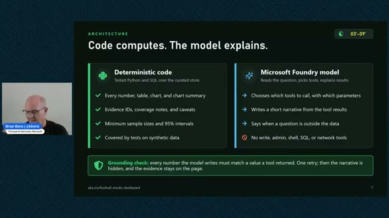
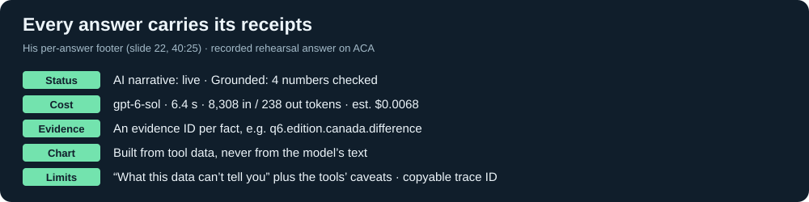
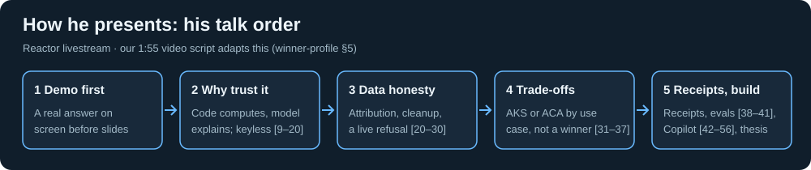
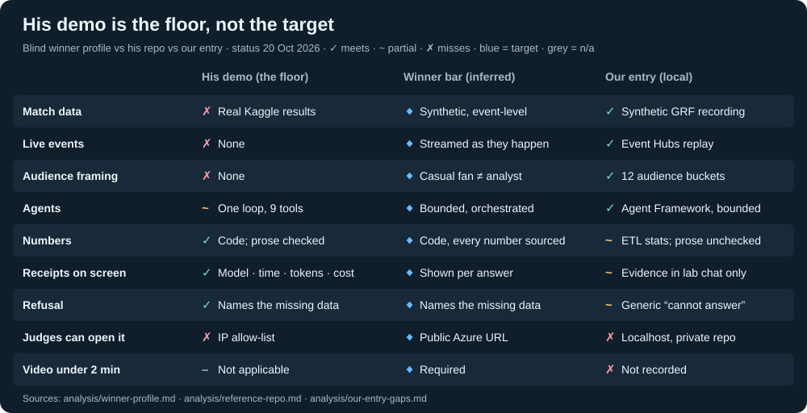

# Reactor livestream: Build AI-powered soccer insights apps with AKS and ACA

[← Research](../README.md) · [Video](https://www.youtube.com/watch?v=EQ187ohgCbo) · [Transcript](transcript/transcript.txt) · [Frames](frames/) · [His repo (archived, MIT)](reference-repo/README.md)

Microsoft Reactor, 63 min, uploaded **15 Oct 2026** (his runbook schedules 14 Oct). Brian Benz, Principal AI Advocate, Microsoft. Archived **20 Oct 2026**. [42] = video minute 42; frame links are MM:SS.

**Deadlines (PT, [rules §1](https://github.com/microsoft/insidethegamehackathon/blob/9c6c99620b06b2b04dcf69a434cdf4d203d19eda/OFFICIAL%20RULES.md#1-dates-and-timing)):** registration closes 20 Oct 12:00 PM · submissions close 27 Oct 11:59 PM · keep the demo up until judging ends 10 Nov 11:59 PM · winners announced by 20 Nov. The event slide adds “top six notified by 10 Nov” (frame [04:43](frames/04-43.jpg)).

## The one-line message

> “Deterministic code for the numbers. A model for the words. One set of images on two platforms.” — closing slide, frame [57:32](frames/57-32.jpg)

He demoed a Q&A dashboard over 150 years of *real* international results (Kaggle, public domain). Deterministic tools compute every number; GPT-6 Sol on Microsoft Foundry picks the tools and writes the narrative. He built it in about a day with GitHub Copilot: “GPT-6.1 Sol” (caption unclear) helped write the 498-line build prompt and Claude Opus 5.5 wrote the code [44, 60]. The same images run locally, on AKS and on ACA.

**Is he a judge?** Unknown. He is “just the guy who built the demo” with no insight into judging [58]. Read him as Microsoft taste, not the rubric.

## What he values

| Value | Evidence |
| --- | --- |
| Data credit | Attribution right after the description in the repo README, and in the app; no data in the repo, enforced by a CI guard [12, 24–25, 49] |
| Grounding | Every number must match a tool result; one retry, then the narrative is hidden [13, 39] |
| Honest limits | Live refusal of “best Premier League team at counterattacks?” with reasons [29] |
| Receipts | Model, latency, tokens, cost, evidence IDs and trace ID under each answer [39] |
| Keyless security | Entra + managed identity per service, key auth off [14–20]. His IP allow-list would block judges: copy the keyless setup, not the lock |
| Observability | OpenTelemetry → App Insights, trace view in the app [30] |
| Copilot productivity | “Not writing a lot of hand code”; about 12 steering iterations [42–43] |

[Slide index](analysis/slides.md) · [Frame 40:25](frames/40-25.jpg)

## What he hinted at

- **Said:** focus on the app, not the data, and relate it to the Premier League [23]; made-up leagues are fine [21]; build locally, as no Azure credits are given [57]; “running on Azure is the goal” [61].
- **Inferred:** show trust on screen (receipts, a refusal, a data label); bound the agent (read-only tools, call/token/time caps); choose a platform by use case and say why.
- **Dodged three times** [15, 16–17, 61–62]: whether synthetic data is mandatory. The [official rules §4.7](https://github.com/microsoft/insidethegamehackathon/blob/9c6c99620b06b2b04dcf69a434cdf4d203d19eda/OFFICIAL%20RULES.md#47-use-of-footage) say it is (“Projects must use synthetic, football-realistic data”), so his real-data approach is not a compliant template.
- **Left open:** his session blurb promised play styles, counterattacks and player patterns; his app refuses them. That is the gap the brief asks entrants to fill.

## How he presents

[Video skeleton](analysis/winner-profile.md#5-video-skeleton-under-155-his-order-compressed) · [How he explains things](analysis/judge-lens.md#3-how-he-explains-things)

## What a winner looks like

Two stages: a pass/fail theme and technology check, then five criteria at 20% each. The rules (§4.1) ask you to explain *why* moments matter and to personalise for different audiences. *Inferred:* every number sourced, on a public Azure demo.

[Winner profile and checklist](analysis/winner-profile.md) · [Our ranked gaps](analysis/our-entry-gaps.md) · [His talk vs his code](analysis/reference-repo.md#5-talk-vs-code)

## For our entry

Submission blockers (rules §1, §4.4, §4.8): confirm registration (closes 20 Oct 12:00 PM PT); no public repo, no judge-accessible URL, no video. Narratives are written offline by AI, not at runtime; the viewer says so, keep that in the README and video. Next: replace Premier League fonts, club crests and real player names; show receipts in the match viewer; make refusals name the missing data. [This week’s actions](analysis/our-entry-gaps.md#4-top-7-actions-this-week)

## Reports

Four were written blind, with no knowledge of our entry; one maps them to ours. They overlap by design: use winner-profile §5 for the video plan and reference-repo §6 for what to copy.

| Report | Lens |
| --- | --- |
| [judge-lens.md](analysis/judge-lens.md) | Values, hints, rhetoric, Q&A, tensions, red flags |
| [winner-profile.md](analysis/winner-profile.md) | Winning portrait per criterion, anti-patterns, video script, checklist |
| [reference-repo.md](analysis/reference-repo.md) | His architecture, the 498-line prompt, evals, talk vs code |
| [slides.md](analysis/slides.md) | Timestamped slide index and on-screen text he didn’t say |
| [our-entry-gaps.md](analysis/our-entry-gaps.md) | **Informed:** where we match, gaps, risks, this week’s actions |

## Provenance

Auto-generated captions ([raw VTT](transcript/)), 360p frames (the only downloadable resolution), and [bbenz/football-results-dashboard](https://github.com/bbenz/football-results-dashboard/tree/c75ddb036a81dbccd523bfabffa9c2e79dc7b29d) at `c75ddb0` (MIT, no data). Read only: do not run the archived code. The video stays in ignored `.local/livestream-2026-10-15/`.
