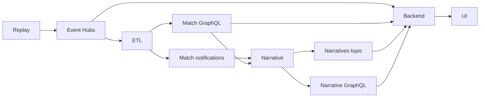

# Integration boundaries

**Development contracts, not a final production schema.** Keep the same names in emulator config and Terraform. Each service owns its database and API. Fixtures stay small, synthetic and checked in.

| Boundary | Producer → consumer | Contract |
| --- | --- | --- |
| `match-events` | Replay → ETL / backend | Match-partitioned events; separate `etl` and `user-backend` consumer groups. |
| Match GraphQL | ETL → narrative / backend | Historical events, key-event ledger, computed stats. Only raw-event fixture queries exist locally. |
| `match-notifications` | ETL → narrative | `KeyEventDetected`, `MinuteClosed`; fields and timing policy to agree with the ETL service. |
| `narratives` | Narrative → backend | Narrative ID, match ID/time, bucket, text; optional ordered approved stat IDs. Final schema still to agree. |
| Narrative GraphQL | Narrative → backend | Match/bucket history. Planned; never substitute direct backend Cosmos access. |
| Viewer API/live connection | Backend → frontend | Harness implements HTTP + WebSocket for profiles, takeover, cards and backlog; chat is pending. |

The [event fixture](fixtures/match-events.jsonl) contains `id`, `matchId`, `sequence`, `eventTime` (UTC), `matchMinute`, `type`, `teamId`, `synthetic` and structured `qualifiers`. It is a starting development shape, not the archived simulator's native schema. Define a source adapter when the full match is selected.

Before real integration, agree corrections/versioning, ordering/watermarks, and history-to-live handoff. Consumers must tolerate redelivery using event IDs; test out-of-order and corrected events. Do not use a live-only consumer to reconstruct complete history.

## Backend fixture boundary

`./dev up backend` runs separate fake upstreams from `user-backend/backend/fakes.py`. ETL exposes GraphQL `matchEvents(matchId)` and `matchState(matchId, team)`; narrative exposes `context(matchId, bucket)`. Results use a temporary JSON scalar, not the eventual production schemas. The [Opta-inspired JSONL](../user-backend/fixtures/README.md) is a separate test input with an explicit normalizer, not a replacement for the existing Event Hubs probe contract above.

Replay posts `/events` or `/narratives` to the appropriate fake, which stores the fixture and sends an HTTP notification to the backend's `/dev/*` routes. The backend reads history/stats through GraphQL and delivers snapshots via WebSocket. No production broker wiring is implied. Replace these test bridges with the agreed Event Hubs and Service Bus consumers when those services are ready.

Presence feedback remains an [open design question](../narrative-engine/design-notes.md#open-question-audience-presence). No presence topic is provisioned. Viewer questions never trigger shared narrative generation. Jev subscriptions, clips and delayed playback remain Phase 2.
