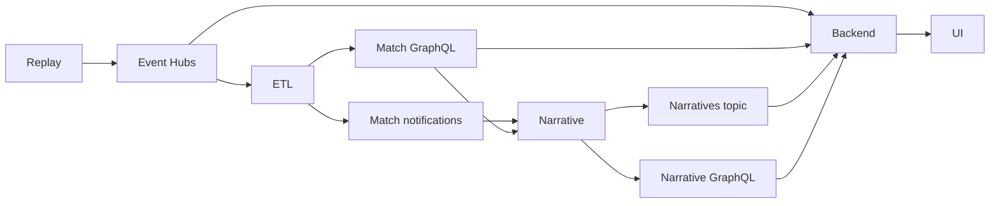

# Integration boundaries

**Development contracts, not a final production schema.** Keep the same names in emulator config and Terraform. Each service owns its database and API. Fixtures stay small, synthetic and checked in.

| Boundary | Producer → consumer | Contract |
| --- | --- | --- |
| `match-events` | Replay → ETL / backend | Match-partitioned events; separate `etl` and `user-backend` consumer groups. |
| Match GraphQL | ETL → narrative / backend | ETL-computed stats from its Cosmos DB; historical/key events from its Azure SQL store. No direct backend database access or standard-stat recalculation. Real DAB currently serves only a raw-event fixture; the backend harness uses separate fake GraphQL. |
| `match-notifications` | ETL → narrative | `KeyEventDetected`, `MinuteClosed`; fields and timing policy to agree with the ETL service. |
| `narratives` | Narrative → backend | Narrative ID, match ID/time, bucket, text; optional ordered approved stat IDs. Final schema still to agree. |
| Narrative GraphQL | Narrative → backend | Match/bucket history. Planned; never substitute direct backend Cosmos access. |
| Viewer API/live connection | Backend → frontend | The product harness implements HTTP + WebSocket for profile sessions, takeover, three stat slots, narrative backlog and saved questions/Track offers. `/product` uses the same match run as the filter engine and question agent; the older viewer probe endpoints remain separate test contracts. |

The [event fixture](fixtures/match-events.jsonl) contains `id`, `matchId`, `sequence`, `eventTime` (UTC), `matchMinute`, `type`, `teamId`, `synthetic` and structured `qualifiers`. It is a starting development shape, not the archived simulator's native schema. Define a source adapter when the full match is selected.

Before real integration, agree corrections/versioning, ordering/watermarks, and history-to-live handoff. Consumers must tolerate redelivery using event IDs; test out-of-order and corrected events. Do not use a live-only consumer to reconstruct complete history.

## Backend fixture boundary

`./dev up backend` runs separate fake upstreams from `user-backend/backend/fakes.py`. ETL exposes GraphQL `matchEvents(matchId)` and `matchState(matchId, team)`; narrative exposes `context(matchId, bucket)`. `matchState` returns computed stats and key moments, not raw history. `matchEvents` is a separate on-demand query for investigations/custom calculations. Results use a temporary JSON scalar, not the eventual production schemas. The [Opta-inspired JSONL](../user-backend/fixtures/README.md) is a separate test input with an explicit normalizer, not a replacement for the existing Event Hubs probe contract above.

Replay posts `/events` or `/narratives` to the appropriate fake, which stores the fixture and sends an HTTP notification to the backend's `/dev/*` routes. The backend reads history/stats through GraphQL and delivers snapshots via WebSocket. No production broker wiring is implied. Replace these test bridges with the agreed Event Hubs and Service Bus consumers when those services are ready.

The narrative engine generates for every available bucket returned by the backend audience API. No audience-presence feedback is needed. No presence topic is provisioned. Viewer questions never trigger shared narrative generation. Jev subscriptions, clips and delayed playback remain Phase 2.

The optional `NARRATIVE_SERVICEBUS_CONNECTION_STRING` enables the backend receiver for already-bucketed `Narrative` messages. It never calls an LLM. The default local harness continues to use HTTP notifications.

Audience configuration: `GET /matches/{match_id}/audience-config` on the backend returns revisioned layers, options, combinations and expanded generation targets. Read-only to the narrative engine; conditional reads use ETag/If-None-Match. [Contract](../user-backend/docs/audience-api.md).

## Product viewer projection

`/product` uses one process-local projection refreshed after committed replay changes. A shared adapter reads computed statistics from fake ETL GraphQL and already-framed messages from fake narrative GraphQL once per observed prefix, then composes each viewer's three cards and audience feed. WebSocket delivery is bounded; slow peers reconnect to a fresh snapshot. It retains routing/pin IDs, not chat transcripts, per connection.

The local snapshot-upload bridge is explicitly development infrastructure: it sends the observed event prefix to separate fake services. Production must replace this with upstream live projections/deltas plus durable reconnect cursors. Adding API replicas does not coordinate the in-memory replay owner. See [scaling](../user-backend/docs/scaling.md).
