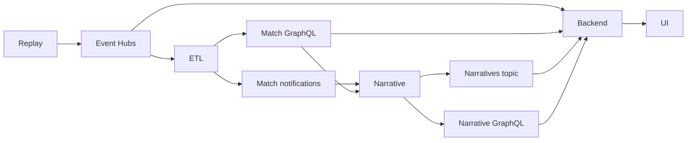

# Integration boundaries

**Development contracts, not a final production schema.** Keep the same names in emulator config and Terraform. Each service owns its database and API. Fixtures stay small, synthetic and checked in.

| Boundary | Producer → consumer | Contract |
| --- | --- | --- |
| `match-events` | Replay → ETL / backend | Match-partitioned events; separate `etl` and `user-backend` consumer groups. |
| Match GraphQL | ETL → narrative / backend | ETL-computed stats from its Cosmos DB; historical/key events from its Azure SQL store. No direct backend database access or standard-stat recalculation. Real DAB currently serves only a raw-event fixture; the backend harness uses separate fake GraphQL. |
| `match-notifications` | ETL → narrative | `KeyEventDetected`, `MinuteClosed`; fields and timing policy to agree with the ETL service. |
| `narratives` | Narrative → backend | Narrative ID, match ID/time, bucket, text; optional ordered approved stat IDs. Final schema still to agree. |
| Narrative GraphQL | Narrative → backend | Match/bucket history. Planned; never substitute direct backend Cosmos access. |
| Viewer API/live connection | Backend → frontend | The product harness implements HTTP + WebSocket for profile sessions, takeover, five stat slots, narrative backlog and saved questions/Track offers. `/product` uses the same match run as the filter engine and question agent; the older viewer probe endpoints remain separate test contracts. |

The [event fixture](fixtures/match-events.jsonl) contains `id`, `matchId`, `sequence`, `eventTime` (UTC), `matchMinute`, `type`, `teamId`, `synthetic` and structured `qualifiers`. It is a starting development shape, not the archived simulator's native schema. Define a source adapter when the full match is selected.

Before real integration, agree corrections/versioning, ordering/watermarks, and history-to-live handoff. Consumers must tolerate redelivery using event IDs; test out-of-order and corrected events. Do not use a live-only consumer to reconstruct complete history.

## Recorded-match demo boundary

`./dev up backend` starts independent `etl/` and `narrative-engine/` images. ETL owns the recording and two local PostgreSQL databases (history and standard projections). The authored narrative stub owns its SQLite archive. The older backend fake modules are isolated test doubles, not running upstream services.

The backend loads `GET /demo/recording` once, then replays its observed events through the shared custom filter engine. For each shared checkpoint it posts metadata (run, hash, cursor, clock, catalogue) to ETL, never event history. ETL validates against its own source and commits history/projections. The narrative stub fetches that committed snapshot and releases already-authored entries. Both expose `questionData` GraphQL reads; stats, raw investigations and recap history remain distinct operations.

This is a local replay clock/HTTP checkpoint bridge. Replace it with Event Hubs input and Service Bus notifications when those owners are ready; no Azure broker or ASA implementation is implied. All source clocks map to the same 12-minute video. Ordinary viewer cards never query raw event history or recompute standard values.

The narrative engine reads `GET /matches/{match_id}/audience-config` from the backend. Connected combinations are enabled; all 12 definitions remain. The manual stub contains 12 releases × 12 buckets but only returns currently enabled combinations. Question reads never trigger bucket generation. Jev, clips and delayed playback remain Phase 2.

## Product viewer projection

`/product` uses one process-local projection refreshed after committed replay changes. A shared adapter reads computed statistics from ETL GraphQL and already-framed messages from narrative GraphQL once per observed prefix, then composes each viewer's five cards and audience feed. WebSocket delivery is bounded; slow peers reconnect to a fresh snapshot. It retains routing/pin IDs, not chat transcripts, per connection.

The metadata checkpoint bridge is explicitly development infrastructure: the source and standard calculations belong to ETL; the backend observes an aligned replay prefix. Production must replace this with upstream live projections/deltas plus durable reconnect cursors. Adding API replicas does not coordinate the in-memory replay owner. See [scaling](../user-backend/docs/scaling.md).
