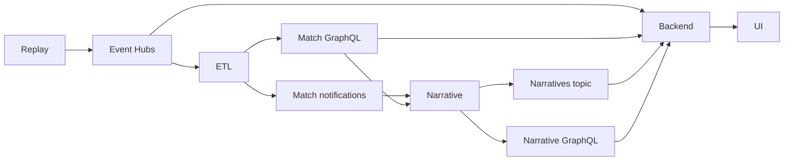

# Integration boundaries

**Development contracts, not a final production schema.** Keep the same names in emulator config and Terraform. Each service owns its database and API. Fixtures stay small, synthetic and checked in.

| Boundary | Producer → consumer | Contract |
| --- | --- | --- |
| `match-events` | Replay → ETL / backend | Match-partitioned events; separate `etl` and `user-backend` consumer groups. |
| Match GraphQL | ETL → narrative / backend | ETL-computed stats from its Cosmos DB; historical/key events from its Azure SQL store. No direct backend database access or standard-stat recalculation. Real DAB serves only a raw-event infrastructure fixture; the viewer uses the standalone demo ETL GraphQL. |
| `match-notifications` | ETL → narrative | Demo `MatchSnapshotReady` metadata after committed projections; production key-event/minute policies remain to agree. |
| `narratives` | Narrative → backend | Versioned `BucketNarratives` delivery: snapshot watermark, bucket items, stat-selection events and audience revision. |
| Narrative GraphQL | Narrative → backend | Match/bucket history and neutral recap tiers. The standalone stub implements GraphQL; never substitute direct backend Cosmos access. |
| Viewer API/live connection | Backend → frontend | The product harness implements HTTP + WebSocket for profile sessions, takeover, five stat slots, narrative backlog and saved questions/Track offers. `/product` uses the same match run as the filter engine and question agent; the older viewer probe endpoints remain separate test contracts. |

The [event fixture](fixtures/match-events.jsonl) contains `id`, `matchId`, `sequence`, `eventTime` (UTC), `matchMinute`, `type`, `teamId`, `synthetic` and structured `qualifiers`. It is a starting development shape, not the archived simulator's native schema. Define a source adapter when the full match is selected.

Before real integration, agree corrections/versioning, ordering/watermarks, and history-to-live handoff. Consumers must tolerate redelivery using event IDs; test out-of-order and corrected events. Do not use a live-only consumer to reconstruct complete history.

## Recorded-match demo boundary

`ACCEPT_EULA=Y ./dev up backend` starts independent `etl/` and `narrative-engine/` images. ETL owns the recording and two local PostgreSQL databases (history and standard projections). The authored narrative stub owns its SQLite archive. The older backend fake modules are isolated test doubles, not running upstream services.

The replay source loads `GET /demo/recording`, then publishes versioned `MatchEvent` envelopes to Event Hubs. Each contains canonical `event` (or null for a recovery watermark) and `snapshot` metadata with an empty event list. ETL validates the watermark against its recording and commits the observed prefix; the backend consumes the event in its own consumer group for custom calculations.

ETL publishes ready snapshots to `match-notifications`. The narrative stub reads the ETL demo snapshot endpoint, archives neutral recaps and releases authored versions to `narratives`. GraphQL remains the read path for stats, raw event investigations and historical recaps. Emulator delivery uses Azure SDKs; the recording and repositories remain demo implementations, not Stream Analytics or cloud deployment.

The narrative engine reads `GET /matches/{match_id}/audience-config` from the backend. Connected combinations are enabled; all 12 definitions remain. The manual stub contains 12 releases × 12 buckets but only returns currently enabled combinations. Question reads never trigger bucket generation. Jev, clips and delayed playback remain Phase 2.

## Product viewer projection

`/product` uses one process-local projection refreshed after committed replay changes. A shared adapter reads computed statistics from ETL GraphQL and routes already-framed Service Bus narratives, then composes each viewer's five cards and audience feed. WebSocket delivery is bounded; slow peers reconnect to a fresh snapshot. It retains routing/pin IDs, not chat transcripts, per connection.

The recorded replay is development infrastructure: the source and standard calculations belong to ETL; the backend observes an aligned replay prefix. Production still needs durable Event Hubs checkpoints, upstream projections/deltas and reconnect cursors. Adding API replicas does not coordinate the in-memory replay owner. See [scaling](../user-backend/docs/scaling.md).
