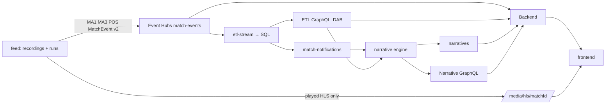

# Integration boundaries

> **In short:** each service owns its database and API; services meet only at the boundaries below: the multi-match contracts agreed 2026-10-20.

| | |
| --- | --- |
| **Status** | Implemented and tested on the local stack and on Azure ([status](../../README.md#what-works-today)) |
| **Match identity** | `matchId = {fixture}-{run8}`, minted by the feed per run; never reused |
| **Snapshot identity** | `(matchId, seq)`; `seq` = canonical `MatchEvent` sequence |
| **Live input** | Event Hubs `match-events`, partition key `matchId`: MA1, MA3, POS ([ETL contracts](../../etl/contracts/README.md)) and `MatchEvent` v2 |
| **Read path** | ETL GraphQL (DAB) only; never another service's database |
| **Reset** | Per match: every owner's `POST /admin/matches/purge` |

**Development contracts, not a final production schema.** Keep the same names in emulator config and Terraform. Fixtures stay small, synthetic and checked in. Agree changes here before changing producers and consumers.



## 1. Identity and snapshots

*In short: a match run is a `matchId`; a point in it is `(matchId, seq)`.*

- **`matchId`** = `{fixture}-{first 8 hex of runId}`, ≤ 64 chars, e.g. `riverton-forgeham-1a2b3c4d`. Only the feed mints it (`POST /runs`). Owners learn about a match from its MA1 on the stream.
- **Contestant ids** are stable club slugs (`riverton`, `forgeham`) across fixtures and runs, so stat ids and saved pins stay valid.
- **`seq`** counts canonical events 1, 2, 3… per match with no gaps, in send order. `seq 0` means MA1 only. MA3 `seq` and POS `sampleId` also count 1, 2, 3… per match in send order; the Azure watermark relies on all three ([Stream Analytics](../../etl/docs/components/stream-analytics.md#5-watermarks)).
- **Snapshot** = `(matchId, seq)`; its string id is `{matchId}:{seq}`. It replaces `run_id`, `recording_hash` and `cursor`. Everything derived cites it: `statsAtSeq` rows, backend cards and projections, and question answers. Engine narratives add `eventSeq` (the watermark they were written from); their own `seq` stays the per-bucket narrative sequence.
- Data at `(matchId, s)` is immutable once `matchWatermarks.seq ≥ s` (SPADL actions and stats: once `spadlSeq ≥ s`). Read at `s` only when `s ≤` the watermark. Data past the watermark is unreachable.

## 2. MatchEvent v2

*In short: the canonical contact-level event; it clocks the backend's snapshots. Custom rules read SPADL (§3), not this.*

The feed sends one per canonical event on `match-events` (partition key `matchId`), before that event's MA3 rows. It has no `feed` key, so MA consumers skip it. Consumers: the backend (group `user-backend`) for the snapshot clock and periods, the viewer and lab event ticker and gap recovery; ETL stores it (`canonicalEvents`). Since 2026-10-21 neither the catalogue (§4) nor backend custom rules count it; the ticker still shows its canonical `event_type` ([why](../../user-backend/docs/decisions.md#3-open-items)).

```json
{"type": "MatchEvent", "version": 2, "matchId": "riverton-forgeham-1a2b3c4d", "seq": 2,
 "timeStamp": "2026-10-20T15:00:00.240Z", "synthetic": true,
 "event": {"event_id": "grf-rvr-fgu-2", "match_id": "riverton-forgeham-1a2b3c4d", "revision": 1,
   "event_type": "touch", "team_id": "forgeham", "player_id": "forgeham-1", "body_part": "left_foot",
   "period": 1, "match_time_seconds": 0, "outcome": null, "distance_metres": null, "deleted": false,
   "sequence": 2, "video_seconds": 0.24, "x": 50.0, "y": 50.0, "possession_id": 1,
   "qualifiers": {"bodyPart": "left_foot"}}}
```

`event` is today's backend `Event` model ([events.py](../../user-backend/backend/models/events.py), strict, extra fields forbidden):

| Field | Meaning |
| --- | --- |
| `event_id`, `revision`, `deleted` | Identity and corrections: a correction is a new `seq` with the same `event_id` and a higher `revision`; `deleted: true` removes it. Counts use the latest non-deleted revision. |
| `event_type` | Canonical category (`pass`, `shot`, `goal`, `touch`, … 34 types); `period_start`/`period_end` give the backend its periods. |
| `team_id`, `player_id`, `body_part`, `period`, `match_time_seconds`, `outcome` | Event context (ticker). |
| `distance_metres` | Supplied ball distance. |
| `qualifiers` | Typed qualifier map (`bodyPart`, `restart`, `cross`, `defensiveBlock`, …). |
| `sequence`, `video_seconds`, `x`, `y`, `possession_id` | Delivery context; excluded from content equality. |

Invariants: `event.match_id == matchId`, `event.sequence == seq`. There are no snapshot or recording fields and no null-event watermarks; the backend persists every received event per match (its snapshot `seq` never passes what it received).

## 3. ETL GraphQL (DAB)

*In short: new read models beside Luke's tables, all keyed by `matchId`, including SPADL actions and trend indicators.*

Served by `etl-dab` (`http://etl-dab:5000/graphql` in Docker, `localhost:15001` on the host). Anonymous read. Existing entities (`rawEvents`, `keyEvents`, `minuteStats`, `matchStatsAsOfs`) are unchanged.

| Entity | Source | One row per |
| --- | --- | --- |
| `matches` (+ `teams`, `players` relationships) | table from MA1, plus `matchTeams` and `matchPlayers` | match |
| `matchWatermarks` | view: latest committed canonical event per match | match |
| `statDefinitions` | config table, seeded by migration (§4) | catalogue stat |
| `possessionSamples` | table from POS | sample |
| `canonicalEvents` | table from MatchEvent v2 | canonical event (`seq`) |
| `spadlActions` | table from MA3, by the SPADL post-processor | final SPADL action |
| `executeStatsAtSeq(matchId, seq)` | stored procedure `statsAtSeq` | stat × scope |
| `trendDefinitions` | config table, seeded by migration (§4b) | trend |
| `executeTrendsAtSeq(matchId, seq)` | stored procedure `trendsAtSeq` | indicator × team × window |
| `executeTrendSpellsAtSeq(matchId, seq)` | stored procedure `trendSpellsAtSeq` | territory or pressure spell |
| `executeTrendMinutesAtSeq(matchId, seq)` | stored procedure `trendMinutesAtSeq` | minute × team |

**canonicalEvents.** The stored MatchEvent v2 per `(matchId, seq)`, columns of `dbo.canonicalEvents` (`seq eventId revision eventType teamId playerId bodyPart periodId matchTimeSeconds outcome distanceMetres deleted videoSeconds x y possessionId qualifiers eventTime`; `qualifiers` is a JSON string). The backend reads it only to recover a seq gap (an invalid or lost MatchEvent): `canonicalEvents(filter: {matchId: {eq: $m}, seq: {eq: $s}})`.

**spadlActions.** Standard SPADL actions converted from MA3 by ETL ([ETL contracts](../../etl/contracts/README.md#output-3-spadl-actions), [schema](../../etl/contracts/spadl-action.schema.json)): `actionId originalEventId periodId timeSeconds teamId playerId startX startY endX endY typeId typeName resultId resultName bodypartId bodypartName` plus `seq finalSeq sourceEventId sourceTypeId clockSeconds videoSeconds possessionId bodypartObserved startZone endZone fromShotOffTarget defensiveBlock` (the last two: Opta qualifiers 190 and 94 on the source row, marking a `keeper_save` that is a touch of an off-target shot or an outfield block, not a goalkeeper save). Only final rows are stored; snapshot `s` (≤ `spadlSeq`) reads `finalSeq ≤ s`. The backend's custom rules, questions and replays and the engine's context read these (one converter, in ETL). The backend reads only new rows, `finalSeq: {gt: from, lte: s}` in 1,000-row pages, at its snapshot `s = min(received seq, seq, spadlSeq)`, and un-mirrors coordinates to the acting team's frame. It reads MA3 `rawEvents` with `typeId: {in: [16, 17, 900]}, eventSeq: {lte: s}` (goals, cards, VAR decisions) for cards and scores; `rawEvents.eventSeq` (migration `010`, indexed) is the canonical seq each MA3 row derives from, so the bound runs in the database.

```graphql
query ($m: String!, $s: Int!) {
  spadlActions(filter: {matchId: {eq: $m}, finalSeq: {lte: $s}}, orderBy: {actionId: ASC}, first: 1000) {
    items { actionId periodId timeSeconds teamId playerId typeName resultName bodypartName startX startY endX endY
            startZone endZone seq finalSeq clockSeconds videoSeconds }
    hasNextPage endCursor } }
```
```json
{"data": {"spadlActions": {"items": [{"actionId": 0, "periodId": 1, "timeSeconds": 2.0, "teamId": "forgeham",
  "playerId": "forgeham-1", "typeName": "pass", "resultName": "success", "bodypartName": "foot_left",
  "startX": 60.480000000000004, "startY": 33.184, "endX": 55.019999999999996, "endY": 26.520000000000003, "startZone": "middle_third",
  "endZone": "middle_third", "seq": 7, "finalSeq": 12, "clockSeconds": 2.0, "videoSeconds": 2.8}, …],
  "hasNextPage": true, "endCursor": "…"}}}
```

**matches.** Luke's existing columns stay (`homeContestantId`, `homeName`, `payload`, …). Added: `fixture sourceMatchId runId status capabilities` (`capabilities` is MA1 JSON). `status`: `scheduled` (MA1 only), `live`, `finished` (final `period_end`). Purged matches have no rows.

```graphql
query ($m: String!) {
  matches(filter: {matchId: {eq: $m}}) {
    items {
      matchId fixture sourceMatchId runId status scheduledKickoff synthetic description capabilities
      teams { items { contestantId position name shortName code knownNames primaryColour secondaryColour crestAssetId } }
      players { items { playerId contestantId name shirtNumber position starter } }
    }
  }
}
```
```json
{"data": {"matches": {"items": [{"matchId": "riverton-forgeham-1a2b3c4d", "fixture": "riverton-forgeham",
  "sourceMatchId": "product-demo-match", "runId": "1a2b3c4d-…", "status": "live",
  "scheduledKickoff": "2026-10-20T15:00:00.000Z", "synthetic": true, "description": "Riverton Rovers v Forgeham United",
  "capabilities": "{\"video\":true,\"possessionSamples\":true,…}",
  "teams": {"items": [{"contestantId": "riverton", "position": "home", "name": "Riverton Rovers", "shortName": "Riverton Rovers",
    "code": "RVR", "knownNames": "[\"the Blues\"]", "primaryColour": "#001c68", "secondaryColour": "#0743b7", "crestAssetId": "riverton"}, …]},
  "players": {"items": [{"playerId": "riverton-1", "contestantId": "riverton", "name": "Kai Ashworth",
    "shirtNumber": 10, "position": "FW", "starter": true}, …]}}]}}}
```

**matchWatermarks.** `seq` is the highest canonical seq whose event, MA3 rows and POS samples (`videoSeconds ≤` its `videoSeconds`) are all committed. `spadlSeq` (≤ `seq`) is the highest seq the SPADL post-processor has converted: every action with `finalSeq ≤ spadlSeq` is stored. Read SPADL-derived data (`spadlActions`, `executeStatsAtSeq`) at `s ≤ spadlSeq`; it trails `seq` by about one poll (0.5 s). No row means `seq 0`, `spadlSeq 0`.

```graphql
query ($ids: [String!]) {
  matchWatermarks(filter: {matchId: {in: $ids}}) { items { matchId seq spadlSeq periodId clockSeconds videoSeconds eventTime } }
}
```
```json
{"data": {"matchWatermarks": {"items": [{"matchId": "riverton-forgeham-1a2b3c4d", "seq": 812, "spadlSeq": 812, "periodId": 1,
  "clockSeconds": 402, "videoSeconds": 402.88, "eventTime": "2026-10-20T15:06:42.880Z"}]}}}
```

**statsAtSeq.** The catalogue's stats (§4) as of one snapshot, counted over `spadlActions` with `finalSeq ≤ seq`. Returns an empty list for an unknown match or `seq` above the watermark or above `spadlSeq` (retry), never a partial set. Rows are ordered `all`, home, away, each in `displayOrder`. DAB returns a plain list (no `items`); `eventTypes` is a JSON string.

```graphql
query ($m: String!, $s: Int!) {
  executeStatsAtSeq(matchId: $m, seq: $s) {
    statId kind contestantId label value available unit definition eventTypes complete
  }
}
```
```json
{"data": {"executeStatsAtSeq": [
  {"statId": "all:goals", "kind": "goals", "contestantId": null, "label": "Both teams goals", "value": 1,
   "available": true, "unit": "", "definition": "Successful SPADL shots (shot, shot_freekick, shot_penalty) plus …",
   "eventTypes": "[\"shot\", \"shot_freekick\", \"shot_penalty\"]", "complete": true},
  {"statId": "riverton:possession", "kind": "possession", "contestantId": "riverton", "label": "Riverton Rovers possession",
   "value": 53.1, "available": true, "unit": "%", "definition": "Share of measured …", "eventTypes": "[]", "complete": true}]}}
```

**Trends.** `trendsAtSeq`, `trendSpellsAtSeq` and `trendMinutesAtSeq` (§4b) as of one snapshot, from the same rows as `statsAtSeq`, with the same bounds: empty for an unknown match or `seq` above the watermark or `spadlSeq` (retry). DAB returns plain lists. Shapes, windows and flags: [ETL contracts, output 4](../../etl/contracts/README.md#output-4-trend-indicators). The narrative engine's analyst reads them; a claim needs a `flagged` row of an `enabled` trend.

## 4. Stat catalogue

*In short: 42 stat kinds × 3 scopes = 126 stat ids, defined on SPADL actions; ids never change meaning without a row below.*

Stat id = `{scope}:{kind}`, where scope is `all` or a contestant id (`all:goals`, `riverton:possession`). The backend's card defaults and fallbacks and saved pins (`standard_stat_id`) store these ids. A kind keeps its id when the concept is the same (definition and value may change, recorded below); a new stat gets a new kind; a retired one stays served with `available: false`.

**Since 2026-10-21 the catalogue counts SPADL actions** (`spadlActions` with `finalSeq ≤ seq`, §3), converted from MA3, instead of canonical MatchEvent v2 events. Cards (MA3 card rows) and possession (POS samples) stay outside SPADL. MA3 has no revisions in this feed, so canonical corrections no longer change stats. Migrations `008_spadl_catalogue.sql` (definitions) and `009_spadl_stats_staged.sql` (staged procedure, VAR overturns) replace `004`'s table and procedure; Python twin [catalogue.py](../../etl/reference/catalogue.py); golden values `etl/tests/fixtures/catalogue-golden.json`.

`statDefinitions` columns:

| Column | Type | Meaning |
| --- | --- | --- |
| `statId` | `nvarchar(40)` PK | The kind, e.g. `goals`. |
| `label` | `nvarchar(80)` | Served as `{team name or "Both teams"} {label}`. |
| `unit` | `nvarchar(8)` | `%` for `pass_accuracy`, `cross_accuracy`, `possession`; else empty. |
| `definition` | `nvarchar(400)` | Served verbatim. |
| `actionTypes` | `nvarchar(400)` JSON | SPADL types counted (served as the row's `eventTypes`). |
| `result`, `bodypart` | `nvarchar(16)` | Optional filters on `resultName`, `bodypartName`. |
| `zone` | `nvarchar(16)` | `entries`: the zone entered (`final_third` includes `opp_box`). |
| `counter` | `nvarchar(32)` | `count`, `opponent_count`, `goals` (+ the opponent's `owngoal`, − MA3 VAR overturns up to the snapshot), `on_target`, `blocked`, `keeper_saves` (`fromShotOffTarget` and `defensiveBlock` both false), `accuracy` (%), `entries`, `cards`, `possession`, `retired`. |
| `requires` | `nvarchar(400)` JSON | `shotOutcomes` (MA1 `capabilities.shotOutcomes` true; from `010`, undeclared is unavailable), `bodyParts` (`capabilities.bodyParts`, or every one of `actionTypes` in the SPADL `capabilities.bodyPartActionTypes`); otherwise `available: false`, `value: null`. |
| `displayOrder` | `int` | Order below. |
| `enabled` | `bit` | Config; disabled kinds are not served. |

**Old → new.** Values at full time, `all/home/away`, on the recordings re-rendered 2026-10-22; n/a unavailable. **Bold**: the move to SPADL (2026-10-21) changed the kind's value on that recording; "was A → B" are its canonical and SPADL values on the previous render (the before values belong to the previous renders), other kinds were equal there. "Pass family" = `pass cross throw_in freekick_crossed freekick_short corner_crossed corner_short goalkick`; "shot family" = `shot shot_freekick shot_penalty`.

| # | Kind | Before (canonical events) | Now (SPADL) | Riverton Rovers–United | Redcastle Town–Port Albion | Skybridge–Whitmore |
| --- | --- | --- | --- | --- | --- | --- |
| 1 | `goals` | goal | shot, shot_freekick, shot_penalty success + opponent's owngoal − VAR overturns | 2/1/1 | 1/1/0 | 2/1/1 |
| 2 | `shots` | shot, goal | shot, shot_freekick, shot_penalty | 14/9/5 | 18/10/8 | 10/9/1 |
| 3 | `passes` | pass | pass family | 1403/941/462 | **1375/628/747** (was 1556/855/701 → 1560/858/702) | **1491/1012/479** (was 1473/844/629 → 1475/844/631) |
| 4 | `corners` | corner | corner_crossed, corner_short | 5/2/3 | 3/2/1 | 7/4/3 |
| 5 | `cards` | card | MA3 type 17 rows (not SPADL) | 0/0/0 | 2/1/1 | 4/1/3 |
| 6 | `tackles` | tackle | tackle | 25/12/13 | 33/15/18 | 26/15/11 |
| 7 | `interceptions` | interception | interception | **83/37/46** (was 33/14/19 → 113/51/62) | **105/44/61** (was 36/12/24 → 93/36/57) | **92/37/55** (was 33/9/24 → 94/43/51) |
| 8 | `fouls` | foul | foul | 30/19/11 | 26/13/13 | 33/22/11 |
| 9 | `fouls_won` | foul_won | opponent's foul | 30/11/19 | 26/13/13 | 33/11/22 |
| 10 | `offsides` | offside | pass family; result offside | 5/2/3 | 16/5/11 | 8/5/3 |
| 11 | `throw_ins` | throw_in | throw_in | 9/5/4 | 10/5/5 | 25/6/19 |
| 12 | `free_kicks` | free_kick | freekick_crossed, freekick_short, shot_freekick | 33/13/20 | 42/24/18 | 41/14/27 |
| 13 | `goal_kicks` | goal_kick | goalkick | 19/6/13 | 20/8/12 | 15/3/12 |
| 14 | `kick_offs` | kick_off | retired: `available: false` | n/a (was 5/2/3) | n/a (was 7/3/4) | n/a (was 8/4/4) |
| 15 | `penalties` | penalty | shot_penalty | 2/1/1 | 0/0/0 | 0/0/0 |
| 16 | `keeper_claims` | keeper_claim | keeper_claim | 0/0/0 | 0/0/0 | 1/0/1 |
| 17 | `clearances` | clearance | clearance | 98/47/51 | 81/44/37 | 94/42/52 |
| 18 | `take_ons` | take_on | take_on | 28/17/11 | 38/19/19 | 31/11/20 |
| 19 | `ball_recoveries` | ball_recovery | retired: `available: false` | n/a (was 503/271/232) | n/a (was 483/261/222) | n/a (was 484/264/220) |
| 20 | `headed_passes` | pass; head | pass family; bodypart head; needs bodyParts (pass family certified) | 9/3/6 | 8/2/6 | 8/5/3 |
| 21 | `headed_shots` | shot, goal; head | shot, shot_freekick, shot_penalty; bodypart head; needs bodyParts (shot family certified) | 0/0/0 | 0/0/0 | 1/1/0 |
| 22 | `headed_contacts` | touch; head | all action types; bodypart head; needs bodyParts | n/a/n/a/n/a | n/a/n/a/n/a | n/a/n/a/n/a |
| 23 | `saves` | save; keeper_save | keeper_save | **4/1/3** (was 9/2/7 → 12/2/10) | 7/2/5 | **4/0/4** (was 6/1/5 → 8/2/6) |
| 24 | `shots_on_target` | shot, goal; shot_on_target | shot family: success, or Opta 15 ending on the goal line; needs shotOutcomes | 5/3/2 | 7/5/2 | 4/4/0 |
| 25 | `blocked_shots` | shot; shot_blocked | shot family: Opta 15 ending before the goal line; needs shotOutcomes | 0/0/0 | 0/0/0 | 0/0/0 |
| 26 | `aerials_won` | aerial; success | retired: `available: false` | n/a (was 43/24/19) | n/a (was 48/21/27) | n/a (was 54/21/33) |
| 27 | `successful_take_ons` | take_on; success | take_on; result success | 28/17/11 | 36/19/17 | 28/10/18 |
| 28 | `pass_accuracy` | pass; pass_accuracy | % success of pass family | 77.8/80.3/72.5 | **75.6/72.6/78** (was 77.1/77.4/76.7 → 76.9/77.2/76.6) | **77.3/79.7/72** (was 76.4/76.7/76.2 → 76.3/76.7/75.9) |
| 29 | `possession` | —; possession | POS samples (not SPADL) | 100/63.6/36.4 | 100/50.9/49.1 | 100/62.8/37.2 |
| 30 | `passes_completed` | new | pass family; result success | 1091/756/335 (new) | 1039/456/583 (new) | 1152/807/345 (new) |
| 31 | `crosses` | new | cross, corner_crossed, freekick_crossed | 130/88/42 (new) | 128/73/55 (new) | 157/109/48 (new) |
| 32 | `crosses_completed` | new | cross, corner_crossed, freekick_crossed; result success | 86/63/23 (new) | 90/47/43 (new) | 117/87/30 (new) |
| 33 | `cross_accuracy` | new | % success of cross, corner_crossed, freekick_crossed | 66.2/71.6/54.8 (new) | 70.3/64.4/78.2 (new) | 74.5/79.8/62.5 (new) |
| 34 | `dribbles` | new | dribble | 1011/659/352 (new) | 1015/487/528 (new) | 1087/717/370 (new) |
| 35 | `corners_crossed` | new | corner_crossed | 5/2/3 (new) | 3/2/1 (new) | 7/4/3 (new) |
| 36 | `corners_short` | new | corner_short | 0/0/0 (new) | 0/0/0 (new) | 0/0/0 (new) |
| 37 | `free_kicks_crossed` | new | freekick_crossed | 33/13/20 (new) | 42/24/18 (new) | 41/14/27 (new) |
| 38 | `free_kicks_short` | new | freekick_short | 0/0/0 (new) | 0/0/0 (new) | 0/0/0 (new) |
| 39 | `free_kick_shots` | new | shot_freekick | 0/0/0 (new) | 0/0/0 (new) | 0/0/0 (new) |
| 40 | `final_third_entries` | new | pass family + dribble into final_third; result success | 134/68/66 (new) | 144/61/83 (new) | 141/75/66 (new) |
| 41 | `box_entries` | new | pass family + dribble into opp_box; result success | 214/157/57 (new) | 211/95/116 (new) | 224/171/53 (new) |
| 42 | `shots_saved` | new (the old `saves` concept) | keeper_save with `fromShotOffTarget` and `defensiveBlock` false: real goalkeeper saves | 3/1/2 (new) | 6/2/4 (new) | 3/0/3 (new) |

The backend serves unavailable rows (retired kinds, missing channels) as unavailable cards with ETL's `definition` as `unavailable_reason`.

Why values changed with SPADL (measured on the previous renders):
- `interceptions`: SPADL's interception includes blocked passes (Opta 74), which the canonical catalogue did not count.
- `offsides`: SPADL marks the offside pass (Opta 2), credited to the passing team. The MA3 export sends one per offside call, by the offside team (data-generation/contracts/README.md), so the values equalled the canonical ones.
- `passes`, `pass_accuracy`: where no pass of the offside team was flagged (a deflection or loose touch put the player offside), its last touch becomes that offside pass: 4 more passes in Redcastle Town–Port Albion and 2 in Skybridge–Whitmore, all unsuccessful.
- `saves`: SPADL's keeper_save is every Opta save event, including outfield blocks and stops of off-target shots, which the canonical catalogue excluded. `spadlActions.defensiveBlock` and `fromShotOffTarget` mark those rows; `shots_saved` (42) counts only real goalkeeper saves and equalled the old `saves` values. The backend's question agent uses `shots_saved` for "saves" (custom rules: `save_kind` `save`).
- `kick_offs`, `ball_recoveries`, `aerials_won`: no SPADL action (a kick-off is a pass; a ball recovery becomes a dribble or is dropped; aerial duels are not actions), so retired. Old values above.
- Every other old kind had the same values on all three previous renders.
- Skybridge–Whitmore's 47′ goal is a Joaquín Esteller own goal (a City `bad_touch`, result `owngoal`; counted for Whitmore), not a Whitmore attempt.

## 4b. Trend definitions

*In short: 26 trends computed at read time from SPADL, MA3 and POS rows; formulas fixed, thresholds, direction and `enabled` in `trendDefinitions`.*

Migration `011_trend_definitions.sql` creates the table and `seedTrendDefinitions`; `014_trend_patterns.sql` (replacing `012`'s procedures) adds flanks, the late fade and territory by game state, the `direction`, `requires` and `meaning` columns, and the seed recalibrated on the scripted-tactics recordings (S1 v2; `python -m devtools.calibrate_trends` prints the thresholds: the outer 20% / 10% of served values in the trend's direction, and the 90th percentile of |change|). `015_trend_parameters.sql` moves the formulas' constants (ball-time cap, long-pass length, fast-break limits, momentum alpha, build-up and pressing lines, flank lanes, threat weights) into `trendParameters`, seeded with the values `014` had inline. Python twin [trends.py](../../etl/reference/trends.py) (reads the newest seed blocks); tests compare it with SQL Server on every recording at 10 seqs. A re-seed replaces the whole block in a new migration ([how](../../etl/docs/components/trends.md#5-re-seeding)).

`trendDefinitions` columns: `trendId` (PK), `family` (`indicator`, `composite`, `momentum`, `spell`), `label`, `meaning` (plain words, for writers), `unit`, `definition` (served verbatim), `enabled`, `direction` (`high`: levels at or above `notableAt`/`highAt`; `low`: at or below), `changeAt` (`|delta|` for a change flag; null: none), `minuteAt`/`minMinutes`/`minBallSeconds` (spells; `minMinutes` also the minutes a game-state value needs), `requires` (a spell served enabled only while it overlaps a spell of that kind of the same team), `evidence` (why enabled or not), `displayOrder`.

**Minute components** (`trendMinutesAtSeq`; a minute is `(periodId, floor(clock / 60))`, every minute the canonical clock reached; team frame: the team attacks towards x = 105; the 8 s, 32 m, 12 s, 30 m, lines, lanes, threat weights and α below are the `trendParameters` seed):

| Component | From |
| --- | --- |
| `possessionSeconds` | POS samples up to the snapshot's video time, each in the minute with the latest start (first event's video time) at or before it |
| `ballSeconds`, `attHalfSeconds`, `finalThirdSeconds` | Ball timeline: each final SPADL action's start holds until the next action in its period (at most 8 s; 1 s after the period's last), split at minute ends; half at 52.5 m, final third at 70 m |
| `ftActions`; `ftEntries`, `boxEntries`; `shots`, `boxShots` | SPADL: actions (not fouls) starting at x ≥ 70; successful pass-family or dribble crossing 70 m / into the box (x ≥ 88.5, \|y − 34\| ≤ 20.16), first per (period, possession, team); shot family, starting in the box |
| `passes`, `forwardMetres`, `passMetres`, `longPasses` | SPADL `pass` and `cross` (open play): count, forward and total metres, ≥ 32 m |
| `fastBreaks` | SPADL possession chains starting in the own half, not a set piece, reaching x ≥ 70 with ≥ 30 m progress (or shooting) before any action > 12 s after the first; in the first action's minute |
| `buildPasses`, `pressActions`, `defActions`, `defHeight` | MA3 rows (`eventSeq ≤ seq`, x in metres): passes (type 1) below 63 m; tackles, interceptions, challenges and fouls (7, 8, 45, 4/0) at ≥ 42 m; those plus clearances, recoveries, blocked passes (12, 49, 74), with their mean x |
| `fouls`, `cards`, `tackles`, `challenges`, `aerials`, `takeOns` | MA3 types 4 (outcome 0), 17, 7, 45, 44, 3 |
| `threat`, `momentum` | `0.02 × finalThirdSeconds + ftEntries + 2 × boxEntries + 3 × shots`; momentum = EWMA (α 0.4, from kick-off) of home − away threat, negated for the away row |
| `attActions`, `rightActions`, `leftActions` | SPADL actions (not fouls) starting in the attacking half; of those, in the right / left third of the width (team frame, y < 68/3 is the right) |
| `goalsFor`, `leadAtStart` | Successful SPADL shots, plus the opponent's `owngoal` actions, less MA3 VAR overturns (type 900, qualifier 901 `goal-overturned`; an overturned own goal was the opponent's); the team's goal difference at the start of the minute |
| `territoryMinute`, `pressureMinute` | `ballSeconds ≥ minBallSeconds` and `(zone + 1) / (ball + 2) ≥ minuteAt` (attacking half; final third, also needing an entry or shot) |

**Seeded definitions** (window values; shares `(own + 1) / (own + other + 2)`; rates per 5 minutes; formulas in each `definition`). `territory_fade` is served in window `last15` only (the 15 minutes before it in the period minus last15, attacking-half share), `att_half_leading` / `att_half_trailing` in `half` only (this period's minutes the team started ahead / behind):

| # | trendId | Meaning | enabled | notable / high / change |
| --- | --- | --- | --- | --- |
| 1 | `possession` | their share of the time on the ball | yes | 0.704 / 0.774 / 0.358 |
| 2 | `field_tilt` | their share of the play in the two final thirds | yes | 0.881 / 0.936 / 0.599 |
| 3 | `att_half_share` | how much of the ball's time is in their attacking half | yes | 0.734 / 0.804 / 0.425 |
| 4 | `final_third_share` | how much of the ball's time is in their final third | yes | 0.565 / 0.676 / 0.357 |
| 5 | `def_height` | how far from their own goal they win or contest the ball | yes | 57.546 / 62.786 / 25.186 |
| 6 | `box_entries` | passes and dribbles into the opponent's penalty area | yes | 7 / 8 / 5 |
| 7 | `dominance` | overall control of the game: ball, territory, shots and entries together | yes | 0.357 / 0.465 / 0.592 |
| 8 | `ppda` | opponent passes allowed per defensive action high up the pitch; lower means pressing harder | yes (low end) | 4.25 / 3.333 / 11.429 |
| 9 | `directness` | how much of their passing distance goes forward | yes | 0.613 / 0.663 / 0.202 |
| 10 | `right_flank_share` | how much of their attacking-half play goes down the right | yes | 0.371 / 0.456 / 0.251 |
| 11 | `left_flank_share` | how much of their attacking-half play goes down the left | yes | 0.408 / 0.507 / 0.268 |
| 12 | `territory_fade` | how much less of the ball's time is in their attacking half than in the 15 minutes before | yes | 0.204 / 0.252 / – |
| 13 | `att_half_leading` | how much of the ball's time is in their attacking half this half while they lead | yes (low end) | 0.357 / 0.351 / – |
| 14 | `att_half_trailing` | how much of the ball's time is in their attacking half this half while they trail | yes | 0.644 / 0.645 / – |
| 15 | `shots` | shots | yes | 2 / 2 / 1.5 |
| 16 | `box_shots` | shots from inside the penalty area | yes | 2 / 2 / 1.5 |
| 17 | `ft_entries` | passes and dribbles into the final third | yes | 6 / 6 / 3 |
| 18 | `fouls` | fouls committed | yes | 2 / 3 / 2 |
| 19 | `cards` | cards shown | yes | – / – / – |
| 20 | `contests` | duels: tackles, challenges, aerials and take-ons | no | 7 / 8 / 4 |
| 21 | `aggression` | fouls, cards and tackles together | no | 3.5 / 4.5 / 2.75 |
| 22 | `fast_breaks` | quick attacks from their own half | no | 4 / 5 / 3 |
| 23 | `long_ball_share` | how many of their passes are long | no | 0.079 / 0.102 / 0.074 |
| 24 | `momentum` | recent threat compared with the opponent | no | 2.96 / 3.81 / – |
| 25 | `territory_spell` | a run of minutes with the ball mostly in their attacking half | yes | minute share 0.75, 3 min, 15 s ball |
| 26 | `pressure_spell` | a run of minutes pressing in their final third with entries or shots | yes (with `territory_spell`) | minute share 0.58, 3 min, 15 s ball |

The seed's `definition` and `evidence` texts are served as written.

## 5. Purge

*In short: one endpoint per owner; a tombstone first, so a purged match never comes back.*

```http
POST /admin/matches/purge
{"match_id": "riverton-forgeham-1a2b3c4d"}     or     {"all": true}
→ 200 {"match_ids": ["riverton-forgeham-1a2b3c4d"], "purged": {"<store>": <rows>, …}}
```

| Owner | In Docker | Removes | Tombstones in |
| --- | --- | --- | --- |
| feed | `feed:8000` | Run (stops it), its HLS directory | feed DB |
| ETL | `etl-stream:8000` | SQL rows of every match table, outbox, idle-flush state | SQL `purgedMatches` |
| Narrative engine | `narrative-live:8000` | Orchestrator; Cosmos narratives and context | Cosmos |
| Backend | `backend:8000` | LiveMatch, received events, recorded gaps, sessions, chat (questions and follow chat), calculation results, narratives, follows (topics, subscriptions, follow narratives), the match's audience catalogue copy | Postgres |

- **Exactly one of** `match_id` or `all: true`; otherwise `422`. `503` means retry; the call is idempotent.
- **Tombstone first, then delete.** Messages, notifications and narratives for a tombstoned `matchId` are settled and dropped, never re-creating rows. Tombstones are permanent (matchIds are never reused).
- **`all`** tombstones every matchId the owner knows and records a cut-off time. An MA1 stamped before it is dropped. Owners accept MA3, POS and `MatchEvent` only for matches whose MA1 they stored, so in-flight messages can't revive a match.
- Unknown `match_id`: `200`, zero counts, tombstone written.
- Only match data goes. Configuration stays: profiles, audience templates (with their enabled buckets), prompts, backend config tables (presentation, replay timing, key-moment ranks, prices, stream, subscriptions, key-moment feed), `statDefinitions`, `trendDefinitions` and the recordings catalogue.
- Callers (`./dev demo start`, `/dev/` Matches panel, demo control §7a) purge in this order: feed, ETL, engine, backend. It replaces `POST /admin/runs/purge`. Not exposed through the public proxy.
- On Azure every owner has internal ingress, and the ETL purge API and the engine also need `Authorization: Bearer <token>` (Terraform `admin_token` outputs). The frontend's `/purge-api/{etl,engine}` (developer consoles, basic auth) adds it; the browser never holds a token.

## 6. Live media (HLS)

*In short: `/media/hls/{matchId}/live.m3u8`, only what has played.*

- Only the feed writes `live-media/{matchId}/` (playlist and segments, in its own volume) and serves it at `/hls/{matchId}/`. nginx proxies `/media/hls/{matchId}/` to that origin; the backend reads it via `FEED_HLS_BASE`.
- The playlist lists a segment only once its end ≤ the run's published video clock. Before the first segment, and after a purge, it is `404`.
- The playlist is `no-cache`; segments are immutable. Nothing else under `/media/` is served, and there is no MP4.
- Present only when MA1 `capabilities.video` is true. Replay clips reference published segments only.

## 7. Feed admin API (dev only)

*In short: list recordings, start runs, list runs. No seek and no event data.*

Internal `feed:8000`; nginx proxies `/feed-api/` only for the developer screen.

| Route | Body → result |
| --- | --- |
| `GET /recordings` | `[{"fixture": "riverton-forgeham", "source_match_id": "product-demo-match", "description": "…", "teams": [{"id": "riverton", "name": "Riverton Rovers", "position": "home"}, …], "duration_seconds": 5544.28, "capabilities": {…}, "synthetic": true}]`, catalogue metadata only, never events or media. |
| `POST /runs` | `{"fixture": "riverton-forgeham", "kickoff": "next-minute"}` or an ISO-8601 UTC time → `201 {"run_id", "match_id", "fixture", "kickoff", "status": "scheduled"}`. `404` unknown fixture, `422` past kickoff. `next-minute` = the first whole UTC minute ≥ now + 60 s, so MA1 leads by about 60 s. Several runs, including of one fixture, may run at once. |
| `GET /runs` | `[{"run_id", "match_id", "fixture", "kickoff", "status": "scheduled" \| "live" \| "finished", "seq", "video_seconds"}]`. Purged runs are gone. |
| `POST /admin/matches/purge` | §5. |
| `GET /demo`, `PUT /demo` | Demo settings: `fixtures` (main first), `main_fixture` (default `redcastle-portalbion`; starts first, the viewer opens it), `stagger_seconds`, `max_active_runs`, `start_points` (`id`, `label`, `period`, `minute`, `seed`); `PUT` adds `expected_revision` (`409` when stale). |
| `POST /demo/start` | `{"point": "kickoff"}` → `201 {"started": true, "point", "runs"}`; while any run is scheduled or live `200 {"started": false, "runs"}` (one demo under concurrent calls). Purges the feed's finished runs first. A point after kick-off without a `seed` is `409`. |
| `POST /demo/skip` (`DEMO_SEEDS=1` only) | `{"target": "20"}` → `200 {"skipped_seconds", "target", "runs"}`: every unfinished demo run's clock moves on by the same whole minutes (a `skip_targets` entry: `minutes`, or a start `point` read on the main game's clock); each run then sends what became due at once in capped sends and publishes video up to its new clock; matchIds stay. `409` with no playing demo, while a seed is recorded or when already past the target; `404` unknown target; `403` without `DEMO_SEEDS`. |
| `POST /runs/{match_id}/release` | `{"after_seconds": 5}` → the run that waited for its seed starts, its clock reading the start point `after_seconds` from now; idempotent. |
| `GET /health` | Readiness. |

Seeds ([demo control](../docs/components/demo-control.md)): `POST /runs` also takes `hold_point` (a recording run sends nothing at or past that point) and `resume_point` (the run waits, `awaiting_restore`, until `release`, then plays on from the point without MA1 or anything earlier). A seeded `/demo/start` creates its runs waiting. Runs list `awaiting_restore`, `hold_seconds`, `held_at` (the hold point's id) and `started_from`. Owners' seed routes (internal, purge auth): ETL `GET /admin/matches/export?match_id=` and `POST /admin/matches/restore {match_id, max_seq, schema, tables}`; engine `POST /admin/matches/export {match_id}` and `POST /admin/matches/restore {match_id, max_seq, schema, containers}`; backend `POST /admin/matches/export {match_id}` and `POST /admin/matches/restore {match_id, max_seq, schema, tables}`. Each export returns its `schema` (a fingerprint of the seeded tables' or documents' shapes). Each restore refuses (`409`) another `schema`, a known or tombstoned match, rows of another match and rows past `max_seq`.

`POST /runs` is `409` while `max_active_runs` runs are scheduled or live. Runs list `position` (items sent; 1 = MA1).

### 7a. Demo control (public)

`local/demo_control.py serve` (Compose `demo-control`); nginx exposes `/demo-api/{start,cancel,skip,state,status}` with no login. `skip {target}` forwards to the feed's `/demo/skip` (answers directly; `409` while a start or cancel runs); `state.skips` lists the targets while a demo plays. `start` purges finished matches from ETL, engine and backend, then calls the feed's `/demo/start`; `cancel` purges every match (`all`) from every owner (§5 order) when the feed lists any run; start and cancel answer at once (`202 {"accepted": true, "pending"}`; `200` when a demo is already on or nothing is there to cancel; `409` at once for a recording or a stale seed) and then run one after another; `state` → `{"points": [{"id", "label", "ready"}], "live", "runs", "live_from", "main_fixture", "main_match_id", "pending", "last"}` (`pending`: queued actions; `last`: how the last start or cancel ended, `{"action", "ok", …}` or `{"ok": false, "status", "detail"}`, which the viewer polls for) (`live_from`: the start point's label when the demo began from a seed; `main_match_id`: the live demo's main game, which the viewer opens by default, while `/?choose` keeps the picker for switching); a seeded `start` restores ETL, engine and backend for each waiting run, then releases them staggered (main game first), or purges them and answers `503` (`409` for a seed of another format, schema or seq: record it again); while a seed is recorded `start` is `409` and `state` omits its held runs from `runs` and lists them as `recording` (`[{"match_id"}]`), which the viewer never lists (they stop at their hold point); `status` → `{"live", "matches", "stages": [{"id", "ready"}]}` for feed, event-hubs, etl, service-bus, engine, backend, viewer. Start and cancel are POST only under one shared rate limit; state and status are GET only, limited per client (the last `X-Forwarded-For` hop, which the ingress appends; behind `edge-proxy/` a Cloudflare edge node); `429` over the limit. Capture refuses held runs that stop at another start point (`held_at` on feed runs). Overrides: `DEMO_PURGE_TIMEOUT`, `DEMO_PURGE_RETRIES`, `DEMO_PURGE_RETRY_SECONDS`, `DEMO_RELEASE_LEAD`, `DEMO_CAPTURE_POLL`, `DEMO_CAPTURE_TIMEOUT`.

A kick-off demo starts at 00:00; a seeded one starts at its point with every owner restored to it. `FEED_ALLOW_SEEK` is dev-only and off by default. Seed export/restore on each owner (`/admin/matches/export|restore`, the feed's `/runs/{id}/release` and `hold_point`/`resume_point`) exist only with `DEMO_SEEDS=1` (local compose and the demo build); a production release leaves it off and they answer 404 (feed: 403/409).

## 8. Backend product API

*In short: everything under `/product/matches/{matchId}`, a session per (viewer, profile, match).*

`GET /product/matches` lists `live` matches first, then `scheduled` (by kickoff), then `finished`:

```json
[{"match_id": "riverton-forgeham-1a2b3c4d", "fixture": "riverton-forgeham", "status": "live",
  "scheduled_kickoff": "2026-10-20T15:00:00Z", "description": "Riverton Rovers v Forgeham United (synthetic GRF simulation)", "seq": 812, "period": 1, "clock_seconds": 402,
  "teams": [{"id": "riverton", "position": "home", "name": "Riverton Rovers", "short_name": "Riverton Rovers", "code": "RVR", "score": 0,
             "branding": {"primary_colour": "#001c68", "secondary_colour": "#0743b7", "crest_asset_id": "riverton"}}, …],
  "video": {"hls": "/media/hls/riverton-forgeham-1a2b3c4d/live.m3u8"}}]
```

| Today | Multi-match (`M` = `/product/matches/{matchId}`) |
| --- | --- |
| `POST /product/demo/reset` | Removed; use `./dev demo start` (purge, then feed `POST /runs`). |
| `GET /product/profiles` | Unchanged (global). |
| (none) | `GET /product/matches` |
| `POST /product/sessions` `{profile_id}` | `POST M/sessions` `{profile_id, viewer_id}` (`viewer_id`: the browser's random v4 UUID; anything else `422`) |
| `GET /product/{token}` | `GET M/sessions/{token}` |
| `PUT /product/{token}/audience` | `PUT M/sessions/{token}/audience` |
| `POST /product/{token}/messages` | `POST M/sessions/{token}/messages` |
| `GET /product/{token}/turns/{turn}/replay/{page}` | `GET M/sessions/{token}/turns/{turn}/replay/{page}` |
| `POST /product/{token}/offers/{offer}/track` | `POST M/sessions/{token}/offers/{offer}/track` |
| `DELETE /product/{token}/pins/{calculation}` | `DELETE M/sessions/{token}/pins/{calculation}` |
| `WS /product/{token}/live` | `WS M/sessions/{token}/live` |

- `description` is the MA1 `description` (via ETL `matches`; null if absent). `video` is null when MA1 `capabilities.video` is false.
- `seq`, `period` and `clock_seconds` are ETL's watermark; `teams[].score` is ETL's goals at the newest snapshot both ETL and the backend have committed (≤ `seq`; null before ETL has it).
- A token belongs to one match; under another `matchId` it is `404`. An unknown or purged match is `404`, and its WebSockets close with code `4404`. `POST M/sessions` for a match whose MA1 has not arrived (and was never purged) is `404 match_not_started`; the viewer waits and retries. A `scheduled` match's snapshot carries `match.scheduled_kickoff`.
- The frontend's `/viewer-api/` prefix maps to `/product/` as today. The engine keeps `GET /matches/{matchId}/audience-config`; prompts stay global (`GET /narrative-prompts`), and so does the storyline policy (`GET /storyline-policy`).
- **Audiences are configuration only.** Each fixture's template (or `default`) defines layers, their options (`id`, viewer `label` with `{home}`/`{away}` placeholders, model-facing `description`, optional `team`: `home`/`away`) and buckets (option combinations) with an `enabled` flag, edited in `/dev/` with revision checks. `generation_targets` = the enabled buckets: `[{bucket_id, selections, layers: [{id, description, option: {id, description, label?, team?}}]}]` (unset fields omitted). Viewers never enable buckets; there is no presence.
- **Team support is data, not a layer name.** The engine says "This audience supports X" when any option of the bucket has `team`, or else a `label` naming exactly one of `{home}`/`{away}` (the default template's `team` layer). Layer and option ids carry no meaning.
- The viewer chooses one enabled bucket: `PUT M/sessions/{token}/audience` `{"bucket_id": "home:analytical"}` (`422 audience_unavailable` otherwise). Snapshots carry `audience` `{bucket_id, selections}` and `audience_buckets` `[{id, label}]`; narratives are filtered to the chosen bucket.
- `POST M/sessions/{token}/messages` takes `{prompt, request_id, seq?}`; `seq` is the snapshot the viewer is showing and the answer is computed at `min(latest, seq)`, so it never cites a later event.
- `GET /product/prices` returns `{input, output}` (US$ per million tokens, ETag) for answer receipts; edited as the `prices` config table.

## 8b. Story follows

*In short: a viewer follows one story per match; the feed then shows only that story, plus pivotal key moments for everyone.*

Migrations `024`, `027`–`030`. `S` = `/product/matches/{matchId}/sessions/{token}`.

| Route | Body → result |
| --- | --- |
| `GET S/follows` | `{"follow": Follow \| null, "follows": [Follow…] (newest first), "turns": [follow-chat turns]}` |
| `POST S/follows` | `{"spec": FollowSpec, "seq"?}` → `{"follow": Follow, "created": bool, "snapshot": …}`. The same topic again returns it (`created: false`); another active follow is `409 follow_limit`; unknown ids `422 unknown_team`/`unknown_player`/`unknown_storyline`, a resolved storyline `422 storyline_resolved`; too many changes `429 rate_limited` |
| `DELETE S/follows/{subscription_id}` | → `{"follow": null, "ended": Follow, "snapshot": …}`; not this viewer's active follow: `404 follow_not_found` |
| `GET S/follow/suggestions?seq=` | `{"snapshot_id", "items": [{"id": topic_id, "label", "spec": FollowSpec}]}`, by rule: open storylines by salience, players in the key moments (newest first), teams (the viewer's first); the current follow left out |
| `POST S/follow/messages` | `{prompt, request_id, seq?}` (as questions) → a follow-chat turn (below); `503 model_unavailable` without a model; `429 rate_limited` |
| `GET /matches/{matchId}/subscription-targets` | Engine only (ETag): [engine contracts](../../narrative-engine/contracts/README.md#subscription-targets) |

```json
FollowSpec {"kind": "storyline" | "team" | "player" | "theme", "storyline_id": null, "team_id": "riverton",
            "player_id": null, "focus": "", "label": "Riverton Rovers"}
Follow     {"subscription_id": "uuid", "topic_id": "topic:3fa2c1d0e4b5a697", "spec": FollowSpec, "label": "Riverton Rovers",
            "since_seq": 812, "since_period": 1, "since_clock_seconds": 1140, "created_at": "…", "ended_at": null}
```

- **Spec rules:** `storyline` needs `storyline_id`, `team` `team_id`, `player` `player_id` (its `team_id` is filled in), `theme` a non-empty `focus`. Ids must exist in the match at the viewer's snapshot (storylines read from the engine's `storylines`, bounded to the snapshot). Identical subject and focus share one `topic_id` (generation shared; the label is not part of it).
- **One follow per viewer** (per profile and match), enforced by a unique index. Follow plus unfollow count against `limits.follow_changes_per_minute`.
- **Follow chat** reuses the question tables (`question_turns.channel = 'follow'`); `S` bootstrap's `turns` stay questions only and it adds `follow_turns`. The planner (prompt role `subscription-planner`) drafts; code resolves names to ids. A turn's reply:
  `{"status": "proposal" | "clarify" | "unfollow" | "answer" | "unsupported", "text", "proposal": {"id", "label", "spec"} | null, "candidates": [{"id", "label", "spec"}], "snapshot", "usage"}`. A proposal is never a follow: the viewer confirms with `POST S/follows` and the proposal's `spec`. `unfollow` means the viewer asked to stop; the UI confirms with `DELETE`.
- **Snapshot (WebSocket and bootstrap) adds** `feed_mode` (`following` | `insights`), `follow` (Follow or null) and `key_moments`. `narratives` follows the feed rules: following → only the followed topic's narratives for the viewer's bucket (`kind: "subscription"`, `topic_id`, `storyline_ids`); not following → the bucket's insights. Unfollowing restores the insights.
- **`key_moments`** (everyone, followed or not): pivotal facts from ETL's MA3 `rawEvents` (`eventSeq ≤` the snapshot), never authored text: `[{"id": "km:{rawId}", "kind", "label", "period", "clock_seconds", "minute_label", "event_seq", "team_id", "player_id", "overturned"}]` in match order. Kinds: `goal`, `own_goal`, `red_card`, `second_yellow`, `penalty` (awarded; `team_id` = the team that won it), `penalty_missed`, `var_overturn`, `kick_off`, `half_time`, `second_half`, `full_time`, `period_start`, `period_end`. Which kinds show and each `label` template (`Goal · {team} · {scorer}` → "Goal · Riverton Rovers · Kai Ashworth"; `Half time · {score}` → "Half time · Riverton Rovers 1–0 Forgeham") are the `key-moment-feed` config table; the seed shows goals, red cards, second yellows, penalties, VAR overturns, kick-off, half-time and full-time. Show them as short, centred, greyed lines; strike through `overturned` goals.
- **`follow_playlist`** (followers only, else null; migration `038_follow_clips.py`, PLAN.md §10.2 D3): the followed topic's moment clips in the chat replay's shape (`clips` with `start`/`end`/`playlist_start`/`playlist_end` on the match's own stream, `captions` from the key-moment labels, `marks`), one page, chronological. A moment joins when the engine sends a `FollowClip` for it (Decision-1's clip `Score` on a key event of `subscriptions.clips.key_types`; apart from the follow narrative, so it does not depend on the narrative's grounding; migration `039_follow_clip_step.py`); only kinds in `clips.timing` clip, cut with that `replay-timing` key; at most the newest `clips.max_items` (and, past the reel's `max_clips`/`max_seconds`, the newest kept); bounded to the viewer's snapshot (`event_seq ≤ seq`, footage the snapshot has reached) and purged with the match. Each clip also carries `moments` (its key moments' preview-card facts: `id`, `kind`, `period`, `clock_seconds`, `minute_label`, `label`, `team_id`, `team_name`, `player_name`, `score` after the moment; PLAN.md §10.2 D6). A topic whose kind `subscriptions.clips.always_for` names clips without Decision-1's clip question (migration `041_capture_clips.py`).
- **`moment_playlist`** (Insights viewers only, else null; migration `041_capture_clips.py`, PLAN.md §10.2 D7): the key-event clips of the viewer's bucket's shared narratives, in the same shape as `follow_playlist`. A moment joins when the engine sends a `MomentClip` for its key event (`clips.key_types` with `subscriptions.clips.shared` on), apart from the narratives; same kinds, timing, `max_items`, snapshot bound and purge; seeded with the match (`narrative_clips`).
- **Tunables** (`/dev/config/{table}`, ETag + `expected_revision`): `subscriptions` (decision question, clip question and clippable kinds (`clips`), novelty check, prefilter, limits incl. the minimum gap between a topic's narratives and the follow-chat turns the planner sees, the catch-up step's trigger reason, suggestions, `min_name_match` for the planner's name resolution; permissive defaults) and `key-moment-feed`.
- **Follow anything:** no breadth limit; the planner asks only when it cannot resolve what the viewer means.
- **Purge** removes `subscription_narratives`, `subscriptions`, `subscription_topics`, `subscription_revisions` and the follow-chat turns with the match.

### 8c. Cross-match reach and follow offers

*In short: from any demo match a viewer asks about, pins from and follows the demo's other live matches; that content is marked with the other match's header. Migration `040_cross_match.py`; PLAN.md §10.2 D5, D5b.*

- **Which match.** Only the other matches the backend tracks now (the current demo; purge removes a match). `services/cross_match.CrossMatch.named(match, text)` returns `(other match, its info)` when the text names one of its teams (name, short name, code, known names) or players with at least `cross-match.min_name_coverage` of that name's rarity-weighted words (weights across every live match's names, `services/names.coverage`) and more than any name of the viewer's own match; else `None`. `CrossMatch.other(match_id, other_id)` admits an explicit id (404 when off or unknown).
- **Bounds.** Another match is read at its own live position (its `capture()` without the viewer's `seq`), never past it. No match's own narratives mention another; cross content is per request.
- **Header** (`OtherMatch`): `{"id", "fixture", "teams": [{"id", "position", "name", "short_name", "code", "branding"}]}`, never a score. It appears as `other_match` on a question reply, a pinned card, a cross follow's narratives and a cross follow option, and as `follow_match` on the snapshot of a viewer following another match.
- **Questions.** `POST S/messages` answers from the named match; the reply carries `other_match`; its replay pages re-cut against that match. Its stat offers pin from that match: the card's id is `{pin_id}@{matchId}`, its value is that match's at its own position, and it says unavailable once that match is cleared.
- **Follows.** Suggestions add the other matches' teams (`cross-match.suggest_teams`) with `match_id` and `other_match`; the follow chat's planner also sees the other matches' teams and squads, and a name is resolved in another match when none in the viewer's matches it (the proposal carries `match_id`, `other_match`). `POST S/follows` takes `"match_id"` for such an option: the spec is validated at that match's position and written for an enabled bucket of that match's catalogue, one backing neither team when any is enabled (else the enabled bucket sharing most of the viewer's other choices) (`Follow.bucket_id`); `Follow.match_id` names the followed match. That match's engine writes it (its `subscription-targets` lists the topic with that bucket). The follower's snapshot carries those narratives (each with `other_match`), that topic's `follow_playlist` and `follow_match`. Purging that match ends the follow (its connected followers get a snapshot back on Insights; a follow racing the purge is 404); its pinned cards say unavailable.
- **Follow offer** (`follow-offer` config): for a question that is not a statistic, has no stat offers and was answered or could not be answered yet (a story the chat cannot answer is one to follow; never a clarification), the backend asks a yes/no decision (Microsoft-Decision-1 via `DECISION_*`, else the local model) with the config's question; at or above `min_probability` the reply carries `follow_offer: {"prompt", "other_match"}`. At most `max_per_minute` per backend; a slow or failed decision gives no offer and never fails the answer. The viewer accepts in the follow view (the prompt goes to the follow chat, which proposes; the viewer confirms); there is never a follow without that click.

### 8d. Replay playback (sting and slow motion)

*In short: every replay and clip playlist carries `playback`, from `replay-timing.playback` (migrations `037`, `049`; PLAN.md §10.2 D3, D4).*

```json
"playback": {"transitions": {"enabled": true, "hold_seconds": 0.6, "asset": "builtin:league",
                             "asset_start_seconds": 0.3, "sting_seconds": 2.4, "cut_seconds": 0.5, "fade_seconds": 0.3},
             "slow_motion": {"enabled": true, "rate": 0.5, "ramp_seconds": 0.6, "before_seconds": 1.0, "after_seconds": 1.5}}
```

- **Transitions:** hold the clip's last frame, fade the sting in (`builtin:league`: the league's own CSS sting; any other value is a video URL), cut under it, fade it out as the next clip plays (chat replays, `follow_playlist`, `moment_playlist`).
- **Slow motion:** the rate eases to `rate` over `ramp_seconds`, holds from `before_seconds` ahead of each marked event to `after_seconds` past it, then eases back.
- `prefers-reduced-motion`: hold and cut, no sting, no slow motion. Edited in `/dev/`; an existing edit is kept by the migration.
