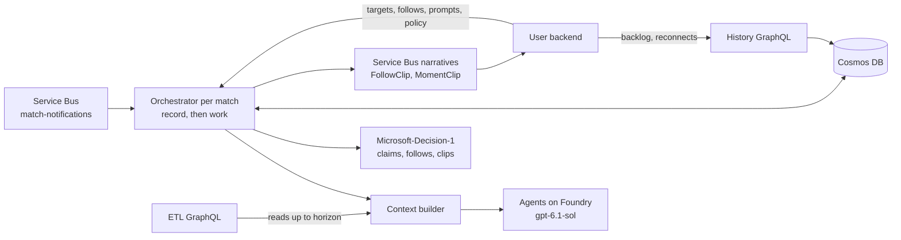

# Narrative engine

Turns the ETL's live match data into short narratives for every audience bucket the user backend has enabled, with Microsoft Agent Framework agents on Azure AI Foundry and Microsoft-Decision-1 for claim checks, story-follow triggers and moment clips. Shared match memory and analysis happen once per match; only the author runs per bucket. Narratives go to Cosmos DB, Service Bus and a history GraphQL API. Viewer questions never come here.

| Step | What happens |
| --- | --- |
| Every closed minute | The **minute summariser** writes a neutral summary (an empty minute gets a fixed block, no call); the **context compressor** merges older summaries when due ([rules](#context-compression)) |
| Every 5 match minutes, half and full time | The **match analyst** names what is developing in its own words, each observation citing the ETL's trend numbers; a validator keeps only grounded ones; a pure reducer opens, develops and resolves **storylines** |
| A key event, ten quiet minutes, a storyline turn, half time, full time, a bucket enabled | A **narrative step**: the **author** writes one or two sentences per enabled bucket (4 at once), advancing one focus storyline shared by every bucket; numbers, names and claims (cause, intent, result, comparison, score) are checked, claims by Decision-1, with one repair turn; saved to Cosmos, then published |
| Anything followed | One Decision-1 call per update decides which followed stories moved and which key events earn a clip; one follow narrative per fired topic and follower bucket |

| Folder | Does |
| --- | --- |
| `core/` | Match clock and message models, settings, the orchestrator and its Cosmos checkpoint; `audience/` reads the backend's targets |
| `context/` | `compression.py` (pure rules), `render.py` (ETL rows → compact prompt text in SPADL terms), `builder.py` (prompt variables per agent, every read bounded) |
| `agents/` | `minute-summariser`, `context-compressor`, `match-analyst`, `narrative-author`; versioned prompts in `agents/prompts/` (`narrative-author.v8`, `match-analyst.v4`, `minute-summary.v3`, `context-compression.v2`, `subscription-decision.v2`, `subscription-author.v1`); model, effort and endpoint per role (`OPENAI_<SETTING>_<ROLE>`) |
| `analysis/` | Grounding validator (cited values must equal the ETL's trend rows), storyline reducer and focus choice |
| `decisions/` | `decide(state, questions) → Decisions`: `Noul` (probability), `Choice`, `Score` (levels); Microsoft-Decision-1 over its own deployment, paced by `DECISION_REQUESTS_PER_MINUTE`; a constrained-LLM fallback behind the same interface |
| `follows/` | Topics from the backend (ETag), entity prefilter, gap guard, one batched decision call (positional keys, no viewer text in the shared state), fire rule, authoring |
| `match_data/`, `store/`, `transport/` | ETL GraphQL client bounded by the horizon; Cosmos and in-memory stores behind one interface; Service Bus listener and publisher, JSONL files locally |
| `api.py`, `service.py`, `demo/` | History GraphQL; composition root, router, model gate, telemetry; seed export/restore mounted only with `DEMO_SEEDS=1` |
| `devtools/`, `fixtures/`, `tests/` | Local runs, Azure helpers, HTML report, fixture tools; authored commentary fixtures for backend tests (not served); pytest with doubles in `tests/doubles/` |

The original design (October 2026) kept the board's prompts unchanged in `docs/design/example-prompts/`; a test checks the runtime prompts' first paragraphs against them.

## Run it

| Command | Does |
| --- | --- |
| `ACCEPT_EULA=Y ./dev up backend` | Runs as `narrative-live` in the shared stack (GraphQL :18012, Cosmos emulator, local model, `DEMO_SEEDS=1`); `./dev logs narrative-live` |
| `cd narrative-engine && python3.11 -m venv .venv && .venv/bin/pip install -r requirements-dev.txt` | Environment (Python 3.11; no Docker needed) |
| `.venv/bin/python -m pytest tests` | All tests; Cosmos tests skip without `COSMOS_ENDPOINT`, live ETL tests without a running stack |
| `.venv/bin/python -m devtools.local tests/fixtures/itg-syn-0001-notifications.jsonl` | A whole match offline in seconds: fake agents, memory store, fixture ETL data; `--agents llm --buckets neutral:casual,home:analyst` for real models; `--data graphql` for a real ETL |
| `.venv/bin/python -m devtools.azure env` then `USER_BACKEND_URL=<url> .venv/bin/python -m narrative_engine.service` | The full service on your machine against Azure dev |
| `python -m narrative_engine.api .local/narratives.jsonl`, `devtools.azure report --match-id X` | Browse a run's output; an HTML report of how the engine thought about a match |

| Test | Proves |
| --- | --- |
| `test_compression.py`, `test_models.py`, `test_render.py` | Compression against the worked example below; clock and messages; prompt text |
| `test_orchestrator.py`, `test_recording_run.py`, `test_servicebus.py` | Full matches, triggers, idempotency, backlog equals live, restarts, concurrent matches, model gate, purge, seeds |
| `test_llm_agents.py`, `test_model_roles.py`, `test_backend_sources.py` | Agents against a mocked API, per-role settings, prompts; targets, prompts and policy from the backend with no fallback |
| `test_follows.py`, `test_decisions.py`, `test_storylines*.py` | Follows, decision models, storylines over the recording |
| `test_graphql_data.py`, `test_graphql_live.py`, `test_store_contract.py`, `test_api.py` | No future leakage; memory and Cosmos stores behave the same; history API |

## Context compression

Recent minutes in detail, older play in ever larger blocks, never across half time; active blocks always tile the match from kickoff to the last summarised minute with no gaps or overlaps. Replaced blocks stay with `supersededBy` set.

1. When **11 minute summaries** are held, the oldest **5** are compressed into one **five-minute block**.
2. When **4 five-minute blocks** are held, the oldest **2** are merged with the existing **earlier block** (if any) into one earlier block. Rule 2 counts only five-minute blocks.
3. Both rules count within the current period; when a period ends its blocks collapse into one block, so memory never spans half time.

| At end of minute | Action | Non-superseded blocks afterwards |
| --- | --- | --- |
| 11 | Compress 1–5 | [1–5], m6..m11 |
| 16 | Compress 6–10 | [1–5] [6–10], m11..m16 |
| 21 | Compress 11–15 | [1–5] [6–10] [11–15], m16..m21 |
| 26 | Compress 16–20; four blocks, so merge 1–5 + 6–10 | [1–10] [11–15] [16–20], m21..m26 |
| 31 | Compress 21–25 (three blocks, no merge) | [1–10] [11–15] [16–20] [21–25], m26..m31 |
| 36 | Compress 26–30; merge 1–10 + 11–15 + 16–20 | [1–20] [21–25] [26–30], m31..m36 |
| 41 | Compress 31–35 | [1–20] [21–25] [26–30] [31–35], m36..m41 |
| 45+1 | Compress 36–40; merge 1–20 + 21–25 + 26–30 | [1–30] [31–35] [36–40], m41..m45+1 |

The context is therefore bounded at one earlier block, up to three five-minute blocks and 6–10 minute summaries however long the match runs. The author also gets the key-event ledger, raw events since the last summary, the catalogue stats at the step's seq, the flagged trends and the bucket's last five narratives. The author prompt puts this shared material first and the bucket framing last, and the first bucket's call runs before its siblings, so Foundry caches the shared prefix (`cached_tokens` is recorded).

## How it runs

| Rule | Detail |
| --- | --- |
| Record, then work | A Service Bus message updates the per-match checkpoint (closed minutes, horizon, targets, queued steps) and is completed at once; a background worker per match then runs the earliest ready step, else summarises the next minute, else closes a period. A step records the horizon it was queued at, so a backlog produces the same narratives as live. Restarts resume from checkpoints |
| No future leakage | Every ETL read is bounded by the horizon: MA3 rows and key events by clock, SPADL actions and catalogue stats by canonical seq; reads wait for `spadlSeq` |
| Audience | `GET /matches/{matchId}/audience-config` (ETag) on every message; `generation_targets` are the buckets enabled in `/dev/`; a bucket enabled mid-match gets a `catchUp` step; never read yet → steps wait and `/health` is 503. No fallback list |
| Concurrency | One worker per match; the author serialised per bucket, at most 4 per match; `MODEL_CONCURRENCY` calls across all matches, summaries first, then the match served least recently. Keeps up while `matches × (1.4 + 0.15 × buckets) × mean call seconds ≤ 60 × MODEL_CONCURRENCY`; above that a backlog drains in match order, nothing dropped |
| Clips | The engine never cuts video: `FollowClip` for a followed topic's moment (clip `Score` ≥ `clips.min_level`, or a clip-on kind), `MomentClip` for a key event on the shared step (`clips.shared`); both sent before and apart from the narratives, so a narrative dropped as ungrounded keeps its clip |
| Demo seeds | With `DEMO_SEEDS=1`: `POST /admin/matches/export {match_id}` and `/restore {match_id, max_seq, schema, containers}` (bearer `ADMIN_TOKEN`); seeds `checkpoints`, `contextBlocks`, `narratives`, `analyses`, `storylines`, never viewers' follow decisions; `409` for another schema, a known or tombstoned match or documents past `max_seq`; the match then continues as after a restart |
| Not supported | Extra time and shoot-outs; a second replica (workers live in memory) |

Cosmos containers, all partitioned by `/matchId`: `checkpoints` (progress, horizon, targets, pending and done steps with pinned inputs, follow state), `contextBlocks` (`level`, `tier`, `coversFrom`, `coversTo`, `summary`, `supersededBy`), `narratives` (`narr:{matchId}:{userType}:{seq}`; also the message body), `analyses`, `storylines`, `subscriptionDecisions`, `subscriptionNarratives`, `tombstones`.

## Contracts

| Output | Shape |
| --- | --- |
| GraphQL `/graphql` (read-only) | Narratives paged per match and bucket from a `seq` (for a viewer's backlog and reconnects) and the match's current state (horizon, status, active buckets); errors as GraphQL errors |
| Service Bus topic `narratives` | One message per narrative: `id`, `matchId`, `userType` (bucket), `seq` (per match and bucket, no gaps), `stepId`, `trigger {type, ref, reason, eventIds}`, `matchTime`, `timeSec`, `text`, `model`, `promptVersion`, `tokens`, `eventSeq` (the watermark it was written from), `analysisId`, `storylineIds`; `MessageId = id`, properties `matchId`, `userType`, `kind` (`bucket`). At least once; consumers deduplicate on `id` |
| Follow narratives (`kind: subscription`) | Same document plus `topicId` and `decision {score, confidence, novelty, model}`; `id = sub:{matchId}:{topicId}:{userType}:{seq}`; one per fired topic and follower bucket; `trigger.type` adds `catchUp` ("the story so far") |
| `FollowClip`, `MomentClip` | `{type, id, matchId, topicId?, buckets?, eventId, eventSeq, stepId, decision?}`; `eventId` is the key event's MA3 id; the backend cuts the clip and shows it once the viewer's snapshot reaches `eventSeq` |

Inputs from the user backend (ETag-cached, no fallback): `GET /matches/{matchId}/audience-config` (`generation_targets`: buckets with layer and option descriptions, team support as data), `GET /narrative-prompts` (templates with the shipped placeholders), `GET /storyline-policy` (analyst limits, claim thresholds, catch-up retries, trend windows), `GET /matches/{matchId}/subscription-targets` (followed topics, follower buckets, follow and clip tunables), `GET /model-roles`. Inputs from ETL: `match-notifications` and GraphQL ([ETL contracts](../etl/README.md#contracts)). Admin: `POST /admin/matches/purge` writes a tombstone and drops the orchestrator.

## Deployment

Terraform in `infra/` (`rg-itg-narrative-dev`), applied by `./dev azure up` ([terraform](../terraform/README.md)); it reads the ETL's state for the Service Bus namespace and Container Apps environment; `user_backend_url` is required. Idle about A$10–20/month; models and Cosmos pay per use.

| Resource | Notes |
| --- | --- |
| Container App `itg-narrative-dev-engine` | 0.5 vCPU, 1 GiB, 1 replica, internal ingress; `DEMO_SEEDS=1` on the demo build |
| Azure AI Foundry (`foundry.tf`) | `writer` (`gpt-6.1-sol`, 120K TPM; every agent at effort `low`, its lowest), alternates `gpt-6-luna` and `gpt-5-mini` (100K TPM, switchable per role live in `/dev/config/models` or permanently in `infra/local.auto.tfvars` `agents`), `decision-1` (Microsoft-Decision-1, DataZoneStandard, 50 requests/minute); the backend's `questions` deployment lives here too |
| Cosmos DB (`cosmos.tf`) | Serverless, database `narrative`, eight containers; managed identity |
| Service Bus topic `narratives` (`messaging.tf`) | In the ETL namespace; subscriptions `user-backend`, `narrative-check` |
| Application Insights (`monitoring.tf`) | Workbook "Narrative engine": agent runs, latency and tokens per agent, narratives per minute, failures; `invoke_agent` spans show one run; data 2–5 minutes late; `ENABLE_SENSITIVE_DATA=true` includes prompts |

Operating: `devtools.azure check-narratives --match-id X`; `az containerapp logs show -n itg-narrative-dev-engine -g rg-itg-narrative-dev --tail 50`; restart any time; purge old matches (`{"all": true}`) before a demo so the subscription's backlog is not narrated.

## Decisions

| We chose | Because |
| --- | --- |
| Record a message in the checkpoint and complete it, then work in the background | Long model calls lost Service Bus locks |
| Blocks never span half time | A finished half collapses into one block; memory per half reads better |
| The backend's enabled buckets, polled with an ETag, no fallback | The backend owns audience definitions; no stale fallback to all buckets |
| A match analyst every 5 minutes keeps storylines; each step advances one focus storyline shared by every bucket | Narratives are storylines through the game, not last-minute commentary |
| The analyst names patterns in its own words; the validator checks only grounding | Don't hard-code or lead the witness |
| One repair turn with the check's reasons, then drop and log | Ungrounded text reached viewers; one repair recovers most of it |
| Storyline constants and claim thresholds in the backend's policy config; prompts describe inputs and outputs only | No magic numbers in code or prompts; every tunable editable per deployment |
| One batched Decision-1 call per update for every involved topic; no viewer text in the shared state | Shared topics generate once; the limit is requests per minute; one viewer's words never reach another's judgement |
| Clips flagged in the follow decision call, cut by the backend | No extra model call; a dropped narrative keeps its clip |
| Shared match material first in the author prompt, framing last | The framing kept the shared prefix under Azure's 1024-token caching minimum, so nothing was ever cached |
| History served over GraphQL from the engine; the whole narrative on the topic | One query style, testable offline; consumers fill gaps without a second read |
| Every role on `gpt-6.1-sol` at `low` | It has no `minimal` effort |
| One replica; managed identity for Cosmos, keys elsewhere | Enough for the demo ([production gaps](../terraform/README.md#decisions-and-production-gaps)) |

Open: grounding rate not sampled on Azure; throughput under several matches on one shared model (raise `MODEL_CONCURRENCY` or a faster author model); occasional odd phrasing.
