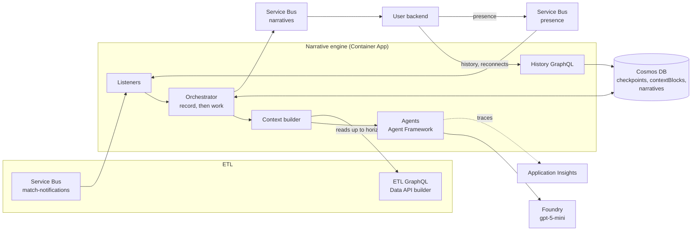

# Architecture

> **In short:** one Python process per deployment. Service Bus messages are recorded in a per-match Cosmos checkpoint and completed at once; a background worker per match then does the model work in match-time order, reading the ETL only up to the announced horizon, and stores, publishes and serves each narrative.

| | |
| --- | --- |
| **Process** | `python -m narrative_engine.service` (one Container App replica) |
| **State** | Cosmos DB, partitioned by `matchId`; nothing important lives only in memory |
| **Concurrency** | One worker per match; author runs serialised per bucket, at most 4 in flight |
| **Delivery** | At least once; consumers deduplicate on narrative `id` |

## 1. Diagram

*In short: ETL and user backend on the left, Azure services the engine owns on the right.*

The rendered overview diagram is [../architecture.svg](../architecture.svg); the original design board section is [design/design-board.svg](design/design-board.svg).

## 2. Components

*In short: each box above is one code folder.*

| Component | Folder | Responsibility |
| --- | --- | --- |
| [Service](components/service.md) | `service.py` | Reads settings, builds everything, routes messages to per-match orchestrators, serves the API |
| [Core](components/core.md) | `core/` | Match clock and message models, settings, the orchestrator |
| [Context](components/context.md) | `context/` | Compression rules, prompt text from ETL data, prompt variables per agent |
| [Agents](components/agents.md) | `agents/` | Minute summariser, context compressor, narrative author |
| [Match data](components/match-data.md) | `match_data/` | ETL reads, bounded by the horizon |
| [Store](components/store.md) | `store/` | Checkpoints, context blocks, narratives |
| [Transport](components/transport.md) | `transport/` | Service Bus in and out; JSONL files locally |
| [API](components/api.md) | `api.py` | Narrative history GraphQL |
| [Devtools](components/devtools.md) | `devtools/` | Local runs, Azure helpers, HTML report (not deployed) |

## 3. Runtime flows

*In short: every message is recorded first and worked on later, so slow models never block Service Bus.*

### 3.1 Record, then work

1. A listener receives a message and the router passes it to that match's orchestrator (`accept`).
2. **Record:** the orchestrator updates the checkpoint (closed minutes, horizon, presence) and queues any narrative steps, then saves it. The message is completed.
3. **Work:** the match's background worker loops until nothing is due. On each turn it runs the earliest ready step, or else summarises the next closed minute, or else closes a finished period.
4. After a restart, `resume()` restarts the workers of live matches from their checkpoints.

A step records the horizon at the time it was queued and waits for the minutes closed at that time (key events, catch-ups) or for its own minute (scheduled, half and full time). A backlog therefore produces the same narratives as live processing.

### 3.2 Each minute (`MinuteClosed`)

1. Every unsummarised minute up to the closed one is summarised in order. A minute with no events gets a fixed block without a model call.
2. Compression runs if due (rules in [context](components/context.md#2-compression-rules)).
3. If ten summarised minutes have passed without a narrative step, a `scheduled` step is queued.

### 3.3 Key event (`KeyEventDetected`)

1. A `keyEvent` step is queued straight away (no debounce), so a VAR overturn gets its own corrective step.
2. The author sees the key-event ledger with overturned goals marked, raw events since the last summary, the memory blocks and the bucket's last five narratives.

### 3.4 Half and full time (`PeriodEnded`)

1. The period's blocks collapse into one block for that period, so memory never spans half time.
2. A `halfTime` or `fullTime` step is queued at the period's last minute. Extra time is not supported.

### 3.5 Presence (`PresenceChanged`)

1. The active buckets are updated; messages older than the last applied `sentAt` are ignored.
2. A bucket going from 0 to 1+ viewers gets a `catchUp` step.

### 3.6 One narrative step

1. Buckets are chosen when the step is queued: the active buckets, or all 12 when presence is missing or stale.
2. For each bucket (serialised per bucket, 4 at once overall) the author writes text.
3. The narrative is saved to Cosmos DB, then published to Service Bus. If it already exists (a retry), it is published again rather than rewritten.

## 4. Data model

*In short: three Cosmos containers, all partitioned by `/matchId`.*

### 4.1 `checkpoints` (one document per match)

| Field | Meaning |
| --- | --- |
| `status` | `live` or `complete` |
| `lastSummarised`, `closedThrough` | Last minute summarised; last minute the ETL closed |
| `horizon` | Latest announced `(clock, second)` |
| `periodEnds`, `closedPeriods` | Where periods ended; which have been collapsed |
| `minutesSinceStep` | Drives the ten-minute scheduled step |
| `presence` | Last presence counts and `sentAt` |
| `pending`, `done` | Queued narrative steps (trigger, clock, horizon, buckets, gate) and finished step refs |

### 4.2 `contextBlocks`

`id` (`block:{matchId}:{level}:{start}:{end}`), `level` (0 minute, 1 five-minute, 2 earlier), `coversFrom`, `coversTo`, `summary`, `statsTime`, `model`, `promptVersion`, `tokens`, `createdAt`, `supersededBy`.

### 4.3 `narratives`

`id` (`narr:{matchId}:{userType}:{seq}`), `userType`, `seq`, `stepId` (`{matchId}:{trigger ref}`), `trigger` (`type`, `ref`, `reason`, `eventIds`), `matchTime`, `text`, `model`, `promptVersion`, `tokens`, `createdAt`. This is also the Service Bus message body.

## 5. Azure resources

*In short: the engine owns its resource group; it borrows the ETL's Service Bus namespace and Container Apps environment.*

| Resource | Name (dev) | Notes |
| --- | --- | --- |
| Resource group | `rg-itg-narrative-dev` | Budget alert at US$20/month |
| Container App | `itg-narrative-dev-engine` | 0.5 vCPU, 1 GiB, 1 replica, external ingress on 8000; in the ETL's environment (one per region on the trial) |
| Container Registry | `itgnarrativedevdhcyoacr` | Basic; images built locally and pushed |
| Cosmos DB | `itg-narrative-dev-dhcyo-cosmos` | Serverless; engine uses managed identity |
| Foundry (AI Services) | `itg-narrative-dev-dhcyo-foundry` | Deployments in Terraform `models`; agents pick one in `agents` |
| Service Bus topics | `narratives`, `presence` | In the ETL namespace; subscriptions `user-backend`, `narrative-check`, `narrative-engine` |
| Application Insights | `itg-narrative-dev-dhcyo-appi` | Own Log Analytics workspace (0.2 GB/day cap); workbook "Narrative engine" |

## 6. Guarantees and limits

*In short: what holds under failure, and what is out of scope.*

- **Idempotent:** block and step IDs are deterministic; a duplicate or redelivered message changes nothing.
- **No future leakage:** every ETL read is bounded by the horizon recorded with the work.
- **Restart-safe:** all progress is in the checkpoint; a restart resumes the queue.
- **Single replica:** workers live in memory, so a second replica would race. Leader election is not built.
- **Not supported:** extra time and penalty shoot-outs; stat-selection output (handled by the user backend).
