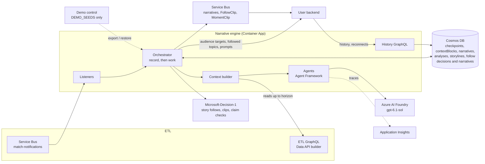

# Architecture

> **In short:** one Python process per deployment. Service Bus messages are recorded in a per-match Cosmos checkpoint and completed at once; a background worker per match then does the model work in match-time order, reading the ETL only up to the announced horizon, and stores, publishes and serves each narrative.

| | |
| --- | --- |
| **Process** | `python -m narrative_engine.service` (one Container App replica) |
| **State** | Cosmos DB, partitioned by `matchId`; nothing important lives only in memory |
| **Concurrency** | One worker per match; author runs serialised per bucket, at most 4 per match; `MODEL_CONCURRENCY` model calls across all matches ([§6](#6-guarantees-and-limits)) |
| **Delivery** | At least once; consumers deduplicate on narrative `id` |

## 1. Diagram

*In short: ETL and user backend on the left, Azure services the engine owns on the right.*

The rendered overview diagram is [../architecture.svg](../architecture.svg); the original design board section is [design/design-board.svg](design/design-board.svg).

## 2. Components

*In short: each box above is one code folder.*

| Component | Folder | Responsibility |
| --- | --- | --- |
| [Service](components/service.md) | `service.py` | Reads settings, builds everything, routes messages to per-match orchestrators, serves the API |
| [Core](components/core.md) | `core/` | Match clock and message models, settings, the orchestrator |
| [Context](components/context.md) | `context/` | Compression rules, prompt text from ETL data, prompt variables per agent |
| [Agents](components/agents.md) | `agents/` | Minute summariser, context compressor, match analyst, narrative author |
| [Analysis](components/analysis.md) | `analysis/` | Grounding validator for the analyst; storyline reducer and focus choice |
| [Match data](components/match-data.md) | `match_data/` | ETL reads, bounded by the horizon |
| [Decisions](components/decisions.md) | `decisions/` | Bounded classifiers: Microsoft-Decision-1, constrained-LLM fallback |
| [Follows](components/follows.md) | `follows/` | Followed topics, trigger rules, follow evaluation and authoring steps |
| [Store](components/store.md) | `store/` | Checkpoints, context blocks, narratives, analyses, storylines, follow decisions and narratives |
| [Transport](components/transport.md) | `transport/` | Service Bus in and out; JSONL files locally |
| [API](components/api.md) | `api.py` | Narrative history GraphQL |
| [Demo seeds](components/demo.md) | `demo/` | Seed export/restore, mounted only with `DEMO_SEEDS=1` |
| [Devtools](components/devtools.md) | `devtools/` (service root) | Local runs, Azure helpers, HTML report, fixture tools (not deployed) |

The folder names map onto the house layers: `core/` holds models and the orchestrator (the service layer), `store/` the repositories, `transport/` and `match_data/` the adapters, and `api.py` and `service.py` the HTTP layer and composition root.

## 3. Runtime flows

*In short: every message is recorded first and worked on later, so slow models never block Service Bus.*

### 3.1 Record, then work

1. A listener receives a message and the router passes it to that match's orchestrator (`accept`).
2. **Record:** the orchestrator updates the checkpoint (closed minutes, horizon, audience targets) and queues any narrative steps, then saves it. The message is completed.
3. **Work:** the match's background worker loops until nothing is due. On each turn it runs the earliest ready step, or else summarises the next closed minute, or else closes a finished period.
4. After a restart, `Router.start()` restarts the workers of live matches from their checkpoints.

A step records the horizon at the time it was queued and waits for the minutes closed at that time (key events, catch-ups) or for its own minute (scheduled, half and full time). A backlog therefore produces the same narratives as live processing.

### 3.2 Each minute (`MinuteClosed`)

1. Every unsummarised minute up to the closed one is summarised in order. A minute with no events, and a merge of only such minutes, gets a fixed block without a model call.
2. Compression runs if due (rules in [context](components/context.md#2-compression-rules)).
3. If ten summarised minutes have passed without a narrative step, a `scheduled` step is queued, except in stoppage time and on a period's last minute, where the half-time or full-time step follows within minutes. A period's last minute also skips the regular compression, because closing the period merges it all.

### 3.3 Key event (`KeyEventDetected`)

1. A `keyEvent` step is queued straight away (no debounce), so a VAR overturn gets its own corrective step.
2. The author sees the key-event ledger with overturned goals marked, raw events since the last summary, the memory blocks and the bucket's last five narratives.

### 3.4 Half and full time (`PeriodEnded`)

1. `PeriodEnded` closes the period's last minute at once, at the End event's clock and second (from the notification), without waiting for `MinuteClosed` or the ETL's idle flush. That minute is summarised once its End row is readable in ETL GraphQL (the SQL write can trail the notification; the worker retries).
2. The period's blocks collapse into one block for that period, so memory never spans half time.
3. A `halfTime` or `fullTime` step is queued at the End event's clock. Extra time is not supported.

### 3.5 Audience targets

1. The orchestrator reads the user backend's `GET /matches/{matchId}/audience-config` on every message and every `TARGETS_POLL_SECONDS` (ETag-cached). Its `generation_targets` are the buckets enabled in the backend's configuration (toggled in `/dev/`); there is no viewer presence.
2. A bucket enabled mid-match gets a `catchUp` step at the current horizon; a disabled one gets no further steps.
3. Never read yet (backend down): steps wait and `/health` is 503. There is no fallback list of buckets.

### 3.6 One narrative step

1. Buckets are chosen when the step is queued: the current targets (an empty list writes nothing).
2. The author drafts every bucket's text (4 at once); the grounding check runs on each, and the decision model answers the claim questions for all drafts in one call; failures get the policy's rewrites.
3. The narrative is saved to Cosmos DB, then published to Service Bus. If it already exists (a retry), it is published again rather than rewritten.

### 3.7 Story follows

Each key event, minute recap, storyline update and period end also queues a follow evaluation when anything is followed: one Decision-1 call for the involved topics, the decision stored, then one narrative per fired topic and follower bucket ([follows](components/follows.md)).

### 3.8 Moment clips

The engine never cuts video: it says which key event deserves a clip, and the backend cuts it from the played stream.

| Message | When | Who sees it |
| --- | --- | --- |
| `FollowClip` | A key event of `clips.key_types` whose clip `Score` (asked in the same Decision-1 call) reaches `clips.min_level`, or any clip moment of a clip-on topic (`clips.always_for`) | That topic's followers (follow view playlist) |
| `MomentClip` | A key event of `clips.key_types` that triggers the shared step, with `clips.shared` | Every Insights viewer of the step's buckets |

Both are sent before and apart from the narratives, so a narrative dropped as ungrounded keeps its clip ([contracts](../contracts/README.md#follow-clips-type-followclip)).

### 3.9 Demo seeds

With `DEMO_SEEDS=1`, demo control exports a held run's documents at a start point and later restores them under a new matchId; the engine adopts the match as after a restart and continues live ([demo](components/demo.md)).

## 4. Data model

*In short: eight Cosmos containers, all partitioned by `/matchId`.*

### 4.1 `checkpoints` (one document per match)

| Field | Meaning |
| --- | --- |
| `status` | `live` or `complete` |
| `lastSummarised`, `closedThrough` | Last minute summarised; last minute the ETL closed |
| `horizon` | Latest announced `(clock, second)` |
| `periodEnds`, `closedPeriods` | Where periods ended; which have been collapsed |
| `minutesSinceStep` | Drives the ten-minute scheduled step |
| `targets`, `left` | Last audience targets read (revision, buckets); match minute each dropped bucket left |
| `pending`, `done` | Queued narrative steps and analyses (trigger, clock, horizon, buckets, gate; on the first attempt the prompt, the canonical `seq` it reads to and, for a narrative step, the analysis and focus storyline are pinned) and finished refs |
| `analysis`, `focusLog` | The latest analysis run (`id`, `horizon`); the last ten focus storylines (rotation) |
| `follows`, `followPairs`, `followFired` | Last followed topics and tunables read; (topic, bucket) pairs seen; each topic's last fire (gap) |

### 4.2 `contextBlocks`

`id` (`block:{matchId}:{level}:{start}:{end}`), `level` (0 minute, 1 five-minute, 2 earlier), `tier` (`minute`, `five-minute`, `twenty-minute`, `half`), `coversFrom`, `coversTo`, `summary`, `statsTime`, `model`, `promptVersion`, `tokens`, `createdAt`, `supersededBy`.

### 4.2a `tombstones`

`id` = `matchId` of a purged match (permanent), plus `*all*` with the purge-all `cutoff`.

### 4.3 `narratives`

`id` (`narr:{matchId}:{userType}:{seq}`), `userType`, `seq`, `stepId` (`{matchId}:{trigger ref}`), `trigger` (`type`, `ref`, `reason`, `eventIds`), `matchTime`, `text`, `model`, `promptVersion`, `tokens`, `createdAt`, `timeSec`, `audienceRevision`, `eventSeq`, `analysisId`, `storylineIds`. This is also the Service Bus message body.

### 4.4 `analyses` and `storylines`

Immutable match analyses and the storylines' current state ([analysis](components/analysis.md)).

### 4.5 `subscriptionDecisions` and `subscriptionNarratives`

Immutable follow decisions (`subdec:{matchId}:{trigger ref}`) and follow narratives (`sub:{matchId}:{topicId}:{userType}:{seq}`, `kind: subscription`) ([follows](components/follows.md)).

## 5. Azure resources

*In short: the engine owns its resource group; it borrows the ETL's Service Bus namespace and Container Apps environment.*

One Container App (internal ingress, one replica), a container registry, serverless Cosmos DB, an Azure AI Foundry account (`writer`, `gpt-6-luna`, `gpt-5-mini`, `decision-1`), the `narratives` topic in the ETL's namespace and Application Insights. Files and settings: [deployment §1](deployment.md#1-infrastructure).

## 6. Guarantees and limits

*In short: what holds under failure, and what is out of scope.*

- **Idempotent:** block and step IDs are deterministic; a duplicate or redelivered message changes nothing.
- **No future leakage:** every ETL read is bounded by the horizon recorded with the work: MA3 rows and key events by clock, SPADL actions and catalogue stats by canonical seq (a key-event step by its own row's). Only settled SPADL actions are stored and reads wait for `spadlSeq`, so a backlog builds the same prompts as live (`test_recording_run.py`, whole Riverton Rovers–Forgeham United match).
- **Restart-safe:** all progress is in the checkpoint; a restart resumes the queue. A lost Service Bus connection reconnects in-process with backoff (1 s doubling to 30 s); unsettled messages are redelivered.
- **Single replica:** workers live in memory, so a second replica would race. Leader election is not built.
- **Throughput:** a match costs about 1.2 summary or compression calls per match minute, 0.2 analyst calls (one every five minutes), plus about 0.12–0.16 author calls per minute per active bucket (storyline turns add a few steps but reset the ten-minute scheduled step) (the three GRF recordings: 92–94 summaries, 20–24 compressions, 11–15 steps; 2.65–3.17 calls per match minute with 12 buckets). The engine keeps up while `matches × (1.2 + 0.15 × buckets) × mean call seconds ≤ 60 × MODEL_CONCURRENCY`. Example: three matches with two buckets each make about 4.5 calls a minute, so at `MODEL_CONCURRENCY=2` (the local stack, which shares its model with viewer questions) calls must average under about 25 s. Above that a backlog builds. Nothing is dropped: it stays in each checkpoint and drains in match order, mostly during half time. Summaries are served first, so author steps (what viewers see) carry the lag; a short run can be purged before its later scheduled steps are written. Each step logs `closed through` to show the lag.
- **Not supported:** extra time and penalty shoot-outs; stat-selection output (handled by the user backend).
