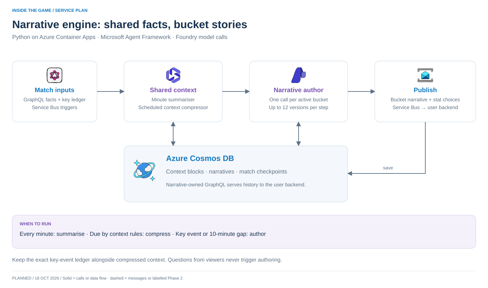

# Develop shared narratives



**Own:** neutral match memory, audience definitions, bucket narratives, narrative history and deduplication. Questions never start this workflow.

```text
Notification + match GraphQL → memory → bucket author
                                ↓          ↓
                             Cosmos    Service Bus + history API
```

**Start:** [Docker setup](../../DEVELOPMENT.md), then `./dev test` for Cosmos or `./dev test azure` for messaging. Local tests create `narrative/{contextBlocks,narratives,checkpoints}`, partitioned by `/matchId`.

**Build next:** Python orchestrator using Microsoft Agent Framework; implement the [summary/compression rules](../design-notes.md). Keep original [prompts](../prompts/README.md) intact. Resolve text-vs-JSON outputs before wiring the author. Publish bucket IDs and approved stat selections; expose owned GraphQL history.

**Prove it:** repeat a notification without duplicate output; recover checkpoints; exclude superseded summaries; keep independent match context; route only relevant buckets. Use labelled deterministic model fixtures for tests, then run a separate real-model check.

**Azure:** Container Apps, Foundry, Cosmos and Service Bus. Foundry requires a real configured model endpoint; no LLM is emulated here. Generate for all available buckets defined in this service's database; no viewer-presence dependency. Never read the backend's user database.
