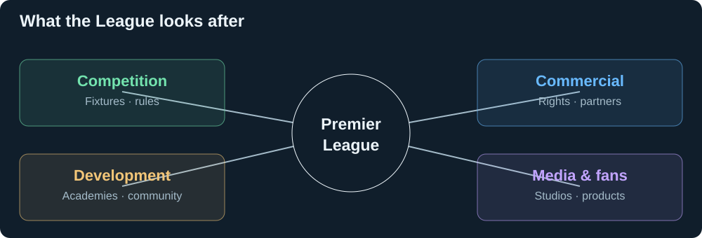

# The League and its business

[← Research](README.md) · [Fan products](fans.md)

| It controls or supports | Scope |
| --- | --- |
| Competition | Fixtures, league rules, club standards, central distributions. |
| Rights and partners | Broadcast licensing; commercial partnerships and licensees. |
| Media | Studios produces international match coverage and programmes. |
| Fan products | App/site, FPL, Companion, and Singapore PL+. |
| Development | Academy standards, community funding and programmes. |

Sources: [governance](https://www.premierleague.com/en/news/4679198/4322439), [rights](https://www.premierleague.com/es/news/3703577/premier-league-broadcast-deals-for-2025-2028), [partners](https://www.premierleague.com/en/about/partners), [Studios](https://www.premierleague.com/es/news/4172032), [Foundation](https://www.premierleague.com/en/footballandcommunity/morethanagame/premier-league-foundation).

**Business logic:** more people watching, returning, or caring about more matches can strengthen rights and partner value. This is the economic connection to examine—not a measured uplift.

| Signal | Why the League would care |
| --- | --- |
| More viewers / watch time | Audience demand behind media rights. |
| More returning fans | Season-long interest, including less prominent fixtures. |
| More markets / accessible viewing | A broader reachable audience. |
| More engagement on its products | Direct fan relationships and partner reach. |
| Better PL+ conversion / retention | Subscription value on its own service. |

The League supplies centrally produced content as well as licensing rights. Partner efficiency matters commercially when it improves the viewing experience or strengthens demand. [Studios](https://www.premierleague.com/es/news/4172032), [PL+](https://www.premierleague.com/en/news/4687725/premier-league-launches-video-streaming-service-in-singapore).

## Microsoft context

| Confirmed | Source |
| --- | --- |
| Five-year partnership: fans, match analysis, Azure infrastructure, internal operations. | [Joint announcement](https://news.microsoft.com/source/2025/07/01/premier-league-and-microsoft-announce-five-year-strategic-partnership-to-personalize-the-fan-experience-with-ai-for-1-8-billion-people/) |
| Microsoft chooses judges; the League assists. | [Rules §2/6](brief.md) |
| Entrants retain ownership; organisers receive broad commercial-use rights. | [Rules §7](https://github.com/microsoft/insidethegamehackathon/blob/9c6c99620b06b2b04dcf69a434cdf4d203d19eda/OFFICIAL%20RULES.md#7-intellectual-property-rights) |
| Cash-equivalent prizes per member: $4,000 first, $2,500 second, $1,500 category; USD e-gift cards. | [Rules §8](https://github.com/microsoft/insidethegamehackathon/blob/9c6c99620b06b2b04dcf69a434cdf4d203d19eda/OFFICIAL%20RULES.md#8-prizes) |

**Working lens:** idea/research sourcing for the partnership. The reuse terms support that interpretation; the organisers' internal intent is not public.
