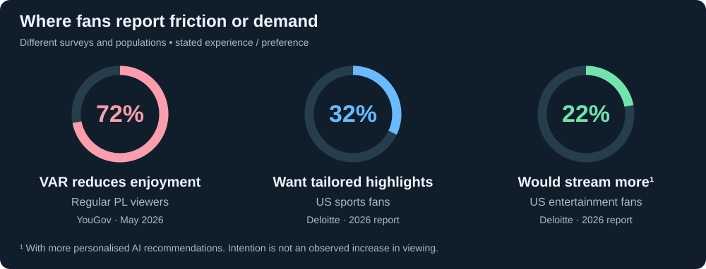

# Where improvement has a business case

[← Research](README.md) · [Microsoft brief](brief.md) · [Existing products](fans.md)

| Concrete situation | Evidence of need | Microsoft asks for | League value to measure |
| --- | --- | --- | --- |
| A fan wants their player's story, not just the match's goals. | **Survey:** 32% of US sports fans want team/athlete-specific highlights and commentary. [1] | Player-focused modes, favourite clubs/players, recaps. | Viewing across more fixtures; repeat visits. |
| A returning fan needs relevant content to watch next. | **Survey:** 22% of US entertainment fans say better AI recommendations would increase their streaming use. [1] | Tailored experiences and contextual narratives. | Archive/replay starts; returning viewers. |
| A viewer loses enjoyment during disputed decisions. | **PL survey:** 72% say VAR reduces enjoyment; 68% want changes. [2] | Explain key moments; synchronised graphics. **Indirect fit.** | Decision comprehension; viewing satisfaction. |

These are demand signals, not measured revenue gains. The VAR survey does not establish that explanations alone fix the problem. Recommendation interest is broader entertainment evidence, not a PL-specific finding.

## Improvements named by Microsoft

| Concrete situation | Published need | League outcome to test |
| --- | --- | --- |
| A casual fan sees pressure numbers but cannot tell why the match changed. | Different experiences for analysts/casual fans; explain control, pressure and rhythm. [3] | Understanding the match; continued viewing. |
| A fan follows a match in a less familiar language. | Native-language access and multilingual narratives. [3, 4] | Comprehension and repeat use by language. |

These are explicit improvement goals; public evidence here does not quantify the current PL experience gap. Companion, myPL and overlays already exist—[the baseline matters](fans.md).

**Business connection:** greater viewing and repeat interest can support rights, sponsorship and PL+ subscription value. Each case still needs a measurable improvement over the existing experience.

### Sources

1. [Deloitte, Digital Media Trends 2026](https://www.deloitte.com/us/en/insights/industry/technology/digital-media-trends-consumption-habits-survey.html): US survey, fieldwork October–November 2025; stated preferences, not observed uplift.
2. [YouGov, 29 May 2026](https://yougov.com/en-gb/articles/54860-premier-league-fans-still-say-var-is-working-badly): regular Premier League viewers.
3. [Microsoft rules §4.1](https://github.com/microsoft/insidethegamehackathon/blob/9c6c99620b06b2b04dcf69a434cdf4d203d19eda/OFFICIAL%20RULES.md#41-hackathon-challenge): audience modes, explanations, player focus and languages.
4. [Microsoft–PL partnership](https://news.microsoft.com/source/2025/07/01/premier-league-and-microsoft-announce-five-year-strategic-partnership-to-personalize-the-fan-experience-with-ai-for-1-8-billion-people/): global and native-language fan access.
