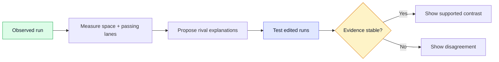
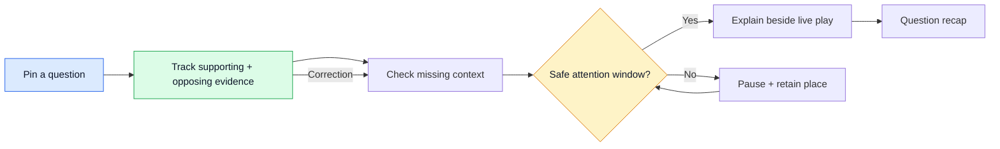
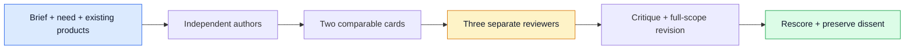

# Two stretch ideas

[← Research](../README.md) · [Challenge](../brief.md) · [Data](../data.md)

**Research examples. Full production targets. No selected product or repo direction.**

| Example | The fan's moment | The research leap |
| --- | --- | --- |
| **A · The Unplayed Run** | “Did that run create the space?” | Test competing explanations against plausible defensive responses. |
| **B · Open Thread** | “Has my player stopped being isolated?” | Keep a question current through absence, interruptions and revised evidence. |

## Independent scores

**A: 76/100 · B: 76/100 — tied in this design review.** Three reviewers assessed both concepts twice. No winner was selected.

| 20% each | A · Unplayed Run | B · Open Thread |
| --- | --- | --- |
| Technical | ▰▰▰▰▱ **4/5** | ▰▰▰▰▱ **4/5** |
| Agent innovation | ▰▰▰▰▱ **4/5** | ▰▰▰▰▱ **4/5** |
| Impact | ▰▰▰▱▱ **3/5** | ▰▰▰▱▱ **3/5** |
| Experience | ▰▰▰▰▱ **4/5** | ▰▰▰▰▱ **4/5** |
| Category | ▰▰▰▰▱ **4/5** | ▰▰▰▰▱ **4/5** |

All final criterion ranges are **4–4**, except impact **3–3**. Agreement is not independent empirical confirmation: the reviewers share a model family.

| Remaining challenge | Decisive evidence |
| --- | --- |
| **A · Plausible alternatives can mislead.** Adaptive search may find apparently confident effects by chance. | Full-loop null-scene tests, multiple-comparison control and response-model dependence checks; fan tests of false causal certainty. |
| **B · Questions may not earn their complexity.** Mass corrections stress inference and patience. | Equal-state scheduler ablations, actual question uptake/reuse, and 100,000-unique-question correction tests with measured fresh-answer coverage. |
| **Both · Specific demand is still a hypothesis.** | Invitation-level trials versus strong existing experiences; separate added League viewing from shifted viewing. |

## A · The Unplayed Run

A winger never touches the ball. Tap their run, change its path, and explore how defenders might respond. **Solid = observed; ghosted = simulated.** The explanation can say the models disagree.

| Design | Full target |
| --- | --- |
| **Experience** | A beginner explores one movement; an analyst compares response distributions. Favourite-player selection changes which moments appear. Localised recaps preserve the same evidence. |
| **Agent decisions** | Hypothesis agent proposes rival explanations; challenger chooses distinguishing interventions; evidence agent requests samples or rejects unstable conclusions. A deterministic arbiter controls publication. |
| **What's different** | [Opta](https://www.statsperform.com/products/opta-vision/) already analyses off-ball movement. [TacticAI](https://www.nature.com/articles/s41467-024-45965-x), [GenTac](https://arxiv.org/abs/2604.11786) and [MCPS](https://arxiv.org/abs/2606.11120) already explore alternatives. The proposed delta is **adaptive testing of rival fan explanations**, not generating trajectories. |
| **Microsoft role** | Agent Framework checkpoints typed handoffs; Azure GPU workers sample responses; Foundry generates evidence-grounded explanations. Cache by match/evidence version and intervention. |
| **Category** | Best Multi-Agent System: prove the challenger and verifier improve explanations over equal-compute single-agent and deterministic controls. |
| **Production interaction** | A live goal interrupts exploration; resume from a checkpoint. Corrections invalidate affected branches. Missing/imputed tracking is labelled; a missed branch deadline returns observed geometry. |

**90-second scene:** quiet attack → reveal the winger → edit the run → challenge an explanation → show beginner/analyst versions together → interrupt and recover → recap with evidence.

A · research and capacity contract

**Proposed scientific tests, not established football causality.**

| Test | Acceptance target |
| --- | --- |
| Independent interventions | Independently authored simulator withheld from training. At least 200 possessions per defensive-policy × displacement stratum; zonal/man-marking/switching × 0–2/2–5/5–10 m. Hold out a fourth policy for rejection tests. Paired seeds and 10,000 reference rollouts per scene. |
| Coverage + usefulness | Six-second futures: nominal 95% player-time regions achieve 92–98% coverage; nominal 90% joint-trajectory regions achieve 85–95%, within every supported stratum. Region area ≤1.25× reference at matched coverage. Availability ≥80%; broad regions or universal abstention cannot pass. |
| Challenge loop | Three rounds / 96 rollouts maximum. Stop after two rounds alter every reported contrast by <5 percentage points. Publish only directionally agreeing, zero-excluding contrasts across three response families; otherwise expose disagreement. |
| Agent advantage | ≥20% fewer unsupported explanations at matched answer coverage versus equal-compute controls. Independent blinded labels require each claim to follow the cited observed facts or explicitly qualified model output. |
| Fan understanding | Compare with equally polished observed-only explanations and deterministic alternative exploration. Target +15 percentage points comprehension; 95% confidence upper bound below +2 points for increased false belief in real-football causal certainty. |
| Capacity | 10 matches at 25 Hz; 100,000 viewers; 100 new interventions/s sustained, 300/s for 60 seconds. At most 96 joint-player six-second rollouts per intervention, counting all challenger rounds. |
| Qualification profile | Start benchmark with 16 Azure workers, each H100 80 GB; frozen BF16 trajectory model ≤1B parameters, batches of 32. Pin Foundry model/version/quota; count queueing, cache misses and GPU seconds. Scale is a test target, not a throughput claim. |
| Latency | p95 ingest→visible observed insight ≤2 s; edited run→visible branch ≤4 s, hard deadline 5 s; overlay clock skew p95 ≤100 ms. Rebenchmark with the full 96-rollout loop. |

Paired effects establish causality only inside the independent simulator. Football transfer requires separate, licensed data and expert/user evaluation. Failure of a research test remains an unresolved mechanism, not evidence of success.

## B · Open Thread

Pin a question at minute 18, leave at 26, return at 41. The answer updates using the match **and what you explicitly saw or acknowledged**. A live attack interrupts its explanation; it resumes at a stoppage.

| Design | Full target |
| --- | --- |
| **Experience** | An Arabic-speaking beginner receives a spatial explanation; an analyst sees opportunities, time windows and uncertainty. “Already know this,” undo, pause and rewind are explicit controls. Exposure never automatically means comprehension. |
| **Agent decisions** | Question agent chooses observable tests; memory agent retrieves support and contradictions; attention agent selects prerequisites and a delivery window. A version-checking publisher commits or abstains. |
| **What's different** | [Companion](https://www.premierleague.com/en/about/partners/microsoft), [WSC](https://wsc-sports.com/case/cleveland-cavaliers/) and [Data Story Finder](https://aws.amazon.com/blogs/media/bundesliga-data-story-finder-delivering-fans-the-stories-they-love/) already personalise or summarise. The proposed delta is **an evolving question with revisable evidence and viewer context**, not another narrative feed. |
| **Microsoft role** | Agent Framework preserves thread/checkpoint state; Foundry reasoning/evaluation; Azure AI Search finds intervals, while exact event queries verify numbers. Shared match evidence and private viewer history have separate stores. |
| **Category** | Best Multi-Agent System: compare against one agent with identical state/tools and a deterministic scheduler; isolate memory and attention decisions. |
| **Production interaction** | Playback watermark prevents spoilers. Save a semantic cursor on interruption; withdraw corrected claims before resuming. Keyboard/screen-reader controls and caption-only/reduced-motion paths preserve the same evidence. |

**90-second scene:** pin question → develop evidence → return in another language → show two viewing histories → interrupt → correct and recover → final question recap.

B · research and capacity contract

| Revised mechanism | Concrete contract |
| --- | --- |
| Meaning of isolation | Receptions per eligible passing opportunity in equal five-minute on-pitch windows. Define opportunities by teammate possession and a disclosed passing-lane heuristic; retain counts/duration. Show “2/6 versus 0/7,” not an unsupported causal conclusion. |
| Graph + decisions | Separate observations from hypotheses. Conflicting observations block claims; alternative interpretations stay labelled. Schedule to minimise context gaps and interruption, publish urgent corrections immediately, defer nonurgent speech, remain silent on unchanged answers. |
| Induced workload | Index subscriptions by entities, metrics and event dependencies; evaluate every unique affected predicate. Provision/test 100 new + 500 induced paths/s sustained, plus 100,000 unique invalidations in one second. Similarity caches cannot hide this test. |
| Burst capacity | Target 4,000 complete paths/s across sharded Foundry deployments: peak 960M input + 120M output tokens/minute at the stated ceilings. Quota and measured throughput remain explicit qualification gates. |
| Honest recovery | Withdraw every affected answer within 2 s independently of inference. During burst, fresh answers or evidence-based abstentions within 30 s; ≥90% of eligible paths must yield substantive supported answers. Unresolved states do not pass answer coverage. |
| Backpressure | Queue ≤100,000 paths; cancel obsolete versions, coalesce superseded work, enforce per-session fairness. Overflow stays visibly unresolved and fails the acceptance test. Repeat bursts with no cache sharing. |
| Memory/attention proof | Hold retrieved evidence constant and vary acknowledged history. Require ≥10-point prerequisite-selection gain over equal-tools/state/budget controls, with no comprehension loss or increased missed action. Undoing acknowledgements must revise prerequisites. |

| Test | Acceptance target |
| --- | --- |
| Evidence retrieval | 1,000 independently labelled unseen synthetic episodes: ≥90% jointly correct answer + evidence interval, zero observed future leakage, ≥10-point gain versus equal-budget single-agent retrieval. [S-EMBER](https://arxiv.org/abs/2607.02689v2) motivates joint evaluation; its wearable-video results do not establish football performance. |
| Distinctive mechanism | Same evidence, different histories/acknowledgements/absences/locales. Compare identical tools/state/token budgets; separately remove memory decisions and replace attention decisions with deterministic scheduling. Measure prerequisite selection, comprehension and missed live action. |
| Nominal capacity | 10 matches; 100,000 connected viewers; 100 new/changed questions/s for two hours. Shared event interpretation; equivalent evidence bundles reused, private history isolated. |
| Serving assumption | Provisional pinned Foundry GPT-4.1 mini deployment; regional availability/quota is a procurement gate. Hardware is managed, not assumed. At ≤4,000 input + 500 output tokens across all calls/question, 100 questions/s means 24M input + 3M output tokens/minute before induced updates. |
| Normal latency | p95/p99 ingest→eligible insight ≤3/6 s; question→supported answer or explicit unresolved state ≤4/8 s. Report unresolved rate and actual answer latency separately. Pending indicators and intentionally deferred explanations do not count as delivered insight. |
| Timing / recovery | Overlay skew p95 ≤100 ms, p99 ≤250 ms; suppress beyond 500 ms. Preempt audio within 250 ms of a scheduler priority event. Restore thread within 2 s after service recovery; withdraw corrected claims within 2 s. |

## Same brief, different mechanisms

| Stage | A · Unplayed Run | B · Open Thread |
| --- | --- | --- |
| **Ingest** | Seeded fictional events + 25 Hz player XY/ball XYZ; shared rendered clock. | Same coherent event/position/identity model, plus corrections and explicit viewer state. |
| **Interpret** | Spatial graph, passing lanes, competing response models. | Opportunity-normalised patterns, claim prerequisites, contradictory evidence. |
| **Explain** | What is observed; which model contrasts survive challenge. | What changed; what this viewer needs to understand it. |
| **Render** | Timed pitch replay and uncertainty corridors. | Timed evidence replay, captions and interruptible audio. |
| **Personalise** | Player, analytical depth, language, accessible modality. | Persistent question, acknowledged context, locale, recap history. |

**Business test for both:** the [32% US sports-fan preference](https://www.deloitte.com/us/en/insights/industry/technology/digital-media-trends-consumption-habits-survey.html) supports player-specific content, not demand for these exact interactions. Randomise invitations **before opt-in**; measure uptake, repeat use and comprehension against strong matched controls. A targets +5% next-fixture minutes; B +5% remaining-match live-play minutes. Track missed action and cross-surface substitution; no assumed rights/revenue uplift.

Shared full-production contract

Both concepts must satisfy this contract; all service and research thresholds are proposed qualification targets.

| Area | Required behaviour |
| --- | --- |
| Truth | Versioned event/evidence IDs; original timestamps and provenance; future events and generator labels withheld. Deterministic statistics; observe/model/infer labels; abstention and correction lineage. |
| Access / privacy | OAuth/OIDC publisher/user authentication, role-scoped APIs, tenant-partitioned stores/caches, encrypted transport/storage. Consent for history; private history excluded from shared inference caches. Default session history expires after 24 h; deletion propagates to derived state and checkpoints. Cross-tenant adversarial tests must pass. |
| Failure | Durable idempotent ingest and checkpoints. Revoke stale claims before regenerating. Provider outage serves verified observations and visible unresolved states; never converts missing evidence into confident narration. Exercise regional/agent failures and correction bursts. |
| Operations | 99.95% monthly serving-availability target, counted separately from useful-answer coverage. Traces connect ingest→agent→evidence→screen. Monitor latency, sync, grounding, abstention, per-locale quality, queue age and cost/viewer-hour. |
| Release | Version prompts/models/schemas; shadow evaluation, canary deployment, automatic rollback on SLO/grounding regressions, checkpoint migration tests and on-call runbooks. |
| Audience | Keyboard/screen reader, captions, reduced motion and no-colour-only meaning; translation checks entities, numbers, negation and uncertainty. Test acknowledgements that are mistaken or revoked. |
| Rights | Own synthetic assets; record generator/seed/licences. External training/validation and live feeds need explicit rights. Neither synthetic demo depends on an unavailable exclusive PL feed. |

## The harness

| 20% each | Strong-design test |
| --- | --- |
| **T · Technical** | Coherent synthetic pipeline, meaningful Microsoft role, testable production behaviour. |
| **A · Agent innovation** | Specific advance, purposeful decisions/recovery, fair simpler-system ablation. |
| **I · Impact** | Supported fan need, direct League benefit, adoption and controlled outcome measurement. |
| **U · Experience** | Clear live journey, real audience differences, accessible timed output and recap. |
| **C · Category** | One official category is central; its claimed advantage is testable. |

**0** absent · **1** assertion · **2** major gaps · **3** coherent/testable · **4** differentiated/explicit · **5** exceptional justification. Equal weights mirror [Microsoft §6](https://github.com/microsoft/insidethegamehackathon/blob/9c6c99620b06b2b04dcf69a434cdf4d203d19eda/OFFICIAL%20RULES.md); anchors are ours. Assume exceptional engineering capacity; penalise unexplained mechanisms, not ambition.

Method research, repeatable prompts and audit trail

| Research finding | Control used |
| --- | --- |
| [Research-idea study](https://arxiv.org/abs/2409.04109): self-evaluation/diversity weaknesses. | Separate authors/scorers; different mechanism lenses. |
| [LLM judge study](https://arxiv.org/abs/2306.05685): position, verbosity and self-enhancement biases. | Anonymous comparable cards, varied order, criteria before preference, preserve disagreement. |
| [Creativity study](https://doi.org/10.1126/sciadv.adn5290): shared suggestions can reduce collective diversity. | Fresh author contexts; no shared favourite pitch. |

These studies use other tasks/models. The controls are methodological adaptations, not guarantees.

**Run:** three research agents informed the frozen protocol; two fresh authors generated four seeds and developed two; three fresh reviewers scored both. Authors did not score themselves. Reviewers share a model family, so separate contexts do not remove correlated bias.

**Seeds retained for traceability:** A explored Unplayed Run / Attention Atlas; B explored Open Thread / Return Ticket. The developed pair separates intervention-based explanation from persistent evidence/attention. The other seeds overlapped existing personalised coverage or catch-up playlists more closely; this is example selection, not a product decision.

**Concept gates:** G1 full five-stage/live/recap path; G2 coherent synthetic truth; G3 legitimate input access; G4 production contract and falsifiable research. Use pass/conditional/fail. Conditional research is allowed; failed gates require revision. Future public-code/demo/access requirements remain delivery obligations.

**Aggregation:** three integer score vectors; median per criterion, then `4 × sum(medians)` out of 100. Show ranges and dissent. Criterion spread ≥2 or any gate conflict requires evidence review. Scores within four points are a practical tie by our convention, not a statistical interval.

**Author prompt:** “Develop two different seeds, then one full production-target example. Name the fan moment, five-stage flow, existing baseline/delta, data, Microsoft/agents, category, operating contract, research falsifier, business test and 90-second scene. Assume world-class execution; separate established capabilities, proposed engineering and research hypotheses.”

**Reviewer prompt:** “Read only anonymised cards, sources and the frozen rubric. Score all five criteria, 0–5, before expressing preference. Return gates, evidence for each score, strongest objection and decisive experiment. Do not reward agent count, pitch length or speculative uplift. Do not reduce scope for deadline/budget.”

### Scores retained from both rounds

Vectors are **T / A / I / U / C**, each 0–5. Parentheses show `/100` totals.

| Reviewer / lens | Round 1 order | A · round 1 → 2 | B · round 1 → 2 |
| --- | --- | --- | --- |
| R1 · engineering | A → B | 3/4/3/4/4 (72) → 4/4/3/4/4 (76) | 4/4/3/4/4 (76) → 4/4/3/4/4 (76) |
| R2 · fan/business | B → A | 3/4/3/4/4 (72) → 4/4/3/4/4 (76) | 3/3/3/4/4 (68) → 4/4/3/4/4 (76) |
| R3 · brief/experience | A → B | 3/4/3/4/4 (72) → 4/4/3/4/4 (76) | 3/3/3/4/4 (68) → 4/4/3/4/4 (76) |

Each reviewer saw the reverse order in round two. Content also changed, so this does **not** isolate an order effect. No reviewer saw another's scores before rescoring.

**Gates:** round one, all reviewers gave both concepts `pass / pass / pass / conditional`; round two, all gave `pass / pass / pass / pass`. Pass means the obligation is specified in the design, not that the implementation or scientific result has been verified.

| Criticism | Revision made | What remains open |
| --- | --- | --- |
| A: observational calibration permits wide, unhelpful alternatives. | Independent interventions, sharpness bound, availability floor, full-loop capacity and false-certainty tests. | Adaptive-selection statistics and real-football transfer. |
| B: nominal query rate hides correction storms. | Unique-predicate indexing, induced-load/burst envelope, immediate withdrawal, queue bound and substantive-answer coverage. | Provisioned throughput and user tolerance of recovery. |
| B: retrieval accuracy does not test memory/attention. | Equal-state/tools/budget ablations; history held variable while evidence is fixed. | Prerequisite-scoring definition and measured benefit. |
| Both: operational obligations and demand tests too vague. | Explicit tenant/privacy/failure/release contract; invitation-level uptake and strong matched controls. | Actual demand, adoption and performance evidence. |

No score was increased solely because an idea became longer. Remaining objections are retained above; the totals assess the final designs, not completed experiments.

*Checked 13 October 2026 · Rules `9c6c99620b06b2b04dcf69a434cdf4d203d19eda` · Design review, not production certification or a prediction of winning.*
