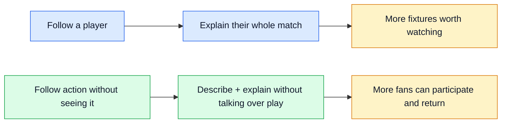
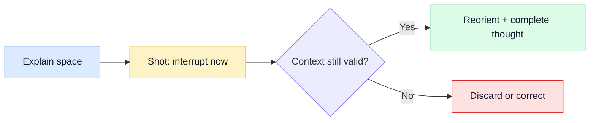
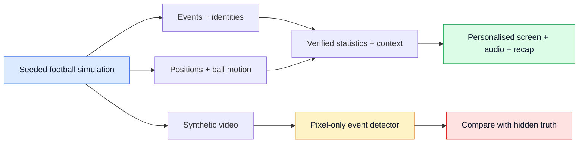

# Stretch ideas · examples only

[← Research](../README.md) · [Official brief](../brief.md) · [Competitor reviews](../../competitors/README.md#evidence-scores)

**Two full-production targets to challenge. Neither selects the product, stack or direction of this repo.**

The right-hand outcomes are **business hypotheses**, not measured gains.

## What fans actually need

| Evidence | What it supports | What it does not prove |
| --- | --- | --- |
| **70%** value ongoing player/team information; **53%** say too much technology reduced live-viewing fun. [Capgemini](https://www.capgemini.com/wp-content/uploads/2025/07/Final-Web-Version-Report-Tech-In-Sports.pdf) | Player interest; protect attention. | Demand for this interface. March–April 2025; 12,017 sports fans, 11 countries. |
| **13m+ FPL participants**; the League describes owned players making other clubs' fixtures interesting. [PL](https://www.premierleague.com/en/news/4359395/what-is-fantasy-premier-league) | An existing player-based audience and a route to cross-fixture viewing. | Incremental viewing caused by these examples. |
| **6.1/15** football-TV experience score; insufficient description to follow action. [RNIB](https://www.rnib.org.uk/documents/1946/RNIB_report_on_accessibility_of_TV_football_broadcasts.pdf) | A specific accessibility problem. | Market prevalence: ten interviews; report dated November 2022, webpage posted October 2023. |

**Business route:** [PL+ Singapore](https://www.premierleague.com/en/news/4687725/premier-league-launches-video-streaming-service-in-singapore) already has live matches, cameras and overlays. It is a plausible surface to improve; no integration access or commercial agreement is assumed.

## C · Follow the Player

**“I came for this player. What are they doing when they never touch the ball?”**

A live name tag and short pitch trace show a changing role. Tap for evidence at a stoppage; finish with a player recap. A beginner sees one useful relation; an analyst sees opportunities, windows and uncertainty.

| The stretch | The proof that would matter |
| --- | --- |
| Agents maintain rival interpretations, request evidence that could disprove them, and decide when to speak or stay quiet. | Better supported explanations than fixed-window analytics and one agent with identical tools, evidence and compute. |
| Explain a 0–0 passage through movement, pressure and passing options. | Understanding beyond a good player-stat/clip feed, without more missed action. |
| A favourite player gives another fixture relevance. | Invitation-level trial: **+5% total legal PL live minutes**, **+3 percentage points non-favourite-club match starts**, over four fixture weeks. Targets, not forecasts. |

**Existing bar:** [Opta Vision](https://www.statsperform.com/products/opta-vision/) already supplies off-ball/pass analysis; PL products already personalise. The proposed advance is **actively resolving disputed evidence through a continuous player story**. Exact unmet demand remains the main weakness.

Worked example · the evidence overturns the story

| Step | Decision |
| --- | --- |
| Role agent | “Mara is receiving wider.” Rivals: whole team moved, or identity error. At most three hypotheses, including no meaningful change. |
| Evidence agent | Reject a narrow crop; request an available eight-second wide-camera interval. Choose expected disagreement reduction per millisecond, not a supporting highlight. |
| Verifier | Detect a shirt-identity swap. Dispute evidence version 18; an agent vote cannot resolve identity. |
| Director | Withdraw the player claim. Show verified team territory, or stay unresolved. A missing camera remains unavailable. |
| Recovery | Correct identity, recompute equal-window statistics and denominators. The player-level difference disappears. |

Maximum three requests within 600 ms; stop only after checking support and contradiction, with calibrated confidence ≥0.9. Otherwise show ambiguity or abstain. Role hypotheses cannot write viewer state; evidence access and audience scheduling have separate tool permissions. A deterministic publisher checks version and expiry.

Test fixed windows, one agent and specialist coordination at equal compute. Remove each specialist separately. If a monolithic agent matches the result, the multi-agent advantage is unproven. This is a research mechanism to test, not proof that splitting roles helps.

**90-second demo:** select midfielder → disputed off-ball change → request evidence → correct identity → beginner/analyst/language views → player recap.

## D · Hear the Whole Game

**“Tell me where the action is and why it matters—without explaining the previous move over the next goal.”**

One evidence stream becomes a pitch view, captions and optional descriptive audio. A blind analyst, low-vision newcomer and sighted casual fan get different detail. Immediate action interrupts explanation; resumption restores the context that is still needed.

| The stretch | The proof that would matter |
| --- | --- |
| Agents choose the minimum spatial context and wording that fit between decisive actions. | Better comprehension than professional descriptive commentary, fixed scheduling and one agent at matched voice, evidence, rate and latency. |
| Corrections repair what was already heard; stale fragments never resume. | **+15 percentage points comprehension**; no material increase in missed action or listening effort. |
| Let underserved fans follow a whole match and return. | Access activation and repeat participation; **+5 percentage points four-match return** as a separate commercial signal. Revenue is not required to establish access value. |

**Existing bar:** [Action Audio](https://action-audio.com/) supplies spatial sound; [Describe Now](https://arxiv.org/abs/2411.11835v2) studies user-controlled descriptions. The proposed advance is **football explanations that remain understandable through interruptions and corrections**. It must beat good descriptive commentary, not ordinary TV commentary.

Worked example · exactly what the fan hears

| Playback | Audio | Why |
| --- | --- | --- |
| 00:00 | “Blue attacking right. Mara on the right wing.” | Establish direction, possession and location. |
| 00:03 | “Two defenders follow Mara. Space opens—” | Start an observed spatial explanation. |
| 00:04 | “Sol shoots. Saved.” | Preempt within 250 ms; discard the unfinished clause. |
| 00:06 | Silence; shot/save caption and pitch update. | Do not fill the attack with a backlog. |
| 00:09, stoppage | “Blue still have it. Mara and two defenders moved right; Sol had space.” | Recheck evidence; complete a thought rather than resume a fragment. |
| 00:12, correction | “Correction: that runner was Nia, not Mara.” | Repair the heard claim and every linked visual/recap. |
| 00:14 | Silence; optional “Repeat that.” | Do not restart merely because a job finished. |

Illustrative timing, subject to speech-duration tests. Announce halftime direction changes. On turnover before resumption, restore current orientation and discard the old explanation or label it a replay. Audio is an alternative commentary track; crowd sound is adjustable. Caption-only mode keeps the same corrected event sequence and user-controlled detail.

The attention agent builds a prerequisite graph from possession/direction/player-location and explicit listener knowledge. It selects expected comprehension gain per available speaking second; expiry and essential-action priority are hard constraints. An evidence agent rejects stale facts; an explanation agent proposes short/long evidence-equivalent forms. The deterministic publisher can reject both. Learned selection, specialist coordination and semantic resumption each need a separate ablation. Listening never automatically means understanding.

**90-second demo:** audio/caption/pitch together → explanation interrupted by shot → identity correction → change language/depth/player → restore context → recap.

## Use the whole description

**All rows below are specified targets, not implemented features.** Suggested metrics have a purpose; no points are added for feature count. Each example includes the full ingest → interpret → explain → render → personalise path, live narratives and automated recaps.

| Brief invitation | C · player story | D · accessible match |
| --- | --- | --- |
| Player identification | Live tag; expose identity uncertainty. | Name + location before explanation. |
| Player speed / distance thresholds | Highlight a recovery run. | Speak a relevant effort, not every number. |
| Pass distance / accuracy / difficulty | Metres, completion denominator, calibrated pre-pass model. | Explain a difficult pass at a safe moment. |
| Ball / shot speed | Calibrated time-resolved ball motion. | Selective shot context. |
| Video auto-eventing | Extract events from synthetic pixels; challenge tracking conflicts. | Uncertain or late estimates cannot become confident speech. |
| Pressure / control / chaos / rhythm | Explain role and opportunity changes. | Adapt context and pacing to play. |
| Player / club / metric focus | Whole-match player continuity. | Player mode plus essential match-wide action. |
| Casual ≠ analyst; multilingual | Different representations; English/Arabic/Spanish. | Different spatial/detail needs; same facts across languages. |
| Timed overlays; milestones; recaps | Evidence IDs, expiry, correction lineage and fictional season history. | Same contract for captions/audio/pitch and recap. |

## Data: events + tracking + video, one truth

Text is an **output grounded in state**, not invented match truth. Video tests auto-eventing; the detector cannot read simulator metadata. Observed, estimated and unknown positions stay distinct—even commercial tracking can impute off-camera players.

Full production and research targets · not an MVP

| Contract | Qualification target |
| --- | --- |
| Coherent synthetic data | Field bounds, possession/event legality, continuous trajectories, speed/acceleration limits and render agreement. Separate matches/tactics/cameras/seeds; two independently authored held-out policies and blinded football realism review. |
| Tracking / perception | 22 players at 25 Hz; higher-rate internal ball motion with anti-aliasing. Pixel worker gets only frames/time/calibration. Per visibility/camera stratum: pass/shot macro-F1 ≥0.90, identity F1 ≥0.95, p95 ball-speed error ≤2 m/s, useful coverage ≥80%. |
| Pass model | Inputs available before release; report denominator/window and uncertainty. Calibration error ≤0.05 plus proper scoring against frequency baseline. Synthetic results do not prove real-footage transfer. |
| C truth / research | 1,000 independent unseen episodes, including null change and conflicting sources. ≥99% supported published claims at ≥80% eligible-moment coverage; ≥15% fewer unsupported claims than strongest equal-compute control. |
| D truth / research | ≥99.5% factual essential utterances, ≥95% essential-event coverage; zero observed severe wrong-player/goal-direction errors across 10,000 held-out utterances. Report confidence intervals, all error strata, explanation coverage and future leakage. |
| User experiments | Preregister before results; powered invitation-level trials and crossover comprehension tests. D: 95% upper bound on excess missed-decisive-action rate ≤2 points; co-design listening-effort noninferiority margin. Measure uptake, repeat use and cross-surface substitution. |
| Scale | 10 matches / 100,000 viewers; shared evidence and 12 qualified language/depth cohorts per match. Local player filters, separate private preferences. No claim of unlimited per-user generative variants. |
| Inference bound | 50 jobs/s sustained; 200/s for 60 s; ≤2 calls/job totalling 6,000 input + 600 output tokens. Requires up to 18M/1.8M tokens per minute sustained and 72M/7.2M burst; quota and measured model capacity are qualification gates. |
| Deadlines / load | Queue ≤200 jobs, age ≤1 s; cancel obsolete work. Essential cues p95 ≤500 ms; eligible insight p95 ≤2 s, deeper request ≤4 s. Burst useful coverage ≥90% within 2 s; dropped jobs do not count as success. Test empty caches, all player choices and distinct preferences. |
| Correction / interruption | Revoke affected visuals ≤2 s across all viewers; explicitly repair heard audio. Preempt ≤250 ms; optional explanation ≤8 s, no overlapping speech. Test correction storms, out-of-order events and provider/region recovery. |
| Operational safety | OIDC/RBAC, tenant isolation, encryption, consent/deletion, durable idempotent replay, audit traces, pinned schemas/models, regression tests, canaries/rollback and regional failover. 99.95% serving availability separate from useful-answer coverage. |
| Cost / access | Meter perception, inference and cost/viewer-hour; set release budget from measured unit costs. Keyboard/screen reader/reduced motion; bilingual names/numbers/negation checks. Own synthetic assets; actual match feeds/distribution require rights. |

**Microsoft roles:** Foundry reasoning, Agent Framework state/handoffs, Azure perception and serving. Deterministic code calculates numbers and publishes version-checked cues. Both examples target **Best Multi-Agent System Prize**; neither gets credit merely for having several agents.

## Independent scores

**C: 76/100 · D: 80/100.** Two reviewers independently reached the same final vectors after three rounds. These assess **design potential**, not built software or chances of winning.

| 20% each | C · Follow the Player | D · Hear the Whole Game |
| --- | --- | --- |
| Technology | ▰▰▰▰▱ **4** | ▰▰▰▰▱ **4** |
| Agent innovation | ▰▰▰▰▱ **4** | ▰▰▰▰▱ **4** |
| Impact | ▰▰▰▱▱ **3** | ▰▰▰▰▱ **4** |
| Experience | ▰▰▰▰▱ **4** | ▰▰▰▰▱ **4** |
| Category fit | ▰▰▰▰▱ **4** | ▰▰▰▰▱ **4** |

**Why not higher?** C still needs evidence that this experience improves on existing player products. D has a documented access problem, but must preserve understanding through interruptions and beat professional descriptive commentary. Neither has measured adoption or demonstrated its agent advantage. Final reviewer ranges are 4–4, except C impact 3–3; related reviewers can share blind spots.

## The review harness

| Stable criterion · 20% each | What reviewers challenge |
| --- | --- |
| `technology` | Synthetic-data creativity/coherence, Microsoft use, maintainability, production mechanism. |
| `agent_innovation` | Useful decisions and meaningful improvement; orchestration, MCP or collaboration, not mandatory agent count. |
| `impact` | Significant developer/business/user problem; credible adoption. Direct fan/League benefit is an additional diagnostic. |
| `experience` | Clear live journey, real audience differences, UI/backend and presentation. |
| `category_fit` | The actual chosen category, including recovery and single-agent comparison for multi-agent entries. |

**Design scale:** 0 absent · 1 claim · 2 material gaps · 3 coherent/testable · 4 strong, specifically supported mechanism · 5 exceptional justification. The five equal weights follow [Microsoft §6](https://github.com/microsoft/insidethegamehackathon/blob/9c6c99620b06b2b04dcf69a434cdf4d203d19eda/OFFICIAL%20RULES.md); anchors are ours. Source-reviewed competitors use a **different evidence scale** and are not a leaderboard against these proposals.

Review history, bias controls and repeatable prompts

**Process:** freeze brief/rubric → research actual need and existing products → separate author → independent challenge → revise mechanisms → rescore. Two reviewers, three rounds for this pair. One reviewer supplied demand research; another used a fresh context and did not read prior score records. Neither authored C/D. They share a model family; agreement is not external validation. Cards retained their names; reviewer ordering was not a controlled randomisation.

Vectors: **technology / agent innovation / impact / experience / category**.

| Reviewer | C · round 1 → 2 → 3 | D · round 1 → 2 → 3 |
| --- | --- | --- |
| Demand / business | 3/3/3/4/4 **68** → 4/4/3/4/4 **76** → **76** | 3/4/4/4/4 **76** → 4/4/4/4/4 **80** → **80** |
| Independent mechanism / brief | 4/3/3/4/3 **68** → 4/4/3/4/3 **72** → 4/4/3/4/4 **76** | 4/3/4/3/3 **68** → **68** → 4/4/4/4/4 **80** |

| Challenge | Revision | Remaining test |
| --- | --- | --- |
| C: evidence acquisition was vague. | Finite hypotheses/queries, query objective, stopping and conflict handling. | Adaptive acquisition must beat simpler controls at matched coverage. |
| D: “resume context” named a capability without showing it. | Spoken interruption/correction trace, orientation tuple and prerequisite selection. | Real speech timing, listener comprehension and effort. |
| Production targets lacked failure boundaries. | Queue/token limits, useful-coverage floor and perception gates. | Measured capacity, quality and unit cost. |
| Agent roles did not establish a category advantage. | Typed permissioned handoffs and separate coordination/role ablations. | A single agent may still match the result. |

All core stages and suggested-feature rows were checked as **specified**, not implemented. Final design gates accept the specification; empirical qualification and entry delivery remain unverified. Both reviewers kept impact unchanged through revisions: no new demand evidence was manufactured.

**History, not a trend line:** previous examples Unplayed Run / Open Thread each scored 76 under rubric v1 after three reviewers and two rounds. C/D replace that pair and use v2; a different idea and rubric cannot be called a measured score improvement. Earlier material remains in Git history.

**Author prompt:** “Create a full-production-target example with a concrete fan job, exact/adjacent demand, current baseline, five-stage path, every relevant description suggestion, purposeful Microsoft/AI decisions, failure behaviour, falsifiable research and a business-outcome experiment. Assume exceptional engineering. Keep facts, hypotheses and targets distinct.”

**Reviewer prompt:** “Apply the frozen named criteria before expressing preference. Inspect sources; distinguish stated preference from behaviour and plans from results. Give evidence, strongest objection, unknowns and a decisive comparison. Do not reward agent count, word count, speculative revenue or matching a desired score.”

Median per criterion ×4 gives /100; show reviewer ranges. A ≥2-point criterion disagreement or core-path conflict requires evidence review. Ties in the actual competition follow the published criterion order, not a made-up win probability. Required delivery access/video/public-code obligations remain distinct from design quality; the judges decide eligibility.

Controls adapt [LLM judge bias research](https://arxiv.org/abs/2306.05685) and [idea-evaluation research](https://arxiv.org/abs/2409.04109). For competitors, named immutable records include repo SHA, stable submission hash, rules/rubric versions and challenge results. New or changed entries queue individually; no fresh score is invented by the daily workflow.

*Checked 13 October 2026 · `itg-rubric-v2` · Rules `9c6c99620b06b2b04dcf69a434cdf4d203d19eda`.*
