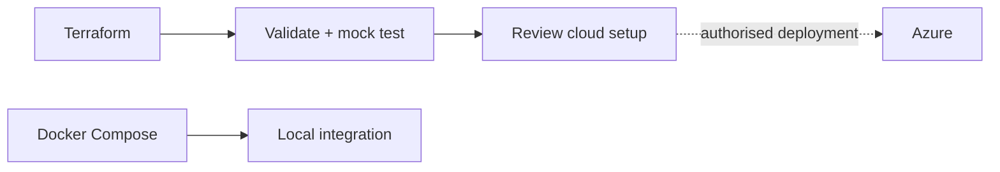

# Azure infrastructure

**Foundation scaffold; not deployed and not a complete cloud release.** Daily local development uses [Docker Compose](../local/README.md).

```sh
./dev terraform check
```

Run from the repo root. Docker runs pinned Terraform, downloads the pinned Azure provider, checks formatting, validates resource schemas and tests a plan with a mock provider. No Azure login, LocalStack token or host Terraform installation is needed. Commit `.terraform.lock.hcl`; keep state, plans and credentials ignored.

The check container uses your user/group ID so generated files remain editable on Linux and WSL.



| File | Resources |
| --- | --- |
| `messaging.tf` | Event Hubs stream + independent consumers; Service Bus topics/subscriptions. |
| `databases.tf` | Azure SQL, Cosmos containers, Postgres server with two databases. |
| `main.tf` | Resource group, logs and Container Apps environment. |
| `tests/design.tftest.hcl` | Account-free checks of service boundaries. |

**Before cloud deployment:** finish networking/private access, identities and permissions, secrets/state storage, real service images and probes, and regional SKU checks. Database public access is disabled; connectivity is intentionally unfinished. Add the Stream Analytics job/query/input/output configuration with Luke. Select Foundry model deployments and frontend hosting separately. Never treat a mock plan as proof Azure will accept or run the stack.

Real deployment will require an Azure account, subscription, provider registrations and billing. `./dev` has no cloud `apply` command and forwards no Azure credentials to the test container. Required cloud values are `subscription_id`, a unique `prefix` and a strong `database_admin_password`; don't commit them. Terraform state can contain passwords even when outputs are sensitive.

LocalStack's [Azure Terraform integration](https://docs.localstack.cloud/azure/connecting/infrastructure-as-code/terraform/) is a separate optional route. It requires [LocalStack authentication](https://docs.localstack.cloud/azure/getting-started/auth-token/), emulator endpoints and compatible provider configuration. It has not been wired or tested here. Microsoft's individual emulators do not implement Terraform's Azure control plane.
