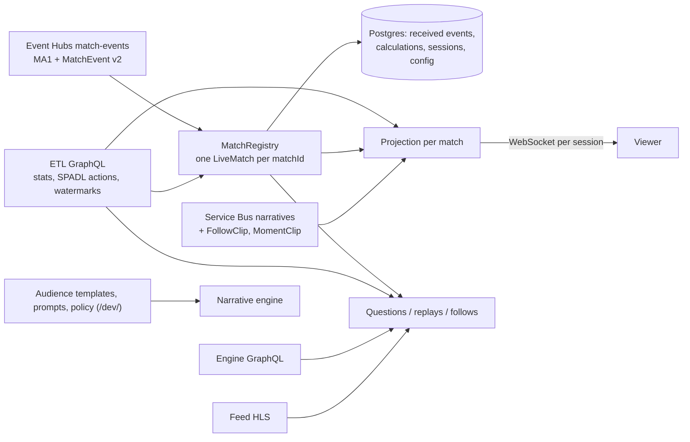

# User backend

Serves the match viewer for every live match: stat cards from ETL GraphQL, the narrative engine's bucket narratives, grounded answers from Microsoft Agent Framework agents, custom stats as bounded rules over ETL's SPADL actions, replay clips from the feed's HLS, story follows with moment clips, cross-game reach and the "Follow this story?" offer. One shared projection per match, composed per viewer over WebSocket. Code computes every value; agents only decide what to compute and how to explain it.

| Folder | Does |
| --- | --- |
| `backend/adapters/` | Every upstream behind one adapter: Event Hubs and Service Bus consumers (commit, then acknowledge), ETL GraphQL (allow-listed queries at a seq), engine GraphQL, HLS playlist, model and decision clients, the SPADL reference |
| `backend/agents/` | Router → goal agent + deterministic compiler, answer agent with read tools, replay agent, follow planner; the event-data skill (`skills/event-data/SKILL.md`) |
| `backend/models/` | Strict Pydantic contracts: SPADL actions, canonical event, stream envelopes, the rule DSL, question replies, audiences, prompts, config |
| `backend/services/` | `MatchRegistry`/`LiveMatch` (received events, custom rules), gaps, the filter engine (a general index over the rule language; each final action counted once), composites, replays (`replay_clips.py` picks seconds), projections, questions, follows, clips, cross-game |
| `backend/repositories/`, `migrations/` | All SQL, one class per table group; versioned SQL and data migrations applied once under an advisory lock; prompt seeds are byte-for-byte copies of the engine's prompts |
| `backend/routes/`, `backend/app.py` | FastAPI routers (HTTP translation only); composition root, `/health`, `/ready`, `/dev/*`, `/lab/*`, seed routes (`DEMO_SEEDS=1`) |
| `benchmarks/`, `fixtures/`, `devtools/`, `tests/` | Golden sets, the 100-case custom-stat corpus, model comparisons, filter performance (never on the live path); the synthetic filter-lab match; `spadl_reference.py`; pytest against real Postgres |

## Run it

| Command | Does |
| --- | --- |
| `ACCEPT_EULA=Y ./dev up backend` then `./dev demo start` | The backend in the shared stack: API `http://localhost:18000/docs`; viewer, `/lab/` and `/dev/` on :18020 |
| `./dev test backend` | Isolated pytest plus `local/backend_broker_check.py` (a probe match through the real Event Hubs emulator), without touching running matches |
| `cd user-backend && ACCOUNTS_DATABASE_URL=… MATCH_APP_DATABASE_URL=… pytest -q` | Every behaviour against real Postgres, one throwaway schema per test; `tests/harness.py` plays the feed and ETL DAB; no model, broker or cloud needed |
| `python -m devtools.spadl_reference` | Regenerate `backend/contracts/spadl-reference.json` from ETL's schema and converter (`test_spadl_contract.py` fails while stale) |
| `python -m benchmarks.question_inprocess --agent fixture`, `python -m benchmarks.replay_eval --agent fixture` | Golden sets with scripted decisions; `--env-file ../.local/backend-llm.env` for the local model |

| Test | Proves |
| --- | --- |
| `test_multi_match.py` | Two live matches never cite each other's cards, narratives, answers or replays; seed export, refusals, restore, adopt |
| Sessions, restart, purge | One session per (viewer, profile, match), takeover closes the old socket (`4001`); every match rebuilt from received events and saved calculations; tombstone first, sockets close `4404`, configuration stays |
| No future data | Snapshot = min(ETL watermark, `spadlSeq`, received); only actions with `finalSeq ≤ seq`; answers never cite anything after the viewer's `seq` |
| `test_stream_gaps.py`, `test_spadl_*.py` | Buffered out-of-order events, recovery from `canonicalEvents` or a recorded skip, a failed commit never freezes the clock; DSL predicates, zones, shot outcomes, migrations `020`/`021` |
| Questions, clips, audiences, config | Admission limit, races, timeouts, evidence checks, clarification; clips reach the right viewers and never pass the snapshot; only enabled buckets are targets; ETag/revision writes |
| No model, runtime boundary | `/ready` 503 and questions refused; no backend module imports recordings, fixtures or doubles |

Configuration: `ACCOUNTS_DATABASE_URL`, `MATCH_APP_DATABASE_URL`, `ETL_GRAPHQL_URL`, `NARRATIVE_GRAPHQL_URL`, `MATCH_EVENTHUB_*` (group `user-backend`), `NARRATIVE_SERVICEBUS_*`, `FEED_HLS_BASE`, `PUBLIC_HLS_BASE`, `LOCAL_LLM_BASE_URL|MODEL|API_KEY|TIMEOUT_SECONDS|EFFORT` (without a model the service is not ready), `AGENT_*`, `QUESTION_*`, `ENABLE_DEV_FEED`, `ENABLE_FILTER_LAB`, `DEMO_SEEDS`, `DECISION_*` (Decision-1 for the follow offer). Tunables (card presentation, replay timing, key-moment ranks, prices, gap timeout, follows and clips, storyline policy, cross-match, follow offer, model per role), audience templates, prompts and demo profiles are edited at [localhost:18020/dev/](http://localhost:18020/dev/) and survive purges.

## How it works

| Flow | Detail |
| --- | --- |
| Stream | MA1 starts a `LiveMatch` unless tombstoned; MatchEvent v2 is kept only for a known match and only clocks the snapshot; each batch commits each match's consecutive events in one transaction, then stores the partition position. An event past the next `seq` is buffered, recovered from ETL `canonicalEvents`, or recorded as a gap after `stream.gap_timeout_seconds` (then the whole run before the first held event is filled from ETL in one pass) |
| Snapshot | `seq = min(ETL watermark, spadlSeq, received)`; new final SPADL actions (`finalSeq ≤ seq`) feed every custom calculation; stats are `executeStatsAtSeq` at that seq; actions, MA3 cards and goals, recaps and key moments are bounded to it |
| Projection | Each committed change wakes the match's projection: one shared snapshot, composed per viewer (five cards from the `presentation` config, each default card showing both teams, plus the viewer's pins; the narratives of the viewer's bucket, shown once the snapshot reaches their `eventSeq`); composing never queries upstreams |
| Questions | Answered at `min(latest, the viewer's shown seq)`, outside match and database locks. A router sees catalogue meanings and recent dialogue, never values; statistics reuse ETL rows or plan a custom rule (a Track card is offered, never started); prose answers use read tools bounded to the snapshot (`read_standard_stats`, `search_actions`, `read_cards`, `read_recaps`, `prepare_stat`, `lookup_spadl`; six calls per answer); every cited id must come from context or a tool; replies carry tokens, calls and seconds. A question about all matches runs one part per match, one after another; replay parts merge into one reel. Answers come in the language of the question |
| Custom stats | Goal agent → deterministic compiler → bounded DSL (conjunctions of typed SPADL predicates with count or sum, plus composites: percentage, ratio, difference, average) → validation (entity, action, operation and time constraints must match the goal) with up to `AGENT_MAX_REPAIRS` repairs; a first-turn check asks which player "his" means without a model call; equivalent rules share one calculation per match; no generated code ever runs |
| Replays | The replay agent chooses evidence (`find_events`, `find_cards`, `find_sequences`, `key_moments`, `recaps`), code chooses seconds and cuts clips from the feed's published HLS; each replay carries `playback` (sting, slow motion) |
| Follows and clips | One follow per viewer per match; the planner proposes, the viewer confirms; identical follows share a topic the engine reads; the engine's `FollowClip` and `MomentClip` become `follow_playlist` and `moment_playlist`, bounded to the snapshot |
| Cross-game | A question, pin or follow naming another live match reads it at its own position and marks the result with `other_match`; a story answer may carry a Decision-1 "Follow this story?" offer; stat answers never do |
| Audiences | A fixture's template (or `default`) lists layers, options and buckets with `enabled` flags edited in `/dev/`; the engine's `generation_targets` are exactly the enabled buckets; the viewer picks one and may change it any time |
| Demo seeds | With `DEMO_SEEDS=1`: `POST /admin/matches/export` and `/restore {match_id, max_seq, schema, tables}` for `received_matches`, `received_events`, `match_gaps`, `audience_catalog`, `engine_narratives`, `narrative_clips`; refusals `409 seed_refused`; then `MatchRegistry.adopt` as after a restart; sessions, follows, questions and calculations are never seeded |

Tables: per match (purged) `received_*`, `match_calculations`, `match_gaps`, `question_*`, `engine_narratives`, `narrative_clips`, `audience_catalog`, `subscription_*`; never purged `match_tombstones`, `match_purge_cutoff`, `stream_checkpoints`, `audience_templates`, `narrative_prompts`, `backend_config`, `rule_vocabulary_map`, Accounts `demo_profiles`. The viewer, audience, prompt, policy and model-role routes are in the [contracts](../local/README.md#8-backend-product-api).

## Limits

One process per deployment until shared state exists: projections, WebSocket fan-out, buffered gap events and plan conversations are process-local. Several replicas need one fenced owner per match partition, snapshots published once and fanned out through gateways, per-account quotas and a bounded question queue (`QUESTION_MAX_ACTIVE` is per process), and job leases for recovery. Measure event rate × candidate rules, question rate × model latency, fan-out and reconnect bursts before claiming viewer scale; the filter benchmarks measure the algorithm, not these.

## Deployment

A Container App in the shared environment (`itgdemo-backend`, 0.5 vCPU, 1 replica, internal ingress; readiness `/ready`), Azure Database for PostgreSQL Flexible B1ms (`accounts`, `matchapp`), Key Vault read by a user-assigned identity (database URLs, broker keys, Foundry and Decision-1 keys), and the Foundry deployment `questions` (`gpt-6.1-sol`, 130K TPM, effort low, over the Responses API) on the engine's account; the follow offer uses the engine's Decision-1 deployment. Defined in the root `terraform/` (`backend.tf`, `databases.tf`, `keyvault.tf`, `foundry.tf`), applied by `./dev azure up` ([terraform](../terraform/README.md)). The same variables as Compose; `ENABLE_DEV_FEED` and `ENABLE_FILTER_LAB` follow `dev_admin` behind nginx basic auth; `DEMO_SEEDS` follows `demo_seeds` (`--release` off).

## Decisions

| We chose | Because |
| --- | --- |
| Many concurrent matches; snapshot `(matchId, seq)` | Per-match isolation and purge |
| A goal agent plus a deterministic compiler to a bounded rule DSL, not generated Python in an executor | No generated code runs; validation is exact |
| Config-only audiences: per-fixture templates with `enabled` buckets | Predictable, editable generation cost; no presence leases |
| Answers at `min(latest, viewer seq)` | An answer must not run ahead of the viewer's picture |
| One session per (viewer, profile, match) with an anonymous `viewer_id` per browser | Two browsers on one demo profile must not share a conversation |
| Custom rules and agents on SPADL actions from ETL; MatchEvent v2 only for the clock and ticker | One converter and one vocabulary across stats, rules, prompts and agents |
| Buffer a gap, recover from ETL, or skip after a timeout; whole-run fill after the first timeout | One bad message must not stall a match; a 900-event gap once took hours one event at a time |
| Cross-game parts run one after another, each scoped to its match | Three at once hit the `questions` deployment's TPM |
| A model per role, applied live from `/dev/` | Cost and quality tuned without a redeploy |
| Seeded starts through a demo-only adapter | A rich story within seconds; core code never branches on a demo |

Open: drop the MatchEvent v2 consumer (clock from `matchWatermarks`, ticker from SPADL); authentication for `/dev`, `/lab`, `/admin` and per-account question quotas; an isolated executor only if the rule DSL proves insufficient. Benchmarks (opt-in, results in ignored `.local/`): question golden set 25/25 and replays 41/42 on the local model after the SPADL move; the event-data skill is kept optional (95 → 97/100 on the corpus); filter performance measures the algorithm's cost, not viewer capacity.
