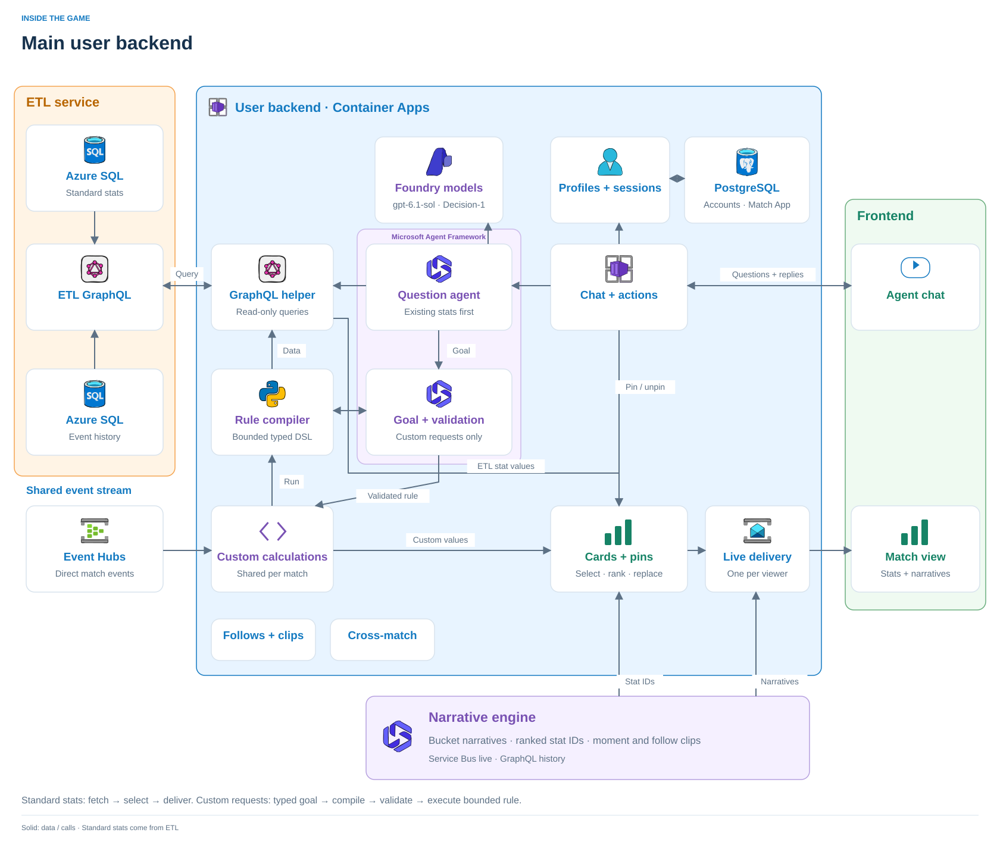

# User backend

> **In short:** serves the match viewer for every live match: cards from ETL GraphQL stats, the narrative engine's bucket narratives, grounded answers from Microsoft Agent Framework agents, custom stats as bounded rules over ETL's SPADL actions, replay clips from the feed's HLS, story follows with moment clips, cross-game reach and the "Follow this story?" offer. Implemented and tested locally; applied on Azure 22 Oct for the Azure test.



| | |
| --- | --- |
| **Status** | Implemented · tested (real Postgres + contract doubles; 601 tests) · D1–D7 run on the local stack 22 Oct · Azure applied 22 Oct, acceptance (PLAN.md §10.4) pending |
| **Reads** | Event Hubs `match-events`, ETL GraphQL (DAB), narrative GraphQL + Service Bus `narratives`, feed HLS |
| **Serves** | `/product` viewer API + WebSocket, audience and prompt APIs for the engine, `/dev` and `/lab` |
| **Models** | Azure (Terraform): `gpt-6.1-sol` deployment `questions`, effort low. Follow offers: Microsoft-Decision-1 when `DECISION_*` is set (local `.local/decision.env`), else the question model |
| **Demo only** | `DEMO_SEEDS=1` mounts seed export/restore (`backend/demo/seeds.py`); a production release leaves it off |
| **Target** | Azure Container Apps, Azure Database for PostgreSQL, Azure AI Foundry models |

```sh
ACCEPT_EULA=Y ./dev up backend
./dev demo start
./dev test backend
```

[Documentation](docs/README.md) · [Overview](docs/overview.md) · [Architecture](docs/architecture.md) · [APIs](docs/components/routes.md) · [Development](docs/development.md) · [Benchmarks](benchmarks/README.md) · [Contracts](../local/contracts.md) · [API explorer](http://localhost:18000/docs) · [Filter lab](http://localhost:18020/lab/) · [Developer config](http://localhost:18020/dev/)
