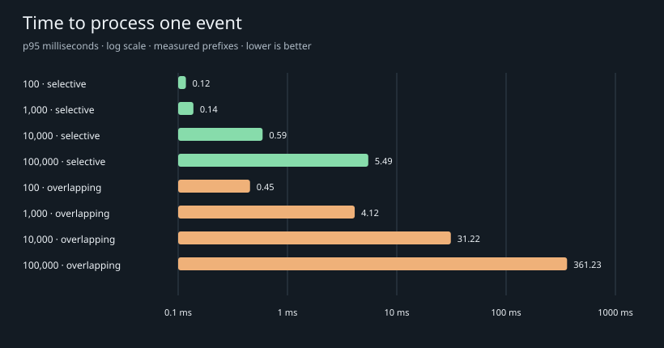

# Measured filter results

Recorded 2026-10-18. Native arm64, Python 3.12.12, 10 logical CPUs. Single-process algorithm; no DB, model, network or viewer delivery in timings.

| Rules | Shape | p95 / event | Mean capacity | Peak RSS | Events measured |
| ---: | --- | ---: | ---: | ---: | ---: |
| 100 | selective | 0.118 ms | 11024.2/s | 76 MiB | 14,018/14,018 |
| 1,000 | selective | 0.138 ms | 8723.0/s | 79 MiB | 14,018/14,018 |
| 10,000 | selective | 0.592 ms | 2444.4/s | 111 MiB | 14,018/14,018 |
| 100,000 | selective | 5.487 ms | 256.0/s | 456 MiB | 5,122/14,018 |
| 100 | overlapping | 0.454 ms | 2718.3/s | 73 MiB | 14,018/14,018 |
| 1,000 | overlapping | 4.122 ms | 334.6/s | 75 MiB | 6,689/14,018 |
| 10,000 | overlapping | 31.220 ms | 36.3/s | 96 MiB | 726/14,018 |
| 100,000 | overlapping | 361.230 ms | 3.1/s | 327 MiB | 63/14,018 |

Larger tiers stop at the configured memory/time limit. **Unmeasured means unmeasured; no claim that 1m–100m unique filters fit or run.** Large tiers may time only a prefix; event counts above disclose this. Mean capacity is not a tail-latency guarantee.

| Requested | Shape | Outcome | Rules registered before limit |
| ---: | --- | --- | ---: |
| 1,000,000 | selective | memory_limit | 251000 |
| 10,000,000 | selective | smaller tier 1000000 reached memory_limit | — |
| 100,000,000 | selective | smaller tier 1000000 reached memory_limit | — |
| 1,000,000 | overlapping | memory_limit | 387000 |
| 10,000,000 | overlapping | smaller tier 1000000 reached memory_limit | — |
| 100,000,000 | overlapping | smaller tier 1000000 reached memory_limit | — |

## Offered event rates

These are queue models driven by measured service times, not real-time traffic tests.

| 100k rule shape | Input | Estimated utilization | p95 processing + queue | Backlog after sample |
| --- | ---: | ---: | ---: | ---: |
| selective | 1/s | 0% | 5.49 ms | 0.00 ms |
| selective | 5/s | 2% | 5.49 ms | 0.00 ms |
| selective | 100/s | 39% | 5.55 ms | 54.72 ms |
| overlapping | 1/s | 32% | 361.23 ms | 0.00 ms |
| overlapping | 5/s | 160% | 7444.42 ms | 7602.98 ms |
| overlapping | 100/s | 3207% | 18654.42 ms | 19572.98 ms |

## Whole-match sampling at 100k filters

A fixed-seed permutation samples both halves rather than only the opening minutes. These are independent unique-ID events; this is not a chronological replay. Small sample sizes and GC/OS pauses limit precision.

| Shape | Events sampled | p95 / event | p99 / event | Maximum | Mean capacity |
| --- | ---: | ---: | ---: | ---: | ---: |
| selective | 3,710 | 6.28 ms | 8.15 ms | 524.63 ms | 185.6/s |
| overlapping | 42 | 585.41 ms | 691.18 ms | 691.18 ms | 2.1/s |

At 100 input events/s, selective filters average 54% utilization, but measured service-time spikes raise modeled p95 queue-plus-processing latency to **74.2 ms**. Dense overlapping filters cannot sustain 5/s. [Raw whole-match samples](spread.json).

The index performs at most 64 probes for a new event, **then evaluates every candidate**. At 100k rules, selective and overlapping candidate counts explain the difference; time-only filters all share one bucket. This implementation needs further work for dense overlapping demand.

Sharing 100 distinct rules among 100k, 1m, 10m or 100m viewers does not add filter computation. This is an architectural arithmetic model, not an allocation or delivery test of those viewers.

Cached reads: **1,000,000 lookups across 100,000 filters**, averaging **1.737 μs/read** (575,760/s). Includes the Python ID-selection loop and value access; excludes serialization and delivery.

Full-match cross-check: **100 generated rules passed** independent reference totals over **14,018 deliveries**.

## Correctness and model understanding

**Gold rules: 100/100 passed** all 35 delivery prefixes and late backfill against explicit hand-authored contributions. These are not answers generated by the model.

**Real agents: 78/112 strict passes.** 6 additional cases produced the correct fixture values but different constraints; 14 produced a wrong value during replay. Remaining failures include status mismatches/timeouts. A redundant inferred team predicate can explain some constraint differences; these are retained for review rather than silently accepted.

| Prompt quality | Strict pass | Total |
| --- | ---: | ---: |
| clear | 48 | 65 |
| average | 12 | 19 |
| messy | 8 | 16 |
| ambiguous_or_unsupported | 10 | 12 |

Of the **100 stat prompts**, 68 passed exactly. The **12 negative prompts** passed 10. Failed requests are not silently replaced with fixture answers.

Failure categories: `different_constraints`: 6, `status`: 14, `wrong_event_value`: 14.

This is one model run with bounded timeouts, not proof of language-understanding reliability. No gold expectations were supplied to the agent; only the normal match/team/player context. The repair harness checks the generated rule against the agent-defined goal, so a wrongly understood goal can still pass its internal validation.

[All agent results](agents.json) · [Cases and expected timelines](cases.json)

[Run the harness](../README.md) · [Raw performance results](performance.json)
