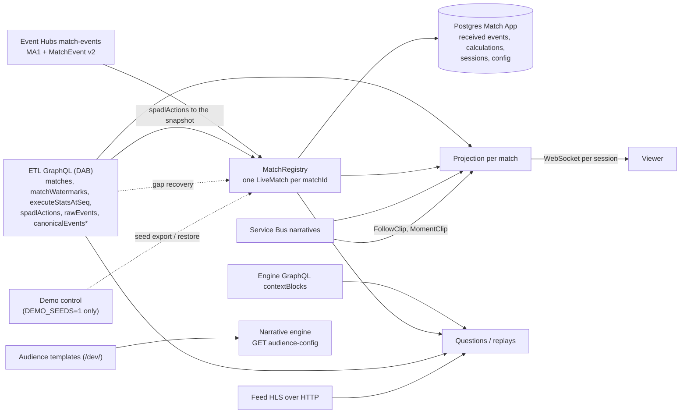

# Architecture

> **In short:** one API process owns every match it has heard of. Stream messages commit to Postgres before they are acknowledged; a per-match projection turns ETL stats and SPADL actions, received events (clock, ticker) and engine narratives into one shared snapshot; viewers get their own composition of it over WebSocket. Agents run outside every lock and read only up to a snapshot.

| | |
| --- | --- |
| **Process** | One FastAPI app (`backend.app:from_env`), background tasks for the two broker consumers and gap recovery |
| **Databases** | Accounts (demo profiles) and Match App (everything else, schema `user_backend`) on one Postgres server |
| **Snapshot** | `(matchId, seq)`; nothing past ETL's watermark, its SPADL watermark `spadlSeq` or what this service received is reachable |
| **Locks** | Per match: the match lock (events, calculations, purge fence) and per-match session locks (one viewer's takeover) |
| **Diagrams** | [../architecture.svg](../architecture.svg), [narrative-framing.svg](narrative-framing.svg) |

## 1. Diagram

*In short: brokers and GraphQL feed a registry and per-match projections.*

`*` `canonicalEvents` is queried only for gap recovery ([§3](#3-runtime-flows)).

## 2. Components

*In short: routes call services; repositories own SQL; adapters own every upstream.*

| Layer | Folder | Page |
| --- | --- | --- |
| Wiring, storage, errors | `backend/app.py`, `store.py`, `domain.py` | [app](components/app.md) |
| Demo-only seeds | `backend/demo/` | [demo](components/demo.md) |
| Upstreams | `backend/adapters/` | [adapters](components/adapters.md) |
| Agents | `backend/agents/` | [agents](components/agents.md) |
| Contracts | `backend/models/` | [models](components/models.md) |
| Persistence | `backend/repositories/` | [repositories](components/repositories.md) |
| HTTP | `backend/routes/` | [routes](components/routes.md) |
| Use cases | `backend/services/` | [services](components/services.md) |

## 3. Runtime flows

*In short: commit first, then publish; read at one snapshot.*

**Stream.** `adapters/match_stream.py` reads Event Hubs batches. MA1 starts a `LiveMatch` unless the match is tombstoned or the MA1 predates a purge-all cut-off. MatchEvent v2 is kept only for a known match. Each batch commits each match's consecutive events in one transaction; duplicates are ignored. Custom rules do not read these events. The partition position is stored afterwards, so a restart resumes there.

**Gaps.** An event past the next expected `seq` is buffered. If the missing `seq` has not arrived after `stream.gap_timeout_seconds` (config table, [routes §6](components/routes.md#6-config-tables)), recovery asks ETL GraphQL `canonicalEvents` for that `(matchId, seq)`. If ETL is past that seq without a row (or still cannot answer one timeout later), the backend records the gap (`match_gaps`), stores a deleted placeholder event `gap-{seq}` to keep `seq` contiguous (it never counts), and drains the buffer. While a gap is open the Event Hubs checkpoint is held, so a restart replays the buffered events. Open gaps appear in `/health` (`gaps`) and `/dev/pipeline` (`gaps`; user-backend status `degraded`).

**Snapshot.** `adapters/match_data.py` captures `seq = min(ETL watermark, spadlSeq, received)`, then `LiveMatch.sync_actions` reads the new final SPADL actions (`finalSeq ≤ seq`) into every custom calculation. Stats are `executeStatsAtSeq` at that seq (an empty list means ETL is catching up); custom values are read at the same seq; actions, MA3 cards and goals, recaps and key moments are bounded to it.

**Projection.** Each committed change wakes the match's projection (`services/product.py`). It publishes one shared snapshot and composes per viewer: five cards from the `presentation` config (defaults, fallbacks and the viewer's pins) and the narratives addressed to the viewer's bucket. Composing never queries upstreams.

**Questions.** The client sends the `seq` it is showing; the backend answers at `min(latest snapshot, viewer seq)`, so an answer never cites an event the viewer has not seen. Model work runs outside match and database locks; the commit re-checks the match is not purged.

**Audiences.** Generation is driven only by configuration. A fixture's template (or `default`) lists layers, options and buckets, each bucket with an `enabled` flag edited in `/dev/`. The engine's `generation_targets` are exactly the enabled buckets. The viewer picks one enabled bucket and may change it at any time; that choice only changes which narratives and default cards the viewer sees.

**Narratives.** Engine narratives (Service Bus) are saved per match and shown once the snapshot reaches their `eventSeq` (or, without one, their clock); a closed period releases all of its steps.

**Clips.** The engine's `FollowClip` (a followed topic's moment) and `MomentClip` (a key event on the shared narratives) are saved per match; the projection cuts them into `follow_playlist` and `moment_playlist` with `replay-timing`, bounded to the snapshot ([services §10](components/services.md#10-clips-cross-game-and-follow-offers)).

**Cross-game.** A question, pin or follow that names another live match reads that match at its own position and marks the result with its header (`other_match`); no match's own narratives ever mention another.

**Demo seeds.** With `DEMO_SEEDS=1`, demo control exports a match's rows at a start point and later restores them under a new `matchId`; the registry then adopts it as after a restart ([demo](components/demo.md)).

**Purge.** `POST /admin/matches/purge` tombstones, then deletes the match's rows, closes its sockets with `4404` and drops its projection. Configuration stays.

## 4. Data model

*In short: match data is purgeable per match; configuration is not.*

| Tables | Holds | Purged |
| --- | --- | --- |
| `received_matches`, `received_events`, `match_calculations`, `match_gaps`, `calculation_id_map` | Stream data and custom results per match | Per match |
| `question_conversations`, `question_sessions`, `question_turns`, `question_offers` | Chat (questions and follow), sessions and pins per (viewer, profile, match) | Per match |
| `engine_narratives`, `narrative_clips`, `audience_catalog` | Narratives, key-event clips per bucket and each match's copy of its audience template | Per match |
| `subscription_topics`, `subscriptions`, `subscription_revisions`, `subscription_narratives`, `subscription_clips` | Story follows, their targets revision and delivered follow narratives | Per match |
| `match_tombstones`, `match_purge_cutoff`, `stream_checkpoints` | Purge fences and broker positions | Never |
| `audience_templates`, `narrative_prompts`, `narrative_prompt_active`, `backend_config` | Configuration edited in `/dev/` | Never |
| Accounts `demo_profiles` (+ revision row) | Demo accounts | Never |

[Migrations](components/migrations.md) lists each file.

## 5. Service boundaries

*In short: the engine writes, the backend routes.*

| Narrative engine owns | User backend owns |
| --- | --- |
| Neutral analysis, summaries and bucket wording | Audience layers, options, buckets and their descriptions |
| Reading `generation_targets` and writing for each enabled bucket | Each viewer's bucket choice and routing supplied text unchanged |
| Narrative history (GraphQL) and live narratives (Service Bus) | Live delivery to viewers and their history in the projection |

ETL owns every standard stat; the backend never recomputes one, and reads ETL only through GraphQL. Custom rules run only for requests no catalogue stat answers. The backend never publishes to a broker.

## 6. Scaling boundary

*In short: one process per deployment until shared state exists.*

Projections, WebSocket fan-out, buffered gap events and plan conversations are process-local. Running several API replicas needs:

| Boundary | Requirement |
| --- | --- |
| Match calculations | One fenced owner per match partition; events, custom results and checkpoint commit together (they do today, in one process) |
| Delivery | Publish changed snapshots once, fan out through gateways; reconnects get a fresh snapshot |
| Questions | Per-account quotas and a bounded queue; `QUESTION_MAX_ACTIVE` is per process today |
| Recovery | Job leases and fencing; a starting replica must not fail another's in-flight answers (today startup marks every pending turn failed) |

Measure before claiming viewer scale: event rate × candidate rules, question rate × model latency, fan-out and reconnect bursts, and recovery with a worker killed mid-commit. The [filter benchmarks](components/benchmarks.md#4-filter-performance) measure the algorithm, not these limits.
