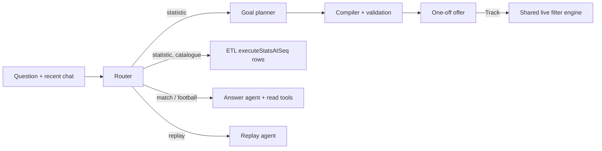

# Agents

> **In short:** Microsoft Agent Framework agents interpret what the viewer means; code computes every value. A router classifies each question; statistics go to a goal agent plus a deterministic compiler (or to ETL catalogue rows), prose answers use read-only tools, replays go to a replay agent that picks evidence while code cuts the clips. No generated Python runs.

| | |
| --- | --- |
| **Code** | [`backend/agents/`](../../backend/agents/) |
| **Framework** | `agent-framework-core`, `agent-framework-openai` (pinned in `requirements.txt`) |
| **Model** | Configured by `LOCAL_LLM_*`: locally the local model; on Azure the Foundry deployment `questions` (`gpt-6.1-sol`, `LOCAL_LLM_EFFORT=low`). Per role (questions, replay, follow planner) under `/dev/config/models` ([adapters §4](adapters.md#4-model-and-decision-clients-usage)). None configured → `/ready` 503 and questions refused (`model_unavailable`) |
| **Decision model** | Follow offer: Microsoft-Decision-1 via `DECISION_*`, else the question model as a constrained yes/no ([services §10](services.md#10-clips-cross-game-and-follow-offers)) |
| **Tests** | `test_agents.py`, `test_structured_agent.py`, `test_questions.py`, `test_compound_stats.py`, `test_question_golden.py`, `test_replay_golden.py`, `test_data_skill.py` |

## 1. Custom-stat workflow

*In short: interpret or clarify, compile, validate; one model call per turn normally.*

```text
Question → goal agent → existing ETL stat, clarification, or custom goal
Custom goal → deterministic DSL compiler → goal/rule validation → one-off value + Track offer
Clarification → viewer reply → goal agent (original request preserved)
```

`workflow.py` builds a real `WorkflowBuilder` graph; `workflow_steps.py` holds the typed goal, generation and validation executors; `orchestrator.py` defines meaning; `compiler.py` emits the bounded DSL ([models](models.md#2-rules)). Validation rejects missing or changed entity, action, operation and time constraints; it checks goal/rule agreement, not that the model understood the viewer. Failed validation routes back with an initial attempt plus `AGENT_MAX_REPAIRS` repairs (default 3, 0–20). Goal definition retries once on a transient or invalid response. All stages share `AGENT_PLAN_TIMEOUT_SECONDS` (default 60, 1–300). Logs hold failure categories, never response bodies or credentials.

`AGENT_GOAL_OUTPUT_MODE`: `prompt` (default) inlines a compact contract generated from the typed models (`contracts.py`); `schema` also passes it as `response_format` and still validates locally, with no silent downgrade. Clarification replies carry `{question, options ≤ 5, allow_free_text}` and survive reconnects. A first-turn check (`clarification.py`) asks which player an unresolved "his"/"her" means without a model call.

Composite goals (percentage, ratio, difference, distance average) contain two independently scoped aggregate inputs ([services §4](services.md#4-composite-metrics)).

## 2. Question agent

*In short: a router, then tools bounded to one snapshot.*



| Piece | Behaviour |
| --- | --- |
| Snapshot | `min(latest snapshot, the viewer's shown seq)`; stats, actions, cards, recaps and key moments are bounded to it |
| Router (`question_intent.py`) | Sees catalogue meanings and recent dialogue, never values, actions or recaps |
| Statistics | Reuse ETL rows (per team for "each team", "split", "score"; on-target % and similar computed in code) or plan a custom rule; a Track card is offered, never started. "Which player has the most X" is a goal with `rank_by: player`: code ranks every player over the snapshot's SPADL actions, names all tied leaders and offers up to three |
| Answer agent (`question.py`) | Tools `read_standard_stats`, `search_actions` (SPADL, 100/page, no raw coordinates), `read_cards`, `read_recaps`, `prepare_stat`, `lookup_spadl`; six tool calls per answer in total; per tool at most two for `prepare_stat` and `read_cards`, four for `lookup_spadl` |
| Evidence | Every cited ID must come from context or a tool (`action:a{id}`, `card:{id}`); labels use the broadcast minute (51:18 is 52′) |
| Usage | Each reply carries input/output tokens, calls and seconds; never the model or provider |

A share, split, percentage, ratio or rate is never a plain count: the planner reuses the matching ETL row or declines. Refusals name the missing data from the feed's capabilities. Who was sent off is read from MA3 cards by code; a score comes from MA3 goals and VAR decisions. General football answers use a small offline reference (`knowledge/football-basics.json`).

## 3. Replay agent

*In short: the agent chooses evidence; code chooses seconds.*

`replay.py` tools: `find_events` (6; SPADL `action_types`, `results`, `bodyparts`, `start_zones`, `end_zones`, `shot_outcomes`, `save_kinds`, team, player, period, minutes), `find_cards` (3), `find_sequences` (3, derived evidence such as a failed pass followed by an opponent's interception), `recent` (2), `key_moments` (3), `recaps` (4), `lookup_spadl` (3). It returns ranked items `{source_id, kind: event|key_moment, caption, lead_in: short|normal|long|move}`; unknown or future IDs are rejected. A caption calling an unsaved shot "saved" is replaced by one written from the evidence. Clip cutting is in [services §5](services.md#5-replays).

## 4. SPADL vocabulary for agents

*In short: every agent speaks SPADL; enums are fixed in the schema, meanings in context, details on lookup.*

| Where | What |
| --- | --- |
| Goal JSON schema | SPADL enums (`action_types`, `results`, `bodyparts`, `start_zones`/`end_zones`, `shot_outcomes`, `save_kinds`) plus `locations` (team-relative x/y bounds); the model picks fixed values |
| Context `data_reference` | The [SPADL profile](adapters.md#5-spadl-reference): one-line meanings per type, result, body part, zone and family, outside-SPADL facts, and this match's `availability` |
| `measurement_support` | Availability only: complete body-part types, recorded body parts, shot outcomes, locations, filters, unavailable data |
| `semantics.py` | Metric mapping in SPADL terms (passes = pass family, shots = shot family, on target = `shot_outcomes [goal, saved]`, saves = the `shots_saved` stat or `save_kinds [save]`, touches = all actions) |
| `lookup_spadl(term)` | Definition, Opta source, catalogue stats and a goal example per term (question and replay agents) |

Tools never return raw action rows or the JSON schema; searches return filtered compact actions, values come from the engine. `AGENT_DATA_SKILL=feed` (off by default) gives the goal agent the SPADL dictionary via `skills/event-data/SKILL.md` instead of the fixed metric mapping. Token and accuracy figures: [benchmarks §5](benchmarks.md#5-measured-results).

## 5. Limits and configuration

*In short: bounded time, calls and concurrency.*

| Setting | Default |
| --- | --- |
| `QUESTION_TIMEOUT_SECONDS` | 90 in code; 240 in the local compose file |
| `QUESTION_MAX_ACTIVE` | 4 (1–32); excess requests fail fast with `503 question_capacity` |
| `AGENT_PLAN_TIMEOUT_SECONDS`, `AGENT_MAX_REPAIRS` | 60, 3 |
| `LOCAL_LLM_TIMEOUT_SECONDS` | 120 |

A retried request UUID returns its saved answer; another pending question is `409`; a restart marks interrupted turns failed. Each request gets a fresh workflow and stateless agent calls; action history, fixture expectations and future actions never reach the goal agent. Classification and prose remain probabilistic: the [golden sets](benchmarks.md) check values and refusals, not every explanation.

## 6. Follow planner

*In short: one structured call names what to follow; code resolves the ids.*

`subscription_planner.py` renders the active `subscription-planner` prompt with the match's teams, players and storylines at the viewer's snapshot, the current follow and the last `limits.planner_context_turns` follow-chat turns, and returns a validated `PlannerDraft` (`follow`, `clarify`, `unfollow` or `none`). The planner and the question agent also get the live matches (teams, minute; `CrossMatch.listing`), so a request may name another match; a clarification carries up to four options, unknown ones dropped by code. The model never supplies ids: `services/subscriptions.resolve` maps its named subject to a team, player or storyline ([services §9](services.md#9-story-follows)).
