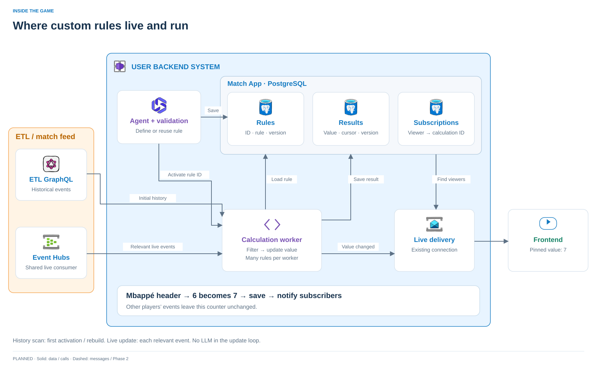

# Where custom rules live and run

**Proposed execution design.** This expands the agreed user-backend boundary; it is not an implemented worker/registry. Standard ETL-provided statistics bypass this path.

## Stored rule, running worker

The agent saves a validated rule in the **Match App PostgreSQL database**, owned by the user backend. A rule is data until the calculation worker loads it. The worker belongs to the same backend system; it can run as a background task for the demo and become a separately scaled worker later. Generated Python still runs only in the separate isolated executor.

| Record | Example contents |
| --- | --- |
| `calculations` | Calculation ID, match ID, normalized rule, rule version, validation/status |
| `calculation_state` | Calculation ID, current value, processed event position(s), result version |
| `viewer_calculations` | Viewer/match, calculation ID, pinned card slot |

For a simple counter, store structured JSON such as `count where player_id=P and body_part=head, from=kickoff`. Resolve the player ID and the meaning of “headers” before saving it. The worker evaluates these fields directly; regex is only useful where text extraction is actually needed. Multiple viewers can point to the same calculation.

## What makes it run?

| Trigger | Worker action |
| --- | --- |
| New validated calculation requested | Register/reuse the rule; send its ID to the worker; load and initialize it from ETL GraphQL history if needed |
| Relevant new match event | Apply the rule to this event and update the existing accumulator; do not rescan the match |
| Correction or retraction | Reverse the old event contribution and apply the replacement, if any |
| Process restart or detected gap | Reload active rules and saved progress, then replay missing events or rebuild from history |
| New viewer pins an existing calculation | Attach the viewer and send the saved value; do not start another calculation |

**The database does not execute the rule.** The registration path explicitly activates it. A demo can notify an in-process worker after committing the definition and reload pending/active definitions on restart. For separate workers, persist the activation request with the definition (an outbox), then deliver it reliably to the worker. Do not require ETL to create a new topic or publication per rule.

For a match-total header count, initialization can run `sum(matches(event) for event in history)`. Afterwards a matching new event contributes `+1`. The same predicate is reused, but the full historical query is not rerun. Sliding windows would also need timer/expiry triggers; they are not implied by this simple cumulative-counter path.

## Save, then deliver

When the value changes, persist the new value and result version. Emit `CalculationChanged(calculation_id, value, version)` and use viewer subscriptions to route it through the existing live connection. A non-matching event advances processing progress without publishing a new value. Reconnecting viewers get the latest saved result.

At scale, persist the change notification with the result (outbox) so a crash after saving cannot silently lose an update. Delivery must tolerate retries and ignore older result versions. This is a proposed durability mechanism, not an existing guarantee of the harness.

## Avoid the history/live gap

Start capturing the live feed, obtain history through a defined ETL cutoff, calculate through that cutoff, then consume buffered/new events beyond it. Event IDs/revisions prevent duplicate contributions. Save calculation state and processing position consistently; checkpoint ingestion only after the corresponding work is durable. ETL must expose a usable completeness boundary/cursor before this can be implemented correctly.

A count alone is insufficient for correction handling: retain each contributing event's ID/revision and contribution, or an equivalent recoverable index. Worker ownership and event ordering must prevent two workers updating the same calculation concurrently.

**Scale by distinct rules, not viewers.** Index active rules by match/player/event fields, reuse equivalent definitions, and fan one changed value out to many subscribers. A worker handles many rules. The three logical records above do not imply that one PostgreSQL server can support 100 million viewers; state, subscription storage and delivery need separate capacity/sharding decisions at that scale.

[Main architecture](../architecture.md) · [Current harness limits](development.md)
