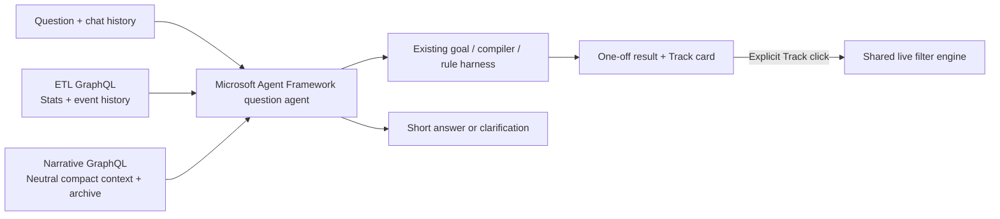

# Question agent implementation plan

> **Historical (18 October 2026), no longer updated.** The fake ETL/narrative snapshot bridge, uploads and single-run lab described here are retired; see [Match questions](../components/agents.md#2-question-agent) for what runs now.

**Status: local implementation built, 18 October 2026; live model/browser verification tracked separately.** Build a working question tab in the current event lab. Preserve the current custom-filter lab and the separate profile harness. This is a local implementation with replaceable upstream adapters, not deployment of the narrative engine.

## Agreed behaviour

- Answer current-match questions and general football explanations, briefly and directly. Lightly adapt wording to the profile's bucket; facts remain neutral. Web search and video are revision 2.
- Start match answers with a single frozen snapshot: current ETL stats, neutral compact recaps, authoritative key-event ledger and events since the last completed recap. Fetch deeper recaps/events only when needed.
- Ask a short clarification before choosing an ambiguous meaning. Feed-supported headed passes, headed shots and recorded headed contacts are different meanings. Unsupported requests receive a short apology; do not substitute another statistic silently.
- Reuse an ETL standard statistic when it answers the request. Otherwise reuse the existing validated custom-rule workflow. Calculate once, answer, and offer a **Track this stat** card. Do not register a new live calculation until the click.
- Persist chat, pending clarification and offered cards per profile and match/run. Refresh/reconnect restores them; a new profile session invalidates the previous session. Answers retain their original as-of time; tracked cards use the latest live values.
- Never call the shared narrative generator, rewrite its bucket narratives or read its database directly.

## Critical existing-code boundaries

| Existing file | Reuse / change |
|---|---|
| `backend/adapters/llm.py` | Existing Microsoft `Agent` / OpenAI-compatible client setup; add a question adapter with native function tools, keeping the JSON stat-planning adapter intact. |
| `backend/agents/workflow.py`, `compiler.py`, `orchestrator.py` | Reuse `RuleWorkflow.plan`, its existing-stat catalogue, clarification, data skill and bounded repair. No second rule DSL or arbitrary Python execution. |
| `backend/services/filter_engine.py` | Evaluate an offered custom rule against captured history in a temporary engine. Registration in the shared engine happens only on Track. |
| `backend/services/lab.py` | Add atomic snapshot capture and a run-checked Track operation; copy replay prefix under its lock, release before network/model work. |
| `backend/adapters/replay_source.py` | Canonical observed deliveries, recording metadata and adapter-owned feed reference. Never expose unobserved recording events to the agent. |
| `backend/store.py` | Reuse profiles/session takeover concepts; new SQL lives in a dedicated repository. |
| `backend/fakes.py` | Extend fake GraphQL services via small dedicated fake modules; keep all fake standard-stat computation upstream of the HTTP boundary. |
| `frontend/lab/api.js`, `controller.js`, `view.js` | Keep current lab working. Add separate chat API/controller/view modules rather than growing filter-planning UI into a chat system. |

**Do not use the existing `FixtureServices.view()` for the lab question context.** It reads the unrelated `synthetic-demo` profile match, while the loaded recording has its own match ID and run. Correct match identity is a required acceptance check.

## Implement in this order

### 1. Typed snapshot and read-only contracts

Add `backend/models/questions.py` and `backend/models/recaps.py`:

- `MatchSnapshot`: opaque ID, recording hash, run ID, match ID, observed delivery cursor, match clock/period, capture timestamp. Delivery cursor freezes knowledge: a late correction can refer to an earlier match minute.
- `ContextBlock`: ID, match ID, tier, coverage start/end, summary, created cursor, child IDs, `superseded_by` and supersession cursor. Keep all archived blocks. Tier names may include minute/five-minute/earlier/half; do not require a fixed 1/5/10/20 tree.
- Typed standard-stat results, paginated event results and recap references; explicit completeness, `has_more` and unavailable states. Missing data is not zero.
- `QuestionReply`: answer / clarification / unsupported, short text, snapshot/as-of label, validated evidence references and optional stat offers. No clickable video.
- Stat offer contains immutable validated rule or standard-stat ID, source snapshot/result and run identity. Track accepts only an offer ID, never client-supplied code/rule/value.

Add `backend/adapters/question_data.py` protocols (`MatchDataClient`, `NarrativeClient`) and HTTP implementations in a small adjacent module. Operations: capture/read snapshot, standard-stat catalogue/values, paged event query, compact neutral context, recap archive query by IDs/interval/tier. Every read is bound to the captured snapshot; reject wrong-match responses. Use existing ETL/narrative URLs and GraphQL. Do not expose arbitrary GraphQL strings as model tools.

**Local fixture bridge:** when a question starts, capture the current lab prefix and upload that immutable prefix + metadata to a dev-only snapshot endpoint on fake ETL; obtain a content-addressed ID. Fake ETL computes its supported standard stats and serves history for that ID. Publish the same prefix-derived ID/context to fake narrative through an explicit test bridge, or let the fake narrative read that snapshot from fake ETL. No full recording/future suffix is uploaded. The backend chat service must not calculate standard stats. Bound snapshot retention and payload size; mark the mechanism synthetic and local-only. This bridge is a replacement point for a real ETL snapshot/watermark contract.

### 2. Fake neutral recap archive

Add `backend/fake_question_data.py` / `backend/fake_recaps.py` (or a small `backend/fake_services/` package) for the fake-service implementation, wired into `fakes.py`. Reuse canonical event models, not the legacy hardcoded RVR/FGU normaliser.

Build deterministic neutral recap fixtures from only the captured prefix. Apply the original board's schedule: at 11 minute blocks compress oldest five; at four five-minute blocks merge oldest two with earlier-match block. Archive children and supersession metadata. The active view is one earlier block, up to three five-minute blocks and six–ten minute blocks after warm-up. It must cover completed time in order without overlap; raw tail covers the remainder. Empty observed minutes can be explicit “no recorded events” summaries, never invented possession or pressure. Use exact ledger events for goals/cards/corrections. Before kickoff, return empty context and unavailable clock where appropriate; never invent a recap. Fake standard-stat semantics must follow the active feed reference, including whether goals count as shots and how revisions replace/delete prior events. Prewritten/deterministic fake recaps are not an implemented narrative LLM.

Resolve active blocks **as of the question cursor**, not by their eventual current supersession status. A future parent must not hide a child that was active when the question was asked. Keep archive pagination so the agent can retrieve older minutes or children. A compact interval with incomplete upstream coverage is flagged, not silently called complete.

### 3. Question service and Microsoft Agent Framework agent

Add `backend/agents/question.py`, `backend/agents/question_instructions.py`, `backend/services/questions.py`, and `backend/question_factory.py` as the composition root.

- Use the installed SDK's `Agent` with typed native function tools and bounded invocations. Ground it initially in snapshot + compact neutral context + active feed meanings + recent persisted chat. Each request has fresh SDK execution state; trusted conversation state lives in the repository.
- Tools: read standard stats; read recap children/interval; search paginated observed events; prepare a custom statistic using `RuleWorkflow`. The stat tool returns clarification unchanged, or a validated one-off result plus offer; it never starts tracking.
- Prefer one question-agent run with tools to extra routing/intent-model calls. The existing goal workflow is invoked only for custom-stat interpretation. Avoid coding an unsupported number in prose before a tool result exists.
- Validate tool arguments and output references. User/model text is not trusted evidence. Store numeric stat result/card values deterministically from tool outputs, not from model-generated values.
- Give the agent history for “what about second half?” including the prior validated goal and pending clarification. Preserve intent across clarification without sending benchmark/gold data. Keep history context bounded while retaining the full conversation in storage.
- Suggested configurable limits: 2,000-character input; recent 12 chat turns; 6 tool calls plus the SDK function-tool iteration cap; 100 events per page; bounded total event/recap evidence; 60-second overall question timeout; existing `AGENT_MAX_REPAIRS=3` for custom planning. A broad custom aggregate must process complete relevant history deterministically or report unavailable, never count a truncated search page.
- Fixture mode uses explicit agent doubles through the same service contracts. Local mode uses Microsoft Agent Framework and current ignored model settings. Report mode in UI; no silent fixture fallback on model failure.

### 4. Persistence, routes and Track handoff

Add `backend/repositories/questions.py`, `migrations/006_questions.sql`, `backend/routes/questions.py`; wire through `app.py` / `question_factory.py`.

Suggested routes under the lab API proxy: `POST /lab/chat/sessions`, `GET /lab/chat/{token}`, `POST /lab/chat/{token}/messages`, `POST /lab/chat/{token}/offers/{offer_id}/track`. Use real demo profiles and match/run-scoped active session tokens; do not start the unrelated profile harness snapshot as a prerequisite. The lab adapter is removable; core question service takes identity and snapshot providers.

Tables hold profile+match+run conversation, active token, ordered turns/status, request UUID and offers. Unique request UUID makes retries return the same result rather than rerun a model or create duplicate offers. One in-flight turn per conversation; concurrent submissions return a clear busy response. No open DB transaction spans model/network work. Recheck active token/run before committing a reply and before Track; stale callbacks cannot write into a new run/session. Persist an interruption/failure state with a short apology if execution stops, so refresh does not leave permanent “thinking”.

Track is idempotent and ownership-checked. Under lab's event lock, register the saved rule using the **current** observed prefix (not the old answer prefix), persist before exposing success, and link profile offer to the canonical calculation ID. Reuse equivalent shared rules. The local lab still shows shared calculation cards; keep per-profile offer ownership and document that production priority-card replacement remains the existing profile-harness integration seam. If standard-stat tracking is offered, use an ETL-backed reference, not a generated duplicate standard rule.

Reset/upload gives a new run ID. Old chat/offers must not appear in the new run or accept Track; do not globally erase another profile's history. Same-run restart restores saved conversation and cards. The current single-process replay/connection limit remains explicit.

### 5. Lab UI

Add `frontend/lab/chat-api.js`, `chat-controller.js`, `chat-view.js`; minimal HTML/CSS additions for a **Questions** tab alongside rule preparation. Show profile selection, short messages, as-of clock, clarification replies, stat offer + Track button, tracked state, and a small synthetic/model-mode label. Restore session and conversation on refresh; takeover shows a reconnect message. No rewind/video/web UI. Use DOM text nodes for every event/model string.

Keep replay independent while questions run. On recording/run change clear visible stale chat, create/recover the right conversation, and ignore late responses from the old run. Show actual uploaded recording team/player names. Polling remains the documented local lab transport, not evidence of production fan-out capacity.

## Verification gates

1. **Unit tests:** compact coverage/chronology, archive retention, as-of supersession, halftime/empty intervals, corrections/tombstones, paginated evidence limits, wrong match, no future deliveries. Agent/tool argument failures and unsupported/ambiguous questions do not invent an answer.
2. **Service tests:** standard-stat answer never calls raw history/compiler; custom one-off produces the known value and offer without changing shared rule count; Track catches up events since answer, reuses equivalent rules and rejects stale/cross-profile offers. Clarification then follow-up reuses the intended goal.
3. **Postgres/API tests:** reload history/offers, session takeover, retry UUID, duplicate Track, two concurrent requests, reset/upload during model execution, startup recovery from pending turn, unavailable upstream, timeouts. Include an uploaded recording with different IDs/names from both repository fixtures.
4. **Fake HTTP integration:** live backend → fake ETL/narrative GraphQL with shared snapshot identity; verify a replay step occurring during model work cannot change the answer. Assert no shared narrative generation endpoint is called.
5. **Client tests:** safe text rendering, restored conversation, clarification submission, Track action/idempotent state, late response ignored after reset, profile takeover and model errors. Run `cd frontend && npm test`.
6. **Live model smoke (opt-in):** standard shots, a custom headed-shot count, ambiguous “headers” then clarification, “what about second half?”, game-status explanation requiring recaps, deeper earlier interval, general offside explanation, unsupported data. Record correctness, tool paths, clarification and latency without committing private model traffic. Model accuracy is measured separately from deterministic test passing.
7. **Running UI:** load recording, start forward replay, ask from Questions, inspect answer/offer, wait for new event then Track, refresh, swap profile/session, New run. Verify displayed facts against the actual observed events. Run `./dev up backend` and inspect real browser output.

## Delivery and honest limits

Update brief backend/frontend development docs and API contract docs after implementation. Preserve original narrative prompts and board. Do not add CI, infrastructure, arbitrary-code execution or cloud deployment. Report deterministic tests, live model outcomes and browser checks separately. Native tool use is Microsoft Agent Framework; fake compaction is not the production narrative engine; lab snapshot upload is not a production broker/snapshot protocol. Production source watermark semantics and generalized audience/profile routing remain adapter integration work.

## Implementation notes

See [the implemented contract](../components/agents.md#2-question-agent). Standard stats currently answer directly without a custom Track offer. The existing profile card-priority replacement flow remains separate from the shared lab cards. The fake recap archive uses the board's variable minute/five-minute/earlier schedule, not a production narrative generation workflow.
