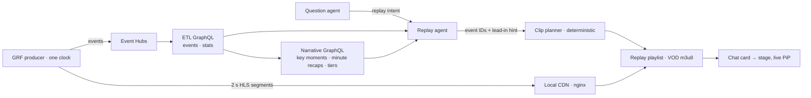

# Replay plan

> **Historical plan (20 October 2026), no longer updated.** Implemented; current behaviour is in [services](../components/services.md#5-replays) and [agents](../components/agents.md#3-replay-agent).

**Status: implemented and unit-tested locally, 20 October 2026** (backend, clip planner, golden set 18/18 against the local model, chat card and PiP; browser-verified against live HLS: card, stage, clip jump, back to live, paging, refine offer, saved-in-chat restore). Differences from the plan are marked. Replay moved forward from Phase 2. A viewer asks in chat ("how did the first half go", "all shots on goal so far", "headers by Palmer"). They receive a short answer and a playlist of clips. Expanding the playlist plays it on the main stage while live continues in a corner.



## Goals

1. Answer replay requests with at most **12 clips and 3 minutes** of footage. Each clip cites an event ID or key-moment ID, its video start/end and a neutral caption.
2. Never show or mention anything after the viewer's observed position. The future cannot leak because segments past the live edge do not exist yet.
3. Summary questions return recap text in the viewer's selected style, plus a reel of the key moments the recaps cite.
4. Broad requests ("all passes") return the first page and offer to narrow it. "Show more" pages the next 12, up to 36 clips per answer.
5. Names absent from the match get "not in this match" and the nearest valid alternative. Nothing is fuzzy-matched.
6. Unrecorded concepts (interceptions) are derived through the existing bounded rule DSL. They are labelled `derived` with their definition, for example *failed pass, next touch by opponent*.
7. Questions still never trigger the shared narrative workflow.

## Ownership

| Part | Owner |
| --- | --- |
| Video segments, live playlist, shared clock | The feed (an external provider) publishes played segments at `/hls/{matchId}/live.m3u8`; the backend reads that playlist over HTTP (`FEED_HLS_BASE`); nginx proxies it locally, Blob + CDN in Azure planned |
| Events, standard stats | ETL, through ETL GraphQL |
| Key moments, minute recaps, hierarchical tiers | Narrative engine, through Narrative GraphQL (read-only) |
| Replay agent, clip planner, replay playlists, saved replays | `user-backend/` |
| Chat card, stage swap, PiP, held live updates | `frontend/` |

## Replay agent

The question agent detects replay intent and delegates to a specialist Microsoft Agent Framework agent. Its tools are read-only (as built, `backend/agents/replay.py`):

- `find_events(...)`: ETL GraphQL history, filtered by type, team, player and qualifiers
- `find_sequences(first, then, within_seconds)`: derived evidence such as *failed pass, next touch by opponent* (replaces the planned rule-DSL `derive`)
- `key_moments(period)`, `recaps(tier, ...)`: Narrative GraphQL
- Players and teams come from match metadata

Each read uses one snapshot bounded to the viewer's observed position. The agent returns a validated `ReplayPlan`:

```text
ReplayPlan { answer, clips: [{ source_id, kind: event|key_moment, caption, lead_in: short|normal|long|move }],
             total_candidates, page, derived_definition?, refine_offer? }
```

The planner rejects unknown IDs, future IDs and oversized plans. The agent never sets seconds itself. As built, a caption that calls an unsaved shot, or a keeper's touch on an off-target shot (`fromShotOffTarget`), "saved" is replaced by the caption written from the evidence; saves exclude those touches, as the ETL `shots_saved` stat does (`saves` counts every keeper_save).

## Clip planner

Cut points are deterministic, from the `replay-timing` configuration (seeded by `migrations/016_config.sql`, edited at `/dev/config/replay-timing`):

| Type | Before / after (s) |
| --- | --- |
| goal | 10 / 2 |
| shot, save | 6 / 3 |
| penalty | 6 / 4 |
| card, foul, foul won | 5 / 4 |
| offside | 5 / 3 |
| corner, free kick | 3 / 6 |
| corner awarded | 4 / 3 |
| default | 4 / 2 |

`short`/`long` scale the lead-in by 0.5×/2×. `move` starts at the team's last possession gain. Clips are clamped to their period and the observed position. Overlapping clips merge and keep both captions. The result becomes a VOD m3u8 listing existing segments, with exact in/out points carried in the playlist metadata.

## Streaming and clock

- One producer clock publishes 2-second HLS segments and Event Hubs events. Live is a growing `EVENT` playlist.
- The frontend holds live cards, insights and score until the playhead reaches each event's `videoSeconds`, so data never runs ahead of the picture.
- The match clock runs continuously, as on a broadcast. Dead play in a half becomes stoppage time (`45+3'`). Events use Opta-style `periodId`, `timeMin` and `timeSec`, with first-half stoppage keeping `timeMin` ≥ 45.

## Viewer

The chat card shows a thumbnail, clip count, total length and captions. **Expand** moves the replay to the main stage with clip navigation. Live becomes a muted corner PiP. **Back to live** or clicking the PiP swaps back. Cards and Insights stay live. Playlists persist with chat and are revalidated against the current run on restore.

## Test data

The 12-minute recording and all hand-written demo/test data are replaced by **one 90-minute GRF match**, still labelled synthetic. Data is derived from that capture:

- Opta-style events with pitch `x/y`, pass `endX/endY` and length, shot location and outcome where tracking proves it, and possession sequences.
- Minute recaps, 5/10/20-minute and half tiers, and ranked key moments, written by watching frames alongside events. Fresh agents then review them.
- All twelve bucket narratives per minute.
- Small edge-case test doubles remain only where a unit test needs one.

## Harness

| Layer | Checks |
| --- | --- |
| Fixture-mode tests | A fake model returns fixed plans. Tests cover clip timing, merging, clamping, paging, absent names and derived labels. |
| Golden set | Questions on the 90-minute match with expected IDs and windows. **Hard fail:** future leakage, invented ID, clip missing its event, cap exceeded. Enumerable asks need precision and recall ≥ 0.9. Summary asks are scored on key-moment coverage. |
| Live-model runner | `./dev benchmark replay`: the configured model against the golden set. Writes a report; never runs in CI. |
| Lab page | Planned, not built: question, tool calls, chosen events, clip timeline and previews. |

## Build order

1. Regenerate the 90-minute match, then build the enriched event contract and the full reviewed test data.
2. HLS producer, shared clock and held live updates.
3. Replay agent, planner, saved replays, harness and lab page.
4. Chat card, expanded stage and live PiP.

Each step is tested against actual outputs before the next.
