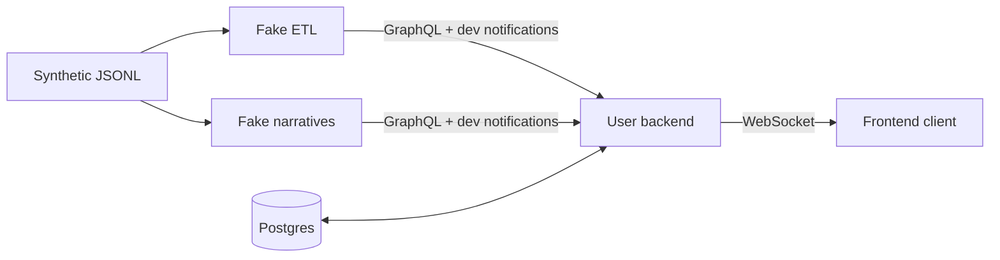

# Develop the user backend

```sh
./dev up backend        # build, start, test; Docker is the only prerequisite
./dev reset backend     # return the synthetic match to minute 20
./dev replay backend    # stream the remaining key moments
./dev test backend      # isolated tests + a live replay through all three services
```

No Azure account, model key or emulator licence acceptance is needed for this profile. It starts **Postgres, backend, fake ETL, fake narrative and the event filter UI**. First run needs internet for images/packages.

Start with the **[filter lab](http://localhost:18020)**: select a preset, add it and start events. [Lab guide](filter-lab.md) explains the index, layers and replaceable feed. [Local LLM setup](local-llm.md) enables flexible requests; default fixture mode supports the documented examples without a model. The profile API below is a separate integration harness.



## Try it

[Backend API explorer](http://localhost:18000/docs) · [Fake ETL](http://localhost:18010/docs) · [Fake narratives](http://localhost:18011/docs)

1. `GET /profiles` lists three demo profiles.
2. `POST /sessions` with `{"profile_id":"chelsea-analytical"}` returns a token and snapshot.
3. Connect to `ws://localhost:18000/sessions/TOKEN/live` for snapshots and matching narratives.
4. `POST /sessions/TOKEN/pins` with `{"calculation_id":"fixture-headers"}` pins the match's headed-touch count.
5. Run `./dev replay backend`. The count rises from **2 → 3 → 4**; the goal changes the bucket's default cards.

Replace `TOKEN` with the returned token. `GET /calculations` lists four pre-approved fixture calculations. `PATCH /sessions/TOKEN/preferences` accepts `team` and `fan_style`; `DELETE /sessions/TOKEN/pins/ID` restores a default card. All endpoints are documented in the API explorer.

A new session for the same profile invalidates the old token and closes its socket with code **4001**. A second socket using the same token replaces the first socket. A full outgoing queue closes with **1013**; reconnect for a fresh snapshot.

## What is real, what is fake

| Real implementation | Temporary fixture behaviour |
| --- | --- |
| PostgreSQL profiles, session tokens, preferences and pins | Three cards by default; final card count undecided |
| Twelve buckets, priority replacement and WebSocket delivery | Profile harness still uses four hand-written calculations |
| Separate HTTP/GraphQL processes for upstream boundaries | In-memory match/narrative history; possession fixed at 50% |
| Lab goal/coding agents, typed rules, shared index and persisted results | Default fixture phrases; optional local model; no arbitrary code execution |

Run one backend process/worker. Session sockets are in memory; scaling to multiple replicas is not implemented. The demo has no authentication, and `/dev/*` injection is explicitly enabled in this local profile. Keep the loopback-only port bindings.

Tests leave the profile harness match at minute 47 and change the demo profile's pins/preferences. The lab smoke check finishes by clearing its own run. `reset backend` resets match/narrative memory and disconnects sockets; **Postgres preferences, pins and lab state survive**. Use **New run** in the browser to clear lab state. `./dev down` also preserves the Postgres volume.

For code changes rerun `./dev up backend` to rebuild. `./dev logs backend` shows recent logs. To run only the isolated suite, use `docker compose --env-file local/env.defaults -f local/compose.yaml run --rm --build --no-deps backend-tests` after Postgres is running.

## Replace the fixtures next

`backend/upstream.py` reads fake GraphQL. Fake services notify `/dev/events` and `/dev/narratives` over HTTP; **these are test bridges**. The new neutral framing path has a separate Service Bus adapter. Standard snapshots fetch ETL-computed values without downloading raw history or recalculating them. Only pinned custom fixture calculations request historical events; those still reload history per snapshot, so this does not prove the production incremental custom calculation path.

ETL owns Cosmos DB for standard stats and Azure SQL for event history. `FixtureServices.match_events()` is the separate historical query helper; an agent can use that route for investigation without duplicating standard stats. The fake services remain in-memory substitutes, not Cosmos/SQL integration.

The separate filter lab implements incremental typed calculations and an optional local model adapter. Its persisted replay prefix provides deterministic startup recovery; it is not an ETL/broker handoff implementation. Keep the agreed production boundaries: Event Hubs for shared match events, Service Bus for neutral narratives, GraphQL for history/stats. No user question calls the narrative generator. Production Event Hubs consumption, filter-lab viewer integration, general question answering and any arbitrary-code executor remain next steps.

[Fixture format and moments](../fixtures/README.md) · [Testing guide](testing.md) · [Full design](../architecture.md)

## Shared narrative framing

[Database-defined layers and options](narrative-framing.md) now frame neutral upstream narratives through Microsoft Agent Framework. The local stack enables a deterministic copy-only fixture by default. `./dev test backend` also checks neutral HTTP ingress and shared WebSocket delivery. An optional Service Bus receiver uses the same service. The older `/dev/narratives` bucket fixture remains only for stat-selection regression coverage.
